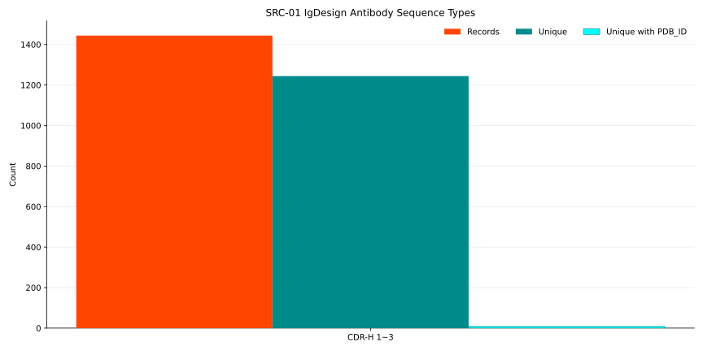
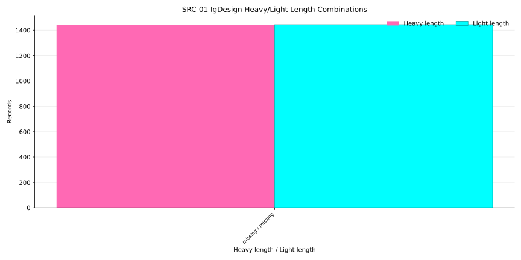
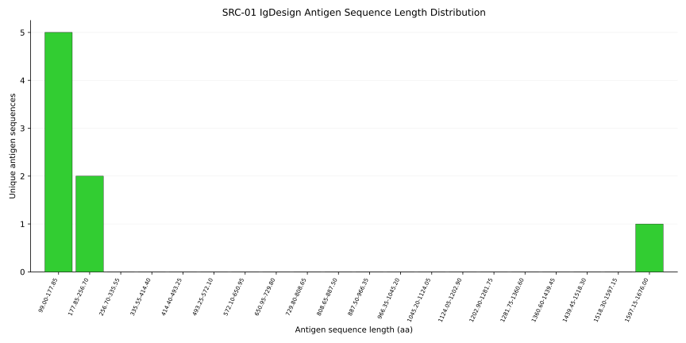

---
tags:
  - context
---

# SRC-01 IgDesign

> 每条 data 统一建模为 `((ab, ag), label, assay, condition, replicate, source)`.
> 本地快照 `G:\abag-datasets\SRC_R01_IGDESIGN\snapshot-2025-01-10`, `igdesign/data/` 8 张同构 CSV (7 张未盲化 + `Blinded/Ravagalimab-CD40.csv`), 共 1,444 行 × 47 列.
> `Unique` 为 `(HCDR1, HCDR2, HCDR3)` 三元组精确去重; 表内无 Heavy / Light 链序列, 只有重链三个 CDR 区.

## Antibody

> 有 Heavy 和 Light 的 `Unique` 字段是 `(heavy, light)` 二元组精确去重. `Unique with PDB_ID` 是按 Unique 后的 sequence 计数.
> Total Unique 计数方式为统一转 string, 如果有 Heavy 和 Light 用 `/` 拼接成 string.

| Key | 含义 | 说明 |
| --- | --- | --- |
| Sequence Type | 抗体序列类型 | 根据原始数据字段、链槽位及已有构建体标签划分的类别. |
| Records | 原始记录数 | 原始数据中的记录数量, 同一序列可能重复出现. |
| Unique | 唯一序列数 | 按对应数据集定义的去重规则统计. |
| Unique with PDB_ID | 关联 PDB 的唯一序列数 | 去重后具有关联 PDB_ID 的序列数量, 不等同于具有可用实验结构监督的序列数量. |
| Description | 类型说明 | 描述分类依据、序列槽位特征及分类限制. |

| Sequence Type | Records | Unique | Unique with PDB_ID | Description |
| --- | --- | --- | --- | --- |
| CDR-H 1~3 | 1,444 | 1,244 | 8 | 全部行只给 `HCDR1` (8 aa)、`HCDR2` (8 aa)、`HCDR3` (8-16 aa), 无 framework、无轻链、无完整重链; 序列形状只支持 CDR-H 1~3, 不能归入 IgG / Fab / Fv 等构建体. CD40 体系 200 行设计区被 `X` 遮蔽. |
| Total | 1,444 | 1,244 | 8 |  |

> 8 张表各对应 1 个参考抗体复合物, 每行是"参考抗体 framework + 已发布 HCDR"的设计或基线候选, 不是完整抗体链. 1,444 行归为 8 个亲本体系, `Unique with PDB_ID` 按亲本复合物计 8 个 (`5I5K`、`5J13`、`5NGV`、`6A3W`、`6HHC`、`6PE8`、`6PPG`、`6U6U`), 不是 1,244 条设计序列各有一个结构; 另有两个无抗原共沉积的独立 Fab 条目 `5NHW`、`6PE7`, 属参考抗体的补充结构, 不增加亲本体系数.
>
> `Ravagalimab-CD40` 的 201 行中 200 行的设计 HCDR 按 `X` 遮蔽, 因此该体系只落 3 个唯一三元组; 遮蔽发生在发布层, 不代表候选序列相同.

| Heavy Length | Light Length | Records | Description |
| --- | --- | --- | --- |
| missing | missing | 1,444 | 表中无重链、轻链序列, 两侧均记 missing. 可用的只有 CDR 长度: `HCDR1` 恒为 8 aa, `HCDR2` 恒为 8 aa, `HCDR3` 8-16 aa, 三段合计 24-32 aa. |

## Antigen

> Antigen 统计以 source-native antigen entity 为核心单位. 优先使用原始 antigen ID/name、construct 和 antigen chain 定义实体; 存在可靠序列时再统计唯一抗原序列.
> 结构、序列和数据库注释压缩到同一张表中, `PDB / UniProt` 采用唯一抗原实体粒度统计 2 × 2 覆盖结果.
> 长度图基于唯一抗原序列, 按该源实际范围平均切分 20 bins.

> 8 个体系各对应 1 个固定参考靶点, 抗原序列取本地冻结的 RCSB canonical entity 选链视图 (`pdb/sequences/rcsb_pdb_<PDB>.fasta`), 属参考复合物序列, 不是逐行测量构建体.

| Records | Unique ag entity | Unique ag sequence | PDB / UniProt coverage | Antigen Length | Antigen Evidence / Provenance | Description |
| --- | --- | --- | --- | --- | --- | --- |
| 1,444 | 8 | 8 | PDB=1/UniProt=0: 8; PDB=0/UniProt=0: 0 | 99-1,676 aa; median 168 aa; 8 unique lengths | Reference PDB / Fixed target | 唯一实体按 `(Target, 参考 PDB)` 计 8 个 (IL17A `6PPG` 133 aa、ACVR2B `5NGV` 99 aa、C5 `5I5K` 1,676 aa、FXI `6HHC` 238 aa、IL36R `6U6U` 197 aa、TSLP `5J13` 147 aa、TNFRSF9 `6A3W` 163 aa、CD40 `6PE8` 173 aa), 8 条序列互不相同. 抗原侧结构证据是共享参考复合物, 不证明每行都有独立抗原结构; 表内无 UniProt 字段, 记 unavailable. 项目另存 IL17A 的 UniProt `Q16552` (release 2026_03, mature chain 132 aa) 作外部序列参考, 属项目补充, 不是作者交付, 不计入本表. |

## Affinity

> 去重口径: 按 **(HCDR1, HCDR2, HCDR3, Target)** 去重. `Replicates` 是每行的 SPR 重复总数.
>
> 8 张 CSV 各一个靶点, `Method` 只有 `Inverse Folding` (983)、`SAbDab` (453)、`Positive Control` (8) 三值. `KD (nM)` 全表 359 行有值 (0.1064-3,980 nM), 1,085 行为空; 空 KD 是未给出定量值, 不是 0. 有值行中 73 行 `Binder=False`, 说明部分重复已产生可定量结合. `Binder` 对非对照要求全部重复观察到结合, 阳性对照保留预设身份. 公开表无逐曲线拟合、残差或质控字段, assay 一律记 HT-SPR.

| Label | Assay | Condition | Replicate | Record pairs | Unique pairs | Description |
| --- | --- | --- | --- | --- | --- | --- |
| `Kd_M` | `SPR` | IL17A (Afasevikumab) | n=2:5; n=4:5; n=6:1; n=8:1; n=16:1 | 13 | 13 | 13 行有值, 全部 1:1; 该体系 179 行中仅 6 行判为 binder. |
| `Kd_M` | `SPR` | ACVR2B (Bimagrumab) | n=1:1; n=2:10; n=4:7; n=6:3; n=8:2; n=16:1 | 24 | 23 | 24 行有值; 有 1 组三元组在不同重复次数下重复出现, 故 Unique 少 1. |
| `Kd_M` | `SPR` | C5 (Eculizumab) | n=2:16; n=4:13; n=6:4; n=16:1 | 34 | 34 | 34 行有值, 全部 1:1. |
| `Kd_M` | `SPR` | CD40 (Ravagalimab) | n=1:1; n=2:16; n=4:9; n=6:10; n=8:1; n=10:1 | 38 | 3 | 38 行有值, 但设计区被 `X` 遮蔽, 只能落 3 个唯一三元组; 唯一值被遮蔽掩盖, 不能据此判断是否重复设计. |
| `Kd_M` | `SPR` | FXI (Osocimab) | n=2:32; n=4:11; n=6:3; n=14:1 | 47 | 47 | 47 行有值, 全部 1:1; 116 行中 47 行有 KD, 是有值比例最高的一组. |
| `Kd_M` | `SPR` | IL36R (Spesolimab) | n=2:19; n=4:17; n=6:2; n=8:1; n=16:1 | 40 | 40 | 40 行有值, 全部 1:1. |
| `Kd_M` | `SPR` | TNFRSF9 (Utomilumab) | n=1:1; n=2:21; n=4:9; n=6:2; n=8:2; n=14:1 | 36 | 35 | 36 行有值; 有 1 组三元组重复出现, 故 Unique 少 1. |
| `Kd_M` | `SPR` | TSLP (Tezepelumab) | n=2:79; n=4:34; n=6:10; n=8:3; n=14:1 | 127 | 127 | 127 行有值, 全部 1:1; 176 行中 115 行判为 binder, 是全表 binder 比例最高的一组. |
| `binary` | `SPR` | 8 体系合并 (`Binder`) | n=1:3; n=2:809; n=4:434; n=6:136; n=8:41; n=10:9; n=12:5; n=14:3; n=16:4 | 1,444 | 1,244 | `Binder` True 286 / False 1,158; False 不区分表达失败、捕获不足与真实不结合, 1,085 行空 KD 在这里仍是一条结合判定. |
