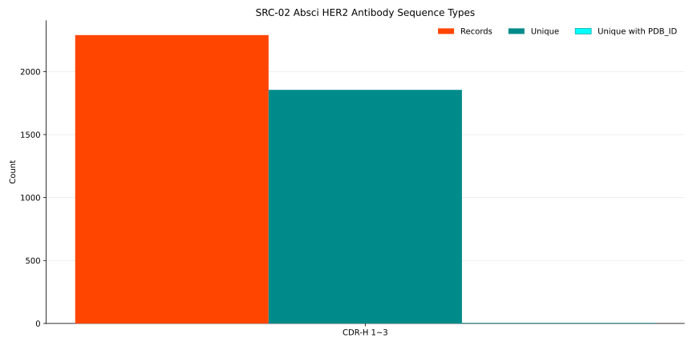
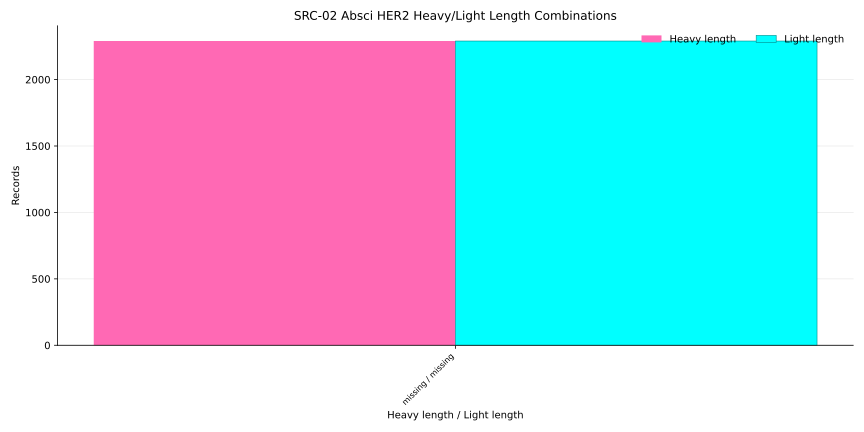
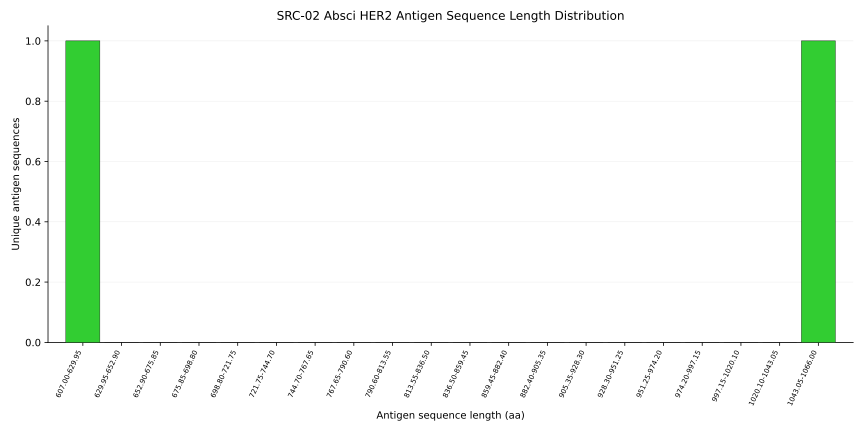

---
tags:
  - context
---

# [SRC-02 Absci HER2](../2026-10-29-3a-src-readme/src-02-absci-her2-readme.md)

> 每条 data 统一建模为 `((ab, ag), label, assay, condition, replicate, source)`.
> 本地快照 `G:\abag-datasets\SRC_R02_ABSCI_HER2\snapshot-2024-08-08`, `unlocking-de-novo-antibody-design/` 3 张 CSV: `spr-controls.csv` 1,855 行 × 5 列, `zero-shot-binders.csv` 422 行 × 7 列, `functionality-developability-cross_reactivity-data.csv` 13 行 × 48 列.
> `Unique` 为 `(HCDR1, HCDR2, HCDR3)` 三元组精确去重; 表内无 Heavy / Light 链序列.

## Antibody

> 有 Heavy 和 Light 的 `Unique` 字段是 `(heavy, light)` 二元组精确去重. `Unique with PDB_ID` 是按 Unique 后的 sequence 计数.
> Total Unique 计数方式为统一转 string, 如果有 Heavy 和 Light 用 `/` 拼接成 string.

| Key | 含义 | 说明 |
| --- | --- | --- |
| Sequence Type | 抗体序列类型 | 根据原始数据字段、链槽位及已有构建体标签划分的类别. |
| Records | 原始记录数 | 原始数据中的记录数量, 同一序列可能重复出现. |
| Unique | 唯一序列数 | 按对应数据集定义的去重规则统计. |
| Unique with PDB_ID | 关联 PDB 的唯一序列数 | 去重后具有关联 PDB_ID 的序列数量, 不等同于具有可用实验结构监督的序列数量. |
| Description | 类型说明 | 描述分类依据、序列槽位特征及分类限制. |

| Sequence Type | Records | Unique | Unique with PDB_ID | Description |
| --- | --- | --- | --- | --- |
| CDR-H 1~3 | 2,290 | 1,855 | 1 | 全部行只给 `HCDR1` (8 aa)、`HCDR2` (8 aa)、`HCDR3` (9-17 aa), 无 framework、无轻链; 序列形状只支持 CDR-H 1~3, 不能归入 IgG / Fab / Fv 等构建体. |
| Total | 2,290 | 1,855 | 1 |  |

> 3 张表共 2,290 行, 但 `zero-shot-binders` 的 422 行与 13 行候选表的 13 行都按 `(HCDR1, HCDR2, HCDR3)` 完全落在 `spr-controls` 内 (三者共享 `HCDR1=GFNIKDTY`、`HCDR2=IYPTNGYT` 的 trastuzumab 背景), 因此唯一抗体单位是 1,855, 不是 2,290.
>
> 全部行是在 trastuzumab 重链 CDR 背景下的 HCDR3 替换体; `Unique with PDB_ID` 按亲本复合物计 1 个 (`1N8Z`, Trastuzumab–HER2 Fab), 不是 1,829 条唯一 HCDR3 各有一个结构. `spr-controls` 另有 50 种 HCDR1 × 106 种 HCDR2 变体, 均属同一亲本框架内的 CDR 替换.

| Heavy Length | Light Length | Records | Description |
| --- | --- | --- | --- |
| missing | missing | 2,290 | 三张表均无重链、轻链序列, 两侧记 missing. 可用的只有 CDR 长度: `HCDR1` 恒 8 aa, `HCDR2` 恒 8 aa, `HCDR3` 9-17 aa (13 aa 最常见, 1,266 行). |

## Antigen

> Antigen 统计以 source-native antigen entity 为核心单位. 优先使用原始 antigen ID/name、construct 和 antigen chain 定义实体; 存在可靠序列时再统计唯一抗原序列.
> 结构、序列和数据库注释压缩到同一张表中, `PDB / UniProt` 采用唯一抗原实体粒度统计 2 × 2 覆盖结果.
> 长度图基于唯一抗原序列, 按该源实际范围平均切分 20 bins.

> 靶点只有 HER2 一个实验主靶, 其余物种 HER2 与 HER 家族成员是交叉反应对照. 抗原序列仅在本地冻结结构的少数条目可得 (`pdb/sequences/`), 不是逐行测量构建体.

| Records | Unique ag entity | Unique ag sequence | PDB / UniProt coverage | Antigen Length | Antigen Evidence / Provenance | Description |
| --- | --- | --- | --- | --- | --- | --- |
| 13 | 7 | 2 | PDB=1/UniProt=0: 2; PDB=0/UniProt=0: 5 | 607-1,066 aa; median 836.5 aa; 2 unique lengths | Reference PDB / Direct sequence (partial) | 唯一实体按 13 行候选表的 `mAb Binding - *` 列名计 7 个: human HER2、mouse HER2、cyno HER2、canine HER2、human HER1、human HER3、human HER4. 本地仅 2 个实体有序列: human HER2 ECD (`1N8Z` chain C, 607 aa) 与 human HER3 (`7MN8` chain A, 1,066 aa); 其余 5 个无序列. `1CZ8` (human VEGF) 与 `1N8Y` (rat HER2) 是结构对照条目, 不对应本表的 7 个列名实体, 不计入. 抗原侧结构证据是共享参考复合物, 不证明每行有独立抗原结构. 表内无 UniProt 字段. |

## Affinity

> 去重口径: 按 **(HCDR1, HCDR2, HCDR3, 靶点)** 去重. 三张表都无重复三元组.
>
> `spr-controls` 的 `Binder=True` 758 行与 `KD (nM)` 有值 758 行完全重合, `Binder=False` 1,097 行 KD 全空. `zero-shot-binders` 的 422 行是 `spr-controls` 中 KD 最好的 422 条, KD 与其逐一相同 (两位小数内), 属重复发布, 不是新测量. 13 行候选表的 `KD (nM)` 是同一数值的一位小数写法. 无 replicate 字段, 全记 `unknown`; 无方法字段, SPR 摘自论文方法, 交叉反应列的单位与拟合方式取自论文 Supplementary Table 10.

| Label | Assay | Condition | Replicate | Record pairs | Unique pairs | Description |
| --- | --- | --- | --- | --- | --- | --- |
| `Kd_M` | `SPR` | Trastuzumab 背景 HCDR 变体 (758 条) | unknown:758 | 758 | 758 | `KD (nM)` 0.56-2,523.9 nM; 全部 `Binder=True`, `Binder=False` 行无 KD, 因此 KD 只覆盖确认结合的记录. |
| `binary` | `SPR` | Trastuzumab 背景 HCDR 变体 (1,855 条) | unknown:1855 | 1,855 | 1,855 | `Binder` True 758 / False 1,097; False 不区分表达失败、捕获不足与真实不结合. |
| `Kd_M` | `SPR` | zero-shot binders (422 条, 与上重复) | unknown:422 | 422 | 422 | 同上 758 条中 KD 最优的 422 条, 0.94-1,461.56 nM; 逐条与 `spr-controls` 相同, 跨表汇总时应按测量身份去重. |
| `Kd_M` | `SPR` | 13 候选 × human HER2 | unknown:13 | 13 | 13 | `KD (nM)` 0.9-9.8 nM (一位小数); 同表另有 `Fab KD` 1.38-9.27 与 `mAb KD` 1.61-10.15, 是三种分子形式, 不合并. |
| `Kd_M` | `SPR` | 13 候选 × cyno HER2 | unknown:13 | 13 | 13 | `mAb Binding - Cynomolgus HER2`, 格式 `mean ± SD` (nM), 原值含不间断空格. |
| `Kd_M` | `SPR` | 13 候选 × canine HER2 | unknown:13 | 13 | 13 | `mAb Binding - Canine HER2`, 格式 `mean ± SD` (nM). |
| `not_recorded` | `SPR` | 13 候选 × mouse HER2 / HER1 / HER3 / HER4 | — | 0 | 0 | 4 列 × 13 行共 52 个 `NB` 单元, 全部无值. `NB` 是原表未报告结合, 不是数值零, 也不等于任何条件下的绝对不结合; 因此记 `not_recorded`, 不计入 Record pairs. |
| `EC50` | `ELISA` | 13 候选 × human HER2 (cELISA) | unknown:13 | 13 | 13 | `cELISA EC50 (pM)` 33.16-128.1 pM, 固定细胞表面结合读出, 与 SPR 的 Kd 不是同一测量. |
| `EC50` | `unknown` | 13 候选 × human HER2 (ADCC 报告) | unknown:13 | 13 | 13 | `ADCC EC50 (pM)` 14.57-77.88 pM, Jurkat NFAT-luciferase 报告信号拟合; 源表未给效应细胞/靶细胞体系外的 assay 归类, 记 unknown. |
