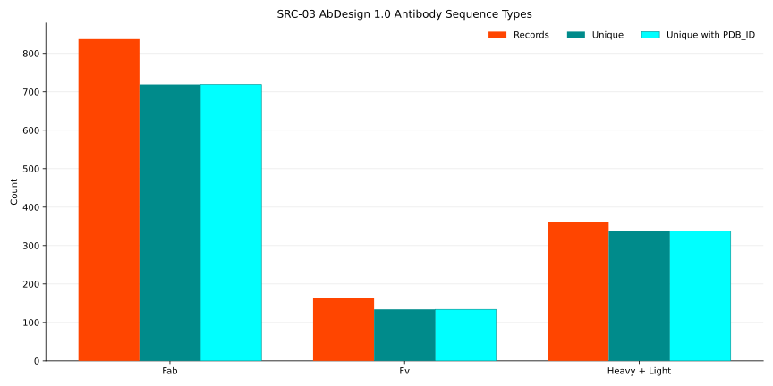
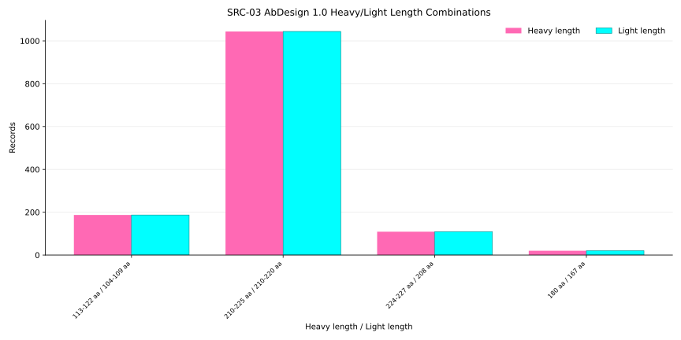
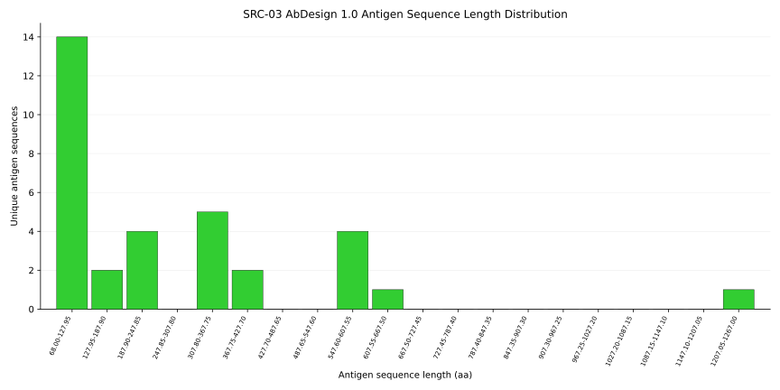

---
tags:
  - context
---

# SRC-03 AbDesign 1.0

> 每条 data 统一建模为 `((ab, ag), label, assay, condition, replicate, source)`.
> 本地快照 `G:\abag-datasets\SRC_R03_ABDESIGN_DB\snapshot-2025-08-26`, `AbDesign/datasets_wt.csv` 57 行 × 25 列 (WT 亲本) + `AbDesign/datasets_mut.csv` 1,303 行 × 38 列 (单点突变体), 共 1,360 行.
> `Unique` 为 `(heavy_sequence, light_sequence)` 二元组精确去重, 表内同时给出完整重链与轻链序列.

## Antibody

> 有 Heavy 和 Light 的 `Unique` 字段是 `(heavy, light)` 二元组精确去重. `Unique with PDB_ID` 是按 Unique 后的 sequence 计数.
> Total Unique 计数方式为统一转 string, 如果有 Heavy 和 Light 用 `/` 拼接成 string.

| Key | 含义 | 说明 |
| --- | --- | --- |
| Sequence Type | 抗体序列类型 | 根据原始数据字段、链槽位及已有构建体标签划分的类别. |
| Records | 原始记录数 | 原始数据中的记录数量, 同一序列可能重复出现. |
| Unique | 唯一序列数 | 按对应数据集定义的去重规则统计. |
| Unique with PDB_ID | 关联 PDB 的唯一序列数 | 去重后具有关联 PDB_ID 的序列数量, 不等同于具有可用实验结构监督的序列数量. |
| Description | 类型说明 | 描述分类依据、序列槽位特征及分类限制. |

| Sequence Type | Records | Unique | Unique with PDB_ID | Description |
| --- | --- | --- | --- | --- |
| Fab | 837 | 719 | 719 | 27 个 parent PDB 的 entity 名称或片段字段显式写为 Fab / `FAB FRAGMENT` / `Antigen binding fragment`; 表内没有逐行构建体列, 标签按 parent 继承. |
| Fv | 163 | 134 | 134 | 1BVK、1VFB、2YSS 三个 parent 的 entity 显式写 `FV` 或 `VH FRAGMENT` + `VL FRAGMENT`, 双链只覆盖可变区. |
| Heavy + Light | 360 | 338 | 338 | 17 个 parent 只写 `heavy chain` / `light chain` 或单克隆抗体名, 未标构建体, 不能由槽位或长度判定 IgG / Fab / Fv. |
| Total | 1,360 | 1,187 | 1,187 |  |

> 47 个 parent PDB 各是一个参考抗体–抗原复合物; 每行是其中一个 parent 的完整重链、轻链序列 (突变体行是 parent 的单点变体). `Unique with PDB_ID` 按 Unique 后的 `(heavy, light)` 计数: 全部 1,187 条唯一序列对都可追溯到其 parent PDB, 因此与 `Unique` 相等; 该 PDB 是 parent 复合物, 不是每个突变体各自解出的结构.
>
> Sequence Type 无逐行字段, 按 parent PDB 的 mmCIF `_entity.pdbx_description` 与 `_entity.pdbx_fragment` 中的构建体措辞继承: 显式写 `Fab` / `FAB FRAGMENT` / `Antigen binding fragment` 的 parent 归 `Fab` (27 个), 显式写 `FV` 或 `VH FRAGMENT` + `VL FRAGMENT` 的归 `Fv` (3 个: `1BVK`、`1VFB`、`2YSS`), 其余 17 个只写 heavy chain / light chain 或单抗名称, 归 `Heavy + Light`.

| Heavy Length | Light Length | Records | Description |
| --- | --- | --- | --- |
| 113-122 aa | 104-109 aa | 187 | 纯可变区量级双链; 含 Fv 163 条与 Fab 18 条 (`1NMB` 122/109 aa、`5C6T` 113/104 aa 的 Fab 槽位偏短), 不能仅凭长度定构建体. |
| 210-225 aa | 210-220 aa | 1,044 | 主簇, 占 76.8%: 双链均达 VH-CH1 / VL-CL 量级, 覆盖 Fab 690 条与 Heavy + Light 354 条. |
| 224-227 aa | 208 aa | 109 | 重链偏长 + 轻链固定 208 aa, 属 `3NGB`、`3SE8`、`3SE9` 三个 HIV-1 Fab. |
| 180 aa | 167 aa | 20 | `1JRH` 的 A6 Fab 单簇; 双链都短于常规 Fab 量级, 源 entity 仍标 `FAB FRAGMENT`. |

## Antigen

> Antigen 统计以 source-native antigen entity 为核心单位. 优先使用原始 antigen ID/name、construct 和 antigen chain 定义实体; 存在可靠序列时再统计唯一抗原序列.
> 结构、序列和数据库注释压缩到同一张表中, `PDB / UniProt` 采用唯一抗原实体粒度统计 2 × 2 覆盖结果.
> 长度图基于唯一抗原序列, 按该源实际范围平均切分 20 bins.

> 抗原序列逐行直接给出 (`antigen_sequence`), 并附 `pdb_name` 与 `orig_antigen_chain_id`; 实体按其亲本 PDB 与抗原链定义, 属 Reference PDB 级证据.

| Records | Unique ag entity | Unique ag sequence | PDB / UniProt coverage | Antigen Length | Antigen Evidence / Provenance | Description |
| --- | --- | --- | --- | --- | --- | --- |
| 1,360 | 47 | 33 | PDB=1/UniProt=0: 47; PDB=0/UniProt=0: 0 | 68-1,267 aa; 28 unique lengths | Direct sequence / Source-native | 唯一实体按 `(pdb_name, orig_antigen_chain_id)` 计 47 个, 唯一抗原序列 33 条 (不同复合物共用同一抗原, 如溶菌酶、VEGF 等). 抗原序列来自作者整理的 parent 结构字段, 是直接序列而非从坐标重建; 每个实体挂其亲本 PDB, 属 Reference PDB, 不是逐行突变体结构. 表内无 UniProt 字段. |

## Affinity

> 去重口径: 按 **(heavy 序列, light 序列, antigen 序列)** 三元组去重. 无 replicate 字段, 全记 `unknown`.
>
> `datasets_mut.csv` 1,303 行, 47 个 PDB, 全部有亲和力值. 两个 label 严格分块: `elisa_mut_to_wt_ratio` 658 行 (全部 AbDesign 数据集, ELISA, 0.0142-1.368 比值, 1:1 唯一), `ddg` 645 行 (SKEMPIv2 377 + AB-Bind 268, 方法 10 种, -4.061-8.0, 两源合并唯一三元组 489). `datasets_wt.csv` 57 行是 WT 参照, 无 label.

| Label | Assay | Condition | Replicate | Record pairs | Unique pairs | Description |
| --- | --- | --- | --- | --- | --- | --- |
| `enrichment` | `ELISA` | AbDesign (`elisa_mut_to_wt_ratio`) | unknown:658 | 658 | 658 | 突变/WT ELISA 比值 0.0142-1.368, 1:1 唯一; 比值不是 Kd, 也不可跨 parent 直接比较. 与 SRC-12 `abdesign` 行同源. |
| `ddG` | `ELISA` | SKEMPIv2 (`ddg`, ELISA) | unknown:35 | 35 | 35 | `ddg` kcal/mol, 源表 `method` 逐行给出 (n=35); SKEMPIv2 同 SRC-15 SKEMPI 2.0 同源. |
| `ddG` | `ITC` / `KinExA` | SKEMPIv2 (`ddg`, ITC/KinExA) | unknown:64 | 64 | 55 | `ddg` kcal/mol, 源表 `method` 逐行给出 (n=64); SKEMPIv2 同 SRC-15 SKEMPI 2.0 同源. |
| `ddG` | `SPR` | SKEMPIv2 (`ddg`, SPR) | unknown:221 | 221 | 221 | `ddg` kcal/mol, 源表 `method` 逐行给出 (n=221); SKEMPIv2 同 SRC-15 SKEMPI 2.0 同源. |
| `ddG` | `unknown` | SKEMPIv2 (`ddg`, FL/SP) | unknown:57 | 57 | 57 | `ddg` kcal/mol, 源表 `method` 逐行给出 (n=57); SKEMPIv2 同 SRC-15 SKEMPI 2.0 同源. |
| `ddG` | `ELISA` | AB-Bind (`ddg`, ELISA/Phage ELISA) | unknown:147 | 147 | 147 | `ddg` kcal/mol, 源表 `method` 逐行给出 (n=147); AB-Bind 同 SRC-14 AB-Bind 同源. |
| `ddG` | `ITC` / `KinExA` | AB-Bind (`ddg`, KinExA) | unknown:9 | 9 | 9 | `ddg` kcal/mol, 源表 `method` 逐行给出 (n=9); AB-Bind 同 SRC-14 AB-Bind 同源. |
| `ddG` | `SPR` | AB-Bind (`ddg`, SPR) | unknown:52 | 52 | 52 | `ddg` kcal/mol, 源表 `method` 逐行给出 (n=52); AB-Bind 同 SRC-14 AB-Bind 同源. |
| `ddG` | `flow` | AB-Bind (`ddg`, Yeast Disp. Flow Cyt) | unknown:35 | 35 | 35 | `ddg` kcal/mol, 源表 `method` 逐行给出 (n=35); AB-Bind 同 SRC-14 AB-Bind 同源. |
| `ddG` | `unknown` | AB-Bind (`ddg`, Enzymatic 1/Enzymatic 2) | unknown:25 | 25 | 25 | `ddg` kcal/mol, 源表 `method` 逐行给出 (n=25); AB-Bind 同 SRC-14 AB-Bind 同源. |
