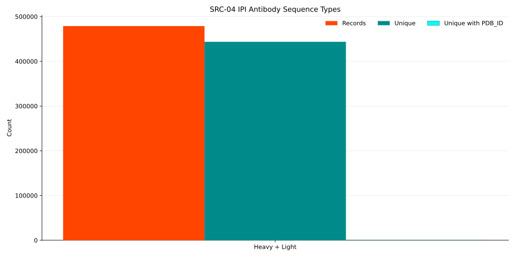
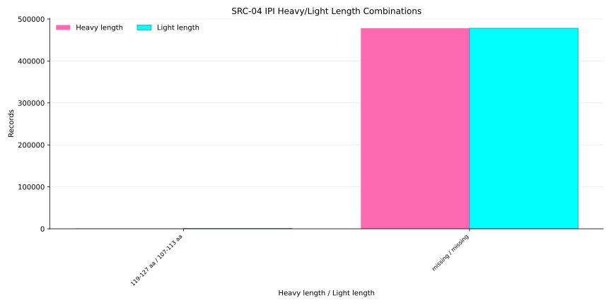
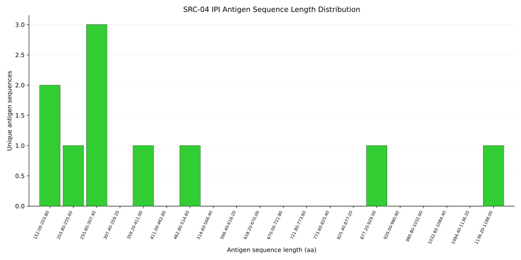

---
- tags:
  - context
---

# SRC-04 IPI

> 每条 data 统一建模为 `((ab, ag), label, assay, condition, replicate, source)`.
> 本地快照 `G:\abag-datasets\SRC_R04_IPI\zenodo-15707494`, 5 层表: `00Library_Biophysics_486Abs(1).csv` 486 行, 22 张选择汇总 CSV 94,274 行, 4 张 `*_Test1_Lib31.csv` 383,341 行, 与 `FLAb/data/binding/` 20 张按 assay 重切的派生 CSV 709 行, 共 478,810 行.
> `Unique` 为 `(heavy 模板, light 模板, CDR-H3)` 三元组精确去重; 只有 FLAb 层给出完整 VH / VL 文本, 其余三层只有链模板 ID (`VH1-69` / `VK3-15` 等) 与 CDRH3.

## Antibody

> 有 Heavy 和 Light 的 `Unique` 字段是 `(heavy, light)` 二元组精确去重. `Unique with PDB_ID` 是按 Unique 后的 sequence 计数.
> Total Unique 计数方式为统一转 string, 如果有 Heavy 和 Light 用 `/` 拼接成 string.

| Key | 含义 | 说明 |
| --- | --- | --- |
| Sequence Type | 抗体序列类型 | 根据原始数据字段、链槽位及已有构建体标签划分的类别. |
| Records | 原始记录数 | 原始数据中的记录数量, 同一序列可能重复出现. |
| Unique | 唯一序列数 | 按对应数据集定义的去重规则统计. |
| Unique with PDB_ID | 关联 PDB 的唯一序列数 | 去重后具有关联 PDB_ID 的序列数量, 不等同于具有可用实验结构监督的序列数量. |
| Description | 类型说明 | 描述分类依据、序列槽位特征及分类限制. |

| Sequence Type | Records | Unique | Unique with PDB_ID | Description |
| --- | --- | --- | --- | --- |
| Heavy + Light | 478,810 | 443,589 | 0 | 重链槽位恒为 `VH1-69` 模板, 轻链槽位为 `VK1-39` / `VK3-15` / `VK3-20` / `VK4-1` 之一, 每行再给一条 CDRH3 (486 表中 10-18 aa). 模板 ID 不是链序列; 全部行共享同一重链骨架, 只有 CDRH3 与轻链模板变化. |
| Total | 478,810 | 443,589 | 0 |  |

> 三层模板级表的 477,900 行只落 443,589 个唯一三元组; FLAb 的 709 行是 486 表中 385 个抗体的按 assay 重切副本 (`Antibody_Name` 与 `CDRH3` 逐字相同), 不新增抗体单位.
>
> CDR-H3 边界三层不一致: 486 表 486 行全部带前导 `C`, 4 张 ML 表 383,341 行中 382,429 行带前导 `C`, 而 22 张选择表 94,274 行中只有 7,603 行带. 去重前统一去掉一个前导 `C`, 这是跨层可比的必要条件, 不改变原始值.
>
> 源表无逐行构建体标签, 重链模板恒为 `VH1-69`, 轻链模板为 4 种 kappa; 论文称该库为合成 Fab 酵母展示库, 但表中没有支撑 Fab 的逐行证据, 因此归 `Heavy + Light`. `Unique with PDB_ID` 为 0: 抗体侧没有 PDB 字段, 本地 10 个结构条目全部是抗原侧参考复合物.

| Heavy Length | Light Length | Records | Description |
| --- | --- | --- | --- |
| 119-127 aa | 107-113 aa | 709 | 只有 FLAb 层给出完整可变区序列; 重链 119-127 aa, 轻链 107-113 aa, 均为纯可变区量级. FLAb 的 385 个 `heavy` 全部含疑似重复的 `YYCARCAR` 边界, 长度可读但边界待上游确认. |
| missing | missing | 478,101 | 其余三层只有链模板 ID 与 CDRH3, 无链序列; CDRH3 本身在 486 表 10-18 aa, 选择表与 ML 表 3-52 aa. |

## Antigen

> Antigen 统计以 source-native antigen entity 为核心单位. 优先使用原始 antigen ID/name、construct 和 antigen chain 定义实体; 存在可靠序列时再统计唯一抗原序列.
> 结构、序列和数据库注释压缩到同一张表中, `PDB / UniProt` 采用唯一抗原实体粒度统计 2 × 2 覆盖结果.
> 长度图基于唯一抗原序列, 按该源实际范围平均切分 20 bins.

> 10 个靶点各是一个固定构建体, 序列来自 FLAb 的 `antigen_seq` 列与 Zenodo 工作簿的 `Antigen sequences:` 段, 属直接序列; 每个靶点另有 1 个参考结构条目.

| Records | Unique ag entity | Unique ag sequence | PDB / UniProt coverage | Antigen Length | Antigen Evidence / Provenance | Description |
| --- | --- | --- | --- | --- | --- | --- |
| 486 | 10 | 10 | PDB=1/UniProt=0: 10; PDB=0/UniProt=0: 0 | 152-1,188 aa; 10 unique lengths | Direct sequence / Fixed target | 唯一实体按工作簿与 FLAb 的靶点名计 10 个 (TIGIT 162、DKK1 282、PD-L1 261、DCC 366、PD-L2 242、IL23R 1,188、LOX1 259、ROBO1 913、ROBO2N 152、Syncytin-2 501 aa). 486 表的 `Antigen` 有 11 个文本值, 其中 `hROBO2N` 6 行与 `ROBO2N` 36 行是同一 ROBO2N 的两种拼写, 已合并, 不新增第 11 个实体. 每个靶点有 1 个参考复合物 (`3BIK` PDL1、`3Q0H` TIGIT、`3S2K` DKK1、`5MZV` IL23R、`5O5G` ROBO1、`5X83` DCC、`6IAA` ROBO2、`6TLA` LOX1、`6UMT` PDL2、`7OIX` Syncytin2), 属 Reference PDB, 不是逐行测量构建体. 表内无 UniProt 字段. |

## Affinity

> 去重口径: 按 **(heavy 模板, light 模板, CDR-H3, 靶点)** 去重. 无 replicate 字段, 全记 `unknown`.
>
> 486 表 `KD (nM)` 364 行有值 / 122 行 `Fail`, `EC50 (nM)` 345 行有值 / 141 行 `Fail`; `Fail` 与空值都是上游失败编码, 不是 0, 也不等于真实不结合. 其中 29 行 ML 派生 KD 在 `nM` 表头下实为 M 量级 (最小 1.9e-08), 保留原值并在此标注, 不与其余行直接比较. 选择表 94,274 行与 ML 表 383,341 行只有 FACS / MACS read count, 没有 Kd 或 EC50.

| Label | Assay | Condition | Replicate | Record pairs | Unique pairs | Description |
| --- | --- | --- | --- | --- | --- | --- |
| `Kd_M` | `SPR` | DCC (57 抗体) | unknown:35 | 35 | 35 | `KD (nM)` 1-52.1 nM, 按表头单位读; 该体系 57 行中 35 行有 KD, 22 行为 `Fail` 或空. 与 SRC-12 `htm` 条件同源. |
| `EC50` | `flow` | DCC (57 抗体) | unknown:23 | 23 | 23 | `EC50 (nM)` 22.69-201.4 nM, 细胞表面展示抗原的滴度响应; 与 SPR 的 Kd 不是同一测量, 同一抗体可只有其中一种. |
| `Kd_M` | `SPR` | DKK1 (22 抗体) | unknown:20 | 20 | 20 | `KD (nM)` 2.3-419.8 nM, 按表头单位读; 该体系 22 行中 20 行有 KD, 2 行为 `Fail` 或空. 与 SRC-12 `htm` 条件同源. |
| `EC50` | `flow` | DKK1 (22 抗体) | unknown:18 | 18 | 18 | `EC50 (nM)` 0.98-210.1 nM, 细胞表面展示抗原的滴度响应; 与 SPR 的 Kd 不是同一测量, 同一抗体可只有其中一种. |
| `Kd_M` | `SPR` | IL23R (75 抗体) | unknown:70 | 70 | 70 | `KD (nM)` 0.02-4.2 nM, 按表头单位读; 该体系 75 行中 70 行有 KD, 5 行为 `Fail` 或空. 与 SRC-12 `htm` 条件同源. |
| `EC50` | `flow` | IL23R (75 抗体) | unknown:56 | 56 | 56 | `EC50 (nM)` 0.19-301.3 nM, 细胞表面展示抗原的滴度响应; 与 SPR 的 Kd 不是同一测量, 同一抗体可只有其中一种. |
| `Kd_M` | `SPR` | LOX1 (55 抗体) | unknown:53 | 53 | 53 | `KD (nM)` 0.93-412.7 nM, 按表头单位读; 该体系 55 行中 53 行有 KD, 2 行为 `Fail` 或空. 与 SRC-12 `htm` 条件同源. |
| `EC50` | `flow` | LOX1 (55 抗体) | unknown:52 | 52 | 52 | `EC50 (nM)` 0.71-309.7 nM, 细胞表面展示抗原的滴度响应; 与 SPR 的 Kd 不是同一测量, 同一抗体可只有其中一种. |
| `Kd_M` | `SPR` | PDL1 (38 抗体) | unknown:29 | 29 | 29 | `KD (nM)` 0.4-274.2 nM, 按表头单位读; 该体系 38 行中 29 行有 KD, 9 行为 `Fail` 或空. 与 SRC-12 `htm` 条件同源. |
| `EC50` | `flow` | PDL1 (38 抗体) | unknown:34 | 34 | 34 | `EC50 (nM)` 0.18-213.2 nM, 细胞表面展示抗原的滴度响应; 与 SPR 的 Kd 不是同一测量, 同一抗体可只有其中一种. |
| `Kd_M` | `SPR` | PDL2 (54 抗体) | unknown:23 | 23 | 23 | `KD (nM)` 1.9e-08-81.25 nM, 按表头单位读; 该体系 54 行中 23 行有 KD, 31 行为 `Fail` 或空. 与 SRC-12 `htm` 条件同源. |
| `EC50` | `flow` | PDL2 (54 抗体) | unknown:23 | 23 | 23 | `EC50 (nM)` 0.51-81.76 nM, 细胞表面展示抗原的滴度响应; 与 SPR 的 Kd 不是同一测量, 同一抗体可只有其中一种. |
| `Kd_M` | `SPR` | ROBO1 (48 抗体) | unknown:39 | 39 | 39 | `KD (nM)` 3.2-628.5 nM, 按表头单位读; 该体系 48 行中 39 行有 KD, 9 行为 `Fail` 或空. 与 SRC-12 `htm` 条件同源. |
| `EC50` | `flow` | ROBO1 (48 抗体) | unknown:45 | 45 | 45 | `EC50 (nM)` 0.16-207.5 nM, 细胞表面展示抗原的滴度响应; 与 SPR 的 Kd 不是同一测量, 同一抗体可只有其中一种. |
| `Kd_M` | `SPR` | ROBO2N (42 抗体) | unknown:22 | 22 | 22 | `KD (nM)` 6.28e-08-48.24 nM, 按表头单位读; 该体系 42 行中 22 行有 KD, 20 行为 `Fail` 或空. 与 SRC-12 `htm` 条件同源. |
| `EC50` | `flow` | ROBO2N (42 抗体) | unknown:22 | 22 | 22 | `EC50 (nM)` 0.53-251.8 nM, 细胞表面展示抗原的滴度响应; 与 SPR 的 Kd 不是同一测量, 同一抗体可只有其中一种. |
| `Kd_M` | `SPR` | Syncytin2 (61 抗体) | unknown:51 | 51 | 51 | `KD (nM)` 1.2-192.2 nM, 按表头单位读; 该体系 61 行中 51 行有 KD, 10 行为 `Fail` 或空. 与 SRC-12 `htm` 条件同源. |
| `EC50` | `flow` | Syncytin2 (61 抗体) | unknown:48 | 48 | 48 | `EC50 (nM)` 0.34-224.9 nM, 细胞表面展示抗原的滴度响应; 与 SPR 的 Kd 不是同一测量, 同一抗体可只有其中一种. |
| `Kd_M` | `SPR` | TIGIT (34 抗体) | unknown:22 | 22 | 22 | `KD (nM)` 2.3-672.9 nM, 按表头单位读; 该体系 34 行中 22 行有 KD, 12 行为 `Fail` 或空. 与 SRC-12 `htm` 条件同源. |
| `EC50` | `flow` | TIGIT (34 抗体) | unknown:24 | 24 | 24 | `EC50 (nM)` 0.35-303.3 nM, 细胞表面展示抗原的滴度响应; 与 SPR 的 Kd 不是同一测量, 同一抗体可只有其中一种. |
| `enrichment` | `NGS_seq` | DCC 选择轮次 | unknown:8,894 | 8,894 | 8,887 | `FACS1-3_count` / `FACS1-3_cluster` 或 `MACS` / `FACS1-3` 列, 三轮选择的 read count 与聚类编号; 是富集读出, 不是 Kd. 同靶点 flat + concave 两个几何合计 8,894 行. |
| `enrichment` | `NGS_seq` | DKK1 选择轮次 | unknown:3,737 | 3,737 | 3,721 | `FACS1-3_count` / `FACS1-3_cluster` 或 `MACS` / `FACS1-3` 列, 三轮选择的 read count 与聚类编号; 是富集读出, 不是 Kd. 同靶点 flat + concave 两个几何合计 3,737 行. |
| `enrichment` | `NGS_seq` | IL23R 选择轮次 | unknown:14,626 | 14,626 | 14,618 | `FACS1-3_count` / `FACS1-3_cluster` 或 `MACS` / `FACS1-3` 列, 三轮选择的 read count 与聚类编号; 是富集读出, 不是 Kd. 同靶点 flat + concave 两个几何合计 14,626 行. |
| `enrichment` | `NGS_seq` | LOX1 选择轮次 | unknown:9,589 | 9,589 | 9,578 | `FACS1-3_count` / `FACS1-3_cluster` 或 `MACS` / `FACS1-3` 列, 三轮选择的 read count 与聚类编号; 是富集读出, 不是 Kd. 同靶点 flat + concave 两个几何合计 9,589 行. |
| `enrichment` | `NGS_seq` | PD-L1 选择轮次 | unknown:14,663 | 14,663 | 14,648 | `FACS1-3_count` / `FACS1-3_cluster` 或 `MACS` / `FACS1-3` 列, 三轮选择的 read count 与聚类编号; 是富集读出, 不是 Kd. 同靶点 flat + concave 两个几何合计 14,663 行. |
| `enrichment` | `NGS_seq` | PD-L2 选择轮次 | unknown:5,749 | 5,749 | 5,728 | `FACS1-3_count` / `FACS1-3_cluster` 或 `MACS` / `FACS1-3` 列, 三轮选择的 read count 与聚类编号; 是富集读出, 不是 Kd. 同靶点 flat + concave 两个几何合计 5,749 行. |
| `enrichment` | `NGS_seq` | ROBO1 选择轮次 | unknown:12,278 | 12,278 | 12,260 | `FACS1-3_count` / `FACS1-3_cluster` 或 `MACS` / `FACS1-3` 列, 三轮选择的 read count 与聚类编号; 是富集读出, 不是 Kd. 同靶点 flat + concave 两个几何合计 12,278 行. |
| `enrichment` | `NGS_seq` | ROBO2N 选择轮次 | unknown:8,838 | 8,838 | 8,826 | `FACS1-3_count` / `FACS1-3_cluster` 或 `MACS` / `FACS1-3` 列, 三轮选择的 read count 与聚类编号; 是富集读出, 不是 Kd. 同靶点 flat + concave 两个几何合计 8,838 行. |
| `enrichment` | `NGS_seq` | Syncytin-2 选择轮次 | unknown:7,911 | 7,911 | 7,896 | `FACS1-3_count` / `FACS1-3_cluster` 或 `MACS` / `FACS1-3` 列, 三轮选择的 read count 与聚类编号; 是富集读出, 不是 Kd. 同靶点 flat + concave 两个几何合计 7,911 行. |
| `enrichment` | `NGS_seq` | TIGIT 选择轮次 | unknown:7,989 | 7,989 | 7,974 | `FACS1-3_count` / `FACS1-3_cluster` 或 `MACS` / `FACS1-3` 列, 三轮选择的 read count 与聚类编号; 是富集读出, 不是 Kd. 同靶点 flat + concave 两个几何合计 7,989 行. |
| `enrichment` | `NGS_seq` | PD1-L1_Test1_Lib31 ML 输入 | unknown:109,857 | 109,857 | 109,857 | `Macs1` / `Aff1-3` read count, `key` 为 `CDR3:heavy:light`; 空计数是上游缺失编码, 作者代码计算时填 0, 此处保留空白. |
| `enrichment` | `NGS_seq` | hPD-L2_chase_Test1_Lib31 ML 输入 | unknown:83,785 | 83,785 | 83,785 | `Macs1` / `Aff1-3` read count, `key` 为 `CDR3:heavy:light`; 空计数是上游缺失编码, 作者代码计算时填 0, 此处保留空白. |
| `enrichment` | `NGS_seq` | hROBO1_Test1_Lib31 ML 输入 | unknown:104,289 | 104,289 | 104,289 | `Macs1` / `Aff1-3` read count, `key` 为 `CDR3:heavy:light`; 空计数是上游缺失编码, 作者代码计算时填 0, 此处保留空白. |
| `enrichment` | `NGS_seq` | hROBO2N_Test1_Lib31 ML 输入 | unknown:85,410 | 85,410 | 85,410 | `Macs1` / `Aff1-3` read count, `key` 为 `CDR3:heavy:light`; 空计数是上游缺失编码, 作者代码计算时填 0, 此处保留空白. |
