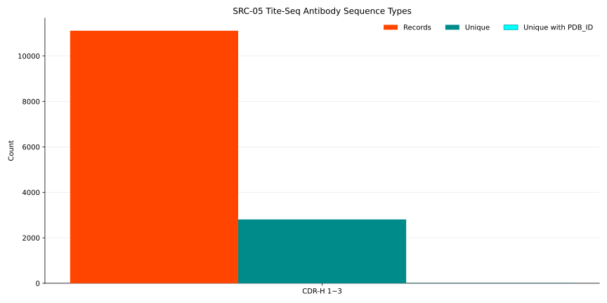
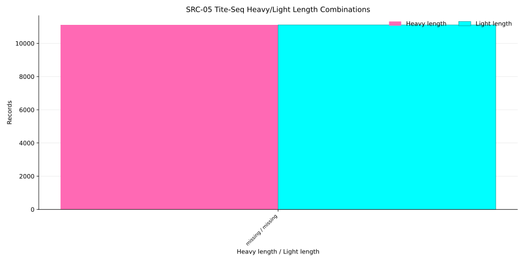
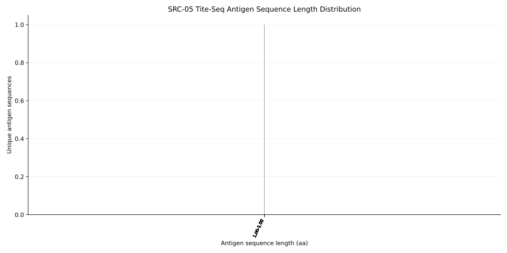

---
tags:
  - context
---

# SRC-05 Tite-Seq

> 每条 data 统一建模为 `((ab, ag), label, assay, condition, replicate, source)`.
> 本地快照 `G:\abag-datasets\SRC_R05_TITESEQ\snapshot-2017-09-24`, `16_titeseq/data/`: `replicate_1/2/3.csv` 3,679 / 3,680 / 3,680 行 × 110 列, `titration_curves.csv` 73 行 × 22 列, 另有 3 张模拟表.
> `Unique` 为 `(CDR1H_AA, CDR3H_AA)` 二元组精确去重; 表内只有两段各 10 aa 的 CDR, 无 framework、无轻链.

## Antibody

> 有 Heavy 和 Light 的 `Unique` 字段是 `(heavy, light)` 二元组精确去重. `Unique with PDB_ID` 是按 Unique 后的 sequence 计数.
> Total Unique 计数方式为统一转 string, 如果有 Heavy 和 Light 用 `/` 拼接成 string.

| Key | 含义 | 说明 |
| --- | --- | --- |
| Sequence Type | 抗体序列类型 | 根据原始数据字段、链槽位及已有构建体标签划分的类别. |
| Records | 原始记录数 | 原始数据中的记录数量, 同一序列可能重复出现. |
| Unique | 唯一序列数 | 按对应数据集定义的去重规则统计. |
| Unique with PDB_ID | 关联 PDB 的唯一序列数 | 去重后具有关联 PDB_ID 的序列数量, 不等同于具有可用实验结构监督的序列数量. |
| Description | 类型说明 | 描述分类依据、序列槽位特征及分类限制. |

| Sequence Type | Records | Unique | Unique with PDB_ID | Description |
| --- | --- | --- | --- | --- |
| CDR-H 1~3 | 11,112 | 2,807 | 0 | 每行只给 `CDR1H_AA` (10 aa)、`CDR3H_AA` (10 aa) 及其核酸序列 (`CDR1H` / `CDR3H`, 各 30 nt), 无 framework、无轻链; 序列形状只支持 CDR-H 1~3. |
| Total | 11,112 | 2,807 | 0 |  |

> 三张 replicate 表的 11,039 行落 2,807 个唯一 CDR 对, 其中 2,802 对在三次重复中都出现; 三次重复是同一文库的独立分选, 不是不同抗体. `titration_curves.csv` 的 73 行是其中 19 个 clone 的低通量重测, 序列对全部落在 replicate 表内, 不新增抗体单位.
>
> `Unique with PDB_ID` 为 0: 抗体侧没有 PDB 字段; 本地唯一结构 `1FLR` 是 WT 4-4-20 Fab 的参考复合物, 不是任何一个变体的结构.

| Heavy Length | Light Length | Records | Description |
| --- | --- | --- | --- |
| missing | missing | 11,112 | 表中无重链、轻链序列, 两侧记 missing. 可用的只有 CDR 长度: 两段各 10 aa (核酸各 30 nt). |

## Antigen

> Antigen 统计以 source-native antigen entity 为核心单位. 优先使用原始 antigen ID/name、construct 和 antigen chain 定义实体; 存在可靠序列时再统计唯一抗原序列.
> 结构、序列和数据库注释压缩到同一张表中, `PDB / UniProt` 采用唯一抗原实体粒度统计 2 × 2 覆盖结果.
> 长度图基于唯一抗原序列, 按该源实际范围平均切分 20 bins.

> 全部测量针对同一固定抗原 (荧光素与 4-4-20 Fab 的高亲和力体系), 无逐行抗原字段; 唯一结构 `1FLR` 是 WT Fab–fluorescein 参考复合物.

| Records | Unique ag entity | Unique ag sequence | PDB / UniProt coverage | Antigen Length | Antigen Evidence / Provenance | Description |
| --- | --- | --- | --- | --- | --- | --- |
| 11,112 | 1 | 1 | PDB=1/UniProt=0: 1; PDB=0/UniProt=0: 0 | 1 aa (fluorescein, small molecule) | Reference PDB / Fixed target | 唯一实体是荧光素 (fluorescein), 一个合成小分子, 不是蛋白抗原; 序列长度一列无蛋白残基可计, 记为 1 aa 以保持表结构, 实际无量纲长度. 参考结构 `1FLR` 是 4-4-20 Fab–fluorescein 复合物, 属 Reference PDB. 表内无 UniProt 字段, 小分子无适用于本表计数的 UniProt 映射. |

## Affinity

> 去重口径: 按 **(CDR1H_AA, CDR3H_AA, replicate)** 去重. `Replicates` 列是三张 replicate 表本身, 每张表内同一 CDR 对只出现 1 次.
>
> `fit_KD` 单位 M, 在两端被删失: 上界 1e-05 (弱结合或无结合), 下界 3.1623e-10 (强结合). 三次重复各自的上界 2,237 / 2,516 / 2,494 行, 下界 25 / 88 / 51 行, 落在开区间内的只有 1,417 / 1,075 / 1,135 行. 这些是拟合边界, 不是点估计; 把边界当真实 KD 会把弱结合体当成 10 uM. `titration_curves.csv` 的 73 行是低通量滴定, 6.48e-11 到 1.0 M, 与高通量拟合是同一批 clone 的另一次测量.

| Label | Assay | Condition | Replicate | Record pairs | Unique pairs | Description |
| --- | --- | --- | --- | --- | --- | --- |
| `Kd_M` | `yeast_display` | replicate_1 (`fit_KD`, 3,679/3,680 行) | n=1:1,417; unknown:2,262 | 3,679 | 3,679 | 上界 1e-05 2,237 行, 下界 3.1623e-10 25 行, 开区间 1,417 行; 边界值是删失标记, 非点估计. |
| `Kd_M` | `yeast_display` | replicate_2 (`fit_KD`, 3,679/3,680 行) | n=1:1,075; unknown:2,604 | 3,679 | 3,679 | 上界 1e-05 2,516 行, 下界 3.1623e-10 88 行, 开区间 1,075 行; 边界值是删失标记, 非点估计. |
| `Kd_M` | `yeast_display` | replicate_3 (`fit_KD`, 3,679/3,680 行) | n=1:1,135; unknown:2,545 | 3,680 | 3,680 | 上界 1e-05 2,494 行, 下界 3.1623e-10 51 行, 开区间 1,135 行; 边界值是删失标记, 非点估计. |
| `Kd_M` | `flow` | titration_curves (73 行, 19 clone) | unknown:73 | 73 | 19 | 低通量滴定 `KD` 6.48e-11-1.0 M; 同一 clone 重复 1-15 次, 逐行是一次独立曲线拟合, 19 个 clone 各 1 个序列对. |
| `predicted` | `NGS_seq` | ideal_0_* 模拟 (3 张) | — | 0 | 0 | `ideal_0_0.001` / `ideal_0_1.0` / `ideal_0_10000.0` 分别 3,679 / 3,679 / 374 行, 是不同 sampling rate 下的模拟拟合与 `true_KD` 真值; 不含任何实验测量, 不计入 Record pairs. |
