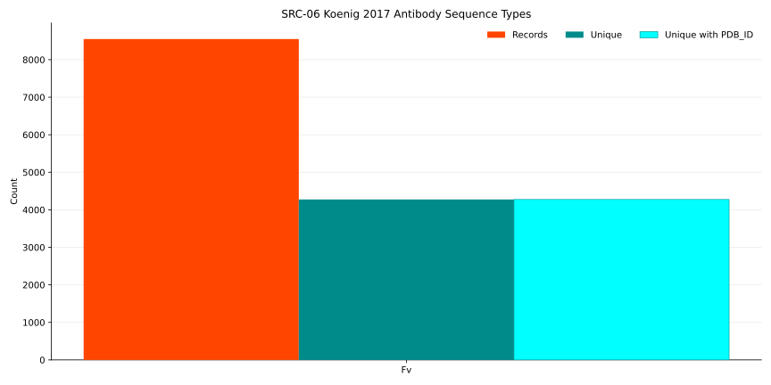
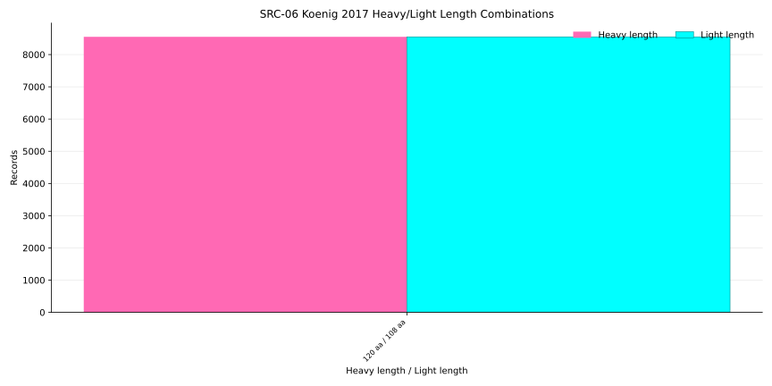
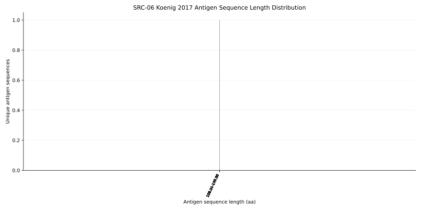

---
- tags:
  - context
---

# SRC-06 Koenig 2017

> 每条 data 统一建模为 `((ab, ag), label, assay, condition, replicate, source)`.
> 本地快照 `G:\abag-datasets\SRC_R06_KOENIG\snapshot-2026-08-17`, `FLAb/data/binding/koenig2017mutational_kd_g6.csv` 4,275 行 × 7 列 + `FLAb/data/expression/koenig2017mutational_er_g6.csv` 4,275 行 × 4 列, 共 8,550 行.
> `Unique` 为 `(heavy, light)` 二元组精确去重; 两张表的序列对完全相同.

## Antibody

> 有 Heavy 和 Light 的 `Unique` 字段是 `(heavy, light)` 二元组精确去重. `Unique with PDB_ID` 是按 Unique 后的 sequence 计数.
> Total Unique 计数方式为统一转 string, 如果有 Heavy 和 Light 用 `/` 拼接成 string.

| Key | 含义 | 说明 |
| --- | --- | --- |
| Sequence Type | 抗体序列类型 | 根据原始数据字段、链槽位及已有构建体标签划分的类别. |
| Records | 原始记录数 | 原始数据中的记录数量, 同一序列可能重复出现. |
| Unique | 唯一序列数 | 按对应数据集定义的去重规则统计. |
| Unique with PDB_ID | 关联 PDB 的唯一序列数 | 去重后具有关联 PDB_ID 的序列数量, 不等同于具有可用实验结构监督的序列数量. |
| Description | 类型说明 | 描述分类依据、序列槽位特征及分类限制. |

| Sequence Type | Records | Unique | Unique with PDB_ID | Description |
| --- | --- | --- | --- | --- |
| Fv | 8,550 | 4,275 | 4,275 | `flab_metadata.csv` 对 `koenig2017mutational_kd_g6.csv` 的 `key_words` 显式写 `Fv, G6.31, VEGF`; 重链 120 aa、轻链 108 aa, 均为纯可变区量级. 全部行是同一 G6.31 Fv 框架的突变体. |
| Total | 8,550 | 4,275 | 4,275 |  |

> 两张表覆盖同一批 4,275 个 G6.31 突变体: 2,262 种重链序列 × 2,015 种轻链序列的两两组合, 每对只出现一次. 22 个位点的单点与多点突变构成该组合, 不是 4,275 个独立设计的抗体.
>
> 构建体类型取自 FLAb `flab_metadata.csv` 的 `key_words` 字段 (`Fv, G6.31, VEGF`), 属源方显式标签. `Unique with PDB_ID` 为 4,275: 抗体侧没有逐行 PDB 字段, 但全部行是 G6.31 Fv 的变体, 亲本 Fv–VEGF 复合物 `2FJG` 是这批变体共同的唯一结构证据; 该数字是亲本体系计数, 不是 4,275 个变体各自解出的结构.

| Heavy Length | Light Length | Records | Description |
| --- | --- | --- | --- |
| 120 aa | 108 aa | 8,550 | 两张表的链长恒定: 重链全长 120 aa、轻链全长 108 aa, 无缺失; 变化只发生在 22 个位点的氨基酸身份上. |

## Antigen

> Antigen 统计以 source-native antigen entity 为核心单位. 优先使用原始 antigen ID/name、construct 和 antigen chain 定义实体; 存在可靠序列时再统计唯一抗原序列.
> 结构、序列和数据库注释压缩到同一张表中, `PDB / UniProt` 采用唯一抗原实体粒度统计 2 × 2 覆盖结果.
> 长度图基于唯一抗原序列, 按该源实际范围平均切分 20 bins.

> 单一固定抗原 VEGF, 表内无抗原字段; 抗原序列取自本地冻结的参考结构 `2FJG`, 属 Reference PDB.

| Records | Unique ag entity | Unique ag sequence | PDB / UniProt coverage | Antigen Length | Antigen Evidence / Provenance | Description |
| --- | --- | --- | --- | --- | --- | --- |
| 4,275 | 1 | 1 | PDB=1/UniProt=0: 1; PDB=0/UniProt=0: 0 | 109 aa (VEGF, 2FJG chain) | Reference PDB / Fixed target | 唯一实体是 VEGF, G6 抗体 的靶点; 抗原序列取 `2FJG` 的抗原链 (109 aa), 属共享参考复合物, 不是逐行测量构建体. 表内无 UniProt 字段. |

## Affinity

> 去重口径: 按 **(heavy, light)** 去重, 两张表各 4,275 行且全 1:1 唯一. 无 replicate 字段, 全记 `unknown`; 包内没有筛选轮次、配体、原始 read counts 或重复身份.
>
> `KD (M)` 6.943e-13-6.009e-8 全列有限正数、无失败编码, 与论文只对少量候选做 SPR 的实验口径不符; 这些值是 FLAb 给出的派生绑定读数, 不能当作逐条 SPR 实测. 列内变换自洽: `KD (M) = KD (nM) x 1e-9`, `fitness = -log( KD (M) )`. 这样的全覆盖有限值说明该列已过滤或插值, 但包内没有说明其生成规则.

| Label | Assay | Condition | Replicate | Record pairs | Unique pairs | Description |
| --- | --- | --- | --- | --- | --- | --- |
| `log_Kd` | `unknown` | koenig2017mutational_kd_g6 (`fitness`) | unknown:4275 | 4,275 | 4,275 | `-log( KD (M) )` 7.2212-12.1584, 与 `fitness` 逐行相同; FLAb metadata 标 `assay/units_raw = -log (Kd [M])`, `assay = SPR Kd`, 但包内无逐条测量记录, assay 记 `unknown`. |
| `Kd_M` | `unknown` | koenig2017mutational_kd_g6 (`KD (M)`) | unknown:4275 | 4,275 | 4,275 | `KD (M)` 6.943e-13-6.009e-8; 与上一行是同一数值的两种表示, 不是两次测量. |
| `enrichment` | `unknown` | koenig2017mutational_er_g6 (`enrichment ratio`) | unknown:4275 | 4,275 | 4,275 | `enrichment ratio` 0.0009765625-3.1777805, 与同表 `fitness` 逐行相同; FLAb 归为 Expression [ER], 是筛选富集代理值. |
