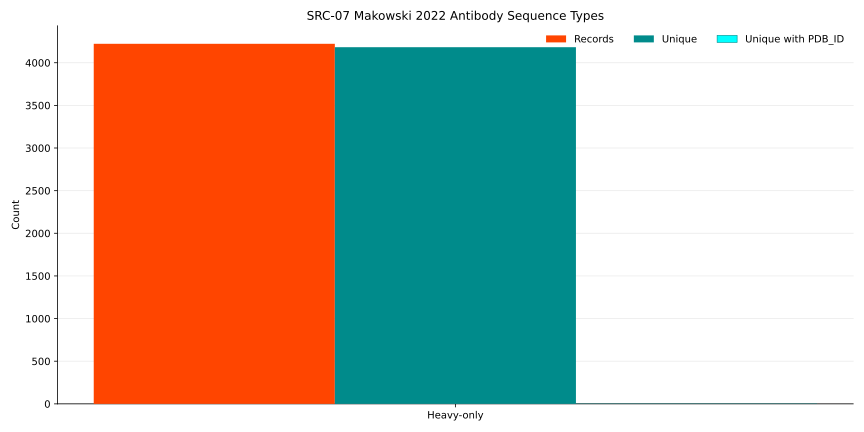
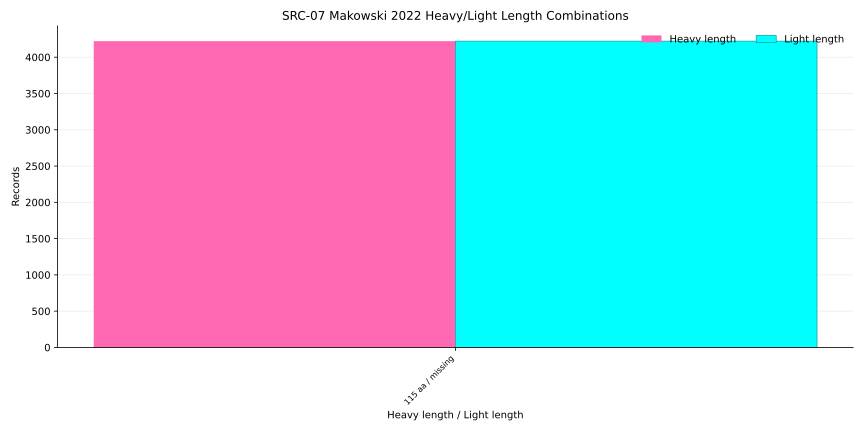
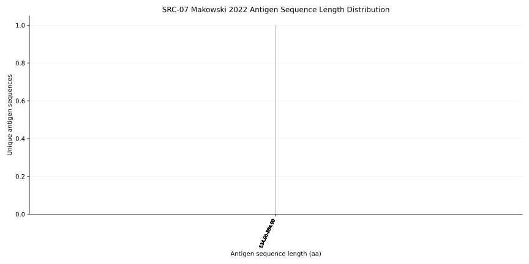

---
tags:
  - context
---

# SRC-07 Makowski 2022

> 每条 data 统一建模为 `((ab, ag), label, assay, condition, replicate, source)`.
> 本地快照 `G:\abag-datasets\SRC_R07_MAKOWSKI\snapshot-2022-06-24`, `Emi_Pareto_Opt_ML/`: `emi_binding.csv` 4,000 行, `iso_binding.csv` 126 行, `igg_binding.csv` 96 行, 共 4,222 行; 另有 `*_reps.csv` (64 维 UniRep 特征) 与热图汇总表.
> `Unique` 为 `VH Sequence` 精确去重; 表内只有 115 aa 的重链可变区, 无轻链.

## Antibody

> 有 Heavy 和 Light 的 `Unique` 字段是 `(heavy, light)` 二元组精确去重. `Unique with PDB_ID` 是按 Unique 后的 sequence 计数.
> Total Unique 计数方式为统一转 string, 如果有 Heavy 和 Light 用 `/` 拼接成 string.

| Key | 含义 | 说明 |
| --- | --- | --- |
| Sequence Type | 抗体序列类型 | 根据原始数据字段、链槽位及已有构建体标签划分的类别. |
| Records | 原始记录数 | 原始数据中的记录数量, 同一序列可能重复出现. |
| Unique | 唯一序列数 | 按对应数据集定义的去重规则统计. |
| Unique with PDB_ID | 关联 PDB 的唯一序列数 | 去重后具有关联 PDB_ID 的序列数量, 不等同于具有可用实验结构监督的序列数量. |
| Description | 类型说明 | 描述分类依据、序列槽位特征及分类限制. |

| Sequence Type | Records | Unique | Unique with PDB_ID | Description |
| --- | --- | --- | --- | --- |
| Heavy-only | 4,222 | 4,182 | 0 | 三表均只给 115 aa 的 `VH Sequence`, 无轻链槽位; 重链恒为 emibetuzumab VH 框架, 变化集中在 CDR 与框架少数位点. |
| Total | 4,222 | 4,182 | 0 |  |

> 三个实验层级是同一 emibetuzumab VH 变体库的不同筛选层, 不是三批独立抗体: `emi_binding` 4,000 条是二元文库筛选, `iso_binding` 126 条与 `igg_binding` 96 条是从中挑出的分离 scFab 与 IgG 候选, 其中 24 条同时出现在文库层与 IgG 层. 三者合并 4,182 条唯一 VH.
>
> 只有重链可变区序列, 轻链未公开; 构建体层级由层级名称给出 (`iso` = isolated scFab, `igg` = IgG), 但序列本身只有 VH, 不能从序列判定构建体, 故归 `Heavy-only`. `Unique with PDB_ID` 为 0: 抗体侧无逐行 PDB 字段; 本地 5 个结构条目是 emibetuzumab 各 CDR/framework 模板与 MET 抗原参考, 不是任一变体的结构.

| Heavy Length | Light Length | Records | Description |
| --- | --- | --- | --- |
| 115 aa | missing | 4,222 | 重链可变区长度恒为 115 aa, 无缺失; 表中无轻链序列, 记 missing. |

## Antigen

> Antigen 统计以 source-native antigen entity 为核心单位. 优先使用原始 antigen ID/name、construct 和 antigen chain 定义实体; 存在可靠序列时再统计唯一抗原序列.
> 结构、序列和数据库注释压缩到同一张表中, `PDB / UniProt` 采用唯一抗原实体粒度统计 2 × 2 覆盖结果.
> 长度图基于唯一抗原序列, 按该源实际范围平均切分 20 bins.

> 靶点为 HGFR / MET, 表内无抗原字段; 抗原序列取本地冻结参考结构 `6WVZ` 的 MET 胞外域链, 属 Reference PDB; 特异性对照为 OVA (鸡卵清蛋白), 不以序列形式给出.

| Records | Unique ag entity | Unique ag sequence | PDB / UniProt coverage | Antigen Length | Antigen Evidence / Provenance | Description |
| --- | --- | --- | --- | --- | --- | --- |
| 4,000 | 2 | 1 | PDB=1/UniProt=0: 1; PDB=0/UniProt=0: 1 | 534 aa (MET, 6WVZ chain C); OVA 无序列 | Reference PDB / Fixed target | 唯一实体按实验用途计 2 个: 目标抗原 HGFR / MET 与非特异性对照 OVA. MET 序列取 `6WVZ` 抗原链 (534 aa), 属共享参考复合物; OVA 在包内无序列, 记无序列. 另 4 个结构条目 (`3W2D`、`4LIQ`、`4YHL`、`5NHW`) 是 emibetuzumab 不同 CDR/framework 的模板结构, 属抗体侧参考, 不计为抗原. 表内无 UniProt 字段. |

## Affinity

> 去重口径: 按 **(VH Sequence, 实验层级)** 去重; 三表内部各自全 1:1 唯一, 跨层级有 24 条重叠. 无 replicate 字段, 全记 `unknown`.
>
> 三层的 label 类型不同, 不能合并: `emi_binding` 的 `ANT Binding` 是 0/1 二元筛选 (1 = 1516, 0 = 2484), `iso_binding` 的 `ANT Binding` 是背景扣除后的连续相对信号 (-0.0084-1.615), 小于零来自扣背景, 不是不结合; `igg_binding` 另有生物重复标准差列 `ANT STDEV` / `OVA STDEV`. 三层都不是 Kd.

| Label | Assay | Condition | Replicate | Record pairs | Unique pairs | Description |
| --- | --- | --- | --- | --- | --- | --- |
| `binary` | `yeast_display` | emi_binding (`ANT Binding`, HGFR) | unknown:4000 | 4,000 | 4,000 | `ANT Binding` 1 = 1,516 / 0 = 2,484; 论文定义为 HGFR 筛选的低/高抗原结合, 是分选门限的二元判定. |
| `binary` | `yeast_display` | emi_binding (`OVA Binding`, 非特异对照) | unknown:4000 | 4,000 | 4,000 | `OVA Binding` 1 = 2,000 / 0 = 2,000; 用于低/高 OVA 非特异性结合的对照分组, 不是目标抗原亲和力. |
| `enrichment` | `yeast_display` | iso_binding (`ANT Binding`, scFab) | unknown:126 | 126 | 126 | 连续相对信号 -0.0084-1.615; 小于零是背景扣除结果, 不能置零, 也不等同不结合. `Sample` 是 scFab clone ID. |
| `enrichment` | `yeast_display` | iso_binding (`OVA Binding`, scFab) | unknown:126 | 126 | 126 | OVA 对照信号 0.2358-1.0818, 越小越特异. |
| `enrichment` | `unknown` | igg_binding (`ANT Binding`, IgG bead) | n=2:96 | 96 | 96 | IgG bead assay 的 HGFR 单点信号 0.06-1.28; `ANT STDEV` 是生物重复标准差, 重复数固定为 2, 记 `n=2:96`. |
| `enrichment` | `unknown` | igg_binding (`OVA Binding`, IgG bead) | n=2:96 | 96 | 96 | OVA 对照信号 0-1.0, 越小越特异; 同表另有 `SMP Binding` 0-1.1, 未单独计入本表. |
