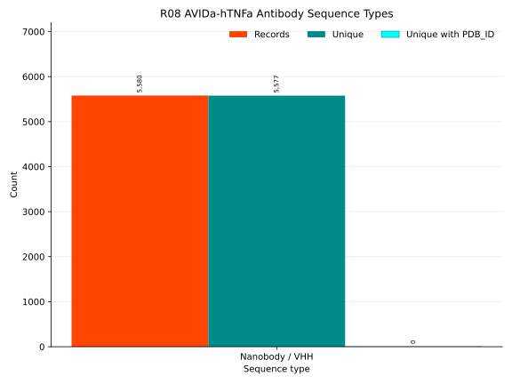
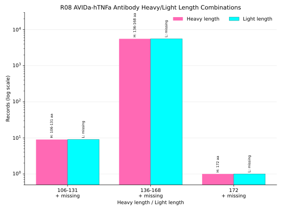
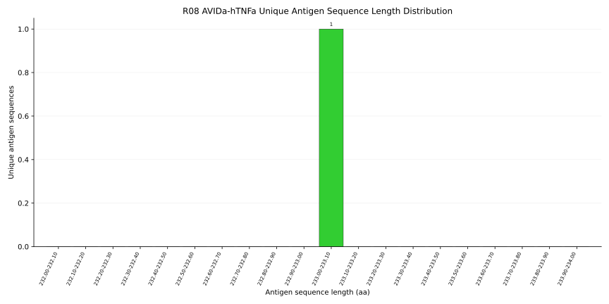

---
tags:
  - context
---

# [SRC-08 AVIDa-hTNFa](../2026-10-29-3a-src-readme/src-08-avida-htnfa-readme.md)

> 每条 data 统一建模为 `((ab, ag), label, assay, condition, replicate, source)`.
> 本地快照 `G:\abag-datasets\SRC_R08_AVIDA_HTNFA\snapshot-2025-06-26`, `AVIDa-hTNFa.csv` 5,580 行 + `corpus-hTNFa.csv` 216,225 行无标签语料.
> `Unique` 为 VHH 序列去重.

## Antibody

> 有 Heavy 和 Light 的 `Unique` 字段是 `(heavy, light)` 二元组精确去重. `Unique with PDB_ID` 是按 Unique 后的 sequence 计数.
> Total Unique 计数方式为统一转 string, 如果有 Heavy 和 Light 用 `/` 拼接成 string.

| Key | 含义 | 说明 |
| --- | --- | --- |
| Sequence Type | 抗体序列类型 | 根据原始数据字段、链槽位及已有构建体标签划分的类别. |
| Records | 原始记录数 | 原始数据中的记录数量, 同一序列可能重复出现. |
| Unique | 唯一序列数 | 按对应数据集定义的去重规则统计. |
| Unique with PDB_ID | 关联 PDB 的唯一序列数 | 去重后具有关联 PDB_ID 的序列数量, 不等同于具有可用实验结构监督的序列数量. |
| Description | 类型说明 | 描述分类依据、序列槽位特征及分类限制. |

| Sequence Type | Records | Unique | Unique with PDB_ID | Description |
| --- | --- | --- | --- | --- |
| Nanobody / VHH | 5,580 | 5,577 | 0 | 上游 dataset card 逐条标注 `VHH_sequence`; 序列含 22 aa 信号肽样前缀与 C 端 6×His, 使用前需按来源定义裁剪, 不能当作已标准化的 VH 区. |
| Total | 5,580 | 5,577 | 0 | |

> 全部记录只对应单一抗原构建体 `TNFa-WT-beads` (233 aa 人 TNFα 前体); `1TNF` 是抗原/参考结构锚点, 不是任何一条 VHH–antigen 复合物 PDB. 抗体侧无自身 PDB 证据.

| Heavy Length | Light Length | Records | Description |
| --- | --- | --- | --- |
| 106-131 aa | missing | 9 | 短构建体: 9 条公认为 106 / 107 / 111 / 119 / 129 / 131 aa, 无独立轻链槽位. |
| 136-168 aa | missing | 5,570 | 主簇 99.8%: 原始串 136-168 aa, 主峰 149 aa (522 条); 去掉 22 aa 信号肽样前缀与 6×His 后为 108-140 aa, 主峰 121 aa, 属单域 VHH 量级. |
| 172 aa | missing | 1 | 单条偏长构建体, 未标构建体差异, 保留为独立观测组. |

## Antigen

> Antigen 统计以 source-native antigen entity 为核心单位. 优先使用原始 antigen ID/name、construct 和 antigen chain 定义实体; 存在可靠序列时再统计唯一抗原序列.
> 结构、序列和数据库注释压缩到同一张表中, `PDB / UniProt` 采用唯一抗原实体粒度统计 2 × 2 覆盖结果.
> 长度图基于唯一抗原序列, 按该源实际范围平均切分 20 bins.

| Records | Unique ag entity | Unique ag sequence | PDB / UniProt coverage | Antigen Length | Antigen Evidence / Provenance | Description |
| --- | --- | --- | --- | --- | --- | --- |
| 5,580 | 1 | 1 | Reference PDB: 1; UniProt=unavailable | 233 aa | Direct sequence / Fixed target | `antigen_sequences.csv` 只含一条 `TNFa-WT-beads` (人 TNFα 前体, 233 aa) 直接序列; 全部 5,580 行 VHH 记录均针对该单一固定抗原构建体. 参考结构 1TNF 是抗原/参考锚点, 不是任何 VHH–antigen 复合物 PDB. 标签表之外另有 216,225 行无标签 VHH 语料, 不计入本表. |

## Affinity

> 去重口径: 按 **VHH 序列** 去重 (5,580 行, 5,577 唯一, 3 条重复). 单抗原 TNFa, `antigen_sequences.csv` 1 行给 `Ag_label=TNFa-WT-beads` 的抗原序列. 无 replicate 字段, 全记 `unknown`.
>
> `AVIDa-hTNFa.csv` 5,580 行: `VHH_sequence` (仅重链 VHH), `Ag_label` 全为 `TNFa-WT-beads`, `label` 1:682 / 0:4,898 (结合/不结合), 全部 alpaca. `corpus-hTNFa.csv` 216,225 行是未标注的 VHH 语料 (无 label). 同 SRC-09 cognano 行同源.

| Label | Assay | Condition | Replicate | Record pairs | Unique pairs | Description |
| --- | --- | --- | --- | --- | --- | --- |
| `binary` | `unknown` | `TNFa-WT-beads` | `unknown:5580` | 5,580 | 5,577 | `label` 结合 1:682 / 不结合 0:4,898, 单抗原, 酵母/展示读出, 方法字段未给. |
| `not_recorded` | `unknown` | `corpus-hTNFa (无 label)` | `unknown:216225` | 216,225 | 不可重建 | `corpus-hTNFa.csv` 仅 VHH 序列, 无 label 无测量, 语料层. |
