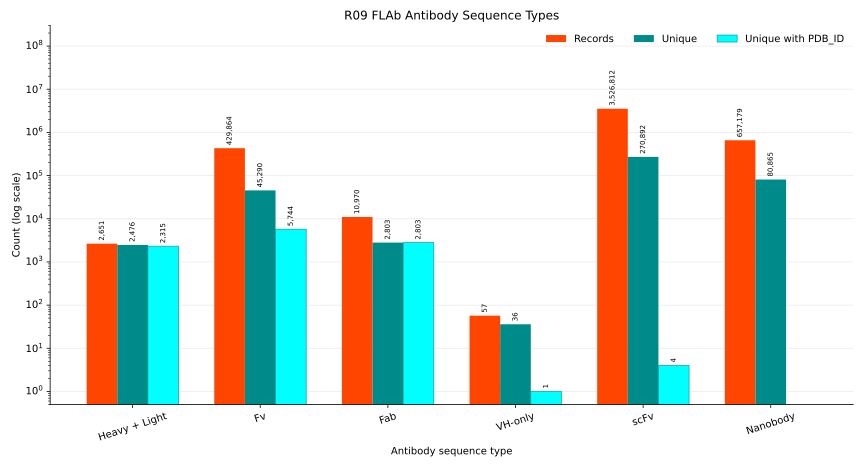
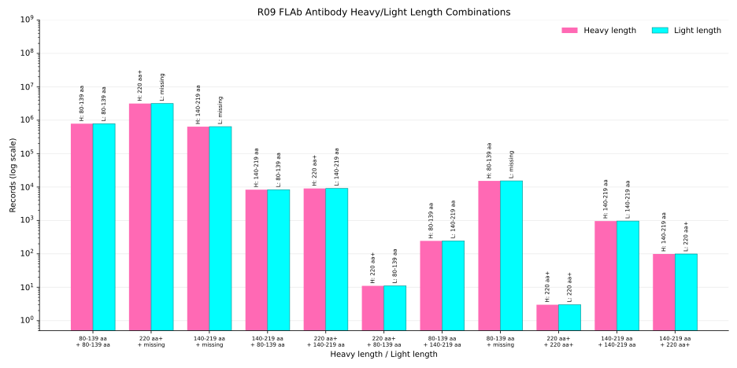
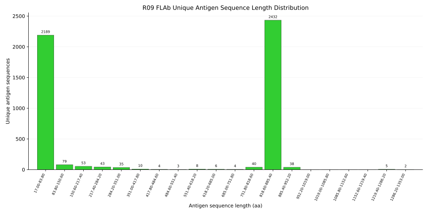

---
- tags:
  - context
---

# SRC-09 FLAb

> 每条 data 统一建模为 `((ab, ag), label, assay, condition, replicate, source)`.
> 本地快照 `G:\abag-datasets\SRC_R09_FLAB\snapshot-2026-08-17`, 165 张表、30 个 study.
> `Unique` 有 `heavy`+`light` 时按 `(heavy, light)` 二元组去重; 只有 `heavy` 的 VHH 按 heavy 序列去重; 无序列列时按行内测量身份, 无法重建 pair 则如实标注.

## Antibody

> 有 Heavy 和 Light 的 `Unique` 字段是 `(heavy, light)` 二元组精确去重. `Unique with PDB_ID` 是按 Unique 后的 sequence 计数.
> Total Unique 计数方式为统一转 string, 如果有 Heavy 和 Light 用 `/` 拼接成 string.

| Key | 含义 | 说明 |
| --- | --- | --- |
| Sequence Type | 抗体序列类型 | 根据原始数据字段、链槽位及已有构建体标签划分的类别. |
| Records | 原始记录数 | 原始数据中的记录数量, 同一序列可能重复出现. |
| Unique | 唯一序列数 | 按对应数据集定义的去重规则统计. |
| Unique with PDB_ID | 关联 PDB 的唯一序列数 | 去重后具有关联 PDB_ID 的序列数量, 不等同于具有可用实验结构监督的序列数量. |
| Description | 类型说明 | 描述分类依据、序列槽位特征及分类限制. |

| Sequence Type | Records | Unique | Unique with PDB_ID | Description |
| --- | --- | --- | --- | --- |
| Heavy + Light | 2,651 | 2,476 | 2,315 | 12 张表未标注构建体类型, 仅 H/L 两槽均有值, 不强行分类. |
| Fv | 429,864 | 45,290 | 5,744 | 143 张表、20 个 study, `key_words` 标注 Fv 或同一 study 的其他表标注 Fv. |
| Fab | 10,970 | 2,803 | 2,803 | `adams2017measuring_4420-fluorescein_exp_er` 明确标注 Fab, 同一构建体重复测表达. |
| VH-only | 57 | 36 | 1 | `rawat2022abcov_ic50/kd` 中 L 链缺失, 属于 Fv study 的缺链记录. |
| scFv | 3,526,812 | 270,892 | 4 | 4 张表明确标注 scFv, 部分数据以 linker 连接的完整序列存储. |
| Nanobody | 657,179 | 80,865 | 0 | 5 张表明确标注 VHH、Nanobody 或 sdAb. |
| Total | 4,627,533 | 402,362 | 10,867 | 165 张表、30 个 study. |

| Heavy Length | Light Length | Records | Description |
| --- | --- | --- | --- |
| 80–139 aa | 80–139 aa | 786,981 | 主流形式: VH-like + VL-like 双链. |
| 220 aa+ | missing | 3,163,621 | scFv 全串: Sequence 槽存 linker 连接的完整 scFv (240 / 246 / 249 aa 三档为主), 无独立轻链槽位. |
| 140–219 aa | missing | 641,980 | 单域 VHH 构建体, 长度 94–179 aa, 主体落在 140–160 aa. |
| 140–219 aa | 80–139 aa | 8,332 | Fv 中重链槽偏长而轻链正常: 含部分 VH-CH1 类延伸, 原始字段未标注构建体边界. |
| 220 aa+ | 140–219 aa | 9,057 | Fv 中重链为完整重链 (约 450–462 aa)、轻链偏长: 整条 IgG 重链序列被写入 heavy 槽. |
| 220 aa+ | 80–139 aa | 11 | Fv 中重链完整、轻链为常规 VL. |
| 80–139 aa | 140–219 aa | 243 | Fv 中轻链槽偏长 (约 140–257 aa), 重链正常. |
| 80–139 aa | missing | 151,256 | 单链重链槽: VH-only 57 行 + Nanobody 151,199 行 (长度 80–139 aa 的短 VHH). |
| 220 aa+ | 220 aa+ | 3 | Fv 中两侧均为长串, 仅 3 行, 原始字段无法确认构建体. |

## Antigen

> Antigen 统计以 source-native antigen entity 为核心单位. 优先使用原始 antigen ID/name、construct 和 antigen chain 定义实体; 存在可靠序列时再统计唯一抗原序列.
> 结构、序列和数据库注释压缩到同一张表中, `PDB / UniProt` 采用唯一抗原实体粒度统计 2 × 2 覆盖结果.
> 长度图基于唯一抗原序列, 按该源实际范围平均切分 20 bins.

| Records | Unique ag entity | Unique ag sequence | PDB / UniProt coverage | Antigen Length | Antigen Evidence / Provenance | Description |
| --- | --- | --- | --- | --- | --- | --- |
| 4,606,788 | 5,985 | 4,962 | PDB=1/UniProt=0: 5,933; PDB=0/UniProt=0: 52 | 17-1,353 aa; median 240 aa; 343 unique lengths (AbRank) | Direct sequence / Source-native | 86 张 binding 表. AbRank 34.2 万行逐行带 `Ag_name` 与 `Ag_seq`, 5,933 个唯一抗原实体, 全部挂 `Ag_PDB_ID` (297 个唯一 PDB 值, 为抗原侧锚点). 其余 79 表多为单抗原固定目标 (52 个命名实体, 如 DCC, IL23R, TNFa-WT-beads, hHER2), 其中 kothiwal 11 个抗原带直接序列. 长度统计以 AbRank 5,933 条唯一实体的 `Ag_seq` 为准 (4,951 条唯一序列). |

## Affinity

> 去重口径: 有 `heavy`+`light` 列按 **(heavy, light)** 序列去重; 只有 `heavy` 的 VHH (tsuruta2024 两个) 按 heavy 序列去重; 无序列列 (li2023 两个, AbRank, engelhart) 按行内 `POI`/`Pred_affinity` 测量身份, 无法跨行重建 pair, unique 记 Record 值并标注.
>
> 86 张 binding 表. 量纲混杂是常态: 同一表内 `fitness` 列独立于 label 列, label 列名与单位逐表不同. 无 replicate 字段, 全记 `unknown` (少数表有 replicate, 见 engelhart/li2023 行). 本表是汇编源, 大表全部并表, 小表逐张保留.

| Label | Assay | Condition | Replicate | Record pairs | Unique pairs | Description |
| --- | --- | --- | --- | --- | --- | --- |
| `predicted` | `NGS_seq` | `li2023 scFv SARS-CoV-2 aff1` | `n=1:419900; n=2:419900; n=3:419900` | 1,259,700 | 314,925 (unique POI) | AlphaSeq 预测 Kd (log nM, −1.43~7.35), `Pred_affinity`; 有 Assay 1/2 与 Replicate 1/2/3 字段. 同 SRC-23 AlphaSeq 数据, 跨源去重按测量身份. |
| `predicted` | `NGS_seq` | `li2023 scFv SARS-CoV-2 aff2` | `unknown:1903926` | 1,903,927 | 190,3926 (含 1 行 `Pred_affinity` 空) | AlphaSeq 预测, 同 li2023 aff1 来源, 续表 (总行数 190 万). 表头含 DISCLAIMER 前置行, 第 2 行起为数据. |
| `predicted` | `unknown` | `engelhart2022 scFv SARS-CoV-2` | `n=1:352139` | 352,139 | 87,807 | `Pred_affinity` 预测 Kd, scFv; 有 Replicate 字段全为 1. |
| `log_Kd` | `SPR` / `BLI` | `hie2023 系列 (7 表)` | `unknown:17/14/20/8/21/12/16/17/21` | 146 | 139 | `IgG Kd avg (nM)`/`Kd avg (nM)`, BLI; 每表一个抗体×抗原, 带 `Round`/`Chain mutated`/`Design` 条件. |
| `log_Kd` | `SPR` / `BLI` | `hutchinson2023 系列 (8 表)` | `unknown:15/15/22/23/50/182/28/27` | 362 | 361 | Fab/IgG, `KD (M)` 各表独立列名 (`KD (M) Fab binding kinetics`, `KD (M)2 Binding kinetics` 等). |
| `log_Kd` | `SPR` / `BLI` | `jain2024 (2 表)` | `unknown:31/2` | 33 | 33 | `Octet b-Hen Lysozyme Kd Monovalent (M)`/`Octet IgG KD b-Mouse Lysozyme-Fc Avid (M)`, Octet. |
| `Kd_M` | `SPR` / `BLI` | `garbinski2023` | `unknown:81` | 81 | 81 | `KD` (M), SPR, 81 变体. |
| `log_Kd` | `SPR` / `BLI` | `koenig2017 mutational G6` | `unknown:4275` | 4,275 | 4,275 | `-ln(KD (nM))`, SPR, G6 深度突变扫描 4,275 点. |
| `Kd_M` | `SPR` / `BLI` | `warszawski2019 D44` | `unknown:2048` | 2,048 | 2,048 | `KD (nM)`, D44 抗体, 2,048 点. |
| `Kd_M` | `SPR` / `BLI` | `rosace2023 (2 表)` | `unknown:14/5` | 19 | 19 | `KD (M)`, adalimumab/golimumab, 各带 `Mutations` 条件. |
| `Kd_M` | `SPR` / `BLI` | `shanehsazzadeh2023 (3 表)` | `unknown:13/13/13/422` | 461 | 461 | `Fab/mAb KD (nM) (hHER2)`/`KD (nM)`, 含 zerokd trastuzumab 422. |
| `Kd_M` | `SPR` / `BLI` | `shanehsazzadeh2024 igdesign (7 表)` | `unknown:13/24/34/47/40/127/36` | 321 | 320 | `KD (nM)`, 每表一靶一参考抗体, 带 `HCDRs Designed`. |
| `Kd_M` | `SPR` / `BLI` | `shanker2024 Kd (3 表)` | `unknown:36/7/30` | 73 | 65 | `Kd avg (M)`, 3 靶. |
| `Kd_M` | `SPR` / `BLI` | `phillips2021 (4 表)` | `unknown:953/921/32392/32767` | 67,033 | 67,033 | `h1_mean`/`h9_mean`/`h3_mean`, 深突变扫描 (cr6261/cr9114), 每行一个 `genotype`; 1 表列名错 (h3 用 `h9_mean_neg_log_kd`). |
| `Kd_M` | `SPR` / `BLI` | `kirby2024 (Kd)` | `unknown:869` | 869 | 616 | `Kd [M]`, SPR, SARS-CoV-2 抗体. |
| `Kd_M` | `SPR` / `BLI` | `rawat2022 Ab-CoV (Kd)` | `unknown:141` | 141 | 136 | `Binding Affinity (KD nM)`. |
| `Kd_M` | `SPR` / `BLI` | `makowski2022 (4 表)` | `unknown:126/96/96/126` | 444 | 444 | `ANT Binding`/`OVA Binding`, 两个抗原. |
| `Kd_M` | `SPR` / `BLI` | `peterson2024 (Kd)` | `unknown:1040` | 1,040 | 547 | `KD`, MAGMA-Seq Kd. |
| `Kd_M` | `Flow Kd` | `adams2017 4420-fluorescein (flow)` | `unknown:15` | 15 | 15 | `Kd (flow) [M]`. |
| `Kd_M` | `NGS_seq` | `adams2017 4420-fluorescein (titeseq)` | `unknown:11052` | 11,052 | 11,052 | `Kd (Tite-Seq) [M]`, 11,052 点. |
| `Kd_M` | `SPR` / `BLI` | `zimmerman2020 4420` | `unknown:21` | 21 | 20 | `KD (microM)`. |
| `binary` | `bind/no bind` | `kirby2024 (binary)` | `unknown:1407` | 1,407 | 1,039 | `KD [bind/no bind]`, 与上 Kd 表同源, 二元判定. |
| `binary` | `MAGMA-Seq` | `peterson2024 (binary)` | `unknown:1071` | 1,071 | 581 | `KD` 二元列, 与 MAGMA-Seq Kd 表同源. |
| `binary` | `NGS_seq` | `tsuruta2024 AVIDa-hIL6` | `unknown:573891` | 573,891 | 573,891 | 只有 `heavy` (VHH), `fitness` 二元, AVIDa-hIL6 全量 57 万. |
| `binary` | `NGS_seq` | `tsuruta2024 SARS-CoV-2` | `unknown:77003` | 77,003 | 77,003 | 只有 `heavy` (VHH), `fitness` 二元, 7.7 万. |
| `binary` | `bind/no bind` | `cognano AVIDa-hTNFa` | `unknown:5580` | 5,580 | 5,580 | `label` 列二元, VHH_sequence, 同 SRC-08. |
| `IC50` | `IC50` | `rawat2022 Ab-CoV (IC50)` | `unknown:427` | 427 | 413 | `IC50 (ng/ml)`, 427 中和测定. |
| `IC50` | `IC50` | `shanker2024 IC50 (3 表)` | `unknown:50/32/19/49` | 150 | 142 | `Avg Neutralization IC50 (ng/µL)`, 4 行表 (含 1 表只有 19). |
| `EC50` | `EC50` | `kothiwal2025 (14 表)` | `unknown:23/35/18/20/56/70/52/53/34/29/23/23/45/39/22/22/48/51/24/22` | 600 | 600 | 7 靶×2 (`_ec50`/`_spr`), 每表含 SPR KD(nM)+EC50(nM)+NGS FACS counts 多条件; 此 label 为 EC50 行. |
| `EC50` | `EC50` | `shanehsazzadeh2023 ADCC EC50` | `unknown:13` | 13 | 13 | `ADCC EC50 (pM)`, 13. |
| `log_Kd` | `IC50` | `AbRank_dataset` | `unknown:74845` | 74,845 | 不可重建 (见注) | AbRank 342,357 行, `IC50 [ug/mL]` 74,845 有值, `Affinity_Kd [nM]` 94,686, `escape` 192,559; `Aff_op` `=`/`>`/`<` 34,062/497; 8 个上游源. 跨源去重按 (Ab_name, Ag_name, 测量). |

> **大表摘要**: 全部 86 表合计 3,657,xxx 行. `fitness` 列在各表独立于 label 列, 本表以 label 列计 Record pairs. AbRank 表在本 SRC 与 SRC-10 重复收录, 跨源去重按测量身份.
