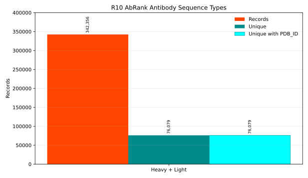
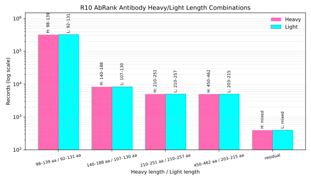
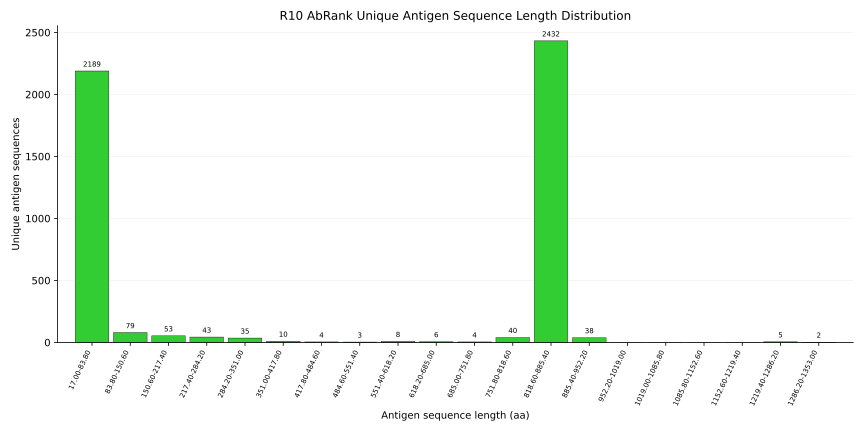

---
tags:
  - context
---

# [SRC-10 AbRank](../2026-10-29-3a-src-readme/src-10-abrank-readme.md)

> 每条 data 统一建模为 `((ab, ag), label, assay, condition, replicate, source)`.
> 本地快照 `G:\abag-datasets\SRC_R10_ABRANK\snapshot-2025-07-08`, 单表 `AbRank_dataset.csv` (TSV), 342,356 行.
> `Unique` 为 `(heavy, light, Ag)` 三元组精确去重.

## Antibody

> 有 Heavy 和 Light 的 `Unique` 字段是 `(heavy, light)` 二元组精确去重. `Unique with PDB_ID` 是按 Unique 后的 sequence 计数.
> Total Unique 计数方式为统一转 string, 如果有 Heavy 和 Light 用 `/` 拼接成 string.

| Key | 含义 | 说明 |
| --- | --- | --- |
| Sequence Type | 抗体序列类型 | 根据原始数据字段、链槽位及已有构建体标签划分的类别. |
| Records | 原始记录数 | 原始数据中的记录数量, 同一序列可能重复出现. |
| Unique | 唯一序列数 | 按对应数据集定义的去重规则统计. |
| Unique with PDB_ID | 关联 PDB 的唯一序列数 | 去重后具有关联 PDB_ID 的序列数量, 不等同于具有可用实验结构监督的序列数量. |
| Description | 类型说明 | 描述分类依据、序列槽位特征及分类限制. |

| Sequence Type | Records | Unique | Unique with PDB_ID | Description |
| --- | --- | --- | --- | --- |
| Heavy + Light | 342,356 | 76,079 | 76,079 | 原始字段没有标注不能强行分类. |
| Total | 342,356 | 76,079 | 76,079 | |

| Heavy Length | Light Length | Records | Description |
| --- | --- | --- | --- |
| 98–139 aa | 92–131 aa | 323,651 | 主簇，占 94.5%；H 与 L 均为单个 V 区量级. |
| 140–188 aa | 107–130 aa | 8,332 | 重链多出一个结构域，轻链仍为 V 区量级. |
| 210–251 aa | 210–257 aa | 5,004 | 双链各约两个结构域. |
| 450–462 aa | 203–215 aa | 4,973 | 重链约四个结构域，轻链含恒定区. |
| residual (稀有组合) | — | 396 | 跨簇的零散长度对，单个组合均 < 200 条. |

## Antigen

> Antigen 统计以 source-native antigen entity 为核心单位. 优先使用原始 antigen ID/name、construct 和 antigen chain 定义实体; 存在可靠序列时再统计唯一抗原序列.
> 结构、序列和数据库注释压缩到同一张表中, `PDB / UniProt` 采用唯一抗原实体粒度统计 2 × 2 覆盖结果.
> 长度图基于唯一抗原序列, 按该源实际范围平均切分 20 bins.

| Records | Unique ag entity | Unique ag sequence | PDB / UniProt coverage | Antigen Length | Antigen Evidence / Provenance | Description |
| --- | --- | --- | --- | --- | --- | --- |
| 342,356 | 5,933 | 4,951 | PDB=1/UniProt=0: 5,933; PDB=0/UniProt=0: 0 | 17-1,353 aa; median 240 aa; 343 unique lengths | Direct sequence / Source-native | 与 SRC-09 内嵌的 AbRank 数据集同源 (同一份 AbRank_dataset.csv 的 Kaggle v4 版, SRC-10 为 TSV 分隔, SRC-09 为逗号版). 逐行带 `Ag_name` 与 `Ag_seq`, 5,933 个唯一抗原实体全挂 `Ag_PDB_ID` (297 个唯一 PDB 值, 抗原侧结构锚点), 无 UniProt 字段. 4,951 条唯一抗原序列, 长度 17-1,353 aa. |

## Affinity

> 去重口径: 按 **(heavy 序列, light 序列, Ag 序列)** 三元组去重. 同 (Ab_name, Ag_name) 的行全部唯一, 跨行配对靠序列三元组重建. 无 replicate 字段, 全记 `unknown`.
>
> 单表 `AbRank_dataset.csv` (TSV), 342,356 行, 28 列, 全行都有三条序列. 三个亲和力列互斥: `Affinity_Kd [nM]` 94,686, `IC50 [ug/mL]` 74,845, `escape` 192,559. `escape` 与 `log(Kd_ratio)` 是衍生的 log_Kd; `log_Aff` 与 `Aff_op` 是统一化派生列. `Aff_op` 标记截断: `=` 307,797, `>` 34,062, `<` 497. 8 个上游源 (RBD-escape 192,559, CATNAP 74,540, AlphaSeq 71,834, AbCoV 1,392, SKEMPIv2 935, AbSci 758, SabDab 249, OVA-binders 89). 本表在 SRC-09 亦收录, 跨源去重按测量身份.

| Label | Assay | Condition | Replicate | Record pairs | Unique pairs | Description |
| --- | --- | --- | --- | --- | --- | --- |
| `log_Kd` | `unknown` | `RBD-escape (escape)` | `unknown:192559` | 192,559 | 188,523 | `escape` 0/1 判定 + `log(Kd_ratio)`, SARS-CoV-2 RBD 深度突变扫描; Kd 子集 20,500 行 0.007~2900 nM, `Aff_op` `>` 62. |
| `Kd_M` | `unknown` | `AlphaSeq` | `unknown:71834` | 71,834 | 71,830 | `Affinity_Kd [nM]` 预测 Kd, 0.0001~10,275 nM; 同 SRC-23 AlphaSeq, 跨源去重按测量身份. |
| `IC50` | `unknown` | `CATNAP` | `unknown:73508` | 73,508 | 73,016 | `IC50 [ug/mL]`, 中和测定 1e-5~500; `Aff_op` `>` 33,984 / `<` 486, 截断值可区分. |
| `IC50` | `unknown` | `AbCoV` | `unknown:1337` | 1,337 | 1,315 | `IC50 [ug/mL]`, 4.3e-6~400; 同 SRC-45. |
| `Kd_M` | `unknown` | `SKEMPIv2` | `unknown:935` | 935 | 45 | `Affinity_Kd [nM]` 0.0015~313,000; 突变对聚集到 45 个野生型, 同 SRC-15. |
| `Kd_M` | `unknown` | `AbSci` | `unknown:758` | 758 | 758 | `Affinity_Kd [nM]` 0.56~2,524; 同 SRC-02. |
| `Kd_M` | `unknown` | `SabDab` | `unknown:249` | 249 | 247 | `Affinity_Kd [nM]` 4e-4~90,900; 同 SRC-20. |
| `Kd_M` | `unknown` | `OVA-binders` | `unknown:89` | 89 | 89 | `Affinity_Kd [nM]` 0.002~34, 卵清蛋白. |
| `Kd_M` | `unknown` | `AbCoV` | `unknown:28` | 28 | 28 | `Affinity_Kd [nM]` 0.001~35,100; 与上 IC50 行同源并存. |
| `not_recorded` | `unknown` | `CATNAP / AbCoV (无亲和力列)` | `unknown:1059` | 1,059 | 1,044 | 两个 label 列均空, 不当作 negative, 是未测/未收录. |

> **Aff_op 截断统计**: 全表 `=` 307,797 / `>` 34,062 / `<` 497. `>` 集中在 CATNAP IC50 33,984 与 RBD-escape Kd 62; `<` 集中在 CATNAP IC50 486 与 AbCoV 11. 同一 (heavy, light, Ag) 三元组至多重复 88 次 (HIV 谱系), 由 escape 多重突变行构成.
