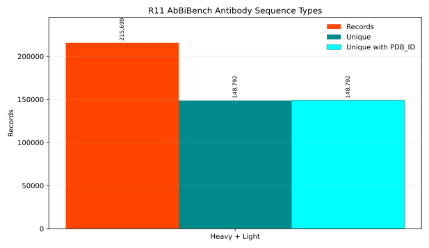
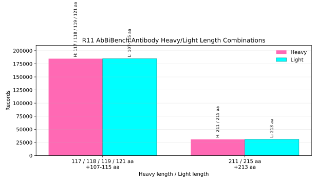
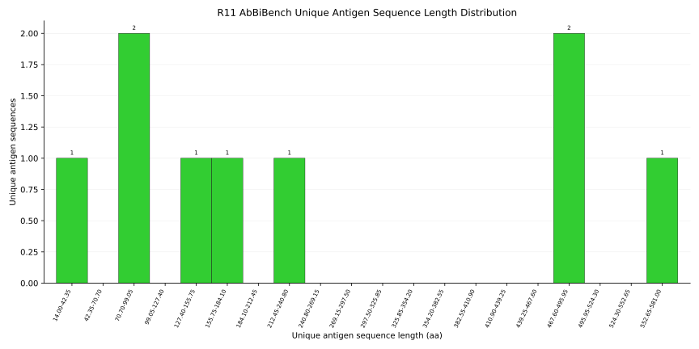

---
tags:
  - context
---

# SRC-11 AbBiBench

> 每条 data 统一建模为 `((ab, ag), label, assay, condition, replicate, source)`.
> 本地快照 `G:\abag-datasets\SRC_R11_ABBIBENCH\snapshot-2026-05-02`, 含 17 张 binding-affinity CSV, 215,699 行.
> `Unique` 为有序二元组 `(heavy_chain_seq, light_chain_seq)` 精确去重, 不拼接、不单链去重.

## Antibody

> 有 Heavy 和 Light 的 `Unique` 字段是 `(heavy, light)` 二元组精确去重. `Unique with PDB_ID` 是按 Unique 后的 sequence 计数.
> Total Unique 计数方式为统一转 string, 如果有 Heavy 和 Light 用 `/` 拼接成 string.

| Key | 含义 | 说明 |
| --- | --- | --- |
| Sequence Type | 抗体序列类型 | 根据原始数据字段、链槽位及已有构建体标签划分的类别. |
| Records | 原始记录数 | 原始数据中的记录数量, 同一序列可能重复出现. |
| Unique | 唯一序列数 | 按对应数据集定义的去重规则统计. |
| Unique with PDB_ID | 关联 PDB 的唯一序列数 | 去重后具有关联 PDB_ID 的序列数量, 不等同于具有可用实验结构监督的序列数量. |
| Description | 类型说明 | 描述分类依据、序列槽位特征及分类限制. |

| Sequence Type | Records | Unique | Unique with PDB_ID | Description |
| --- | --- | --- | --- | --- |
| Heavy + Light | 215,699 | 148,792 | 148,792 | 17 binding-affinity CSV 均含 `heavy_chain_seq` 与 `light_chain_seq`; 原始字段没有标注不能强行分类 IgG / Fab / Fv. |
| Total | 215,699 | 148,792 | 148,792 | |

> `Unique with PDB_ID = 148,792` 是上述二元组去重后的序列级覆盖, 不是独立实验复合物计数. 17 张表没有逐行 `PDB_ID` 列; PDB 关联来自 benchmark 文件 / 参考复合物 provenance, 不证明每个变体都有单独解出的结构.

| Heavy Length | Light Length | Records | Description |
| --- | --- | --- | --- |
| 117 / 118 / 119 / 121 aa | 107 / 108 / 109 / 113 / 115 aa | 184,774 | 短重链序列 + 短轻链序列; 仅按 source-native 长度描述. |
| 211 / 215 aa | 213 aa | 30,925 | 长重链序列 + 213 aa 轻链序列. |

## Antigen

> Antigen 统计以 source-native antigen entity 为核心单位. 优先使用原始 antigen ID/name、construct 和 antigen chain 定义实体; 存在可靠序列时再统计唯一抗原序列.
> 结构、序列和数据库注释压缩到同一张表中, `PDB / UniProt` 采用唯一抗原实体粒度统计 2 × 2 覆盖结果.
> 长度图基于唯一抗原序列, 按该源实际范围平均切分 20 bins.

| Records | Unique ag entity | Unique ag sequence | PDB / UniProt coverage | Antigen Length | Antigen Evidence / Provenance | Description |
| --- | --- | --- | --- | --- | --- | --- |
| 215,699 | 12 | 9 | PDB=1/UniProt=unavailable | 14-581 aa | Direct sequence / Reference PDB | 17 个 benchmark 条目 (metadata.json) 声明 12 个 reference complex; 抗原序列由 complex_structure PDB 的 antigen_chains 重建, 去重后 9 条唯一序列 (14 / 95 / 99 / 129 / 184 / 220 / 493 x2 / 581 aa). PDB 是共享参考复合物, 非逐行实验结构; affinity 表本身无抗原字段. |

## Affinity

> 去重口径: 按 **(heavy 序列, light 序列)** 去重. 每个表格是 `(pdb, antigen_chains)` 体系, 表名即抗原; 同一抗体出现在同体系两个抗原表 (3gbn_h1/h9, 4fqi_h1/h3) 算不同 pair. 无 replicate 字段, 全记 `unknown`. 无 assay 字段, 全记 `unknown`.

| Label | Assay | Condition | Replicate | Record pairs | Unique pairs | Description |
| --- | --- | --- | --- | --- | --- | --- |
| `log_Kd` | `unknown` | `1mlc` | `unknown:1229` | 1,229 | 1,229 | `binding_score` 独立归一化, −4.1~10.2; PDB 1mlc_bae (HEL). |
| `log_Kd` | `unknown` | `1mhp_LC` | `unknown:69` | 69 | 67 | `binding_score` 7.3~10.2; PDB 1mhp_hla. metadata 引 `1mhp_benchmarking_data.csv` 不存在, 实际文件是 `1mhp_LC`. |
| `log_Kd` | `unknown` | `1n8z` | `unknown:419` | 419 | 419 | `binding_score` 5.6~9.3; PDB 1n8z_bac (HER2). |
| `log_Kd` | `unknown` | `2fjg` | `unknown:2223` | 2,223 | 2,223 | `binding_score` −3.0~0.5; PDB 2fjg_hlv (V). |
| `log_Kd` | `unknown` | `3gbn_h1` | `unknown:1887` | 1,887 | 1,887 | `binding_score` 7.0~9.7; PDB 3gbn_hlab, 抗原 A/B. |
| `log_Kd` | `unknown` | `3gbn_h9` | `unknown:1842` | 1,842 | 1,842 | `binding_score` 7.0~10.2; 与 h1 共享 1,812 个 pair, 同 PDB 不同抗原. |
| `log_Kd` | `unknown` | `4d5_her2` | `unknown:2080` | 2,080 | 2,080 | `binding_score` −3.7~5.1; PDB 1n8z_bac, Herceptin HER2 变体库. |
| `log_Kd` | `unknown` | `4fqi_h1` | `unknown:65094` | 65,094 | 65,094 | `binding_score` 7.0~9.8; PDB 4fqi_hlab, 抗原 A/B. |
| `log_Kd` | `unknown` | `4fqi_h3` | `unknown:65535` | 65,535 | 65,535 | `binding_score` 6.0~9.0; 与 h1 共享 65,093 个 pair. |
| `log_Kd` | `unknown` | `5a12_ang2` | `unknown:944` | 944 | 944 | `binding_score` −0.3~0.3; PDB 4zfg_hla (Ang2). |
| `log_Kd` | `unknown` | `5a12_vegf` | `unknown:29981` | 29,981 | 29,981 | `binding_score` −3.5~3.0; PDB 4zff_hld (VEGF). |
| `log_Kd` | `unknown` | `aayl49` | `unknown:4312` | 4,312 | 4,312 | `binding_score` 8.2~11.8; PDB aayl49_bca. |
| `log_Kd` | `unknown` | `aayl49_ML` | `unknown:8953` | 8,953 | 8,953 | `binding_score` 8.5~12.4; 与 aayl49 同 PDB, 不同序列子集. |
| `log_Kd` | `unknown` | `aayl50_LC` | `unknown:11473` | 11,473 | 11,473 | `binding_score` 8.2~13.2; PDB aayl50_bca. |
| `log_Kd` | `unknown` | `aayl51` | `unknown:4320` | 4,320 | 4,320 | `binding_score` 8.2~11.3; PDB aayl51_bca. |
| `log_Kd` | `unknown` | `aayl52_LC` | `unknown:13324` | 13,324 | 13,324 | `binding_score` 8.3~9.7; PDB aayl52_bca. |
| `log_Kd` | `unknown` | `g6_LC` | `unknown:2014` | 2,014 | 2,014 | `binding_score` −3.0~0.4; PDB 2fjg_hlv, G6 抗体. |

> 合计 215,699 行, 17 表全为 `log_Kd` 单 label; 全表 unique pair 215,697 (仅 3gbn_h1∩h9 与 4fqi_h1∩h3 各 2 行重复). metadata.json 引用了 2 个磁盘上不存在的文件 (`1mlc_LC_benchmarking_data.csv`, `1mhp_benchmarking_data.csv`), 表名与实际文件错位, 不影响统计, 已在表内标注.
>
> 各文件 `binding_score` 独立归一化, 跨文件数值不可直接比较 (`2fjg` −3.0~0.5 vs `aayl50` 8.2~13.2).
