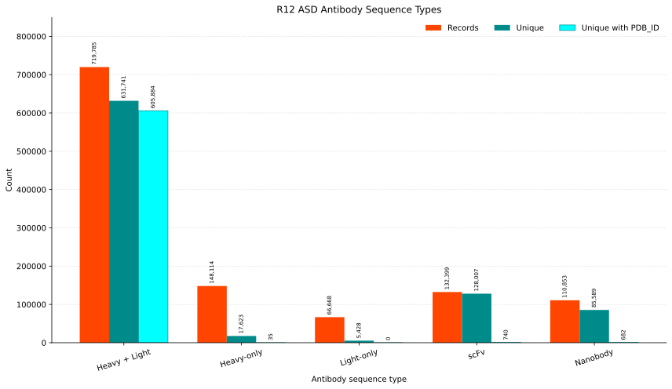
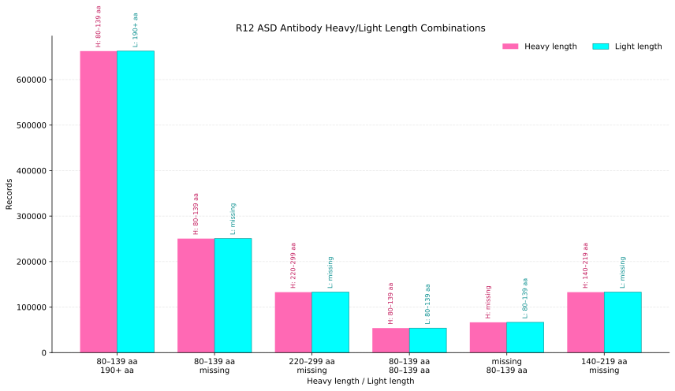
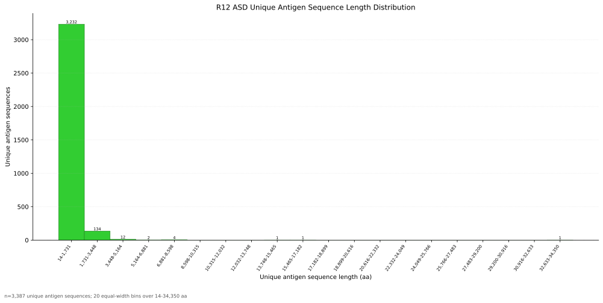

---
tags:
  - context
---

# [SRC-12 ASD / AgAb DB](../2026-10-29-3a-src-readme/src-12-asd-readme.md)

> 每条 data 统一建模为 `((ab, ag), label, assay, condition, replicate, source)`.
> 本地快照 `G:\abag-datasets\SRC_R12_ASD\2.0`, 共 20 个 parquet (delta 表), 1,177,819 条记录.
> `Unique` 均为 `(heavy, light)` 二元组精确去重; 统一转 string 拼接后计数, 无 heavy 或 light 时按各自存在的链去重.

## Antibody

> 有 Heavy 和 Light 的 `Unique` 字段是 `(heavy, light)` 二元组精确去重. `Unique with PDB_ID` 是按 Unique 后的 sequence 计数.
> Total Unique 计数方式为统一转 string, 如果有 Heavy 和 Light 用 `/` 拼接成 string.

| Key | 含义 | 说明 |
| --- | --- | --- |
| Sequence Type | 抗体序列类型 | 根据原始数据字段、链槽位及已有构建体标签划分的类别. |
| Records | 原始记录数 | 原始数据中的记录数量, 同一序列可能重复出现. |
| Unique | 唯一序列数 | 按对应数据集定义的去重规则统计. |
| Unique with PDB_ID | 关联 PDB 的唯一序列数 | 去重后具有关联 PDB_ID 的序列数量, 不等同于具有可用实验结构监督的序列数量. |
| Description | 类型说明 | 描述分类依据、序列槽位特征及分类限制. |

| Sequence Type | Records | Unique | Unique with PDB_ID | Description |
| --- | --- | --- | --- | --- |
| Heavy + Light (具体粒度无明确标注) | 719,785 | 631,741 | 605,884 | 明确非 Nanobody 非 scFv, 原始字段没有标注不能强行分类, 可能是 IgG / Fab / Fv / ... |
| Heavy-only (Heavy 粒度无明确标注) | 148,114 | 17,623 | 35 | 明确非 Nanobody 非 scFv, 原始字段没有标注不能强行分类, 可能是 VH-only / 缺失 Light / ... |
| Light-only (Light 粒度无明确标注) | 66,668 | 5,428 | 0 | 明确非 Nanobody 非 scFv, 原始字段没有标注不能强行分类, 可能是 VL-only / 缺失 Heavy / ... |
| scFv | 132,399 | 128,007 | 740 | 131,645 条 Heavy-only 槽位长度为 220–299 aa, 754 条同时有 Heavy / Light 槽位. |
| Nanobody | 110,853 | 85,589 | 682 | 显式标记为 Nanobody, 作为 VHH 类处理. |
| Total | 1,177,819 | 868,194 | 607,340 | |

| Heavy Length | Light Length | Records | Description |
| --- | --- | --- | --- |
| 80–139 aa | 190 aa 以上 | 662,614 | 最主要的双链形式; 可描述为 VH-like + VL-CL-like. |
| 80–139 aa | 缺失 | 250,575 | VH-only / Heavy-only. |
| 220–299 aa | 缺失 | 132,870 | 可能是含连接区的单链构建体或重链片段; 需结合 scFv / 来源解释. |
| 80–139 aa | 80–139 aa | 53,799 | 两个短链字段均有值; 不能仅凭长度确定 Fv、scFv 或其他构建体. |
| 缺失 | 80–139 aa | 66,526 | Light-only. |
| 140–219 aa | 缺失 | 132,870 | Heavy-only 或异常 / 非标准构建体, 不能直接归类. |

## Antigen

> Antigen 统计以 source-native antigen entity 为核心单位. 优先使用原始 antigen ID/name、construct 和 antigen chain 定义实体; 存在可靠序列时再统计唯一抗原序列.
> 结构、序列和数据库注释压缩到同一张表中, `PDB / UniProt` 采用唯一抗原实体粒度统计 2 × 2 覆盖结果.
> 长度图基于唯一抗原序列, 按该源实际范围平均切分 20 bins.

| Records | Unique ag entity | Unique ag sequence | PDB / UniProt coverage | Antigen Length | Antigen Evidence / Provenance | Description |
| --- | --- | --- | --- | --- | --- | --- |
| 265,508 | 3,387 | 3,387 | unavailable / unavailable | 14-34,350 aa; median 607 aa; 1,102 unique lengths | Direct sequence / source-native sequence | Antigen sequence 每条记录均非空, 序列字符均为标准氨基酸字符. 主要长度簇为 607 aa (193,813 records)、519 aa (48,055 records)、14 aa (6,506 records). Big source 共 19 个来源类别. |

## Affinity

> 去重口径: 按 **(heavy 序列, light 序列, target 链序列)** 三元组去重. 同一抗体对两个抗原=两个 pair; 同源内空链 (nanobody/scfv) 按各自存在的链去重.
>
> 本表 1,177,819 条记录, 全部来自 ASD v2.0 的 20 个 parquet (delta 表). 无 replicate 字段, 全部记 `unknown`. 无 assay 字段, 除 `alphaseq` (NGS 读出) 与 `biomap` (计算 ΔG) 外全部记 `unknown`.

| Label | Assay | Condition | Replicate | Record pairs | Unique pairs | Description |
| --- | --- | --- | --- | --- | --- | --- |
| `log_Kd` | `unknown` | `abbd` | `unknown:152401` | 152,401 | 85,494 | `-log Kd (M)`, 标准化读出; 同条件并含 `log_enrichment` 3,452 行(另一 label). |
| `log_Kd` | `unknown` | `flab_koenig2017` | `unknown:4275` | 4,275 | 4,275 | `-log Kd (M)`, Koenig 2017 深度突变扫描. |
| `log_Kd` | `unknown` | `flab_warszawski2019` | `unknown:2048` | 2,048 | 2,048 | `-log Kd (M)`, Warszawski 2019 D44. |
| `log_Kd` | `unknown` | `flab_hie2023` | `unknown:146` | 146 | 139 | `-log Kd (nM)`, Hie 2023 多靶点. |
| `log_Kd` | `unknown` | `flab_shanehsazzadeh2023` | `unknown:448` | 448 | 422 | `-log Kd (nM)`, Her2 Fab/mAb. |
| `log_Kd` | `unknown` | `flab_rosace2023` | `unknown:19` | 19 | 19 | `-log Kd (nM)`, 阿达木/戈利木. |
| `Kd_M` | `ITC` / `KinExA` | `scmc` | `unknown:754` | 754 | 740 | `Kd (M)`, SCMC. |
| `Kd_M` | `unknown` | `absci` | `unknown:354` | 354 | 354 | `Kd (nM)`, AbSci Her2. |
| `Kd_M` | `unknown` | `aatp` | `unknown:93` | 93 | 92 | `Kd (nM)`, 噬菌体展示. |
| `Kd_M` | `unknown` | `htm` | `unknown:361` | 361 | 361 | `Kd (nM)`, 高通量单克隆. |
| `Kd_M` | `unknown` | `aae` | `unknown:35` | 35 | 35 | `Kd (nM)`. |
| `Kd_M` | `unknown` | `seha` | `unknown:15` | 15 | 15 | `KD (M)`. |
| `Kd_M` | `unknown` | `osh` | `unknown:30` | 30 | 30 | `kd`, 数值型但单位未标. |
| `Kd_M` | `unknown` | `hiv` | — | 0 | 0 | 无 `Kd (nM)` 行, 交叉表占位, 不计入. |
| `enrichment` | `NGS_seq` | `alphaseq` | `unknown:198703` | 198,703 | 193,867 | `binding strength` 连续分, AlphaSeq 选择读出. |
| `enrichment` | `unknown` | `abbd` | `unknown:3452` | 3,452 | 3,452 | `log_enrichment`. |
| `enrichment` | `unknown` | `abdesign` | `unknown:658` | 658 | 658 | `elisa_mut_to_wt_ratio`, 突变/WT 相对比值. |
| `ordinal` | `unknown` | `buzz` | `unknown:524346` | 524,346 | 524,346 | `fuzzy` 量纲, 三档 (`h`/`l`/`m`), 唯一 1:1 的源. |
| `binary` | `unknown` | `patents` | `unknown:190484` | 190,484 | 190,320 | `bool`. |
| `binary` | `unknown` | `hiv` | `unknown:48008` | 48,008 | 23,193 | `bool`, 重链变异多. |
| `binary` | `unknown` | `covid-19` | `unknown:27301` | 27,301 | 26,863 | `bool`. |
| `binary` | `unknown` | `literature` | `unknown:8226` | 8,226 | 8,226 | `bool`. |
| `binary` | `unknown` | `met` | `unknown:4000` | 4,000 | 4,000 | `bool`. |
| `binary` | `unknown` | `genbank` | `unknown:2989` | 2,989 | 2,272 | `bool`. |
| `binary` | `unknown` | `structures-antibodies` | `unknown:2711` | 2,711 | 1,541 | `bool`, 结构库. |
| `binary` | `unknown` | `structures-nanobodies` | `unknown:1258` | 1,258 | 609 | `bool`, 纳米抗体. |
| `binary` | `unknown` | `absci` | `unknown:854` | 854 | 849 | `bool`(与上表 `Kd_M` 并存于同一源). |
| `binary` | `unknown` | `skempiv2` | `unknown:34` | 34 | 34 | `bool`. |
| `binary` | `unknown` | `ab-bind` | `unknown:13` | 13 | 13 | `bool`. |
| `binary` | `unknown` | `abdesign` | `unknown:14` | 14 | 14 | `bool`. |
| `binary` | `unknown` | `rmna` | `unknown:10` | 10 | 10 | `bool`. |
| `ddG` | `computational` | `biomap` | `unknown:2725` | 2,725 | 1,086 | `delta_g` 绝对 ΔG (BM5 计算), 非突变差. |
| `ddG` | `unknown` | `skempiv2` | `unknown:400` | 400 | 367 | `ddg`. |
| `ddG` | `unknown` | `ab-bind` | `unknown:270` | 270 | 268 | `ddg`. |
| `IC50` | `unknown` | `dlgo` | `unknown:360` | 360 | 350 | `ic_50`. |
| `EC50` | `unknown` | `htm` | `unknown:21` | 21 | 21 | `EC50 (nM)`. |
| `?` | `unknown` | `htm` | `unknown:3` | 3 | 3 | `ka (1/Ms)` 结合速率常数, 不在 label 词表内, 先如实单列. |
