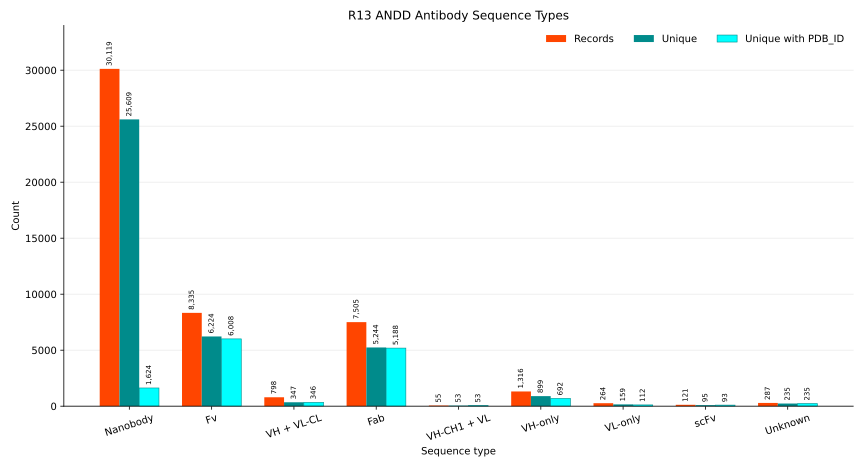
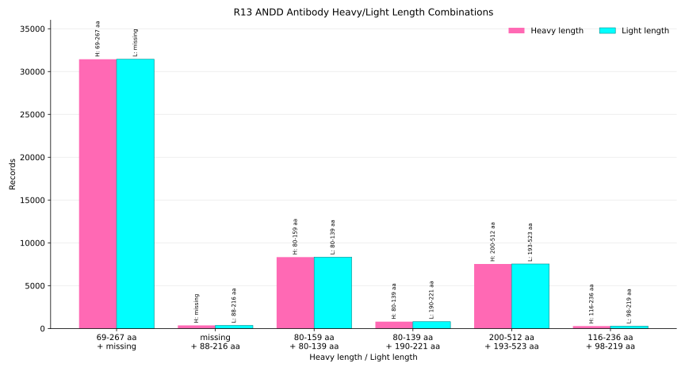
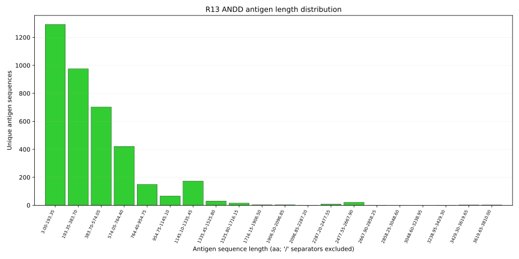

---
- tags:
  - context
---

# SRC-13 ANDD

> 每条 data 统一建模为 `((ab, ag), label, assay, condition, replicate, source)`.
> 本地快照 `G:\abag-datasets\SRC_R13_ANDD\snapshot-2026-01-05`, 单文件 `ANDD_v2.xlsx`, 48,800 行.
> `Unique` 均为 `(heavy, light)` 二元组精确去重; 统一转 string 拼接后计数, 无 heavy 或 light 时按各自存在的链去重.

## Antibody

> 有 Heavy 和 Light 的 `Unique` 字段是 `(heavy, light)` 二元组精确去重. `Unique with PDB_ID` 是按 Unique 后的 sequence 计数.
> Total Unique 计数方式为统一转 string, 如果有 Heavy 和 Light 用 `/` 拼接成 string.

| Key | 含义 | 说明 |
| --- | --- | --- |
| Sequence Type | 抗体序列类型 | 根据原始数据字段、链槽位及已有构建体标签划分的类别. |
| Records | 原始记录数 | 原始数据中的记录数量, 同一序列可能重复出现. |
| Unique | 唯一序列数 | 按对应数据集定义的去重规则统计. |
| Unique with PDB_ID | 关联 PDB 的唯一序列数 | 去重后具有关联 PDB_ID 的序列数量, 不等同于具有可用实验结构监督的序列数量. |
| Description | 类型说明 | 描述分类依据、序列槽位特征及分类限制. |

| Sequence Type | Records | Unique | Unique with PDB_ID | Description |
| --- | --- | --- | --- | --- |
| Nanobody | 30,119 | 25,609 | 1,624 | 显式标记 `Nanobody/VHH`; 按 H 链序列统计, L 链通常为占位符. |
| Fv | 8,335 | 6,224 | 6,008 | `Antibody` 中 H/L 均为短变区序列. |
| VH + VL-CL | 798 | 347 | 346 | H 链为短变区, L 链含较长的 VL-CL 构建体. |
| Fab | 7,505 | 5,244 | 5,188 | H / L 均为含恒定区的较长抗体片段; 记录类型按源表与序列槽位归入 Fab. |
| VH-CH1 + VL | 55 | 53 | 53 | H 链含较长的 VH-CH1 构建体, L 链为短 VL；按源表槽位描述. |
| VH-only | 1,316 | 899 | 692 | `Antibody` 中仅 H 链序列槽位有值, L 链为占位符. |
| VL-only | 264 | 159 | 112 | `Antibody` 中仅 L 链序列槽位有值, H 链为占位符. |
| scFv | 121 | 95 | 93 | `Ab_or_Nano` 显式标记为 `scFv`；使用原始 H/L 序列槽位. |
| Unknown | 287 | 235 | 235 | `Ab_or_Nano` 为 `BJ`, 构建体标签缺失 / `Antibody` 中未落入上述槽位分类的剩余记录. |
| Total | 48,800 | 38,014 | 13,688 | |

| Heavy Length | Light Length | Records | Description |
| --- | --- | --- | --- |
| 69–267 aa | 缺失 | 31,435 | 重链单侧长度分布. |
| 缺失 | 88–216 aa | 360 | 轻链单侧长度分布. |
| 80–159 aa | 80–139 aa | 8,335 | 双短链主簇. |
| 80–139 aa | 190–221 aa | 798 | 重链短、轻链长. |
| 200–512 aa | 193–523 aa | 7,534 | 双长链主簇. |
| 116–236 aa | 98–219 aa | 283 | 其他双链长度组合. |

## Antigen

> Antigen 统计以 source-native antigen entity 为核心单位. 优先使用原始 antigen ID/name、construct 和 antigen chain 定义实体; 存在可靠序列时再统计唯一抗原序列.
> 结构、序列和数据库注释压缩到同一张表中, `PDB / UniProt` 采用唯一抗原实体粒度统计 2 × 2 覆盖结果.
> 长度图基于唯一抗原序列, 按该源实际范围平均切分 20 bins.

| Records | Unique ag entity | Unique ag sequence | PDB / UniProt coverage | Antigen Length | Antigen Evidence / Provenance | Description |
| --- | --- | --- | --- | --- | --- | --- |
| 48,800 | 6,766 | 3,865 | PDB=0/UniProt=0: 195; PDB=0/UniProt=1: 0; PDB=1/UniProt=0: 1,217; PDB=1/UniProt=1: 5,354 | 3-3,810 aa; median 298 aa; 958 unique lengths | Direct sequence / Source-native | Ag_Seq 有值的记录为 12,617 条, 缺失 36,183 条. 唯一序列去重保留原始 / 多链分隔符. 长度图基于 3,865 条唯一抗原序列, 按实际范围划分 20 个等宽区间. |

## Affinity

> 去重口径: 按 **(H 链序列, L 链序列, Ag 序列)** 三元组去重. 48,800 行中唯一 pair 38,014. `unique pairs` 特指抗体–抗原 pair, 不是 H/L 配对.
>
> 单文件 `ANDD_v2.xlsx`, 48,800 行. 亲和力两列 `Affinity_Kd(M)` 与 `∆Gbinding(kJ/mol)`, 正交取值 (Kd-only 6,294 / dG-only 93 / both 907). 无 replicate 字段, 全记 `unknown`. 有无标签与 real/predicted 四态, 见各行. 本表是汇编源: 27 个子来源 (INDI_patent 16,531, SabDab_ab 7,678, sdAB-DB 3,047 ...).

| Label | Assay | Condition | Replicate | Record pairs | Unique pairs | Description |
| --- | --- | --- | --- | --- | --- | --- |
| `Kd_M` | `unknown` | `SabDab_ab` | `unknown:4860` | 4,860 | 3,743 | 真实 Kd (M), 20-25 °C/37 °C 缓冲体系. 来源内还含 2,818 行无亲和力 (schema_harmonisation). |
| `Kd_M` | `unknown` | `SabDab_nano` | `unknown:1097` | 1,097 | 1,097 | 真实 Kd (M), 纳米抗体, 全部有值. |
| `Kd_M` | `unknown` | `PDB-bind_ab` | `unknown:506` | 506 | 506 | 真实 Kd (M), PDB-bind 抗体. |
| `Kd_M` | `unknown` | `de novo (Unlocking)` | `unknown:422` | 422 | 422 | 真实 Kd, Unlocking de novo 生成. |
| `Kd_M` | `unknown` | `AB_Bind` | `unknown:180` | 180 | 180 | 真实 Kd, 同 SRC-14. |
| `Kd_M` | `unknown` | `PDB-bind_nano` | `unknown:101` | 101 | 101 | 真实 Kd (M), 纳米抗体. |
| `Kd_M` | `unknown` | `Virtual_lab` | `unknown:93` | 93 | 93 | 真实 Kd, 虚拟实验室. |
| `Kd_M` | `unknown` | `sdAB-DB` | `unknown:32` | 32 | 32 | 真实 Kd, sdAB-DB 纳米抗体. |
| `Kd_M` | `unknown` | `CD45` | `unknown:3` | 3 | 3 | 真实 Kd, CD45 专利. |
| `Kd_M` | `ELISA` | `mixed (SPR/ELISA/flow/KinExA/酶活)` | `unknown:68` | 68 | 68 | 真实 Kd (M), 68 ELISA + 58 SPR + 35 Yeast flow + 14 KinExA + 5 酶活, 全部同时有 dG. |
| `ddG` | `ELISA` | `mixed (SPR/ELISA/flow/KinExA/酶活)` | `unknown:180` | 180 | 180 | `∆Gbinding(kJ/mol)` 真实值, 与上 Kd 同行 (both 907 中有方法标注的 180). |
| `ddG` | `unknown` | `未标方法` | `unknown:820` | 820 | 813 | `∆Gbinding(kJ/mol)`, 真实, 未标方法 (dG-only 93 + both 中 727). |
| `predicted` | `computational` | `PaddlePaddle` | `unknown:1430` | 1,430 | 1,383 | `Predicted_or_Not=predicted`, ANTIPASTI 预测, Kd (M). |
| `predicted` | `computational` | `SKEMPI2.0_ab` | `unknown:314` | 314 | 314 | 预测 Kd, 同 SRC-15 的 SKEMPI 突变. |
| `predicted` | `computational` | `MpdPPI_ab` | `unknown:311` | 311 | 311 | 预测 Kd, MpdPPI 抗体. |
| `predicted` | `computational` | `DACUM` | `unknown:137` | 137 | 137 | 预测 Kd, DACUM. |
| `predicted` | `computational` | `SKEMPI2.0_nano` | `unknown:75` | 75 | 75 | 预测 Kd, 纳米抗体. |
| `predicted` | `computational` | `MpdPPI_nano` | `unknown:4` | 4 | 4 | 预测 Kd, 纳米抗体. |
| `not_recorded` | `unknown` | `39,235 行无亲和力 (27 源)` | `unknown:39235` | 39,235 | 31,595 | `Predicted_or_Not=\`, 两列均空. 不当作 negative, 是未测/未收录. |

> **四态**: `real` 7,294 (Kd-only 6,294 / dG-only 93 / both 907), `predicted` 2,271 (全来自 PaddlePaddle/SKEMPI2/MpdPPI/DACUM), 无标签 39,235. `Predicted_or_Not` 列 `\` 39,235 与 `real` 7,294 + `predicted` 2,271 严格互斥, 数据自洽.
