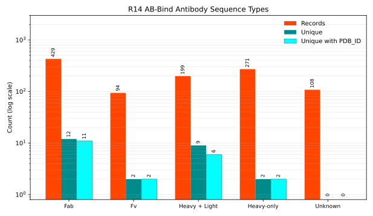
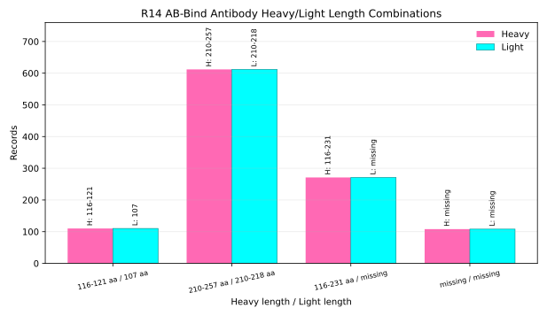

---
- tags:
  - context
---

# SRC-14 AB-Bind

> 每条 data 统一建模为 `((ab, ag), label, assay, condition, replicate, source)`.
> 本地快照 `G:\abag-datasets\SRC_R14_ABBIND\snapshot-2019-04-10`, 单表 `AB-Bind_experimental_data.csv`, 1,101 行、32 个复合物 (含 4 个 `HM_` 同源复合物).
> `Unique` 为 `(heavy, light)` 二元组精确去重; 抗体侧无链时记 `Unknown`.

## Antibody

> 有 Heavy 和 Light 的 `Unique` 字段是 `(heavy, light)` 二元组精确去重. `Unique with PDB_ID` 是按 Unique 后的 sequence 计数.
> Total Unique 计数方式为统一转 string, 如果有 Heavy 和 Light 用 `/` 拼接成 string.

| Key | 含义 | 说明 |
| --- | --- | --- |
| Sequence Type | 抗体序列类型 | 根据原始数据字段、链槽位及已有构建体标签划分的类别. |
| Records | 原始记录数 | 原始数据中的记录数量, 同一序列可能重复出现. |
| Unique | 唯一序列数 | 按对应数据集定义的去重规则统计. |
| Unique with PDB_ID | 关联 PDB 的唯一序列数 | 去重后具有关联 PDB_ID 的序列数量, 不等同于具有可用实验结构监督的序列数量. |
| Description | 类型说明 | 描述分类依据、序列槽位特征及分类限制. |

| Sequence Type | Records | Unique | Unique with PDB_ID | Description |
| --- | --- | --- | --- | --- |
| Fab | 429 | 12 | 11 | 13 个 parent 体系共享 12 个唯一 `(H, L)` 序列对 (3BDY 与 3BE1 同为 bH1 Fab). H 215–257 aa + L 210–218 aa, 双链均含恒定区. 构建体名取自源表 `Protein-1/2` 与 RCSB entity 的 Fab 标注. |
| Fv | 94 | 2 | 2 | 1VFB、1DVF 两个亲本. H 116–121 aa + L 107 aa, 仅可变区. 源 entity 显式写为 `FV`. |
| Heavy + Light | 199 | 9 | 6 | 9 个 parent, 源表标注为 monoclonal antibody / ANTIBODY, 但未给构建体. H 119–231 aa + L 107–218 aa, 不能由槽位判定 Fab 或 Fv. 其中 3 个是 `HM_` 同源模型. |
| Heavy-only | 271 | 2 | 2 | 抗体侧只有 Fc 段: 1T83 的 `IGG1` A/B 链 224 aa、3WJJ 的 `Ig gamma-1 chain C region` 230 aa. 无 Light 槽位. |
| Unknown | 108 | 0 | 0 | 6 个 parent 没有抗体链: 1AK4、1JTG、1KTZ、HM_1KTZ、1FFW 是普通蛋白–蛋白复合物, 3K2M 是 monobody 支架. |
| Total | 1,101 | 25 | 21 | |

| Heavy Length | Light Length | Records | Description |
| --- | --- | --- | --- |
| 116-121 aa | 107 aa | 110 | 单簇 V 区量级双链: 1VFB 116/107, 1DVF 121/107, HM_1YY9 119/107. 三条链均在 190 aa 以下, 不含恒定区. |
| 210-257 aa | 210-218 aa | 612 | 主簇, 占 55.6%: 21 个 parent 的 H 210-231 aa 加 3BN9 的 257 aa, L 全部 210-218 aa. 双链均达 VH-CH1 / VL-CL 量级. |
| 116-231 aa | missing | 271 | Heavy-only. 1T83 的 IGG1 Fc 链 224 aa 与 3WJJ 的 Ig gamma-1 chain C region 230 aa, 无 Light 槽位. |
| missing | missing | 108 | 6 个 parent 无抗体链: 1AK4, 1JTG, 1KTZ, HM_1KTZ, 1FFW 为普通蛋白-蛋白复合物; 3K2M 为 monobody 支架. |

## Antigen

> Antigen 统计以 source-native antigen entity 为核心单位. 优先使用原始 antigen ID/name、construct 和 antigen chain 定义实体; 存在可靠序列时再统计唯一抗原序列.
> 结构、序列和数据库注释压缩到同一张表中, `PDB / UniProt` 采用唯一抗原实体粒度统计 2 × 2 覆盖结果.

| Records | Unique ag entity | Unique ag sequence | PDB / UniProt coverage | Antigen Length | Antigen Evidence / Provenance | Description |
| --- | --- | --- | --- | --- | --- | --- |
| 1,101 | 25 | unavailable | Reference PDB: 25; UniProt=unavailable | unavailable | Reference PDB / Source-native | 32 个亲本体系, 其中 26 个含抗体侧伙伴; 1DVF 两侧皆为 Fv (D1.3 Fv vs E5.2 Fv) 无独立抗原, 故按亲本+伙伴名粒度计 25 个抗原实体 (Integrin-I, Lysozyme, HyHEL-10, HPr, hu-HER2, MT-SP1, VEGF, HER2/ErbB-2, HIV-1 gp120, Bont/A1, Bont/A2, EGFR 等). 6 个 Unknown 亲本无抗体链 (1AK4, 1JTG, 1KTZ, HM_1KTZ, 1FFW, 3K2M). 无逐行抗原序列字段; 亲本 PDB 是共享参考复合物, 非逐行结构. |

> 数据是突变体目录, 逐行只有亲本复合物 PDB 名 (如 1DVF、1N8Z), 无序列列; 抗原连链级定位都没有, 序列从未进表.

## Affinity

> 去重口径: 按 **(PDB, Partners(A_B), Protein-1, Protein-2)** 复合物身份去重, 同复合物下的不同突变行是重复测量. 无 replicate 字段, 全记 `unknown`.
>
> 单表 `AB-Bind_experimental_data.csv`, 1,101 行, 32 个复合物 (含 4 个 `HM_` 同源复合物). 只有 `ddG(kcal/mol)` (−3.37~8.0, 正 775 / 负 281 / 零 45), 无 Kd. `Mutation` 列全表非空, 无 WT 基线行. `Assay Name` 9 个实测方法, 无未知. 结构文件 32 个 PDB + 4 个 `HM_*`.

| Label | Assay | Condition | Replicate | Record pairs | Unique pairs | Description |
| --- | --- | --- | --- | --- | --- | --- |
| `ddG` | `SPR` | `SPR (13 复合物)` | `unknown:335` | 335 | 13 | `ddG(kcal/mol)` 突变差, 335 突变行分布在 13 个复合物. |
| `ddG` | `ITC` / `KinExA` | `KinExA (4 复合物)` | `unknown:88` | 88 | 4 | 突变差, 2NYY/2NZ9 + 同源 `HM_` 各一对. |
| `ddG` | `ELISA` | `ELISA (3 复合物)` | `unknown:117` | 117 | 3 | 突变差, 1FFW/1MHP/3NGB. |
| `ddG` | `ELISA` | `Phage ELISA (3 复合物)` | `unknown:75` | 75 | 3 | 噬菌体 ELISA, 3BDY/3BE1/3K2M. |
| `ddG` | `yeast_display` / `phage_display` | `Yeast Disp. Flow Cyt (3 复合物)` | `unknown:54` | 54 | 3 | 酵母展示流式, 1MLC/1VFB/1YY9. |
| `ddG` | `unknown` | `AlphaScreen (2 复合物)` | `unknown:271` | 271 | 2 | 1T83 (246 突变) + 3WJJ (25). |
| `ddG` | `unknown` | `Enzymatic 1/2 (4 复合物)` | `unknown:118` | 118 | 4 | 酶活 3HFM (48) / 3BN9·3NPS·HM_3BN9 (70). |
| `ddG` | `unknown` | `Other (1 复合物)` | `unknown:43` | 43 | 1 | 2JEL, 43 突变行. |
