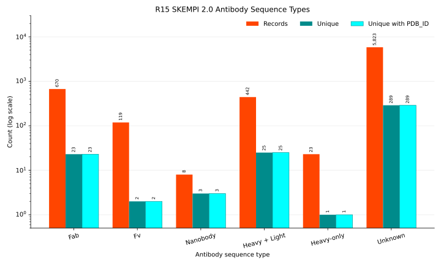
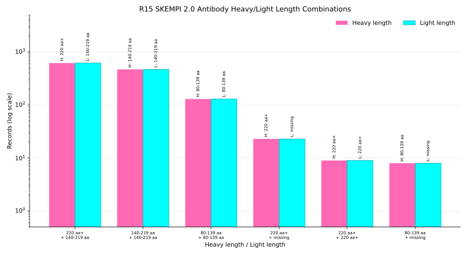

---
tags:
  - context
---

# SRC-15 SKEMPI 2.0

> 每条 data 统一建模为 `((ab, ag), label, assay, condition, replicate, source)`.
> 本地快照 `G:\abag-datasets\SRC_R15_SKEMPI2\2.0`, 单表 `skempi_v2.csv` (分号分隔), 7,085 行、349 个复合物 (345 个 PDB).
> `Unique` 为 `(heavy, light)` 二元组精确去重; 非抗体复合物记 `Unknown`.

## Antibody

> 有 Heavy 和 Light 的 `Unique` 字段是 `(heavy, light)` 二元组精确去重. `Unique with PDB_ID` 是按 Unique 后的 sequence 计数.
> Total Unique 计数方式为统一转 string, 如果有 Heavy 和 Light 用 `/` 拼接成 string.

| Key | 含义 | 说明 |
| --- | --- | --- |
| Sequence Type | 抗体序列类型 | 根据原始数据字段、链槽位及已有构建体标签划分的类别. |
| Records | 原始记录数 | 原始数据中的记录数量, 同一序列可能重复出现. |
| Unique | 唯一序列数 | 按对应数据集定义的去重规则统计. |
| Unique with PDB_ID | 关联 PDB 的唯一序列数 | 去重后具有关联 PDB_ID 的序列数量, 不等同于具有可用实验结构监督的序列数量. |
| Description | 类型说明 | 描述分类依据、序列槽位特征及分类限制. |

| Sequence Type | Records | Unique | Unique with PDB_ID | Description |
| --- | --- | --- | --- | --- |
| Fab | 670 | 23 | 23 | 24 个 accession, entity 标注 FAB. 3BDY 与 3BE1 是同一 bH1 Fab 序列, 故 unique = 23. |
| Fv | 119 | 2 | 2 | 1VFB、1DVF 两个 accession, entity 标注 FV, 只含可变区. |
| Nanobody | 8 | 3 | 3 | 4KRL、4KRO、4KRP 的 VHH 链 (7D12 / EgA1 / 9G8). 4KRO、4KRP 复合物里另有 cetuximab Fab, 本行只计 VHH. |
| Heavy + Light | 442 | 25 | 25 | 26 个 accession 只有 heavy / light chain 文本或 auth 链号, 未标构建体. 2VIR 与 2VIS 序列相同, unique = 25. |
| Heavy-only | 23 | 1 | 1 | 1FC2 的 IGG1 Fc 链, 无 light 槽位. |
| Unknown | 5,823 | 289 | 289 | accession 无抗体链, 是普通蛋白-蛋白复合物 (蛋白酶-抑制剂、HLA-TCR、Ras-Raf 等). |
| Total | 7,085 | 343 | 343 | |

| Heavy Length | Light Length | Records | Description |
| --- | --- | --- | --- |
| 220 aa+ | 140–219 aa | 621 | 主簇: Heavy 为完整重链 (约 450 aa) + Light 为 VL-CL (210–221 aa), 另有 Heavy + Light 288 行. |
| 140–219 aa | 140–219 aa | 471 | 主要为 Fab, 另有 Heavy + Light 142 行. |
| 80–139 aa | 80–139 aa | 130 | 纯可变区双链: Fv 119 行 (107–121 aa + 107–116 aa), Fab 8 行, Heavy + Light 3 行. |
| 220 aa+ | missing | 23 | 1FC2 的 IGG1 Fc 链, 只有 heavy 槽位. |
| 220 aa+ | 220 aa+ | 9 | Heavy 与 Light 均为长序列, 具体构建体未明确. |
| 80–139 aa | missing | 8 | Nanobody, VHH 长度约 120–138 aa. |

## Antigen

> Antigen 统计以 source-native antigen entity 为核心单位. 优先使用原始 antigen ID/name、construct 和 antigen chain 定义实体; 存在可靠序列时再统计唯一抗原序列.
> 结构、序列和数据库注释压缩到同一张表中, `PDB / UniProt` 采用唯一抗原实体粒度统计 2 × 2 覆盖结果.

| Records | Unique ag entity | Unique ag sequence | PDB / UniProt coverage | Antigen Length | Antigen Evidence / Provenance | Description |
| --- | --- | --- | --- | --- | --- | --- |
| 7,085 | 32 | unavailable | Reference PDB: 32; UniProt=unavailable | unavailable | Reference PDB / Source-native | 348 个 accession 中 32 个含抗体侧实体 (与 Antibody 表同一判定); 每 accession 的非抗体侧伙伴即抗原实体 (gp120, HEW Lysozyme, Interleukin-13, EGFR, BoNT/A, gp120+CD4 等, 多链伙伴如 gp120+CD4 计为一个复合物实体). 无逐行抗原序列字段; 亲本 PDB 是共享参考复合物, 非逐行结构. 其余 316 个 accession 为普通蛋白-蛋白复合物 (蛋白酶-抑制剂, HLA-TCR, Ras-Raf 等), 不在本表. |

> 同理 SRC-14, accession→PDB 目录型, 只有突变能量数据; 且多链伙伴 (gp120+CD4) 还需自行拆链, 源内无任何序列来源.

## Affinity

> 去重口径: 按 **(#Pdb, Protein 1, Protein 2)** 复合物身份去重, 同复合物下的突变行是重复测量 (每行一个突变). 无 replicate 字段, 全记 `unknown`.
>
> 单表 `skempi_v2.csv` (分号分隔), 7,085 行, 349 个复合物 (345 个 PDB). 全行有 `Affinity_mut (M)` 与 `Affinity_wt (M)`, 是 Kd 而非 ΔG; 本表为突变数据库, `ddG` 由 WT/mut Kd 派生但源未给数值. `Method` 20 个实测方法, 4 行空. `Temperature` 按行给 (273~338 K, 2,351 行 `298(assumed)`). 抗体相关复合物 942 行 (48 复合物). `Affinity_wt` 含 41 个关系式 (`<1E-11` 24, `<1.4E-10` 17), 截断可区分. `n.b` 228 行.

| Label | Assay | Condition | Replicate | Record pairs | Unique pairs | Description |
| --- | --- | --- | --- | --- | --- | --- |
| `Kd_M` | `SPR` | `SPR (152 复合物)` | `unknown:2655` | 2,655 | 152 | `Affinity_mut (M)` 2e-16~0.0405, SPR. 全表 7,085 行含抗体 942 行 (48 复合物), 表内不单列. |
| `Kd_M` | `unknown` | `FL (30 复合物)` | `unknown:1438` | 1,438 | 30 | 荧光 / 直接读数. |
| `Kd_M` | `ITC` / `KinExA` | `ITC (72 复合物)` | `unknown:557` | 557 | 72 | 等温滴定量热. |
| `Kd_M` | `unknown` | `IASP (53 复合物)` | `unknown:481` | 481 | 53 | 抑制测定, 多为蛋白酶抑制剂. |
| `Kd_M` | `unknown` | `RA / IAFL / IARA (27 复合物)` | `unknown:363/184/132` | 679 | 27 | 放射/酶活类抑制测定. |
| `Kd_M` | `unknown` | `SFFL (17 复合物)` | `unknown:354` | 354 | 17 | 荧光分选. |
| `Kd_M` | `unknown` | `SP (25 复合物)` | `unknown:324` | 324 | 25 | 分光光度. |
| `Kd_M` | `ELISA` | `ELISA (7 复合物)` | `unknown:265` | 265 | 7 | 固相酶联. |
| `Kd_M` | `ITC` / `KinExA` | `KinExA (6 复合物)` | `unknown:129` | 129 | 6 | 动力学排除分析. |
| `Kd_M` | `unknown` | `余 9 方法 (17 复合物)` | `unknown:201` | 201 | 17 | BI 64 / CSPRIA 44 / ELFA 25 / ESMA 22 / SE 14 / SPR,SFFL 10 / SFPF 10 / IAGE 8 / EMSA 6 / 空 4. |
| `not_recorded` | `unknown` | `228 行 n.b` | `unknown:228` | 228 | 63 | `Affinity_mut (M)` 为 `n.b`, 源内无可解析值, 不当作 negative. |
