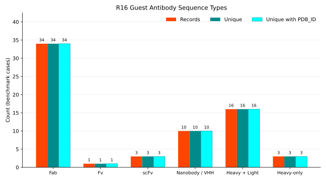
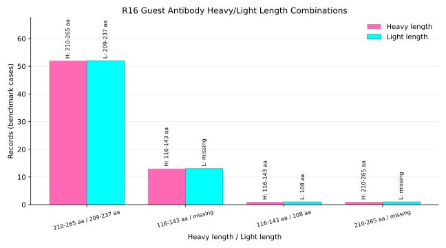
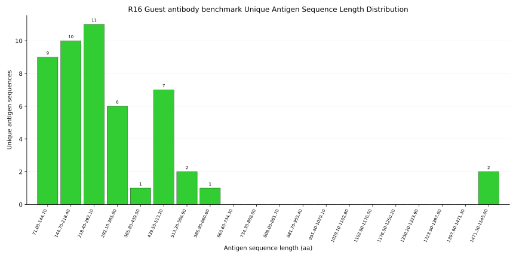

---
tags:
  - context
---

# [SRC-16 Guest antibody benchmark](../2026-10-29-3a-src-readme/src-16-guest-readme.md)

> 每条 data 统一建模为 `((ab, ag), label, assay, condition, replicate, source)`.
> 本地快照 `G:\abag-datasets\SRC_R16_GUEST\snapshot-2020-11-17`, 67 个 docking case、42 条亲和力记录.
> `Unique` 为 `(heavy, light)` 二元组精确去重.

## Antibody

> 有 Heavy 和 Light 的 `Unique` 字段是 `(heavy, light)` 二元组精确去重. `Unique with PDB_ID` 是按 Unique 后的 sequence 计数.
> Total Unique 计数方式为统一转 string, 如果有 Heavy 和 Light 用 `/` 拼接成 string.

| Key | 含义 | 说明 |
| --- | --- | --- |
| Sequence Type | 抗体序列类型 | 根据原始数据字段、链槽位及已有构建体标签划分的类别. |
| Records | 原始记录数 | 原始数据中的记录数量, 同一序列可能重复出现. |
| Unique | 唯一序列数 | 按对应数据集定义的去重规则统计. |
| Unique with PDB_ID | 关联 PDB 的唯一序列数 | 去重后具有关联 PDB_ID 的序列数量, 不等同于具有可用实验结构监督的序列数量. |
| Description | 类型说明 | 描述分类依据、序列槽位特征及分类限制. |

| Sequence Type | Records | Unique | Unique with PDB_ID | Description |
| --- | --- | ---: | ---: | --- |
| Fab | 34 | 34 | 34 | 源表 Antibody 名或 RCSB entity 文本显式写 Fab / FAB fragment. H 210–255 aa + L 209–237 aa, 双链均达 VH-CH1 / VL-CL 量级. |
| Fv | 1 | 1 | 1 | 1VFA Fv D1.3, entity 文本显式写 FV. H 116 aa + L 108 aa, 仅可变区. |
| scFv | 3 | 3 | 3 | 4NKI avelumab scFv、5C2B 3B4 scFv、5I30 PL-2 scFv. 5C2B 存为单条 254 aa 链, 无独立 Light 槽位. |
| Nanobody / VHH | 10 | 10 | 10 | 源表名 Nb14 / Nb4 / Nb.b201 / nb25 / nb130 或 entity 文本显式标记 nanobody / VHH / camelid heavy-chain antibody variable fragment. 单槽位 120–143 aa. |
| Heavy + Light | 16 | 16 | 16 | 双槽位齐全, 源表名只有商品名或抗体编号 (VRC03、adalimumab、m396 等), 未标明构建体类型. H 218–265 aa + L 209–237 aa, 不能仅凭长度判定 Fab 或 IgG. |
| Heavy-only | 3 | 3 | 3 | 5SV4 Single Domain Antibody A3C8、2I24 鲨鱼 IgNAR New Antigen Receptor、6CWK alpaca anti-ricin 单链. 均无明确 Heavy / Light 双槽位, 单条 120–139 aa. |
| Total | 67 | 67 | 67 | |

| Heavy length | Light length | Records | Description |
| --- | --- | ---: | --- |
| 210–265 aa | 209–237 aa | 52 | 主簇: 34 Fab + 16 Heavy + Light + 2 scFv, 双链均含恒定区量级. |
| 116–143 aa | missing | 13 | 单域 Heavy: 10 Nanobody / VHH + 3 Heavy-only, 约 120–143 aa, 无独立 Light 槽位. |
| 116–143 aa | 108 aa | 1 | 1VFB 的 Fv D1.3, VH 116 aa + VL 108 aa. |
| 210–265 aa | missing | 1 | 5C2B 的 3B4 scFv 存为单条 254 aa 链, 无独立 Light 槽位. |

## Antigen

> Antigen 统计以 source-native antigen entity 为核心单位. 优先使用原始 antigen ID/name、construct 和 antigen chain 定义实体; 存在可靠序列时再统计唯一抗原序列.
> 结构、序列和数据库注释压缩到同一张表中, `PDB / UniProt` 采用唯一抗原实体粒度统计 2 × 2 覆盖结果.
> 长度图基于唯一抗原序列, 按该源实际范围平均切分 20 bins.

| Records | Unique ag entity | Unique ag sequence | PDB / UniProt coverage | Antigen Length | Antigen Evidence / Provenance | Description |
| --- | --- | --- | --- | --- | --- | --- |
| 67 | 63 | 49 | PDB=1/UniProt=0: 49; PDB=0/UniProt=0: 14 | 71-1,545 aa; median 263 aa; 40 unique lengths | PDB-derived sequence / Source-native | 67 个 docking case, 每个 case 带 `Antigen PDB` (58 个唯一结构) 与 `Antigen` 名. 按 (Antigen PDB, Antigen) 计 63 个抗原实体, 其中 49 个可从本地 RCSB FASTA 按 `Antigen PDB` 的链 (单链或多链实体, 如 1TNF_ABC = TNF-alpha 三聚体) 重建序列, 序列为派生数据; 14 个实体本地无对应链 fasta (1IK0, 1RUZ, 1TGJ 等, 部分为括号链名). 长度 71-1,545 aa, median 263 aa. 无 UniProt 字段. |

## Affinity

> 去重口径: 按 **Case (复合物 PDB)** 去重, 每 case 一行. 无 replicate 字段, 全记 `unknown`.
>
> `antibody_antigen_affinities.txt` 42 行, 每行一个 case, `Kd (nM)` 与 `ΔG (kcal/mol)` 双值全有 (Kd 0.007~4700 nM, ΔG −15.22~−7.27). 28 个 New-flagged case 带对应的 case 描述表 `antibody_antigen_cases.txt` (68 行, 含抗体名/抗原名/I-RMSD/ΔASA/Category).

| Label | Assay | Condition | Replicate | Record pairs | Unique pairs | Description |
| --- | --- | --- | --- | --- | --- | --- |
| `Kd_M` | `unknown` | `GUEST 42 cases` | `unknown:42` | 42 | 42 | `Kd (nM)` 0.007~4700, 文献实测, 方法未标. |
| `ddG` | `unknown` | `GUEST 42 cases` | `unknown:42` | 42 | 42 | `ΔG (kcal/mol)` 与上 Kd 同 case, 每 case 双 label 并存 (42 行两列全有值). |
