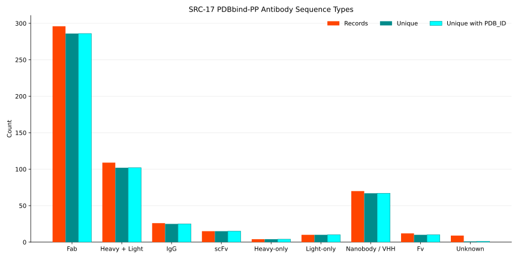
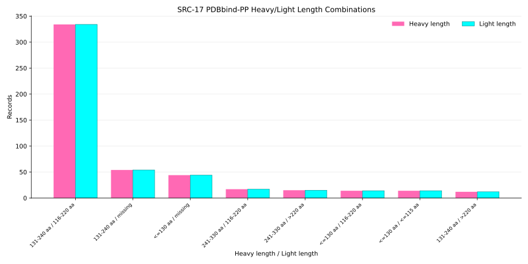
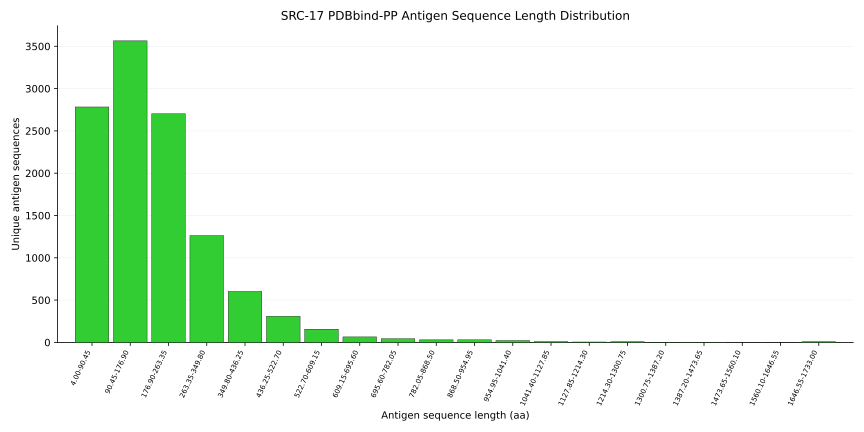

---
tags:
  - context
---

# SRC-17 PDBbind-PP

> 每条 data 统一建模为 `((ab, ag), label, assay, condition, replicate, source)`.
> 本地快照 `G:\abag-datasets\SRC_R17_PDBBIND_PP\2020`, 主表 `PDBbind_v2020/PP/index/INDEX_general_PP.2020` 2,852 条记录 (定宽文本, 非分隔表), 加 2,852 件 `.ent.pdb` 与 2,852 份 RCSB entry FASTA.
> `Unique` 为 `(H 链序列, L 链序列)` 二元组精确去重; 链序列取本地冻结的 RCSB entry FASTA, 链角色由 entity 描述判定.

## Antibody

> 有 Heavy 和 Light 的 `Unique` 字段是 `(heavy, light)` 二元组精确去重. `Unique with PDB_ID` 是按 Unique 后的 sequence 计数.
> Total Unique 计数方式为统一转 string, 如果有 Heavy 和 Light 用 `/` 拼接成 string.

| Key | 含义 | 说明 |
| --- | --- | --- |
| Sequence Type | 抗体序列类型 | 根据原始数据字段、链槽位及已有构建体标签划分的类别. |
| Records | 原始记录数 | 原始数据中的记录数量, 同一序列可能重复出现. |
| Unique | 唯一序列数 | 按对应数据集定义的去重规则统计. |
| Unique with PDB_ID | 关联 PDB 的唯一序列数 | 去重后具有关联 PDB_ID 的序列数量, 不等同于具有可用实验结构监督的序列数量. |
| Description | 类型说明 | 描述分类依据、序列槽位特征及分类限制. |

| Sequence Type | Records | Unique | Unique with PDB_ID | Description |
| --- | --- | --- | --- | --- |
| Fab | 296 | 286 | 286 | entity 描述显式写 `Fab` / `FAB FRAGMENT` / `Antigen binding fragment`. |
| Heavy + Light | 109 | 102 | 102 | entity 只写 `antibody heavy chain` / `antibody light chain` 或单抗名, 未标构建体. |
| Nanobody / VHH | 70 | 67 | 67 | entity 描述显式写 `Nanobody` / `VHH` / `camelid` / `llama`. |
| IgG | 26 | 25 | 25 | entity 描述显式写 `immunoglobulin G` / `IgG` 且无 fragment 字样. |
| scFv | 15 | 15 | 15 | entity 描述显式写 `scFv` / `single-chain Fv`. |
| Fv | 12 | 10 | 10 | entity 描述显式写 `Fv` / `variable fragment`. |
| Light-only | 10 | 10 | 10 | 仅轻链槽位, 无重链. |
| Heavy-only | 4 | 4 | 4 | 仅重链槽位, 无轻链. |
| Unknown | 9 | 1 | 1 | 每个条目只有一条抗体链, 且 entity 未标 heavy / light 槽位 (如 `ANTIBODY CAB-RN05`、`CA1698 camel antibody fragment`), 不能归入 Heavy-only 或 Light-only; 9 条落 6 条唯一序列. |
| Total | 551 | 519 | 519 |  |

> PDBbind v2020 PP 是 protein–protein general set, 不是抗体专库: 2,852 个复合物中只有 551 个含免疫球蛋白链, 其余是无抗体的蛋白–蛋白复合物, 不出现在本节.
>
> 链角色按 RCSB entity 描述判定, 判定顺序为: 先排除 `BINDING PROTEIN` / `FC RECEPTOR` / `HISTOCOMPATIBILITY` / `LIGAND` 等非免疫球蛋白命名 (例: `Immunoglobulin G binding protein A` 是葡萄球菌蛋白 A, 不是抗体), 再要求描述中出现 `ANTIBODY` / `IMMUNOGLOBULIN` / `IGG` / `Fab` / `VHH` 等显式措辞. 仅写 `HEAVY CHAIN` 的实体 (如 MHC 的 `MHC heavy chain`) 不判为抗体.
>
> Sequence Type 只在有显式构建体措辞时有值; 仅写 `antibody heavy chain` / `antibody light chain` 的 105 个条目归 `Heavy + Light`, 不从长度反推 Fab / Fv. `Fab fragment of immunoglobulin G` 这类描述按 Fab 计, 不按 IgG. 9 个只在 entity 描述里写 `VHH` 而不带 `Nanobody` 字样的仍归 `Nanobody / VHH`. `Unique with PDB_ID` 等于 `Unique`: 每条唯一链对都来自一个具名 PDB 条目.

| Heavy Length | Light Length | Records | Description |
| --- | --- | --- | --- |
| 131-240 aa | 116-220 aa | 334 | 主簇: 双链均达 VH-CH1 / VL-CL 量级, 覆盖 Fab 与未标构建体双链的主体. |
| 131-240 aa | missing | 54 | 重链达 Fab 量级但无轻链槽位. |
| <=130 aa | missing | 44 | 单重链 VHH 量级. |
| 241-330 aa | 116-220 aa | 17 | 重链偏长 (CH1-CH2 量级), 轻链常规. |
| 241-330 aa | >220 aa | 15 | 双链都偏长. |
| <=130 aa | 116-220 aa | 14 | 短重链 + 长轻链的不对称组合. |
| <=130 aa | <=115 aa | 14 | 双链均纯可变区量级, 不能仅凭长度定 Fv. |
| 131-240 aa | >220 aa | 12 | 轻链含 CH 量级. |

## Antigen

> Antigen 统计以 source-native antigen entity 为核心单位. 优先使用原始 antigen ID/name、construct 和 antigen chain 定义实体; 存在可靠序列时再统计唯一抗原序列.
> 结构、序列和数据库注释压缩到同一张表中, `PDB / UniProt` 采用唯一抗原实体粒度统计 2 × 2 覆盖结果.
> 长度图基于唯一抗原序列, 按该源实际范围平均切分 20 bins.

> 抗原侧取非免疫球蛋白的 polymer 链, 实体按 `(PDB, chain)` 定义; 序列来自冻结的 RCSB entry FASTA, 属结构派生序列.

| Records | Unique ag entity | Unique ag sequence | PDB / UniProt coverage | Antigen Length | Antigen Evidence / Provenance | Description |
| --- | --- | --- | --- | --- | --- | --- |
| 551 | 1,470 | 499 | PDB=1/UniProt=0: 1,470; PDB=0/UniProt=0: 0 | 4-1,733 aa | PDB-derived sequence / Source-native | 抗体条目共 551 个, 其中 534 个另有非免疫球蛋白链, 合计 1,470 条抗原链, 去重后 499 条唯一序列; 另 17 个抗体条目只有抗体链, 无抗原. 抗原序列从冻结 FASTA 直接取得, 每个实体挂其复合物 PDB, 属 Reference PDB; 非逐行测量构建体. 表内无 UniProt 字段. 其余 2,316 个无抗体条目在本节不计. |

## Affinity

> 去重口径: 按 **(pdb, 抗体链序列, 抗原链序列)** 去重; 每条索引记录对应一个复合物, 2852 条 1:1 唯一. 无 replicate 字段, 全记 `unknown`.
>
> `binding data` 字段只有端点 + 比较符 + 数值 + 单位, 没有实验方法列; assay 一律记 `unknown`. 比较符 `=` 2751 / `~` 65 / `<` 20 / `>` 16: 后三类是删失观测, 不是点估计. `Kd` 2618、`Ki` 171、`IC50` 63 三种端点物理含义不同, 不能只换算单位后直接排序. 表内不含 index 中 PP-only 的抗体–抗原归属, 也不含原始实验曲线.

| Label | Assay | Condition | Replicate | Record pairs | Unique pairs | Description |
| --- | --- | --- | --- | --- | --- | --- |
| `Kd_M` | `unknown` | Kd=nM (确定值) | unknown:1,368 | 1,368 | 1,368 | `binding data` 端点 `Kd` 单位 `nM`, 比较符 `=` (确定值); PDBbind 只保留文献报告的一个端点值, 附自由文本说明. |
| `Kd_M` | `unknown` | Kd=uM (确定值) | unknown:961 | 961 | 961 | `binding data` 端点 `Kd` 单位 `uM`, 比较符 `=` (确定值); PDBbind 只保留文献报告的一个端点值, 附自由文本说明. |
| `Kd_M` | `unknown` | Kd=pM (确定值) | unknown:164 | 164 | 164 | `binding data` 端点 `Kd` 单位 `pM`, 比较符 `=` (确定值); PDBbind 只保留文献报告的一个端点值, 附自由文本说明. |
| `Kd_M` | `unknown` | Ki=nM (确定值) | unknown:110 | 110 | 110 | `binding data` 端点 `Ki` 单位 `nM`, 比较符 `=` (确定值); PDBbind 只保留文献报告的一个端点值, 附自由文本说明. |
| `IC50` | `unknown` | IC50=nM (确定值) | unknown:47 | 47 | 47 | `binding data` 端点 `IC50` 单位 `nM`, 比较符 `=` (确定值); PDBbind 只保留文献报告的一个端点值, 附自由文本说明. |
| `Kd_M` | `unknown` | Kd~uM (近似值) | unknown:35 | 35 | 35 | `binding data` 端点 `Kd` 单位 `uM`, 比较符 `~` (近似值); PDBbind 只保留文献报告的一个端点值, 附自由文本说明. |
| `Kd_M` | `unknown` | Ki=pM (确定值) | unknown:27 | 27 | 27 | `binding data` 端点 `Ki` 单位 `pM`, 比较符 `=` (确定值); PDBbind 只保留文献报告的一个端点值, 附自由文本说明. |
| `Kd_M` | `unknown` | Kd~nM (近似值) | unknown:27 | 27 | 27 | `binding data` 端点 `Kd` 单位 `nM`, 比较符 `~` (近似值); PDBbind 只保留文献报告的一个端点值, 附自由文本说明. |
| `Kd_M` | `unknown` | Ki=uM (确定值) | unknown:24 | 24 | 24 | `binding data` 端点 `Ki` 单位 `uM`, 比较符 `=` (确定值); PDBbind 只保留文献报告的一个端点值, 附自由文本说明. |
| `Kd_M` | `unknown` | Kd=mM (确定值) | unknown:20 | 20 | 20 | `binding data` 端点 `Kd` 单位 `mM`, 比较符 `=` (确定值); PDBbind 只保留文献报告的一个端点值, 附自由文本说明. |
| `Kd_M` | `unknown` | Kd>uM (下界删失) | unknown:15 | 15 | 15 | `binding data` 端点 `Kd` 单位 `uM`, 比较符 `>` (下界删失); PDBbind 只保留文献报告的一个端点值, 附自由文本说明. |
| `IC50` | `unknown` | IC50=uM (确定值) | unknown:13 | 13 | 13 | `binding data` 端点 `IC50` 单位 `uM`, 比较符 `=` (确定值); PDBbind 只保留文献报告的一个端点值, 附自由文本说明. |
| `Kd_M` | `unknown` | Kd=fM (确定值) | unknown:11 | 11 | 11 | `binding data` 端点 `Kd` 单位 `fM`, 比较符 `=` (确定值); PDBbind 只保留文献报告的一个端点值, 附自由文本说明. |
| `Kd_M` | `unknown` | Kd<nM (上界删失) | unknown:9 | 9 | 9 | `binding data` 端点 `Kd` 单位 `nM`, 比较符 `<` (上界删失); PDBbind 只保留文献报告的一个端点值, 附自由文本说明. |
| `Kd_M` | `unknown` | Ki<nM (上界删失) | unknown:5 | 5 | 5 | `binding data` 端点 `Ki` 单位 `nM`, 比较符 `<` (上界删失); PDBbind 只保留文献报告的一个端点值, 附自由文本说明. |
| `Kd_M` | `unknown` | Kd<pM (上界删失) | unknown:4 | 4 | 4 | `binding data` 端点 `Kd` 单位 `pM`, 比较符 `<` (上界删失); PDBbind 只保留文献报告的一个端点值, 附自由文本说明. |
| `Kd_M` | `unknown` | Ki=fM (确定值) | unknown:2 | 2 | 2 | `binding data` 端点 `Ki` 单位 `fM`, 比较符 `=` (确定值); PDBbind 只保留文献报告的一个端点值, 附自由文本说明. |
| `IC50` | `unknown` | IC50=pM (确定值) | unknown:2 | 2 | 2 | `binding data` 端点 `IC50` 单位 `pM`, 比较符 `=` (确定值); PDBbind 只保留文献报告的一个端点值, 附自由文本说明. |
| `Kd_M` | `unknown` | Kd~pM (近似值) | unknown:2 | 2 | 2 | `binding data` 端点 `Kd` 单位 `pM`, 比较符 `~` (近似值); PDBbind 只保留文献报告的一个端点值, 附自由文本说明. |
| `Kd_M` | `unknown` | Ki=mM (确定值) | unknown:2 | 2 | 2 | `binding data` 端点 `Ki` 单位 `mM`, 比较符 `=` (确定值); PDBbind 只保留文献报告的一个端点值, 附自由文本说明. |
| `Kd_M` | `unknown` | Ki<fM (上界删失) | unknown:1 | 1 | 1 | `binding data` 端点 `Ki` 单位 `fM`, 比较符 `<` (上界删失); PDBbind 只保留文献报告的一个端点值, 附自由文本说明. |
| `Kd_M` | `unknown` | Kd<uM (上界删失) | unknown:1 | 1 | 1 | `binding data` 端点 `Kd` 单位 `uM`, 比较符 `<` (上界删失); PDBbind 只保留文献报告的一个端点值, 附自由文本说明. |
| `IC50` | `unknown` | IC50~nM (近似值) | unknown:1 | 1 | 1 | `binding data` 端点 `IC50` 单位 `nM`, 比较符 `~` (近似值); PDBbind 只保留文献报告的一个端点值, 附自由文本说明. |
| `Kd_M` | `unknown` | Kd>pM (下界删失) | unknown:1 | 1 | 1 | `binding data` 端点 `Kd` 单位 `pM`, 比较符 `>` (下界删失); PDBbind 只保留文献报告的一个端点值, 附自由文本说明. |
