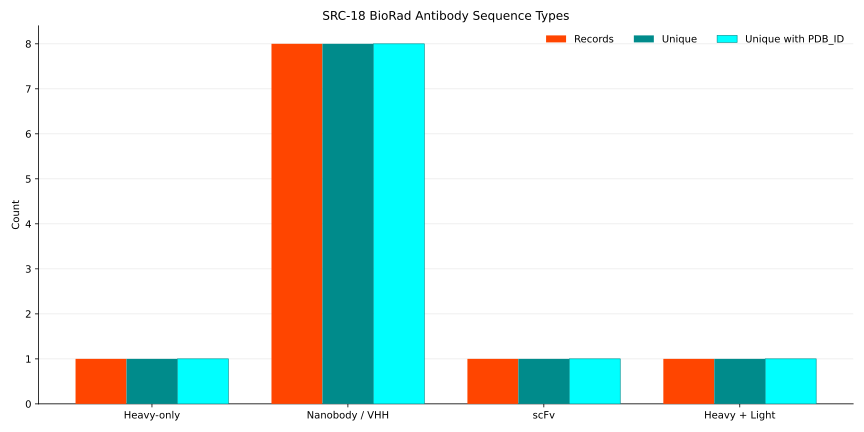
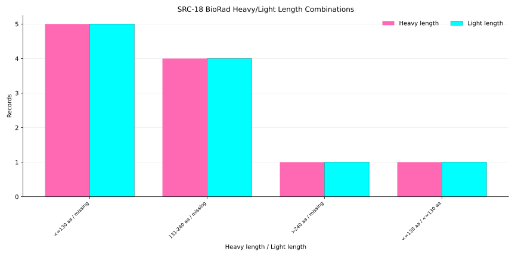
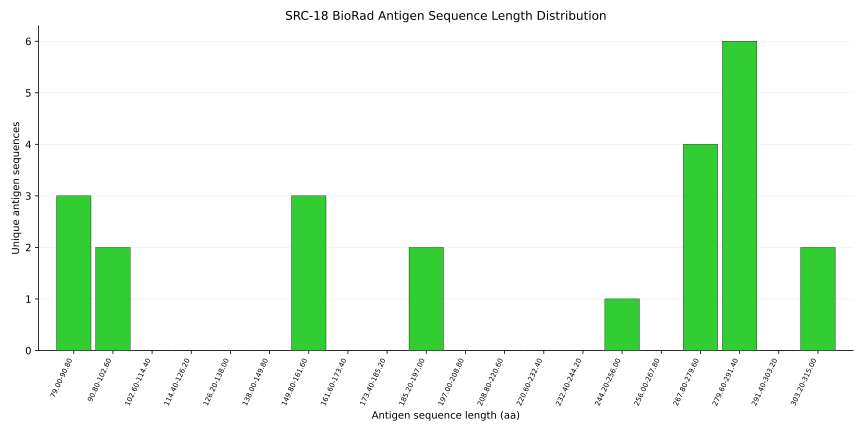

---
tags:
  - context
---

# SRC-18 BioRad

> 每条 data 统一建模为 `((ab, ag), label, assay, condition, replicate, source)`.
> 本地快照 `G:\abag-datasets\SRC_R18_BIORAD\snapshot-2024-12-20`, `BIORAD/data/` 5 张同构 curation CSV: 完整集 262 行 (`curation_pdbbind` / `curation_units` / `curation_different_heterodimers` 三表 ID 集合相同), 另有 238 与 236 行的两个过滤视图; 加 288 份冻结 RCSB entry FASTA.
> `Unique` 为 `(H 链序列, L 链序列)` 二元组精确去重; 链序列取冻结 FASTA, 链角色由 entity 描述判定.

## Antibody

> 有 Heavy 和 Light 的 `Unique` 字段是 `(heavy, light)` 二元组精确去重. `Unique with PDB_ID` 是按 Unique 后的 sequence 计数.
> Total Unique 计数方式为统一转 string, 如果有 Heavy 和 Light 用 `/` 拼接成 string.

| Key | 含义 | 说明 |
| --- | --- | --- |
| Sequence Type | 抗体序列类型 | 根据原始数据字段、链槽位及已有构建体标签划分的类别. |
| Records | 原始记录数 | 原始数据中的记录数量, 同一序列可能重复出现. |
| Unique | 唯一序列数 | 按对应数据集定义的去重规则统计. |
| Unique with PDB_ID | 关联 PDB 的唯一序列数 | 去重后具有关联 PDB_ID 的序列数量, 不等同于具有可用实验结构监督的序列数量. |
| Description | 类型说明 | 描述分类依据、序列槽位特征及分类限制. |

| Sequence Type | Records | Unique | Unique with PDB_ID | Description |
| --- | --- | --- | --- | --- |
| Heavy-only | 1 | 1 | 1 | 只有一条重链槽位的抗体 entity, 无构建体措辞. |
| Nanobody / VHH | 8 | 8 | 8 | entity 描述显式写 `Nanobody` / `VHH` / `camelid` / `sdAb` / `single domain antibody`. |
| scFv | 1 | 1 | 1 | entity 描述显式写 `scFv`. |
| Heavy + Light | 1 | 1 | 1 | entity 给出两条抗体链, 但措辞未区分重链与轻链 (`5N88` 的 `VH59 antibody`). |
| Total | 11 | 11 | 11 |  |

> BIORAD 是蛋白异二聚体数据集, 不是抗体库: 288 个支持 ID 中只有 11 个含免疫球蛋白链. 5 张 curation CSV 的 262 个 ID 全部落在 288 个支持 ID 内, 但其中只有 11 个是抗体条目, 因此本节 Records 为 11 而非 262.
>
> 这 11 个条目全部是单域或单链构建体 (VHH / nanobody / scFv / VH), 没有双链 Fab 或 IgG; 出现 `Heavy + Light` 的行是 entity 给出两条重链副本而非重轻链对, 已按槽位措辞归并. `Unique with PDB_ID` 等于 `Unique`, 每个唯一链对都来自其具名 PDB.

| Heavy Length | Light Length | Records | Description |
| --- | --- | --- | --- |
| <=130 aa | missing | 5 | 单重链单域构建体, 纯 VHH 量级. |
| 131-240 aa | missing | 4 | 单重链, 长度超出纯 VHH 量级 (含 `4W6X` 131 aa 与 `5LHN` 152 aa). |
| >240 aa | missing | 1 | `5JYL` 的 scFv 单链 253 aa, 含 linker. |
| <=130 aa | <=130 aa | 1 | `5N88` 两条 126 aa 链, entity 未区分重轻链. |

## Antigen

> Antigen 统计以 source-native antigen entity 为核心单位. 优先使用原始 antigen ID/name、construct 和 antigen chain 定义实体; 存在可靠序列时再统计唯一抗原序列.
> 结构、序列和数据库注释压缩到同一张表中, `PDB / UniProt` 采用唯一抗原实体粒度统计 2 × 2 覆盖结果.
> 长度图基于唯一抗原序列, 按该源实际范围平均切分 20 bins.

> 抗原侧取每个复合物中的非免疫球蛋白 polymer 链, 实体按 `(PDB, chain)` 定义; 序列来自冻结 FASTA.

| Records | Unique ag entity | Unique ag sequence | PDB / UniProt coverage | Antigen Length | Antigen Evidence / Provenance | Description |
| --- | --- | --- | --- | --- | --- | --- |
| 11 | 23 | 12 | PDB=1/UniProt=0: 23; PDB=0/UniProt=0: 0 | 79-315 aa; median 272 aa | PDB-derived sequence / Source-native | 只统计 11 个抗体条目的抗原侧, 共 23 条抗原链, 12 条唯一序列, 长度 79-315 aa. 抗原序列从冻结 FASTA 直接取得, 每个实体挂其复合物 PDB, 属 Reference PDB. 表内无 UniProt 字段. 其余 277 个无抗体条目不计入本节. |

## Affinity

> 去重口径: 按 **(pdb, 抗体链序列, 抗原链序列)** 去重. 5 张 curation CSV 是同一批 PDB 的不同修订口径, 不是 5 套独立实验; 本表只取 262 行的完整集 (`curation_different_heterodimers`), 另两个视图不重复计入. 无 replicate 字段, 全记 `unknown`.
>
> `affinity_value` 单位 M (2.9e-11-1.87e-3), 全部为 `Kd`; 比较符 `=` 257 / `~` 5, 后者是近似值. `structure_format` 含 `X-RAY=1.10` 这类把分辨率写进字段的形式与 `NMR` 24 条. 源表无 assay 方法字段, 记 `unknown`. 262 个 ID 中只有 11 个含抗体链, 抗体条目的亲和力行数见下表.

| Label | Assay | Condition | Replicate | Record pairs | Unique pairs | Description |
| --- | --- | --- | --- | --- | --- | --- |
| `Kd_M` | `unknown` | 抗体条目 (11 个 PDB) | unknown:10 | 10 | 10 | `affinity_value` M, 比较符 = 10 / ~ 0; 这 11 个条目对应的 Kd 覆盖 6.27e-10-6.8e-06 M. |
| `Kd_M` | `unknown` | 非抗体蛋白异二聚体 (251 个 PDB) | unknown:252 | 252 | 252 | 同表其余 252 条是无免疫球蛋白链的蛋白–蛋白复合物, 与抗体–抗原分析无直接关系, 保留以说明本源的构成比例. |
