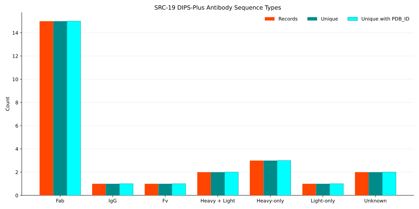
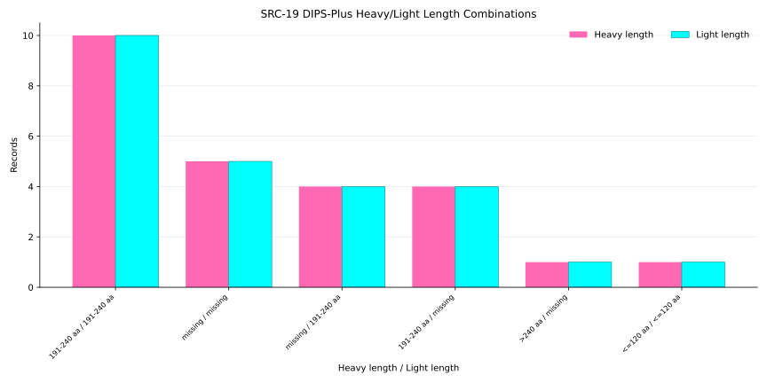
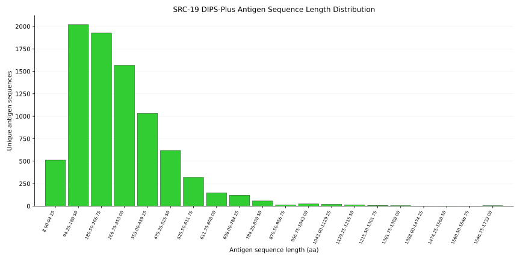

---
- tags:
  - context
---

# SRC-19 DIPS-Plus

> 每条 data 统一建模为 `((ab, ag), label, assay, condition, replicate, source)`.
> 本地快照 `G:\abag-datasets\SRC_R19_DIPS_PLUS\1.1.0`, `DIPS_PLUS/final_raw_dips.tar.gz` 42,112 个最终 Pair 成员 + 4 个列表/统计成员, `DIPS_PLUS/final_raw_db5.tar.gz` 230 个 Pair 成员 + 5 个成员, 加 12,601 份 RCSB entry FASTA.
> `Unique` 为 pair 内抗体链序列的有序元组精确去重; pair 内到底有哪几条链, 由 Pair 记录本身的 `df0` / `df1` 链号决定, 不从 entry 级 FASTA 反推.

## Antibody

> 有 Heavy 和 Light 的 `Unique` 字段是 `(heavy, light)` 二元组精确去重. `Unique with PDB_ID` 是按 Unique 后的 sequence 计数.
> Total Unique 计数方式为统一转 string, 如果有 Heavy 和 Light 用 `/` 拼接成 string.

| Key | 含义 | 说明 |
| --- | --- | --- |
| Sequence Type | 抗体序列类型 | 根据原始数据字段、链槽位及已有构建体标签划分的类别. |
| Records | 原始记录数 | 原始数据中的记录数量, 同一序列可能重复出现. |
| Unique | 唯一序列数 | 按对应数据集定义的去重规则统计. |
| Unique with PDB_ID | 关联 PDB 的唯一序列数 | 去重后具有关联 PDB_ID 的序列数量, 不等同于具有可用实验结构监督的序列数量. |
| Description | 类型说明 | 描述分类依据、序列槽位特征及分类限制. |

| Sequence Type | Records | Unique | Unique with PDB_ID | Description |
| --- | --- | --- | --- | --- |
| Fab | 15 | 15 | 15 | 实体描述显式写 `FAB` / `Fab fragment` / `antibody binding fragment`. |
| IgG | 1 | 1 | 1 | 实体描述写 `IMMUNOGLOBULIN (IGG1, LAMBDA)`, 无 fragment 字样; 是完整免疫球蛋白链而非片段. |
| Fv | 1 | 1 | 1 | 实体描述显式写 `FV`; 是源文标注的 Fv 构建体. |
| Heavy + Light | 2 | 2 | 2 | 实体只写 `antibody ... heavy chain` / `light chain`, 未标构建体; 两侧槽位均由槽位词判定, 不判为 IgG / Fab / Fv. |
| Heavy-only | 3 | 3 | 3 | 该 pair 内只有重链槽位, 无轻链链; 不据此判为 VH-only 构建体. |
| Light-only | 1 | 1 | 1 | 该 pair 内只有轻链槽位, 无重链链. |
| Unknown | 2 | 2 | 2 | 实体只写 `IMMUNOGLOBULIN` / `E8 ANTIBODY`, 无 heavy / light 槽位词也无构建体词, 两条链无法按槽位拆分. |
| Total | 25 | 25 | 25 |  |

> DIPS-Plus 是蛋白质界面结构集, 不是抗体库: 42,342 个 pair 中只有 25 个 (DIPS 1 个, DB5 24 个) 的 pair 内含有免疫球蛋白链, 占 0.06%. 其余 42,317 个 pair 是无抗体的蛋白-蛋白界面, 不出现在本节.
>
> 链角色按冻结的 RCSB entry FASTA 描述判定. 判定要求描述中出现 `IMMUNOGLOBULIN` / `ANTIBODY` / `FAB` / `FV` / `SCFV` / `VHH` / `NANOBODY` 等显式免疫球蛋白措辞, 并先排除只是提到抗体的伙伴命名: `IMMUNOGLOBULIN-LIKE`、`IMMUNOGLOBULIN-BINDING`、`IgG-degrading protease`、`LEUCINE-RICH ... IMMUNOGLOBULIN-LIKE`、`LOW AFFINITY IMMUNOGLOBULIN GAMMA FC REGION RECEPTOR`、`Phage lambda` 系列的 `LAMBDA` 都不算抗体.
>
> Sequence Type 只在有显式构建体措辞时有值 (`FAB` → Fab, `FV` → Fv, `IGG1` → IgG); 只写 `antibody ... heavy chain` 的归 `Heavy + Light`. `Fab fragment of immunoglobulin G` 这类描述按 Fab 计, 不按 IgG. 一个 pair 内可能只出现重链或只出现轻链, 源数据如此, 归 `Heavy-only` / `Light-only`, 不从长度或缺失推断这是 VH-only 构建体.
>
> `Unique with PDB_ID` 等于 `Unique`: 每个唯一链组都来自一个具名 RCSB entry, 且该 entry 的完整 FASTA 与坐标都在本地快照内. 这些 entry 是结构来源, 不是逐抗体的实验复合物; 一个 pair 只给两条链的界面, 不给完整 IgG / Fab 的所有链.
>
> DB5 的 5 个 case id 是上游 README 声明的历史别名 (`9QFW`→`1QFW`、`BAAD`→`3AAD`、`BOYV`→`1OYV`、`BP57`/`CP57`→`3P57`), 序列按映射后的现行 entry 取; pair 记录保留原 case id, 不把现行 `9QFW` 当旧 case.
>
> 表内除链序列外没有构建体注释, 抗体链序列直接取 FASTA 全长 polymer; 不从长度反推 Fab / Fv / IgG.

| Heavy Length | Light Length | Records | Description |
| --- | --- | --- | --- |
| 191-240 aa | 191-240 aa | 10 | Fab 与未标构建体双链的主体, 两侧都达 VH-CH1 / VL-CL 量级. |
| missing | missing | 5 | 实体描述没有 heavy / light 槽位词, 两条链无法按槽位拆分. |
| missing | 191-240 aa | 4 | 只有轻链槽位可判定, 重链链在此 pair 内未出现. |
| 191-240 aa | missing | 4 | 只有重链槽位可判定, 轻链链在此 pair 内未出现. |
| >240 aa | missing | 1 | 单条 epsilon 重链, 无轻链槽位. |
| <=120 aa | <=120 aa | 1 | Fv 量级双链. |

## Antigen

> Antigen 统计以 source-native antigen entity 为核心单位. 优先使用原始 antigen ID/name、construct 和 antigen chain 定义实体; 存在可靠序列时再统计唯一抗原序列.
> 结构、序列和数据库注释压缩到同一张表中, `PDB / UniProt` 采用唯一抗原实体粒度统计 2 × 2 覆盖结果.
> 长度图基于唯一抗原序列, 按该源实际范围平均切分 20 bins.

> 抗原侧取每个 pair 内的非免疫球蛋白链, 实体按 `(PDB, chain)` 定义; 序列来自冻结的 RCSB entry FASTA, 属结构派生序列.

| Records | Unique ag entity | Unique ag sequence | PDB / UniProt coverage | Antigen Length | Antigen Evidence / Provenance | Description |
| --- | --- | --- | --- | --- | --- | --- |
| 42,342 | 42,894 | 11,257 | PDB=1/UniProt=0: 42,894; PDB=0/UniProt=0: 0 | protein 8-1,733 aa; median 257 aa; 778 unique lengths (含核酸时 2-2,922 aa) | PDB-derived sequence / Source-native / Reference PDB | 42,342 个 pair 各是两条链的界面, 抗原侧按 `(PDB, chain)` 计 42,894 个实体, 去重后 11,257 条唯一序列, 其中蛋白链 8,410 条 (长度 8-1,733 aa, median 257 aa). 其中 2,847 条是核酸链 (DNA / RNA, 字符集 ACGTU 或 `5'-...` 头), 源内与蛋白链同列 polymer 序列, 长度分布图只画蛋白链; 最短的几条 (2-6 aa) 都是这类结晶用的寡核苷酸与短肽. 同一 entry 的多个 pair (最多 140 个) 复用同一批链, 因此实体数远大于 entry 数 (11,967 个被 pair 引用的 entry). 每条链都挂其复合物 PDB, 属 Reference PDB; 表内无 UniProt 字段, 不做 accession 映射. |

## Affinity

> DIPS-Plus 没有任何亲和力列. `dataset_statistics.csv` 只统计复合物数、残基数与接触对: DIPS 42,112 个复合物、df0 11,550,354 残基、df1 10,577,383 残基、正接触对 5,677,450、负接触对 3,686,110,067; DB5 230 个复合物、df0 41,905 残基、df1 80,038 残基、正接触对 21,091. 这些是界面几何与采样量, 不是结合强度.
>
> 每个 Pair 成员的字段是 `complex`, `df0`, `df1`, `pos_idx`, `neg_idx`, `srcs`, `id`, `sequences`; atom table 的 24 列是 DSSP 二级结构、RSA、相对深度、原子上限接触数、HSAA 编码与 HMM 特征等结构特征. `pos_idx` / `neg_idx` 是 positive / negative contact 的 DataFrame 行号对, 属于接触标签, 不是 Kd / IC50 / ΔG.
>
> 因此本节只记录配对存在性, `Record pairs` 为 0. 源文件中的插补、预测与接触标签不构成新的亲和力实验.

| Label | Assay | Condition | Replicate | Record pairs | Unique pairs | Description |
| --- | --- | --- | --- | --- | --- | --- |
| `not_recorded` | `unknown` | 全部 pair (42,342) | — | 0 | 0 | 全表没有亲和力列; 42,342 个 pair 各是一次结构界面观测. `pos_idx` / `neg_idx` 是残基接触对的行号索引, 不是亲和力标签. |
