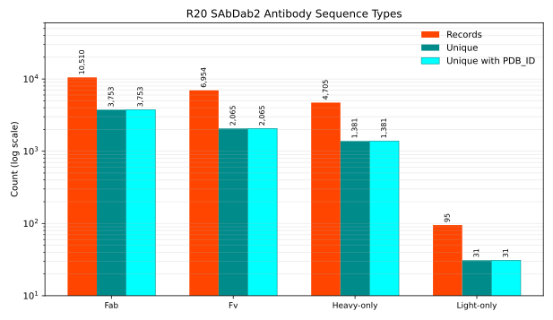
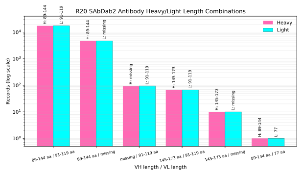
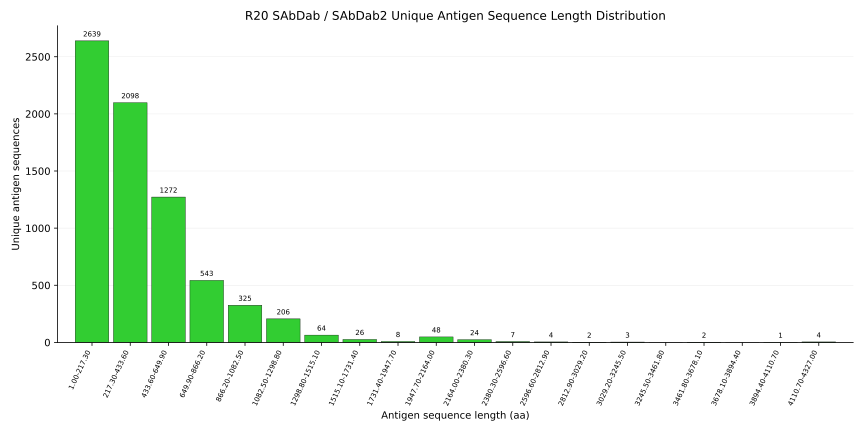

---
tags:
  - context
---

# [SRC-20 SAbDab / SAbDab2](../2026-10-29-3a-src-readme/src-20-sabdab-readme.md)

> 每条 data 统一建模为 `((ab, ag), label, assay, condition, replicate, source)`.
> 本地快照 `G:\abag-datasets\SRC_R20_SABDAB\snapshot-2026-09-11`, `SAbDab2/sabdab2_summary.csv` 22,264 个结构实例, 34,813 个结构文件 (cif.gz + fasta).
> `Unique` 为 `(heavy, light)` 二元组精确去重.

## Antibody

> 有 Heavy 和 Light 的 `Unique` 字段是 `(heavy, light)` 二元组精确去重. `Unique with PDB_ID` 是按 Unique 后的 sequence 计数.
> Total Unique 计数方式为统一转 string, 如果有 Heavy 和 Light 用 `/` 拼接成 string.

| Key | 含义 | 说明 |
| --- | --- | --- |
| Sequence Type | 抗体序列类型 | 根据原始数据字段、链槽位及已有构建体标签划分的类别. |
| Records | 原始记录数 | 原始数据中的记录数量, 同一序列可能重复出现. |
| Unique | 唯一序列数 | 按对应数据集定义的去重规则统计. |
| Unique with PDB_ID | 关联 PDB 的唯一序列数 | 去重后具有关联 PDB_ID 的序列数量, 不等同于具有可用实验结构监督的序列数量. |
| Description | 类型说明 | 描述分类依据、序列槽位特征及分类限制. |

| Sequence Type | Records | Unique | Unique with PDB_ID | Description |
| --- | --- | --- | ---: | --- |
| Fab | 10,510 | 3,753 | 3,753 | 源表显式 `type=FAB` 10,470 条与 `type=FAB+FC` 40 条. `FAB+FC` 额外带 Fc 片段, 构建体仍属 Fab. |
| Fv | 6,954 | 2,065 | 2,065 | 源表显式 `type=FV`. VH/VL 只覆盖可变区, 不含恒定区. |
| Heavy-only | 4,705 | 1,381 | 1,381 | `type=SD-H` 4,614 条与 `type=VNAR` 91 条. 只有 heavy 槽位, 单域构建体, 没有 light 链. |
| Light-only | 95 | 31 | 31 | 源表显式 `type=SD-L`. 只有 light 槽位. |
| Total | 22,264 | 6,897 | 6,897 | |

| Heavy length | Light length | Records | Description |
| --- | --- | --- | --- |
| 89–144 aa | 91–119 aa | 17,396 | 主簇. VH 集中在 112–132 aa, VL 集中在 106–113 aa. |
| 89–144 aa | missing | 4,695 | 单域 heavy 构建体, 对应 SD-H 与 VNAR. |
| missing | 91–119 aa | 95 | 单域 light 构建体, 对应 SD-L. |
| 145–173 aa | 91–119 aa | 67 | 长重链尾簇, 多出约 20–40 aa 的额外结构域片段. |
| 145–173 aa | missing | 10 | 长重链单域构建体. |
| 89–144 aa | 77 aa | 1 | VL 极短离群值, 单条 Fab 实例. |

## Antigen

> Antigen 统计以 source-native antigen entity 为核心单位. 优先使用原始 antigen ID/name、construct 和 antigen chain 定义实体; 存在可靠序列时再统计唯一抗原序列.
> 结构、序列和数据库注释压缩到同一张表中, `PDB / UniProt` 采用唯一抗原实体粒度统计 2 × 2 覆盖结果.
> 长度图基于唯一抗原序列, 按该源实际范围平均切分 20 bins.

| Records | Unique ag entity | Unique ag sequence | PDB / UniProt coverage | Antigen Length | Antigen Evidence / Provenance | Description |
| --- | --- | --- | --- | --- | --- | --- |
| 22,264 | 12,451 | 7,276 | PDB=1/UniProt=0: 12,451; PDB=0/UniProt=0: 0 | 1-4,327 aa; median 316 aa; 1,252 unique lengths | PDB-derived sequence / Source-native | `sabdab2_summary.csv` 逐行带 `antigen_name` (19,913 行有值) 与 `antigen_chain` (结构内链号). 唯一实体按 (antigen_name, antigen_chain) 计 12,451 个; 仅按名称去重 6,286 个 (Spike glycoprotein, Guanine nucleotide-binding protein, Spike protein S1 等). 表内无抗原序列字段; 抗原序列按 (PDB, antigen_chain) 从本地 snapshot CIF (11,604 个结构) 按链重建, 11,024 个实体 (蛋白抗原全覆盖) → 7,276 条唯一序列 (长度 1-4,327 aa, median 316 aa); 1,427 个实体为 NA 链或非蛋白抗原 (配体/离子如 N-(2,6-dimethylphenyl)-5,6-dihydro-4H-1,3-thiazin-2-amine, CHLORIDE, ZINC, ACETATE, DNA/RNA), 无蛋白链可提取. 序列属 PDB-derived, 非逐行独立解出的抗原结构. 无 UniProt 字段. |

## Affinity

> 本 SRC 快照 (snapshot-2026-09-11) 只有结构数据, 无 affinity label. `SAbDab2/sabdab2_summary.csv` 22,264 个结构实例 (XRAY 12,696 / EM 9,520), 53 列全为结构元数据 (PDB, 链序列, 抗原, 方法, 分辨率). 结构文件 34,813 个 (cif.gz + fasta). 无 Kd/IC50/ΔG 列, 不产生 Affinity 行.
>
> 抗体–抗原亲和的实测标注不在 SAbDab 本体, 而在下游汇编 (SRC-13 ANDD 的 SabDab_ab 4,860 / SabDab_nano 1,097, SRC-10 AbRank 的 SabDab 249). 这些已分别在对应 SRC 计入.
