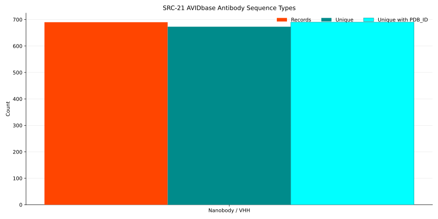
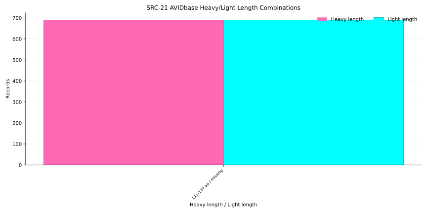
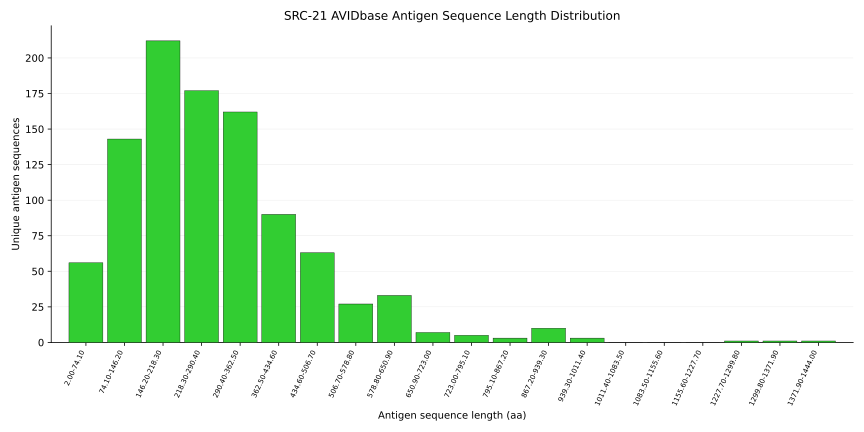

---
tags:
  - context
---

# SRC-21 AVIDbase

> 每条 data 统一建模为 `((ab, ag), label, assay, condition, replicate, source)`.
> 本地快照 `G:\abag-datasets\SRC_R21_AVIDBASE\snapshot-2026-07-29`, `AVIDbase/AVIDbase.xlsx` 4 个 sheet (均 52 列): `AVIDbase-nr` 690 行, `AVIDbase-prot` 591 行, `AVIDbase-low` 99 行, `AVIDbase-r` 1,048 行; 另有 `annotation_input_table_MANUAL.xlsx` 1,909 行人工注释输入.
> `Unique` 为 `vhh_sequence` 精确去重.

## Antibody

> 有 Heavy 和 Light 的 `Unique` 字段是 `(heavy, light)` 二元组精确去重. `Unique with PDB_ID` 是按 Unique 后的 sequence 计数.
> Total Unique 计数方式为统一转 string, 如果有 Heavy 和 Light 用 `/` 拼接成 string.

| Key | 含义 | 说明 |
| --- | --- | --- |
| Sequence Type | 抗体序列类型 | 根据原始数据字段、链槽位及已有构建体标签划分的类别. |
| Records | 原始记录数 | 原始数据中的记录数量, 同一序列可能重复出现. |
| Unique | 唯一序列数 | 按对应数据集定义的去重规则统计. |
| Unique with PDB_ID | 关联 PDB 的唯一序列数 | 去重后具有关联 PDB_ID 的序列数量, 不等同于具有可用实验结构监督的序列数量. |
| Description | 类型说明 | 描述分类依据、序列槽位特征及分类限制. |

| Sequence Type | Records | Unique | Unique with PDB_ID | Description |
| --- | --- | --- | --- | --- |
| Nanobody / VHH | 690 | 673 | 690 | 全部行给 `vhh_sequence` (111-137 aa) 与 IMGT 编号的 `CDR1` / `CDR2` / `CDR3`; 无轻链槽位, 源表无其它构建体. |
| Total | 690 | 673 | 690 |  |

> 四个 sheet 是同一批结构界面的不同视图, 不是四批数据: `AVIDbase-prot` 591 与 `AVIDbase-low` 99 恰好划分 `AVIDbase-nr` 690 行 (protein 抗原 + 低质量界面); `AVIDbase-r` 1,048 行是含冗余副本的原始集, 其 `unique_id` 与 nr 完全不重合, 属另一套编号. 本节以 `AVIDbase-nr` 为计数边界.
>
> 全部 690 行的抗体侧都是 VHH (`vhh_sequence` 111-137 aa, 无轻链槽位). `AVIDbase-r` 的 1,048 行只落 427 条唯一 VHH, 说明该 sheet 大量重复同一界面记录. `Unique with PDB_ID` 按界面计 690: 每个 `unique_id` 都对应一个具名 PDB 条目与 `interface_index`, 同一 PDB 可有多个界面 (`AVIDbase-nr` 690 行来自 643 个 PDB).

| Heavy Length | Light Length | Records | Description |
| --- | --- | --- | --- |
| 111-137 aa | missing | 690 | VHH 单域长度恒定区间, 无缺失; 表中无轻链序列, 记 missing. |

## Antigen

> Antigen 统计以 source-native antigen entity 为核心单位. 优先使用原始 antigen ID/name、construct 和 antigen chain 定义实体; 存在可靠序列时再统计唯一抗原序列.
> 结构、序列和数据库注释压缩到同一张表中, `PDB / UniProt` 采用唯一抗原实体粒度统计 2 × 2 覆盖结果.
> 长度图基于唯一抗原序列, 按该源实际范围平均切分 20 bins.

> 抗原实体按 `(ag_name, ag_auth_chain_id)` 定义; `ag_sequence` 是逗号分隔的链序列, 多链抗原需拆开计数.

| Records | Unique ag entity | Unique ag sequence | PDB / UniProt coverage | Antigen Length | Antigen Evidence / Provenance | Description |
| --- | --- | --- | --- | --- | --- | --- |
| 690 | 413 | 521 | PDB=1/UniProt=0: 17; PDB=1/UniProt=1: 673; PDB=0/UniProt=0: 0 | 2-1,444 aa; median 255 aa | PDB-derived sequence / Source-native | 唯一实体按 `(ag_name, ag_auth_chain_id)` 计 413 个 (仅按 `ag_name` 去重 316 个). `ag_sequence` 逐行给出, 198 行是逗号分隔的多链, 拆开后共 994 条链, 521 条唯一序列; 24 行的部分链含非规范残基 `X` (15 条受影响链, 无整链全 X). `ag_uniprot_accession_code` 覆盖 673 行 / 328 个唯一 accession, 其余 17 行无 UniProt. 每个实体挂在界面所属 PDB 上, 属 Reference PDB; 表内无其它结构级验证. |

## Affinity

> AVIDbase 是结构界面库, **没有任何亲和力列**: 52 列中没有 Kd、ΔG、IC50 或结合标签. 表内只有界面质量分类 (`interface_integrity` high / medium / low)、冗余关系 (`intra_redundancy` / `inter_redundancy`) 与结构几何注释. 因此本节只记录配对存在性, `Record pairs` 为 0.
>
> 去重口径: 按 **(vhh_sequence, ag_sequence)** 去重, 690 行全部 1:1 唯一. 无 replicate 字段, 全记 `unknown`.

| Label | Assay | Condition | Replicate | Record pairs | Unique pairs | Description |
| --- | --- | --- | --- | --- | --- | --- |
| `not_recorded` | `unknown` | AVIDbase-nr (690 界面) | — | 0 | 0 | 全表没有亲和力列; 690 个界面各是一次结构观测, 无 Kd / ΔG / 结合标签. 界面质量 high 569 / medium 48 / low 73 是结构判定, 不是结合强度. |
