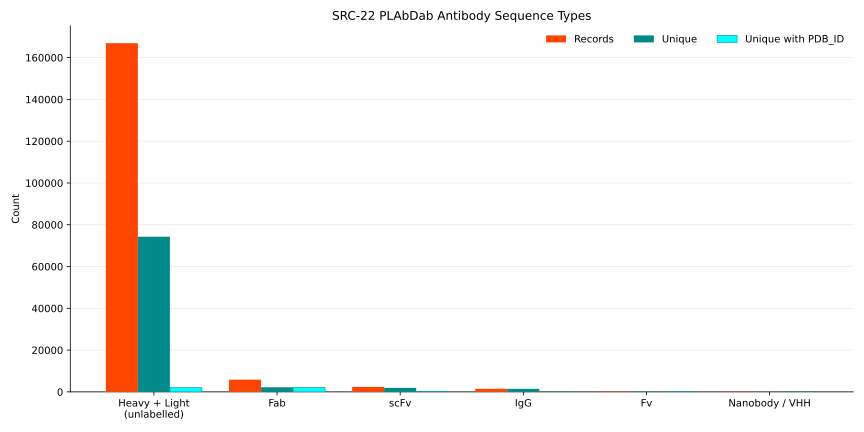
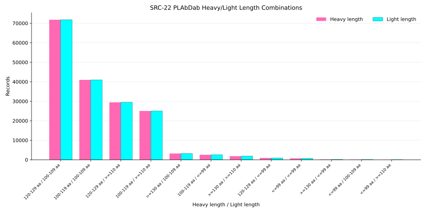
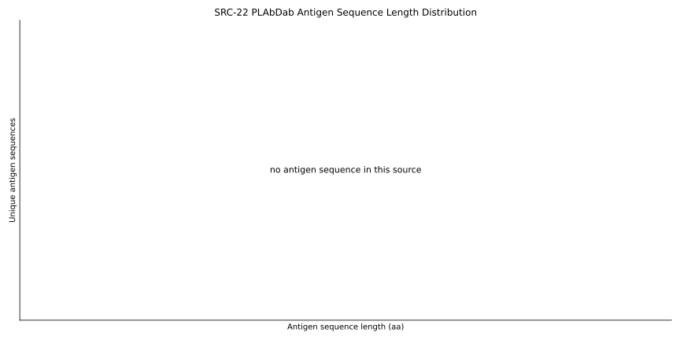

---
tags:
  - context
---

# [SRC-22 PLAbDab](../2026-10-29-3a-src-readme/src-22-plabdab-readme.md)

> 每条 data 统一建模为 `((ab, ag), label, assay, condition, replicate, source)`.
> 本地快照 `G:\abag-datasets\SRC_R22_PLABDAB\snapshot-2024-08-28`, `PLAbDab/paired_sequences.csv.gz` 176,894 行 × 15 列, `unpaired_sequences.csv.gz` 673,959 行 × 17 列, `plabdab_data.tar.gz` 79,125 个成员, 加 6,827 个 RCSB entry 的 FASTA 与完整 mmCIF.
> `Unique` 为 `(heavy_sequence, light_sequence)` 二元组精确去重, 不做同源聚类, 也不跨表相加.

## Antibody

> 有 Heavy 和 Light 的 `Unique` 字段是 `(heavy, light)` 二元组精确去重. `Unique with PDB_ID` 是按 Unique 后的 sequence 计数.
> Total Unique 计数方式为统一转 string, 如果有 Heavy 和 Light 用 `/` 拼接成 string.

| Key | 含义 | 说明 |
| --- | --- | --- |
| Sequence Type | 抗体序列类型 | 根据原始数据字段、链槽位及已有构建体标签划分的类别. |
| Records | 原始记录数 | 原始数据中的记录数量, 同一序列可能重复出现. |
| Unique | 唯一序列数 | 按对应数据集定义的去重规则统计. |
| Unique with PDB_ID | 关联 PDB 的唯一序列数 | 去重后具有关联 PDB_ID 的序列数量, 不等同于具有可用实验结构监督的序列数量. |
| Description | 类型说明 | 描述分类依据、序列槽位特征及分类限制. |

| Sequence Type | Records | Unique | Unique with PDB_ID | Description |
| --- | --- | --- | --- | --- |
| Heavy + Light (unlabelled) | 166,891 | 74,255 | 1,992 | 源表无构建体字段, 只有 heavy / light 两个序列槽位; 不能判定 IgG / Fab / Fv. |
| Fab | 5,859 | 2,209 | 2,103 | `heavy_definition` / `light_definition` 显式含 `Fab` / `F(ab)` / `fragment antigen binding`. |
| scFv | 2,363 | 1,935 | 204 | 定义字段显式含 `scFv` / `single chain`. |
| IgG | 1,484 | 1,433 | 14 | 定义字段含 `immunoglobulin G` / `IgG` 且无 fragment 措辞. |
| Fv | 182 | 99 | 87 | 定义字段显式含 `Fv` / `variable fragment`. |
| Nanobody / VHH | 115 | 45 | 44 | 定义字段显式含 `nanobody` / `VHH` / `single domain`. |
| Total | 176,894 | 78,868 | 4,090 |  |

> paired 表每行给一对重链 / 轻链序列, 是本库的抗体记录单位; unpaired 表 673,959 行是单链 (H 386,323 / L 287,636), `numbered` 串去重 300,033 条, 完整 `GBSeq_sequence` 去重 337,434 条. 两表是同一库的不同入口, 不相加成独立抗体: paired 的重链序列有 59,145 条与 unpaired 的重链序列重合 43,617 条, 轻链重合 33,908 条. 上游论文称 ABodyBuilder2 建模前会用 AbLang 补全部分 N 端缺失, 建模输入可能不同于记录序列, 不能把补全当实验测得的完整构建体.
>
> 构建体只从定义字段措辞判定, 不从长度反推. `Ig heavy chain V region (3H-3H scFv)` 这类描述按 scFv 计而非 IgG; 无构建体措辞的 166,891 行归 `Heavy + Light`, 不判为 IgG / Fab / Fv.
>
> `Unique with PDB_ID` 按 `pairing = Xtal structure` 统计: 12,778 行、6,834 个唯一条目、4,090 个唯一序列对. 这些行的 `ID` 形如 `PDB_authorH_authorL`, 指向真实实验复合物. 其余 pairing 值 (`Patent text` 91,024、`Same entry` 34,983、`Unique source` 22,379、`Ordered entries` 9,062、`Unique chain` 4,218、`Unique word` 1,252、`TheraSAbDab` 1,198) 是文本或 accession 级配对; `plabdab_data.tar.gz` 里 `PDB_H_L` 命名的 .pdb 是 ABodyBuilder2 预测模型, 不是实验坐标.
>
> 序列里保留原样的非标准残基字符 (如 `B`、`Z`、`X`), 26,441 行含这类字符; 不在 raw 层删除或替换, 也不把它们当已确定的标准残基.

| Heavy Length | Light Length | Records | Description |
| --- | --- | --- | --- |
| 120-129 aa | 100-109 aa | 71,819 | 主簇: VH 120-129 aa 配 VL 100-109 aa, 双方都在可变区量级. |
| 100-119 aa | 100-109 aa | 40,965 | 较短重链配常规轻链. |
| 120-129 aa | >=110 aa | 29,451 | 常规重链配偏长轻链, 部分轻链含恒定区片段. |
| 100-119 aa | >=110 aa | 25,033 | 双链均偏短至中等. |
| >=130 aa | 100-109 aa | 3,210 | 重链超过可变区量级, 含 CH1 片段. |
| 100-119 aa | <=99 aa | 2,557 | 轻链被截短. |
| >=130 aa | >=110 aa | 1,865 | 双侧都超可变区量级. |
| 120-129 aa | <=99 aa | 939 | 轻链被截短. |
| <=99 aa | <=99 aa | 721 | 双侧都被截短, 多为片段化输入. |
| >=130 aa | <=99 aa | 175 | 重链含恒定区, 轻链片段化. |
| <=99 aa | 100-109 aa | 113 | 重链片段化. |
| <=99 aa | >=110 aa | 46 | 重链片段化, 轻链偏长. |

## Antigen

> Antigen 统计以 source-native antigen entity 为核心单位. 优先使用原始 antigen ID/name、construct 和 antigen chain 定义实体; 存在可靠序列时再统计唯一抗原序列.
> 结构、序列和数据库注释压缩到同一张表中, `PDB / UniProt` 采用唯一抗原实体粒度统计 2 × 2 覆盖结果.
> 长度图基于唯一抗原序列, 按该源实际范围平均切分 20 bins.

> 抗原实体取源表 `targets_mentioned` 字段: 一行可给出多个同义名, 以 `;` 分隔; 实体按同义名逐个登记.

| Records | Unique ag entity | Unique ag sequence | PDB / UniProt coverage | Antigen Length | Antigen Evidence / Provenance | Description |
| --- | --- | --- | --- | --- | --- | --- |
| 176,894 | 11,218 | unavailable | Reference PDB: 6,834; UniProt=unavailable | unavailable | Source-native / Reference PDB / Fixed target | `targets_mentioned` 有值的 153,565 行给出 2,261,441 个以 `;` 分隔的同义名, 去重后 11,218 个; 只取每行第一个同义名则 2,727 个. 同义名把不同命名习惯并列 (如 `PD1; PDCD1; SLEB2; hSLE1; CD279; PD-1` 是同一个靶点的六个别名), 因此 11,218 是源内同义名数, 不是独立靶点数. 表内没有抗原序列、构建体或抗原链字段, 因此 `Unique ag sequence` 与 `Antigen Length` 记 unavailable; 不从结构链反推被测抗原. 6,834 个 Xtal 条目是参考复合物, 不是逐行实验结构. 表内无 UniProt 字段. |

## Affinity

> PLAbDab 两张表都没有亲和力列: paired 的 15 列是 `ID`、`heavy_sequence`、`light_sequence`、`heavy_ID`、`light_ID`、`heavy_definition`、`light_definition`、`organism`、`reference_authors`、`reference_title`、`update_date`、`cdr_lengths`、`model`、`pairing`、`targets_mentioned`; unpaired 的 17 列是 `chain`、`numbered`、`cdr_lengths` 加 NCBI GenBank 元数据字段. 没有 Kd、IC50、ΔG 或结合 / 不结合判定.
>
> `model` 列是 ABodyBuilder2 的模型名或 `FAILED`, 3,186 行为 `FAILED`, 其余 173,708 行复用 77,302 个非 FAILED 模型名; 它是建模状态, 不是亲和力测量. `targets_mentioned` 只给靶点名, 不给强度.
>
> 因此本节只记录配对存在性, `Record pairs` 为 0. 下游汇编 (SRC-13 ANDD、SRC-10 AbRank) 另给了 PLAbDab 来源的亲和力行, 那些行在各自 SRC 计入, 不回流本表.

| Label | Assay | Condition | Replicate | Record pairs | Unique pairs | Description |
| --- | --- | --- | --- | --- | --- | --- |
| `not_recorded` | `unknown` | paired 表 (176,894 行) | — | 0 | 0 | 全表没有亲和力列; 每行是一次序列配对记录, 无 Kd / ΔG / 结合标签. `model` 是 ABodyBuilder2 建模状态, 不是测量值. |
