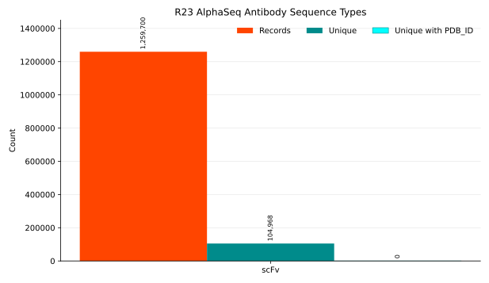
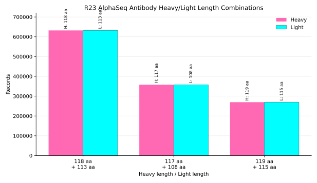
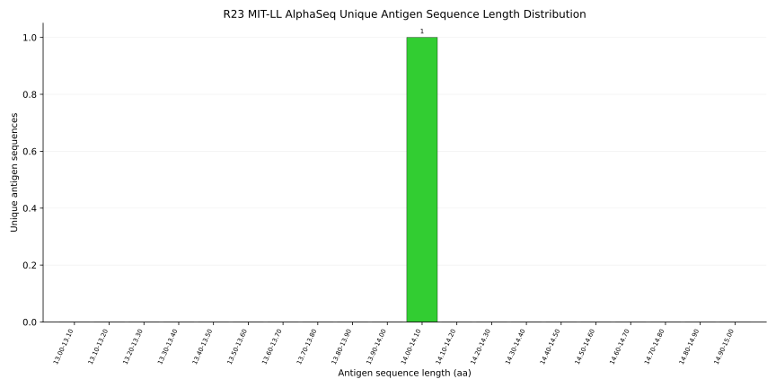

---
- tags:
  - context
---

# SRC-23 MIT-LL AlphaSeq

> 每条 data 统一建模为 `((ab, ag), label, assay, condition, replicate, source)`.
> 本地快照 `G:\abag-datasets\SRC_R23_ALPHASEQ\v1.0.0`, 单表 `MITLL_AAlphaBio_Ab_Binding_dataset.csv`, 1,259,700 行, 14 列.
> `Unique` 为 POI 序列去重, pair 口径为 `(POI, Target)`.

## Antibody

> 有 Heavy 和 Light 的 `Unique` 字段是 `(heavy, light)` 二元组精确去重. `Unique with PDB_ID` 是按 Unique 后的 sequence 计数.
> Total Unique 计数方式为统一转 string, 如果有 Heavy 和 Light 用 `/` 拼接成 string.

| Key | 含义 | 说明 |
| --- | --- | --- |
| Sequence Type | 抗体序列类型 | 根据原始数据字段、链槽位及已有构建体标签划分的类别. |
| Records | 原始记录数 | 原始数据中的记录数量, 同一序列可能重复出现. |
| Unique | 唯一序列数 | 按对应数据集定义的去重规则统计. |
| Unique with PDB_ID | 关联 PDB 的唯一序列数 | 去重后具有关联 PDB_ID 的序列数量, 不等同于具有可用实验结构监督的序列数量. |
| Description | 类型说明 | 描述分类依据、序列槽位特征及分类限制. |

> 逐行没有 antibody PDB_ID. `6LXT` 是目标肽 `PDVDLGDISGINAS` 的参考结构, 不是这些 scFv 的复合物结构.

| Sequence Type | Records | Unique | Unique with PDB_ID | Description |
| --- | --- | --- | --- | --- |
| scFv | 1,259,700 | 104,968 | 0 | 源文档与 README 明确称主表 `Sequence` 为完整 scFv; 每条为 `HC` + 15 aa linker `GGGGSGGGGSGGGGS` + `LC`, 另有六条 CDR 字段. 构建体标签是数据集级属性, 不是逐行字段. |
| Total | 1,259,700 | 104,968 | 0 | |

| Heavy Length | Light Length | Records | Description |
| --- | --- | --- | --- |
| 118 aa | 113 aa | 632,160 | 主簇, 占 50.2%; 完整 `Sequence` 246 aa. |
| 117 aa | 108 aa | 357,840 | 占 28.4%; 完整 `Sequence` 240 aa. |
| 119 aa | 115 aa | 269,700 | 占 21.4%; 完整 `Sequence` 249 aa. |

## Antigen

> Antigen 统计以 source-native antigen entity 为核心单位. 优先使用原始 antigen ID/name、construct 和 antigen chain 定义实体; 存在可靠序列时再统计唯一抗原序列.
> 结构、序列和数据库注释压缩到同一张表中, `PDB / UniProt` 采用唯一抗原实体粒度统计 2 × 2 覆盖结果.
> 长度图基于唯一抗原序列, 按该源实际范围平均切分 20 bins.

| Records | Unique ag entity | Unique ag sequence | PDB / UniProt coverage | Antigen Length | Antigen Evidence / Provenance | Description |
| --- | --- | --- | --- | --- | --- | --- |
| 1,259,700 | 1 | 1 | Reference PDB: 1; UniProt=unavailable | 14 aa | Direct sequence / Fixed target | 全部 1,259,700 行针对单一固定目标肽 `PDVDLGDISGINAS` (SARS-CoV-2 S2 片段, 14 aa), 活动级固定构建体, 无逐行抗原字段. 参考结构 6LXT 是目标肽所在复合物, 非这些 scFv 的逐行结构. 目标序列由 README/源文档给出, 长度 14 aa. |

## Affinity

> 去重口径: 按 **(POI, Target)** 去重; 同一 POI 在 4 个 Target 下的行是不同 PPI. 有 Replicate 1/2/3 字段, 计重复按 POI×Target×Assay.
>
> 单表 `MITLL_AAlphaBio_Ab_Binding_dataset.csv`, 1,259,700 行, 14 列. 104,972 个 POI (Sequence 唯一 104,968). `Pred_affinity` 为 log nM 预测值 (−1.43~7.35, 352,139 行有值, 907,561 行空; 空 ≠ negative). 4 个 Target (MIT_Target + 3 个 AlphaNeg 负对照), 每个 Target 314,925 行. Assay {1, 2}, Replicate {1, 2, 3}, 每 (Target, Assay) 块按 Replicate 平分. 同 SRC-09 li2023 / SRC-79 AlphaBind, 跨源去重按测量身份.

| Label | Assay | Condition | Replicate | Record pairs | Unique pairs | Description |
| --- | --- | --- | --- | --- | --- | --- |
| `predicted` | `NGS_seq` | `MIT_Target assay 1` | `n=1:52681; n=2:52681; n=3:52681` | 70,461 | 52,681 | `Pred_affinity` log nM, 正靶 assay 1; 87,582 行空. |
| `predicted` | `NGS_seq` | `MIT_Target assay 2` | `n=1:52294; n=2:52294; n=3:52294` | 84,171 | 52,294 | 正靶 assay 2; 72,711 行空. |
| `predicted` | `NGS_seq` | `AlphaNeg1 assay 1` | `n=1:52681; n=2:52681; n=3:52681` | 27,149 | 52,681 | 负对照 1; 130,894 行空. |
| `predicted` | `NGS_seq` | `AlphaNeg1 assay 2` | `n=1:52294; n=2:52294; n=3:52294` | 41,166 | 52,294 | 负对照 1; 115,716 行空. |
| `predicted` | `NGS_seq` | `AlphaNeg2 assay 1` | `n=1:52681; n=2:52681; n=3:52681` | 25,472 | 52,681 | 负对照 2. |
| `predicted` | `NGS_seq` | `AlphaNeg2 assay 2` | `n=1:52294; n=2:52294; n=3:52294` | 36,767 | 52,294 | 负对照 2. |
| `predicted` | `NGS_seq` | `AlphaNeg3 assay 1` | `n=1:52681; n=2:52681; n=3:52681` | 27,138 | 52,681 | 负对照 3. |
| `predicted` | `NGS_seq` | `AlphaNeg3 assay 2` | `n=1:52294; n=2:52294; n=3:52294` | 39,815 | 52,294 | 负对照 3. |
| `not_recorded` | `NGS_seq` | `4 Target × 2 Assay (空 Pred_affinity)` | `n=1:314925; n=2:314925; n=3:314925` | 907,561 | 104,972 (无 label 的 POI) | `Pred_affinity` 空行, 有测量记录但无 label, 不当作 negative. |
