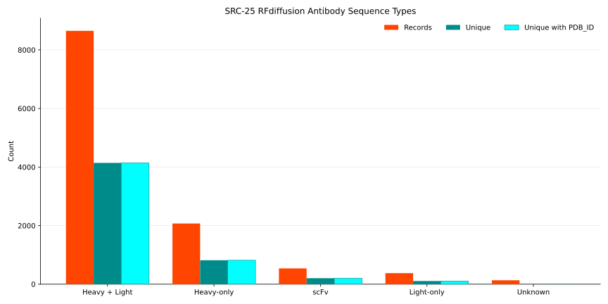
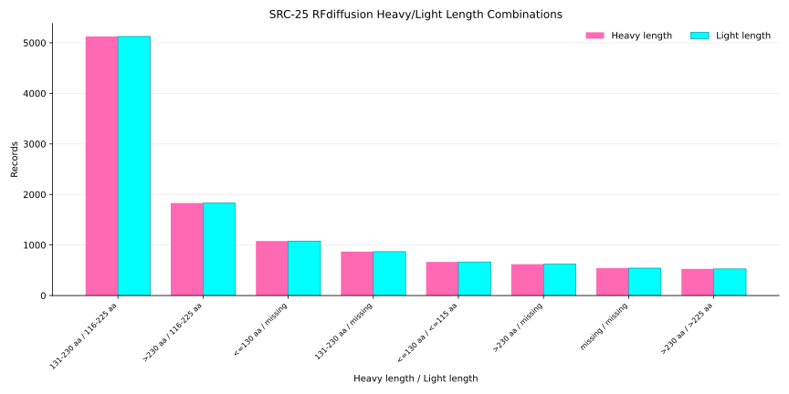
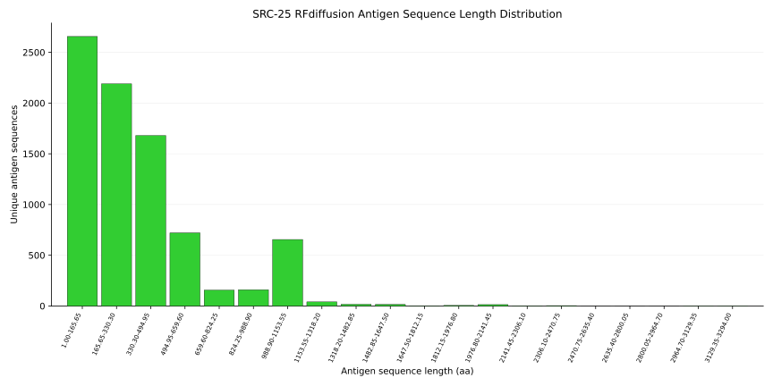

---
- tags:
  - context
---

# SRC-25 RFdiffusion

> 每条 data 统一建模为 `((ab, ag), label, assay, condition, replicate, source)`.
> 本地快照 `G:\abag-datasets\SRC_R25_RFDIFFUSION\snapshot-2025-06-25`, `rfdiffusion/AntibodyTrainingDataset.csv` 11,777 行 × 40 列, 加本地冻结的 6,209 个 RCSB entry FASTA (提供真实链序列).
> `Unique` 为 `(H 链序列, L 链序列)` 二元组精确去重; 序列从 `(pdb, author chain)` 反查冻结 FASTA 得到, 不是表内的 `Hchain` / `Lchain` 文本.

## Antibody

> 有 Heavy 和 Light 的 `Unique` 字段是 `(heavy, light)` 二元组精确去重. `Unique with PDB_ID` 是按 Unique 后的 sequence 计数.
> Total Unique 计数方式为统一转 string, 如果有 Heavy 和 Light 用 `/` 拼接成 string.

| Key | 含义 | 说明 |
| --- | --- | --- |
| Sequence Type | 抗体序列类型 | 根据原始数据字段、链槽位及已有构建体标签划分的类别. |
| Records | 原始记录数 | 原始数据中的记录数量, 同一序列可能重复出现. |
| Unique | 唯一序列数 | 按对应数据集定义的去重规则统计. |
| Unique with PDB_ID | 关联 PDB 的唯一序列数 | 去重后具有关联 PDB_ID 的序列数量, 不等同于具有可用实验结构监督的序列数量. |
| Description | 类型说明 | 描述分类依据、序列槽位特征及分类限制. |

| Sequence Type | Records | Unique | Unique with PDB_ID | Description |
| --- | --- | --- | --- | --- |
| Heavy + Light | 8,652 | 4,142 | 4,142 | H 与 L 两个槽位的 author chain 都解析出序列; 源表无构建体标签, 不能判定 IgG / Fab / Fv. |
| Heavy-only | 2,073 | 818 | 818 | 只有 H 槽位解析出序列; 可能是 VH-only、缺失轻链或纳米抗体, 源表未标, 不进一步判定. |
| scFv | 540 | 205 | 205 | 源表 `scfv=True` 的 540 行, 单链构建体按整条序列存在 `Hchain` 槽位. |
| Light-only | 378 | 108 | 108 | 只有 L 槽位解析出序列; 可能是 VL-only 或缺失重链. |
| Unknown | 134 | 1 | 1 | `Hchain` / `Lchain` 指向的链在冻结 FASTA 中都查不到, 无法取得任何抗体序列. |
| Total | 11,777 | 5,270 | 5,270 |  |

> `Hchain` / `Lchain` 只是 author chain ID, 同一 PDB 的多个 model 与多个配对抗体共用同一 ID 空间; 1,050 行的 ID 在冻结 FASTA 中查不到对应链 (其中 21 行所在 PDB 整个缺失), 因此按序列解析后才落到 5,270 个唯一链对. 直接按列文本去重会得到 376 对, 那是把不同抗体的同名链混为一谈的结果.
>
> Sequence Type 按解析后的序列形状与源表 `scfv` 标志判定: `scfv=True` 的 540 行归 scFv, 其 `Hchain` 槽位存的是整条单链序列. 其余按实际取到的链槽位划分, 不从长度反推 Fab / Fv / IgG. `Unique with PDB_ID` 等于 `Unique`, 因为每个唯一链对都由一个具体 PDB 条目提供, 但该 PDB 同时含抗原与多个 model, 不是逐行独立解出的抗体结构.

| Heavy Length | Light Length | Records | Description |
| --- | --- | --- | --- |
| 131-230 aa | 116-225 aa | 5,125 | 主簇: 双链均达 VH-CH1 / VL-CL 量级. |
| >230 aa | 116-225 aa | 1,830 | 重链含 CH1-CH2-CH3 量级, 轻链常规; 源表未标 IgG. |
| <=130 aa | missing | 1,078 | 短重链单槽位, 多为 VHH / 单域. |
| 131-230 aa | missing | 869 | 重链达 VH-CH1 量级但无轻链槽位. |
| <=130 aa | <=115 aa | 665 | 双链均纯可变区量级, 不能仅凭长度定 Fv. |
| >230 aa | missing | 620 | 长重链单槽位. |
| missing | missing | 542 | 两槽位都未解析出序列. |
| >230 aa | >225 aa | 527 | 双链都超过常规 Fab 量级. |

## Antigen

> Antigen 统计以 source-native antigen entity 为核心单位. 优先使用原始 antigen ID/name、construct 和 antigen chain 定义实体; 存在可靠序列时再统计唯一抗原序列.
> 结构、序列和数据库注释压缩到同一张表中, `PDB / UniProt` 采用唯一抗原实体粒度统计 2 × 2 覆盖结果.
> 长度图基于唯一抗原序列, 按该源实际范围平均切分 20 bins.

> 抗原由源表 `antigen_name` + `antigen_chain` 定义实体, 序列取作者整理的 `target_seq` 列; 抗原类型字段区分 protein / peptide / hapten / carbohydrate / nucleic-acid.

| Records | Unique ag entity | Unique ag sequence | PDB / UniProt coverage | Antigen Length | Antigen Evidence / Provenance | Description |
| --- | --- | --- | --- | --- | --- | --- |
| 11,777 | 4,241 | 4,935 | PDB=1/UniProt=0: 4,241; PDB=0/UniProt=0: 0 | 1-3,294 aa; median 264 aa; 954 unique lengths | Direct sequence / Source-native / Shared upstream source | 唯一实体按 `(antigen_name, antigen_chain)` 计 4,241 个 (仅按名称去重 1,901 个); 唯一抗原序列 4,935 条. 3,463 行没有抗原序列 (`target_seq` 空), 主要是负样本配对与无抗原条目; 有序列的 8,314 行长度 1-3,294 aa. `antigen_type` 覆盖 protein 6,286、peptide 1,054、hapten 390、carbohydrate 193、nucleic-acid 54 及多类型组合 760 行; 抗原类型不可只用 protein 描述. 每个实体挂在复合物 PDB 上, 属 Reference PDB. 表内无 UniProt 字段. 与 SRC-20 SAbDab 同源: 本表是 SAbDab 元数据的再加工. |

## Affinity

> 去重口径: 按 **(cdr_seq, target_seq)** 去重. 无 replicate 字段, 全记 `unknown`.
>
> `affinity` 1,263 行有值 (4e-13-2e-4, 量级为 Kd M), 10,514 行为空; `delta_g` 1,232 行. `affinity_method` 中 SPR 628 / ITC 59 / BLI 35 / Other 81 / Unknown 438, 其余为空. 有值行中 226 行的 `target_seq` 为空, 因此这些行的 `target_seq` 键实际不完整; 有值行合计只落 878 个唯一 `(cdr_seq, target_seq)` 对. `negative_example` 5,857 行是作者构造的负配对标签, 不是实验测得的非结合; 不计入本表.

| Label | Assay | Condition | Replicate | Record pairs | Unique pairs | Description |
| --- | --- | --- | --- | --- | --- | --- |
| `Kd_M` | `SPR` | affinity (`affinity_method=SPR`) | unknown:628 | 628 | 475 | `affinity` M, 有 SPR 方法标注的 628 行; 唯一 `(cdr_seq, target_seq)` 对 475. |
| `Kd_M` | `ITC` / `KinExA` | affinity (`affinity_method=ITC`) | unknown:59 | 59 | 47 | `affinity` M, ITC 标注 59 行. |
| `Kd_M` | `BLI` | affinity (`affinity_method=BLI`) | unknown:35 | 35 | 30 | `affinity` M, BLI 标注 35 行. |
| `Kd_M` | `unknown` | affinity (`affinity_method=Other/Unknown/空`) | unknown:541 | 541 | 328 | 其余 541 行有 `affinity` 值但方法为 Other 81 / Unknown 438 / 空 22; 方法不可信, 记 unknown. |
| `ddG` | `unknown` | delta_g (与 affinity 同行) | unknown:1232 | 1,232 | 857 | `delta_g` 由 Kd 换算的绝对结合自由能, 与 `affinity` 同行并存; 不是与 WT 配对的突变差. |
