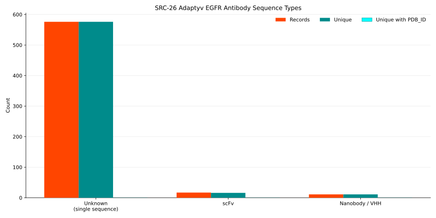
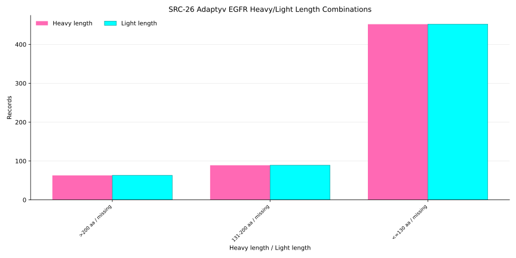
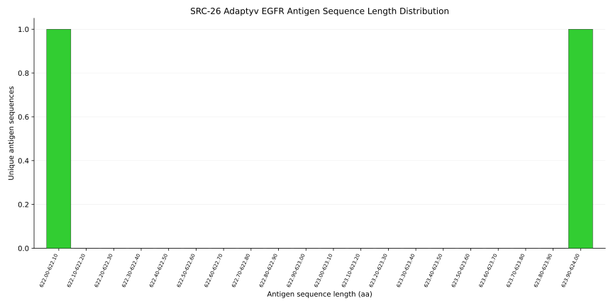

---
tags:
  - context
---

# SRC-26 Adaptyv EGFR

> 每条 data 统一建模为 `((ab, ag), label, assay, condition, replicate, source)`.
> 本地快照 `G:\abag-datasets\SRC_R26_ADAPTYV_EGFR\snapshot-2025-03-18`, 两个固定 GitHub commit 的 `results/` 汇总表 (Round 1 `result_summary.csv` 202 行 / `replicate_summary.csv` 461 行, Round 2 402 / 953 行), 加 2 个 RCSB entry (`1IVO`、`1YY9`).
> `Unique` 为 `sequence` 单字段精确去重; 两轮合并去重, 因为 Round 2 的 `Cetuximab_scFv` 与 Round 1 是同一序列.

## Antibody

> 有 Heavy 和 Light 的 `Unique` 字段是 `(heavy, light)` 二元组精确去重. `Unique with PDB_ID` 是按 Unique 后的 sequence 计数.
> Total Unique 计数方式为统一转 string, 如果有 Heavy 和 Light 用 `/` 拼接成 string.

| Key | 含义 | 说明 |
| --- | --- | --- |
| Sequence Type | 抗体序列类型 | 根据原始数据字段、链槽位及已有构建体标签划分的类别. |
| Records | 原始记录数 | 原始数据中的记录数量, 同一序列可能重复出现. |
| Unique | 唯一序列数 | 按对应数据集定义的去重规则统计. |
| Unique with PDB_ID | 关联 PDB 的唯一序列数 | 去重后具有关联 PDB_ID 的序列数量, 不等同于具有可用实验结构监督的序列数量. |
| Description | 类型说明 | 描述分类依据、序列槽位特征及分类限制. |

| Sequence Type | Records | Unique | Unique with PDB_ID | Description |
| --- | --- | --- | --- | --- |
| Unknown (single sequence) | 576 | 576 | 0 | 提交名不含任何构建体词, 表内只有一条 `sequence`, 无轻链槽位; 不能判为 IgG / Fab / Fv / nanobody. |
| scFv | 17 | 16 | 0 | 提交名含 `scFv` / `single chain`; 是提交者自述的构建体, 不是表内字段. |
| Nanobody / VHH | 11 | 11 | 0 | 提交名含 `vhh` / `nano`; 是提交者自述的构建体, 不是表内字段. |
| Total | 604 | 603 | 0 |  |

> 两轮竞赛针对同一抗原 EGFR, 提交物是一条蛋白序列; README 写明接受"针对 EGFR 的设计 (含抗体及其他结合蛋白)", 没有要求提交物必须是免疫球蛋白. 因此本节只把提交名里带 `scFv` / `single chain` 或 `vhh` / `nano` 的行写成对应构建体 (R1 3 / 5 行, R2 14 / 6 行), 其余 576 行记 `Unknown`: 单序列列、无轻链槽位, 既不能判 IgG / Fab / Fv, 也不能判 nanobody.
>
> `Unique with PDB_ID` 全 0: 表内没有逐提交物的 PDB 字段, 本地 2 个 entry 是 EGFR 受体结构 (`1IVO`) 与 Cetuximab Fab–EGFR 复合物 (`1YY9`), 属参考结构, 不是任何提交物的实验结构. `foldseek_results.tsv` 命中的 PDB 是相似性检索结果, 同样不是该提交物的结构.
>
> 序列长度 13-250 aa, 单链, 无重 / 轻链区分; 长度表只按源内实际长度分档, 不据此推断构建体.

| Heavy Length | Light Length | Records | Description |
| --- | --- | --- | --- |
| >200 aa | missing | 63 | 长单链, 部分为 scFv 串联或含额外结构域. |
| 131-200 aa | missing | 89 | 中等单链. |
| <=130 aa | missing | 452 | 短单链设计, 多为 de novo 或 scFv 量级片段. |

## Antigen

> Antigen 统计以 source-native antigen entity 为核心单位. 优先使用原始 antigen ID/name、construct 和 antigen chain 定义实体; 存在可靠序列时再统计唯一抗原序列.
> 结构、序列和数据库注释压缩到同一张表中, `PDB / UniProt` 采用唯一抗原实体粒度统计 2 × 2 覆盖结果.
> 长度图基于唯一抗原序列, 按该源实际范围平均切分 20 bins.

> 抗原是固定靶点 EGFR, 两条参考 entry 的受体链给出两条抗原序列; 表内没有抗原字段.

| Records | Unique ag entity | Unique ag sequence | PDB / UniProt coverage | Antigen Length | Antigen Evidence / Provenance | Description |
| --- | --- | --- | --- | --- | --- | --- |
| 604 | 1 | 2 | PDB=1/UniProt=0: 1; PDB=0/UniProt=0: 0 | 622-624 aa | Reference PDB / Fixed target | 全部 604 行针对同一个固定抗原 EGFR. 本地 `1IVO` 的受体链 (622 aa × 2) 与 `1YY9` 的受体链 (624 aa) 给出去重后 2 条序列; 两 entry 的差异来自构建体 / 建模细节, 不是两个不同抗原. `1YY9` 另带 Cetuximab Fab 的重链与轻链 (`B`/`C`/`D`), 那是参考抗体, 不是被测抗原. 表内无抗原序列字段与 UniProt 字段, 抗原序列属 PDB-derived, 不是逐行测得的抗原构建体. |

## Affinity

> 去重口径: 按 **(sequence, round)** 去重; 两轮是两次独立的 BLI 活动, 各自的新候选单独计数, 只有 `Cetuximab_scFv` 一序列跨轮重复. `Record pairs` 按 `replicate_summary.csv` 的重复行计, `Unique pairs` 按 `result_summary.csv` 的候选行计.
>
> Round 1 461 个重复行里 18 行有 `kd` (其余为空), Round 2 953 行里 130 行有 `kd`. `replicate` 分布: R1 {1: 202, 2: 201, 3: 54, 4: 4}, R2 {1: 403, 2: 401, 3: 149}.
>
> `kd` 列在两端被删失: 1e-05 是"弱结合 / 无拟合"的上界占位 (R1 7 行、R2 20 行恰好落在 1e-05), 真实拟合值下限约 8.4e-10. 比较符不在单元格里, 只在 `binding` 分类上; 删失行不能当点估计.
>
> `binding` 分类是源内判定, 不是 Kd 换算: R1 `True` 14 / `False` 281 / `weak` 4 / `unknown` 162; R2 `true` 130 / `false` 773 / `unknown` 50. `unknown` 与空 `kd` 是"未测出 / 未完成", 不改写为不结合.
>
> 单位: 官方 README 只明确抗原浓度范围 (R1 316.2-10 nM, R2 1000-10 nM), `result_summary.csv` 与 `replicate_summary.csv` 的 `kd` 列名不带单位; 数值量级符合摩尔浓度, 但表内没有单位字段, 不写成已核验的 M. `kon` / `koff` 同样无单位列.
>
> `nc_adjusted_expression` (仅 R1) 是载荷非特异结合校正后的表达量, 不是结合强度. PAE / pLDDT / ipTM / ESM PLL / similarity_check / FoldSeek 指标都是预测或检索值, 不计入本表.

| Label | Assay | Condition | Replicate | Record pairs | Unique pairs | Description |
| --- | --- | --- | --- | --- | --- | --- |
| `Kd_M` | `BLI` | R1 全部候选 (`kd`) | unknown:461 | 461 | 202 | R1: 461 个重复行中 18 行有 `kd`; 其余为空. 单位未在表内声明, 按官方浓度范围读作 M. |
| `Kd_M` | `BLI` | R2 全部候选 (`kd`) | unknown:953 | 953 | 402 | R2: 953 个重复行中 130 行有 `kd`; 其余为空. 单位未在表内声明, 按官方浓度范围读作 M. |
| `binary` | `BLI` | R1 `binding` | unknown:461 | 461 | 202 | `binding` True 14 / False 281 / weak 4 / unknown 162; 是拟合结果的分类, 与同行 `kd` 并存. |
| `binary` | `BLI` | R2 `binding` | unknown:953 | 953 | 402 | `binding` true 130 / false 773 / unknown 50; `binding_strength` 另分 strong / medium / weak / none. |
