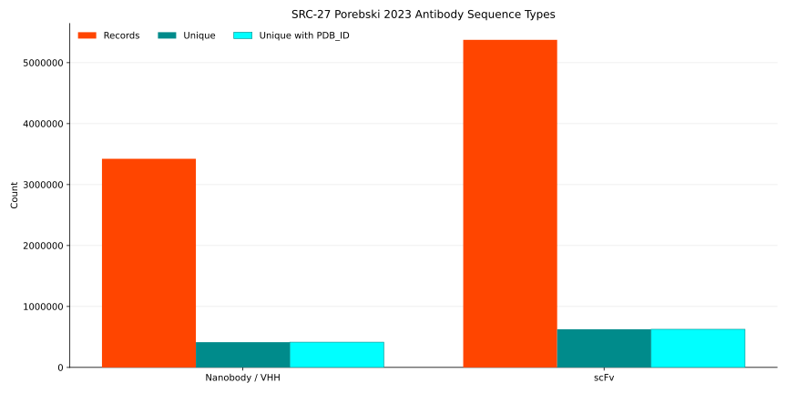
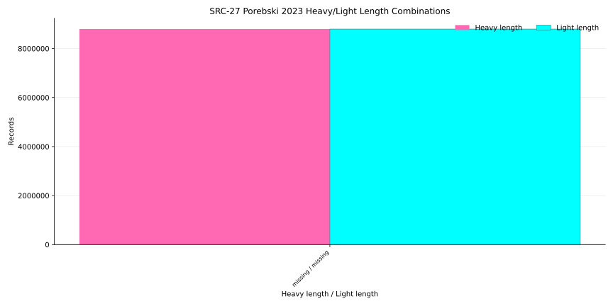
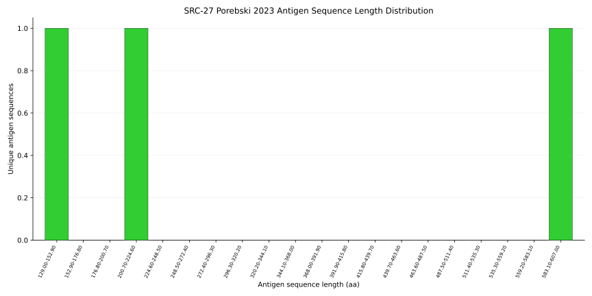

---
tags:
  - context
---

# SRC-27 Porebski 2023

> 每条 data 统一建模为 `((ab, ag), label, assay, condition, replicate, source)`.
> 本地快照 `G:\abag-datasets\SRC_R27_POREBSKI\snapshot-2023-11-14`, `porebski_et_al_2023_datasets/` 5 张 paired CSV: HEL 2 张 (FACS / MACS)、IL7 1 张、HER2 2 张 (affmat / ml_lib), 共 8,796,184 行.
> `Unique` 为按每表 `read 1..N` 三元组 (或二元组) 拼接后精确去重; `read` 字段是翻译后的 CDR 片段, 不是完整链.

## Antibody

> 有 Heavy 和 Light 的 `Unique` 字段是 `(heavy, light)` 二元组精确去重. `Unique with PDB_ID` 是按 Unique 后的 sequence 计数.
> Total Unique 计数方式为统一转 string, 如果有 Heavy 和 Light 用 `/` 拼接成 string.

| Key | 含义 | 说明 |
| --- | --- | --- |
| Sequence Type | 抗体序列类型 | 根据原始数据字段、链槽位及已有构建体标签划分的类别. |
| Records | 原始记录数 | 原始数据中的记录数量, 同一序列可能重复出现. |
| Unique | 唯一序列数 | 按对应数据集定义的去重规则统计. |
| Unique with PDB_ID | 关联 PDB 的唯一序列数 | 去重后具有关联 PDB_ID 的序列数量, 不等同于具有可用实验结构监督的序列数量. |
| Description | 类型说明 | 描述分类依据、序列槽位特征及分类限制. |

| Sequence Type | Records | Unique | Unique with PDB_ID | Description |
| --- | --- | --- | --- | --- |
| Nanobody / VHH | 3,422,464 | 413,736 | 0 | `1.HEL_Nb/` 两张表, 每行三条 9 / 14 / 19 aa 的 `read 1/2/3` 片段 (CDR-H1/H2/H3 量级的局部翻译), 无轻链; 构建体由目录名 `HEL_Nb` 显式给出. |
| scFv | 5,373,720 | 625,263 | 0 | `2.IL7_scFv/` 两段 15 aa read 与 `3.HER2_scFv/` 单段 21 aa read; 构建体由目录名显式给出, 序列本身只是 CDR 片段. |
| Total | 8,796,184 | 1,038,999 | 0 |  |

> 5 张表是 3 个靶点 × 不同分选策略的文库读出, 不是 5 批独立抗体: HEL 的 FACS 与 MACS 两表共享同一 VHH 文库 (读段组合并集 413,736, 交集 5,554), HER2 的 affmat 与 ml_lib 两表共享同一 scFv 文库 (并集 436,124, 交集 100). 逐表条带化的 barcode 几乎全唯一 (8,796,184 行 / 8,796,109 个唯一 barcode), 说明同一抗体在表内被多条 read 组合区分.
>
> `read` 字段长度固定但都很短: HEL 为 9 / 14 / 19 aa 三段, IL7 为 15 / 15 aa 两段, HER2 为 21 aa 一段. 这些是 CDR 片段而非完整可变区, 因此不能按长度判构建体. 构建体来自上游目录名与表名 (`1.HEL_Nb` = nanobody, `2.IL7_scFv` / `3.HER2_scFv` = scFv), 属源方显式命名. `Unique with PDB_ID` 为 0: 抗体侧无 PDB 字段.

| Heavy Length | Light Length | Records | Description |
| --- | --- | --- | --- |
| missing | missing | 8,796,184 | 5 张表都没有重链或轻链序列, 只有 9-21 aa 的 CDR 翻译片段; 两侧记 missing. |

## Antigen

> Antigen 统计以 source-native antigen entity 为核心单位. 优先使用原始 antigen ID/name、construct 和 antigen chain 定义实体; 存在可靠序列时再统计唯一抗原序列.
> 结构、序列和数据库注释压缩到同一张表中, `PDB / UniProt` 采用唯一抗原实体粒度统计 2 × 2 覆盖结果.
> 长度图基于唯一抗原序列, 按该源实际范围平均切分 20 bins.

> 5 张表各对一个固定靶点, 表内无抗原序列字段; 靶点由目录名给出 (HEL 溶菌酶、IL7R、HER2).

| Records | Unique ag entity | Unique ag sequence | PDB / UniProt coverage | Antigen Length | Antigen Evidence / Provenance | Description |
| --- | --- | --- | --- | --- | --- | --- |
| 8,796,184 | 3 | 3 | PDB=1/UniProt=0: 3; PDB=0/UniProt=0: 0 | 129-607 aa; median 223 aa; 3 unique lengths | Reference PDB / Fixed target | 唯一实体按目录名计 3 个 (HEL 溶菌酶 `1LYZ` 129 aa、IL7R `3DI2` 223 aa、HER2 `1N8Z` 607 aa), 表内没有任何抗原序列字段, 序列取本地冻结的参考复合物. 三个靶点各一个固定构建体, 属 Reference PDB, 不证明每行有独立抗原结构. `3DI2` 同时含 IL7 与 IL7R-α, 只取 IL7R-α 侧 (223 aa, 2 条对称链). 表内无 UniProt 字段. |

## Affinity

> Porebski 2023 的这 5 张表只有分选强度, **没有 Kd、EC50 或结合标签**: 每表除 `barcode` 与 `read` 片段外全是 `intensity 0..N`, 表头未编码浓度、分选门限或轮次, 不能按序号推断 assay 条件.
>
> 去重口径: 按 **(read 片段组合, 靶点)** 去重. 无 replicate 字段, 全记 `unknown`.

| Label | Assay | Condition | Replicate | Record pairs | Unique pairs | Description |
| --- | --- | --- | --- | --- | --- | --- |
| `enrichment` | `NGS_seq` | HEL FACS (HEL Nanobody / VHH) | unknown:442,085 | 442,085 | 39,974 | `intensity 0..13` 共 14 列处理后的荧光强度, `intensity 0` 范围 68.73-166.61; 表头无浓度/轮次编码, 不是 Kd. 同日另有 `articles/POREBSKI_2023-...-supplement-3.csv` 25,039 行 CDR 设计表与 4/5 号 XLSX 的验证候选 BLI/SPR 值, 属另一层级, 不计入本表的 intensity 记录. |
| `enrichment` | `NGS_seq` | HEL MACS (HEL Nanobody / VHH) | unknown:2,980,379 | 2,980,379 | 379,316 | `intensity 0..11` 共 12 列处理后的荧光强度, `intensity 0` 范围 80.60-153.64; 表头无浓度/轮次编码, 不是 Kd. 同日另有 `articles/POREBSKI_2023-...-supplement-3.csv` 25,039 行 CDR 设计表与 4/5 号 XLSX 的验证候选 BLI/SPR 值, 属另一层级, 不计入本表的 intensity 记录. |
| `enrichment` | `NGS_seq` | IL7 (IL7R scFv) | unknown:2,387,073 | 2,387,073 | 189,139 | `intensity 0..4` 共 5 列处理后的荧光强度, `intensity 0` 范围 65.96-171.24; 表头无浓度/轮次编码, 不是 Kd. 同日另有 `articles/POREBSKI_2023-...-supplement-3.csv` 25,039 行 CDR 设计表与 4/5 号 XLSX 的验证候选 BLI/SPR 值, 属另一层级, 不计入本表的 intensity 记录. |
| `enrichment` | `NGS_seq` | HER2 affmat (HER2 scFv) | unknown:297,655 | 297,655 | 236,483 | `intensity 0..14` 共 15 列处理后的荧光强度, `intensity 0` 范围 64.97-11210.08; 表头无浓度/轮次编码, 不是 Kd. 同日另有 `articles/POREBSKI_2023-...-supplement-3.csv` 25,039 行 CDR 设计表与 4/5 号 XLSX 的验证候选 BLI/SPR 值, 属另一层级, 不计入本表的 intensity 记录. |
| `enrichment` | `NGS_seq` | HER2 ml (HER2 scFv) | unknown:2,688,992 | 2,688,992 | 199,741 | `intensity 0..13` 共 14 列处理后的荧光强度, `intensity 0` 范围 44.59-5047.03; 表头无浓度/轮次编码, 不是 Kd. 同日另有 `articles/POREBSKI_2023-...-supplement-3.csv` 25,039 行 CDR 设计表与 4/5 号 XLSX 的验证候选 BLI/SPR 值, 属另一层级, 不计入本表的 intensity 记录. |
