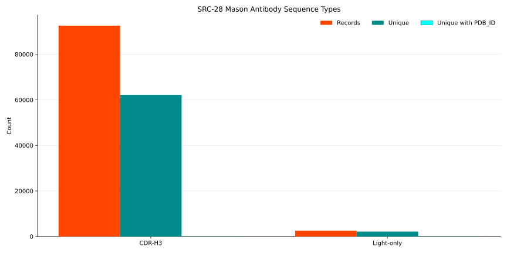
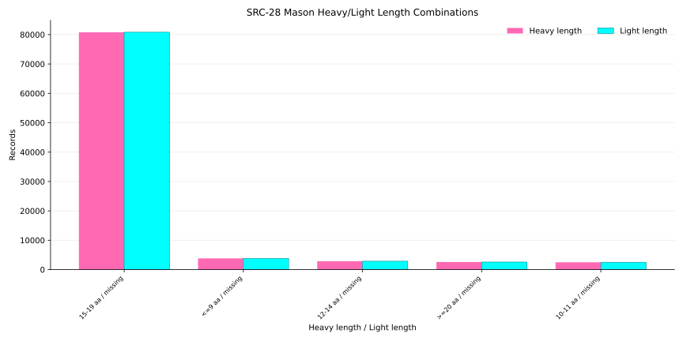
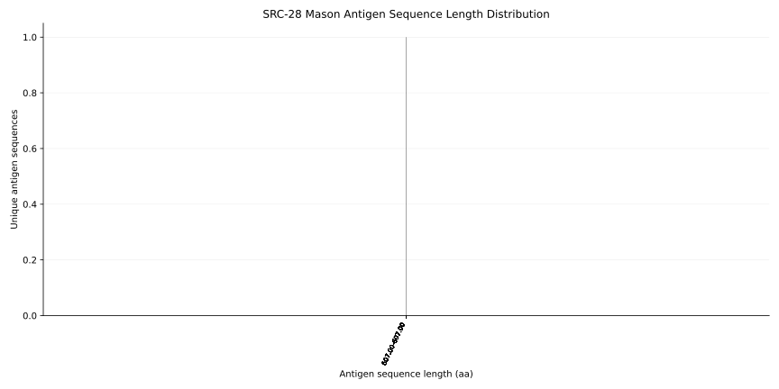

---
- tags:
  - context
---

# SRC-28 Mason

> 每条 data 统一建模为 `((ab, ag), label, assay, condition, replicate, source)`.
> 本地快照 `G:\abag-datasets\SRC_R28_MASON\snapshot-2020-09-02`, `DMS_opt` Git 包内 `data/` 的 20 张 MiXCR 表 (`mHER_H3_` 15 张, `mHER_L3_` 5 张, 共 95,141 行) 与 2 张派生标签 CSV (`mHER_H3_AgNeg.csv` 27,539 行, `mHER_H3_AgPos.csv` 11,300 行), 加 1 个 RCSB entry (`1N8Z`).
> `Unique` 为 CDR3 氨基酸串精确去重, 按库分别计; 两张派生 CSV 的重合序列不重复计入.

## Antibody

> 有 Heavy 和 Light 的 `Unique` 字段是 `(heavy, light)` 二元组精确去重. `Unique with PDB_ID` 是按 Unique 后的 sequence 计数.
> Total Unique 计数方式为统一转 string, 如果有 Heavy 和 Light 用 `/` 拼接成 string.

| Key | 含义 | 说明 |
| --- | --- | --- |
| Sequence Type | 抗体序列类型 | 根据原始数据字段、链槽位及已有构建体标签划分的类别. |
| Records | 原始记录数 | 原始数据中的记录数量, 同一序列可能重复出现. |
| Unique | 唯一序列数 | 按对应数据集定义的去重规则统计. |
| Unique with PDB_ID | 关联 PDB 的唯一序列数 | 去重后具有关联 PDB_ID 的序列数量, 不等同于具有可用实验结构监督的序列数量. |
| Description | 类型说明 | 描述分类依据、序列槽位特征及分类限制. |

| Sequence Type | Records | Unique | Unique with PDB_ID | Description |
| --- | --- | --- | --- | --- |
| CDR-H3 | 92,569 | 62,171 | 1 | 全部行只给 `AA. Seq.CDR3` 一段 (4-57 aa), 无 framework、无轻链、无完整重链; 序列形状只支持 CDR-H3, 不能归入 IgG / Fab / Fv 等构建体. 1,208 条不以 C 开头, 是 MiXCR 已截断的 CDR3 片段. |
| Light-only | 2,572 | 2,149 | 1 | `mHER_L3_` 五张表的 `All V hits` 只有 1,594 行是 IGK、978 行仍是 IGH; 表内只有 CDR3 一段, 无完整轻链序列, 归 Light-only 是据库名与 V 基因家族, 不据长度. |
| Total | 95,141 | 64,320 | 1 |  |

> 这说明对象是 trastuzumab 单一亲本的 CDR3 定向进化文库, 在哺乳动物细胞表面展示完整 IgG 后分选测序. 表内只有 CDR3 一段序列, 没有 framework、没有完整重链、没有轻链; 因此 8 个固定类别里只有 `CDR-H3` 可用, 不从长度反推 IgG / Fab / scFv.
>
> `mHER_L3_` 五张表共 2,572 行, 库名是 L3, 但 `All V hits` 里只有 1,594 行是 IGK, 978 行仍是 IGH; 表内同样只有 CDR3 一段. 归 `Light-only` 是据库名与 V 基因家族, 不是据序列长度.
>
> `Unique with PDB_ID` 记 1: 全部记录只有 1 个 PDB entry (`1N8Z`, trastuzumab Fab–HER2), 它是亲本复合物; 没有任何 CDR3 变体单独解出结构, 表内也没有 PDB 字段, 归属来自源文与冻结 FASTA 的 entity 描述.
>
> 两张派生 CSV 是源内 `scripts/main.py` 的产物, 由本脚本复算并与 CSV 逐序列核对一致: 取 `mHER_H3_` 中除 `1Ag` 外的分选表, 保留 `Clone count > 1`、CDR3 长度 = 15 aa、不含星号 / 下划线的行, 去重后去掉首 3 与末 2 个残基. 复算得 AgNeg 27,456 / AgPos 11,277 / 交集 2,342, 与 CSV 完全相同.

| Heavy Length | Light Length | Records | Description |
| --- | --- | --- | --- |
| CDR-H3 15-19 aa | missing | 80,816 | 重链 CDR3 只有这一段的长度; 无完整重链序列, 该列是 CDR3 长度而非重链长度. |
| CDR-H3 <=9 aa | missing | 3,825 | 重链 CDR3 只有这一段的长度; 无完整重链序列, 该列是 CDR3 长度而非重链长度. |
| CDR-H3 12-14 aa | missing | 2,852 | 重链 CDR3 只有这一段的长度; 无完整重链序列, 该列是 CDR3 长度而非重链长度. |
| CDR-H3 >=20 aa | missing | 2,581 | 重链 CDR3 只有这一段的长度; 无完整重链序列, 该列是 CDR3 长度而非重链长度. |
| CDR-H3 10-11 aa | missing | 2,495 | 重链 CDR3 只有这一段的长度; 无完整重链序列, 该列是 CDR3 长度而非重链长度. |
| missing | CDR-L3 >=12 aa | 1,259 | 轻链侧同理: 只有 CDR3 长度. |
| missing | CDR-L3 10-11 aa | 1,172 | 轻链侧同理: 只有 CDR3 长度. |
| missing | CDR-L3 <=8 aa | 85 | 轻链侧同理: 只有 CDR3 长度. |
| missing | CDR-L3 9 aa | 56 | 轻链侧同理: 只有 CDR3 长度. |

## Antigen

> Antigen 统计以 source-native antigen entity 为核心单位. 优先使用原始 antigen ID/name、construct 和 antigen chain 定义实体; 存在可靠序列时再统计唯一抗原序列.
> 结构、序列和数据库注释压缩到同一张表中, `PDB / UniProt` 采用唯一抗原实体粒度统计 2 × 2 覆盖结果.
> 长度图基于唯一抗原序列, 按该源实际范围平均切分 20 bins.

> 抗原是固定靶点 HER2, 一条参考 entry 的受体链给出唯一抗原序列; 表内没有抗原字段.

| Records | Unique ag entity | Unique ag sequence | PDB / UniProt coverage | Antigen Length | Antigen Evidence / Provenance | Description |
| --- | --- | --- | --- | --- | --- | --- |
| 95,141 | 1 | 1 | PDB=1/UniProt=0: 1; PDB=0/UniProt=0: 0 | 607 aa | Reference PDB / Fixed target | 全部 95,141 行针对同一个固定抗原 HER2. 本地 `1N8Z` 的受体链 C (607 aa, `Receptor protein-tyrosine kinase erbB-2`) 是唯一抗原序列; 同 entry 的 A / B 链是 trastuzumab Fab 的轻链与重链, 属参考抗体. 表内无抗原序列字段与 UniProt 字段, 抗原序列属 PDB-derived, 不是逐行测得的抗原构建体. |

## Affinity

> 去重口径: 按 **AASeq (CDR3 单串)** 去重. `Record pairs` 记两张派生 CSV 的行数, `Unique pairs` 记去重后的 CDR3 串.
>
> 源内的标签方案由 `scripts/main.py` 给定: `Ab` (只分选抗体) 与 `AgN` (抗原阴性) 合成 class 0, `2Ag488` / `2Ag647` (两档抗原浓度的阳性分选) 合成 class 1; 被并入的 2342 条序列在两张 CSV 里各出现一次, 所以 27,539 + 11,300 行只对应 36,391 条唯一 CDR3.
>
> `1Ag` (第一轮抗原阳性分选) 的 H3 表 18,074 行 / 17,367 条唯一 CDR3 不被源内任一类别采用, 单列为 `not_recorded`. L3 五张表共 2,572 行没有对应的派生分类 CSV, 其分选结果不构成本节的 label.
>
> 表内没有 Kd、IC50 或 ΔG; 唯一的分级是分选阴阳性. `Clone count` / `Clone fraction` 是测序计数与频率, 是富集代理, 不是结合强度. 无 replicate 编号与实验方法列, `Replicate` 全记 `unknown`, `Assay` 也记 `unknown`: 源文只说哺乳动物细胞展示与分选, 未写读出方法.

| Label | Assay | Condition | Replicate | Record pairs | Unique pairs | Description |
| --- | --- | --- | --- | --- | --- | --- |
| `binary` | `unknown` | AgNeg (Ab + AgN) | unknown:27,539 | 27,539 | 27,456 | `AASeq` 10 aa, `AgClass = 0`; 由 `Ab` 与 `AgN` 两组合并去重而来. |
| `binary` | `unknown` | AgPos (2Ag488 + 2Ag647) | unknown:11,300 | 11,300 | 11,277 | `AASeq` 10 aa, `AgClass = 1`; 由两档抗原浓度的阳性分选合并去重而来. |
| `not_recorded` | `unknown` | 1Ag (第一轮阳性分选) | unknown:18,074 | 18,074 | 17,367 | 源内派生脚本不采用 `1Ag` 分选表; 这些 CDR3 在表内有测序计数, 但没有被赋予阴阳性标签. |
