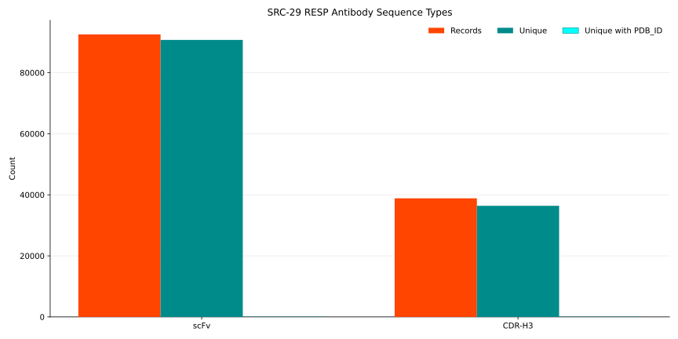
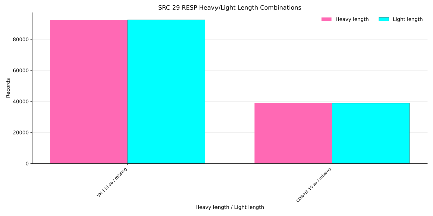
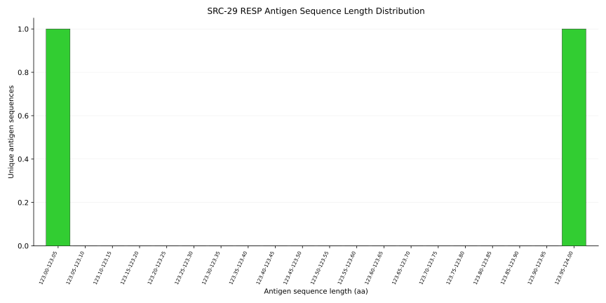

---
tags:
  - context
---

# SRC-29 RESP

> 每条 data 统一建模为 `((ab, ag), label, assay, condition, replicate, source)`.
> 本地快照 `G:\abag-datasets\SRC_R29_RESP\snapshot-2025-06-27`, 三个压缩包各解一次到快照内的 `extracted/`: `RESP-v0.0.1.zip` (153 个成员), Source Data `supplement-3.zip` (9 个工作簿), 以及 `RESP_data.zip` 内 `encoded_data.tar.gz` 的 13 个序列与标签成员 (1.9 GB 的 `.pt` 张量与 `.npy` 是模型输入, 不读出). 加 2 个冻结 RCSB entry.
> 抗体侧有两个独立的表: 本研究的 atezolizumab 文库 (RH01 / RH02 / RH03 三个解离速率分箱, 92,553 行) 与作为迁移学习集并入的 Mason trastuzumab H3 表 (38,839 行).

## Antibody

> 有 Heavy 和 Light 的 `Unique` 字段是 `(heavy, light)` 二元组精确去重. `Unique with PDB_ID` 是按 Unique 后的 sequence 计数.
> Total Unique 计数方式为统一转 string, 如果有 Heavy 和 Light 用 `/` 拼接成 string.

| Key | 含义 | 说明 |
| --- | --- | --- |
| Sequence Type | 抗体序列类型 | 根据原始数据字段、链槽位及已有构建体标签划分的类别. |
| Records | 原始记录数 | 原始数据中的记录数量, 同一序列可能重复出现. |
| Unique | 唯一序列数 | 按对应数据集定义的去重规则统计. |
| Unique with PDB_ID | 关联 PDB 的唯一序列数 | 去重后具有关联 PDB_ID 的序列数量, 不等同于具有可用实验结构监督的序列数量. |
| Description | 类型说明 | 描述分类依据、序列槽位特征及分类限制. |

| Sequence Type | Records | Unique | Unique with PDB_ID | Description |
| --- | --- | --- | --- | --- |
| scFv | 92,553 | 90,745 | 1 | 论文与 README 显式写明 atezolizumab scFv 文库的重链随机突变, 归 scFv 是据源内构建体措辞; 表内只给 118 aa 重链可变区, 无轻链槽位, 因此去重单位是 VH 序列. |
| CDR-H3 | 38,839 | 36,391 | 0 | Mason trastuzumab 图版只给 10 aa 的 CDR-H3, 无 framework、无完整重链、无轻链; 与 SRC-28 同一批行. |
| Total | 131,392 | 127,136 | 1 |  |

> 分箱表的每一行是 `(118 aa 重链可变区, 读数)`; 三箱合计 92,553 行, 全局去重 90,745 条, 合计 550,215 条读数. 与论文报告的 92,553 条唯一序列与 550,215 条总序列逐字一致.
>
> 构建体归 `scFv`: 论文与 README 都写明文库是 atezolizumab scFv 的重链 error-prone PCR 产物 (酵母表面展示), 这是源自己的构建体措辞. 表内只存重链可变区一条槽位, 轻链序列从未出现在任何文件里; 因此本行的 `Unique` 是 VH 序列数, 不是 scFv 全序列数.
>
> Mason 表是同一批 10 aa CDR-H3, 与 SRC-28 的 `mHER_H3_AgPos.csv` / `AgNeg.csv` 逐 (AASeq, Count, AgClass) 完全相同而字节不同: 同源, 跨源汇总按测量身份去重, 不相加.
>
> `Unique with PDB_ID` 记 1 是按亲本体系口径: 本源的 2 个冻结 entry (`5X8L`, `5XXY`) 是 atezolizumab Fab–PD-L1 这同一个亲本复合物的两次沉积, 算一个体系, 90,745 条 VH 变体没有一条单独解出结构. Mason 那 38,839 行在本源内没有任何 PDB: trastuzumab 的 `1N8Z` 不在本快照里, 记 0.
>
> `raw_data/rh04_sequences.txt` 另给 563 条 VH (13,808 条读数, 其中 381 条与三箱重合), 论文没有把它列入 RH01-RH03 任何一箱, 也不进入任何下游表, 因此不计入本表.
>
> 长度表两行各自只有一个槽位: 分箱表全是 118 aa 的 VH, Mason 表全是 10 aa 的 CDR-H3, 都没有轻链.

| Heavy Length | Light Length | Records | Description |
| --- | --- | --- | --- |
| VH 118 aa | missing | 92,553 | 分箱表全部是 118 aa 的 atezolizumab 重链可变区; 轻链不在数据里. |
| CDR-H3 10 aa | missing | 38,839 | Mason 表全部是 10 aa 的 CDR-H3; 该列是 CDR3 长度, 不是重链长度. |

## Antigen

> Antigen 统计以 source-native antigen entity 为核心单位. 优先使用原始 antigen ID/name、construct 和 antigen chain 定义实体; 存在可靠序列时再统计唯一抗原序列.
> 结构、序列和数据库注释压缩到同一张表中, `PDB / UniProt` 采用唯一抗原实体粒度统计 2 × 2 覆盖结果.
> 长度图基于唯一抗原序列, 按该源实际范围平均切分 20 bins.

> 抗原侧只有固定靶点: 本研究测 PD-L1, Mason 表测 HER2. 表内没有抗原字段, 序列只能取冻结 entry 里的非抗体链.

| Records | Unique ag entity | Unique ag sequence | PDB / UniProt coverage | Antigen Length | Antigen Evidence / Provenance | Description |
| --- | --- | --- | --- | --- | --- | --- |
| 131,392 | 2 | 2 | PDB=1/UniProt=0: 1; PDB=0/UniProt=0: 1; PDB=0/UniProt=1: 0; PDB=1/UniProt=1: 0 | 123-124 aa; 2 unique lengths | Fixed target / PDB-derived sequence | 2 个固定靶点: PD-L1 (本研究) 与 HER2 (Mason 表). PD-L1 有 2 条冻结构建体序列, 来自两个 entry 的同一蛋白: `5X8L` 的 123 aa 与 `5XXY` 的 124 aa, 差异在 C 端截短与组氨酸标签, 不合并. HER2 在本快照里没有 entry (Mason 的 `1N8Z` 不在), 实体只有靶点名, 序列记 unavailable, PDB=0. 源内没有 UniProt 字段, 也没有逐行的抗原构建体范围. 长度是链本身的长度, 不是被测表位的长度. |

## Affinity

> 去重口径: 分箱表按 **VH 序列** 去重; Mason 表按 **CDR3 串** 去重; 模型分数表按 **(类别, 分数)** 行去重. 三个来源各自的 (ab, ag) 对不与彼此相加.
>
> 分箱标签是源内的有序类别: RH01 弱结合 / 快解离, RH02 与野生型相当, RH03 强结合 / 慢解离. 分选读数是流式解离门限, 不是 Kd.
>
> `Figure 6B` 的 75,631 行 `ordinal_regression_score` 是模型输出, 不是测量; 它按同一批 RH 类别分组成 `predicted`, 与上一行的 `ordinal` 是标签与预测两层, 不能相加.
>
> `Figure S10A` 的 29,999 行 `Model assigned score` 是迁移学习模型对 Mason 数据的打分, 标签列 `Binder / Nonbinder, training set` 才是实验分类; 本表只把分数记为 `predicted`.
>
> 源内还有 Figure 8 (酵母表面解离曲线, 4 个抗体) 与 Figure S7 (PD-L1 滴定 MFI, WT 与 Mutant 4) 的原始读数. 它们没有拟合出 Kd 列, README 明确记 Mutant 4 因解离极慢无法拟合, 因此记 `not_recorded`, 不当 0, 也不当作不结合.

| Label | Assay | Condition | Replicate | Record pairs | Unique pairs | Description |
| --- | --- | --- | --- | --- | --- | --- |
| `ordinal` | `flow` | RH01 / RH02 / RH03 解离速率分箱 | unknown:92553 | 92,553 | 90,745 | 三箱分别 40,197 / 31,690 / 20,666 行, 全局 90,745 条唯一 VH; 同一条序列可出现在多箱 (两两重合 863 / 360 / 781, 三箱共 196), 所以 Unique 小于行数. 读数合计 550,215 条. |
| `binary` | `unknown` | Mason H3 AgPos / AgNeg (同 SRC-28) | unknown:38839 | 38,839 | 36,391 | `AgClass` 0 (抗原阴性 27,539 行) / 1 (抗原阳性 11,300 行); 两表共 2,342 条 CDR3 重复出现, 去重后 36,391. 与 SRC-28 是同一批行; 该表没有方法列, `Assay` 沿用 SRC-28 的 `unknown`. |
| `Kd_M` | `BLI` | Figure S3 WT / Mutant scFv 全局 2:1 拟合 | unknown:14 | 14 | 2 | `Individual Results` 里 7 个浓度共用一次全局拟合: WT `2.194e-10` M, Mutant `<1.0E-12` M (删失上界, 不是点估计, 也不是 0). 7 个浓度是同一拟合的输入, 不是重复测量. 抗原固定在传感器上 (PD-L1), 抗体为 atezolizumab scFv. |
| `not_recorded` | `flow` | Figure 8 解离曲线 / Figure S7 滴定 | unknown:4 | 4 | 4 | Figure 8A / S7 只给 WT 与 Mutant 4 的 MFI 时间序列与 PD-L1 滴定读数, Figure 8B 另有 Durvalumab / Avelumab 两条参考曲线; 4 个 (抗体, PD-L1) 对都有曲线但没有 Kd 列. 按 `not_recorded`, 不折算. |
| `predicted` | `computational` | Figure 6B ordinal_regression_score | unknown:75631 | 75,631 | 75,571 | 模型对测试集的序数回归分数 (-6.45 至 14.28), 按 RH01 34,439 / RH02 26,122 / RH03 15,070 分组; 60 行 (类别, 分数) 完全重复, 去重后 75,571. 是模型输出, 不是测量. |
| `predicted` | `computational` | Figure S10A Model assigned score | unknown:29999 | 29,999 | 29,981 | 迁移学习模型对 Mason 数据的打分 (-6.27 至 5.81); 训练集标签 22,631 nonbinder / 7,368 binder. 18 行重复, 去重后 29,981. |
