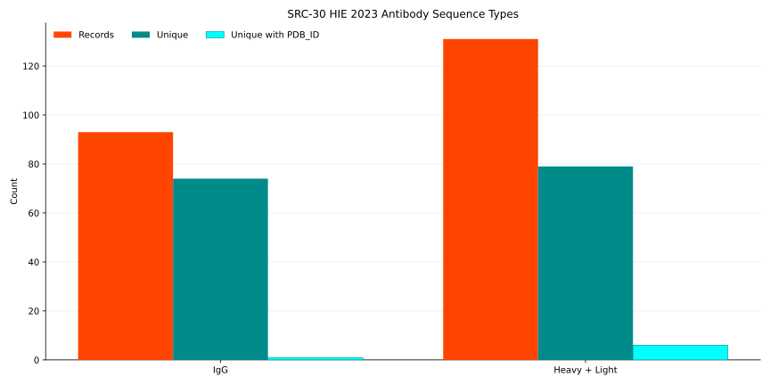
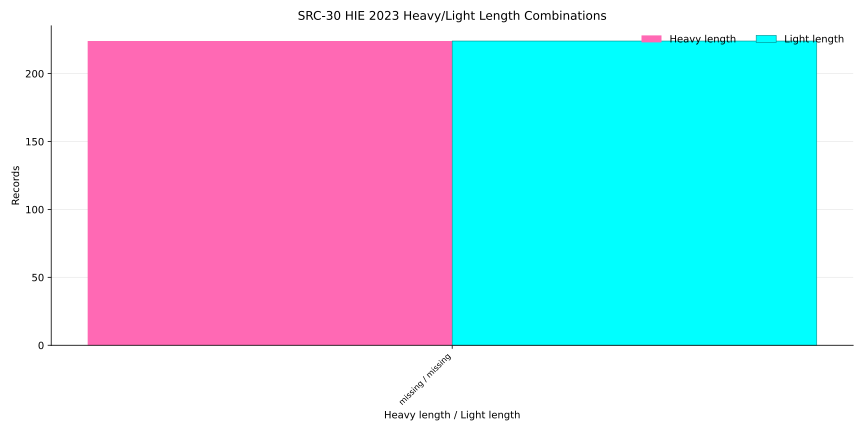
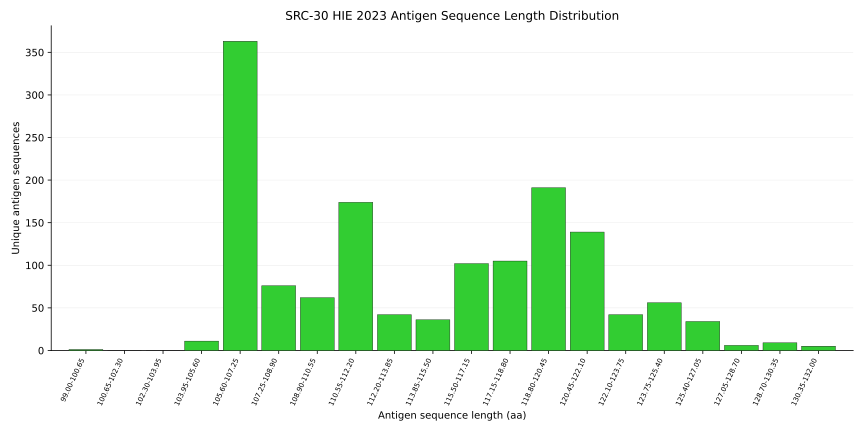

---
tags:
  - context
---

# [SRC-30 HIE 2023](../2026-10-29-3a-src-readme/src-30-hie-readme.md)

> 每条 data 统一建模为 `((ab, ag), label, assay, condition, replicate, source)`.
> 本地快照 `G:\abag-datasets\SRC_R30_HIE\snapshot-2022-08-05`, `articles/` 下 supplementary data 3-8, 加 6 个冻结 RCSB entry. 统计主体是 supplementary data 3 的 14 张 sheet: 22 个设计变体块、9 个浓度序列块、1 个抗原 panel 块.
> `Unique` 为 `(亲本抗体, 设计名)` 二元组精确去重; 表内没有任何链序列, 设计只以突变名给出.

## Antibody

> 有 Heavy 和 Light 的 `Unique` 字段是 `(heavy, light)` 二元组精确去重. `Unique with PDB_ID` 是按 Unique 后的 sequence 计数.
> Total Unique 计数方式为统一转 string, 如果有 Heavy 和 Light 用 `/` 拼接成 string.

| Key | 含义 | 说明 |
| --- | --- | --- |
| Sequence Type | 抗体序列类型 | 根据原始数据字段、链槽位及已有构建体标签划分的类别. |
| Records | 原始记录数 | 原始数据中的记录数量, 同一序列可能重复出现. |
| Unique | 唯一序列数 | 按对应数据集定义的去重规则统计. |
| Unique with PDB_ID | 关联 PDB 的唯一序列数 | 去重后具有关联 PDB_ID 的序列数量, 不等同于具有可用实验结构监督的序列数量. |
| Description | 类型说明 | 描述分类依据、序列槽位特征及分类限制. |

| Sequence Type | Records | Unique | Unique with PDB_ID | Description |
| --- | --- | --- | --- | --- |
| IgG | 93 | 74 | 1 | 块表头逐字写 `IgG Kd`; 亲本为 MEDI8852 UCA / mAb114 UCA / REGN10987 / C143, 只有 REGN10987 有 PDB. |
| Heavy + Light | 131 | 79 | 6 | 块表头只写 `Kd` / `IC50`, `Chain mutated` 列标 `HC` / `LC` / `HC + LC`; 亲本为 MEDI8852 / S309 / mAb114 / REGN10987 (同一亲本的 IgG 块另计), 4 个亲本共 6 个 PDB entry. |
| Total | 224 | 130 | 6 |  |

> 本源的测序对象是 7 个亲本抗体的定向进化变体, 记录单位是 `Design` 名 (如 `E65P-M117Y`、`K58S-V65P/G95P`). `Unique` 按 `(亲本抗体, 设计名)` 计 130 个, 不按设计名单独去重: `S44G` 这类短名在不同亲本下反复出现, 只按名字去重会把不同抗体合并.
>
> 构建体只从块表头判定: 表头逐字写 `IgG Kd` 的块 (MEDI8852 UCA / mAb114 UCA / REGN10987 的 IgG 块 / C143) 归 `IgG`; 其余块表头只写 `Kd` 或 `IC50`, 但 `Chain mutated` 列逐行标 `HC` / `LC` / `HC + LC`, 说明确有重链与轻链两个槽位, 故归 `Heavy + Light`, 不据长度反推.
>
> `Unique with PDB_ID` 是亲本级计数, 不是变体级: 全部记录只有 6 个 PDB entry, 分属 4 个亲本 (`5JW3`/`5JW4`/`5JW5` 为 MEDI8852、`6WPS` 为 S309、`6XDG` 为 REGN10987、`5FHC` 为 mAb114); 另 3 个亲本 (MEDI8852 UCA、mAb114 UCA、C143) 无任何结构. 这些 entry 都是亲本复合物, 没有任何变体单独解出结构. 表内没有 PDB 字段, 归属来自亲本体名与冻结 FASTA 的 entity 描述.
>
> 表内没有链序列, 也没有可安全重建的序列: 设计名只给出突变位置, 亲本全长序列不在本快照内, 因此长度列全记 `missing`. supplementary data 6 的 1,454 条可变区序列 (99-132 aa) 属 742 个具名治疗抗体, 与这 7 个亲本无交集, 不计入本节.

| Heavy Length | Light Length | Records | Description |
| --- | --- | --- | --- |
| missing | missing | 224 | 全部 224 行只有设计名与 Kd/IC50 读数, 没有重链或轻链序列; 亲本全长序列也不在本快照内. |

## Antigen

> Antigen 统计以 source-native antigen entity 为核心单位. 优先使用原始 antigen ID/name、construct 和 antigen chain 定义实体; 存在可靠序列时再统计唯一抗原序列.
> 结构、序列和数据库注释压缩到同一张表中, `PDB / UniProt` 采用唯一抗原实体粒度统计 2 × 2 覆盖结果.
> 长度图基于唯一抗原序列, 按该源实际范围平均切分 20 bins.

> 抗原只有块首行的来源标签 (11 个), 表内没有抗原序列、构建体或链字段; 6 个冻结结构都是亲本抗体复合物.

| Records | Unique ag entity | Unique ag sequence | PDB / UniProt coverage | Antigen Length | Antigen Evidence / Provenance | Description |
| --- | --- | --- | --- | --- | --- | --- |
| 224 | 11 | unavailable | Reference PDB: 6; UniProt=unavailable | unavailable | Reference PDB / Fixed target | 11 个来源标签: 8 个抗原名 (H4 Hubei、H7 HK16、H7 HK17、H1 Solomon、CoV-2 WT S6P、Ebola virus GP、CoV2 Beta S2P、CoV2 Omicron RBD) 与 3 个假病毒标签 (Ebola pseudotyped virus、D614G / Beta pseudotyped lentivirus). 6 个本地结构 (5JW3/5JW4/5JW5 MEDI8852-HA, 6WPS S309-spike, 6XDG REGN10987-spike, 5FHC mAb114-Ebola GP) 全是亲本抗体复合物, 其抗原链属这些复合物; 没有一个标签的构建体被源文明确指认为某个 entry 的抗原链, 因此不把任何参考链当作实测抗原序列, 长度记 unavailable. 表内无 UniProt 字段. |

## Affinity

> 去重口径: 按 **(亲本抗体, 设计名, 抗原标签)** 去重, 但本表按块分行计数, 因为每个块是一次独立实验; 同一设计在不同块里是不同测量, 不跨块合并. 重复结构写在 `Replicate` 列.
>
> supplementary data 3 共 300 条带标签的候选读数: 279 条数值, 12 条删失上界 (`<0.001` nM, 抗原 panel 的检出下限), 2 条 `NB` (源标未检出), 6 条 `NB*` (源文脚注: 有结合但动力学不可拟合), 1 条 `ND` / `-` (未测定). 其余空单元格是未测, 既不是 0 也不是阴性; `NB` 是源内显式判定, 才可当二值阴性. `IC50` 与 `Kd` 是两种端点, 分列. 浓度序列块 (`Concentration (nM)`) 是同一抗体对在不同浓度下的 Kd, 属方法学复核, 不与设计块相加.
>
> 其余补充材料都不是亲和力: supplementary data 3 的 `Thermal melt data` 表是 39 个设计的 Tm (热稳定性, 单位 °C), data 4 是多元反应性荧光与 MHC 结合预测, data 5 是与其他序列方法的基准对比, data 6 是 17,168 行模型推荐突变 (742 个治疗抗体, 1,454 条可变区序列, 无亲和力列), data 7 是模型排名, data 8 是引物序列. Tm 不在 `Label` 词表内, 这些行一律不计入本表.

| Label | Assay | Condition | Replicate | Record pairs | Unique pairs | Description |
| --- | --- | --- | --- | --- | --- | --- |
| `Kd_M` | `unknown` | MEDI Round alpha (row 0) | n=2:30 | 30 | 30 | `Kd` 单位 `nM`; 2 个重复列; 本块 30 行给出可读值, 含 `NB`/`NB*`/`ND`/`-` 等非数值标记, 其余行同块未测或标 `NB` / `NB*` / `ND`. |
| `Kd_M` | `unknown` | MEDI8852 抗原 panel (Kd) | unknown:18 | 18 | 18 | `Kd` 单位 `nM`; 单列读数, 无重复编号; 本块 18 行给出可读值, 含 `NB`/`NB*`/`ND`/`-` 等非数值标记, 其余行同块未测或标 `NB` / `NB*` / `ND`. |
| `Kd_M` | `unknown` | MEDI Round beta (row 0) | n=2:6 | 6 | 6 | `Kd` 单位 `nM`; 2 个重复列; 本块 6 行给出可读值, 含 `NB`/`NB*`/`ND`/`-` 等非数值标记, 其余行同块未测或标 `NB` / `NB*` / `ND`. |
| `Kd_M` | `unknown` | MEDI Round beta 浓度序列 (row 8) | unknown:16 | 16 | 16 | `MEDI / E65P-M117Y` 的 Kd (nM) 按浓度 (200 / 100 / 50 / 25 nM) 逐点给出, 16 个数值格点; `Average` / `Stdev` 行是汇总, 不计. 这是同一对相当批抗体的浓度复核, 与同 sheet 的设计块重叠, 不当作新的 (ab, ag) 对. |
| `Kd_M` | `unknown` | MEDI UCA Round alpha (row 0) | n=2:9 | 9 | 9 | `Kd` 单位 `nM`; 2 个重复列; 本块 9 行给出可读值, 含 `NB`/`NB*`/`ND`/`-` 等非数值标记, 其余行同块未测或标 `NB` / `NB*` / `ND`. |
| `Kd_M` | `unknown` | MEDI UCA Round beta (row 0) | n=2:26 | 26 | 26 | `Kd` 单位 `nM`; 2 个重复列; 本块 26 行给出可读值, 含 `NB`/`NB*`/`ND`/`-` 等非数值标记, 其余行同块未测或标 `NB` / `NB*` / `ND`. |
| `Kd_M` | `unknown` | MEDI UCA Round beta (row 29) | n=2:14 | 14 | 14 | `Kd` 单位 `nM`; 2 个重复列; 本块 14 行给出可读值, 含 `NB`/`NB*`/`ND`/`-` 等非数值标记, 其余行同块未测或标 `NB` / `NB*` / `ND`. |
| `Kd_M` | `unknown` | S309 Round alpha (row 0) | n=3:11 | 11 | 11 | `Kd` 单位 `nM`; 3 个重复列; 本块 11 行给出可读值, 含 `NB`/`NB*`/`ND`/`-` 等非数值标记, 其余行同块未测或标 `NB` / `NB*` / `ND`. |
| `Kd_M` | `unknown` | S309 Round beta (row 0) | n=2:10 | 10 | 10 | `Kd` 单位 `nM`; 2 个重复列; 本块 10 行给出可读值, 含 `NB`/`NB*`/`ND`/`-` 等非数值标记, 其余行同块未测或标 `NB` / `NB*` / `ND`. |
| `Kd_M` | `unknown` | S309 Round beta 浓度序列 (row 12) | unknown:6 | 6 | 6 | `S309 / Sotrovimab / G79A/T28S` 的 Kd (nM) 按浓度 (200 / 100 / 50 / 25 nM) 逐点给出, 6 个数值格点; `Average` / `Stdev` 行是汇总, 不计. 这是同一对相当批抗体的浓度复核, 与同 sheet 的设计块重叠, 不当作新的 (ab, ag) 对. |
| `Kd_M` | `unknown` | S309 Round beta 浓度序列 (row 18) | unknown:6 | 6 | 6 | `S309 / Sotrovimab / G79A/T28S` 的 Kd (nM) 按浓度 (200 / 100 / 50 / 25 nM) 逐点给出, 6 个数值格点; `Average` / `Stdev` 行是汇总, 不计. 这是同一对相当批抗体的浓度复核, 与同 sheet 的设计块重叠, 不当作新的 (ab, ag) 对. |
| `Kd_M` | `unknown` | S309 Round beta 浓度序列 (row 24) | unknown:4 | 4 | 4 | `S309 / G79A/T28S` 的 Kd (nM) 按浓度 (200 / 100 / 50 / 25 nM) 逐点给出, 4 个数值格点; `Average` / `Stdev` 行是汇总, 不计. 这是同一对相当批抗体的浓度复核, 与同 sheet 的设计块重叠, 不当作新的 (ab, ag) 对. |
| `Kd_M` | `unknown` | S309 Round beta 浓度序列 (row 30) | unknown:6 | 6 | 6 | `S309 / Sotrovimab / G79A/T28S` 的 Kd (nM) 按浓度 (200 / 100 / 50 / 25 nM) 逐点给出, 6 个数值格点; `Average` / `Stdev` 行是汇总, 不计. 这是同一对相当批抗体的浓度复核, 与同 sheet 的设计块重叠, 不当作新的 (ab, ag) 对. |
| `Kd_M` | `unknown` | mAb114 Round alpha (row 0) | n=3:14 | 14 | 14 | `Kd` 单位 `nM`; 3 个重复列; 本块 14 行给出可读值, 含 `NB`/`NB*`/`ND`/`-` 等非数值标记, 其余行同块未测或标 `NB` / `NB*` / `ND`. |
| `Kd_M` | `unknown` | mAb114 Round beta (row 0) | n=2:7 | 7 | 7 | `Kd` 单位 `nM`; 2 个重复列; 本块 7 行给出可读值, 含 `NB`/`NB*`/`ND`/`-` 等非数值标记, 其余行同块未测或标 `NB` / `NB*` / `ND`. |
| `IC50` | `unknown` | mAb114 Round beta (row 9) | n=4:7 | 7 | 7 | `IC50` 单位 `nM`; 4 个重复列; 本块 7 行给出可读值, 含 `NB`/`NB*`/`ND`/`-` 等非数值标记, 其余行同块未测或标 `NB` / `NB*` / `ND`. |
| `Kd_M` | `unknown` | mAb114-UCA Round alpha (row 0) | n=2:10 | 10 | 10 | `Kd` 单位 `nM`; 2 个重复列; 本块 10 行给出可读值, 含 `NB`/`NB*`/`ND`/`-` 等非数值标记, 其余行同块未测或标 `NB` / `NB*` / `ND`. |
| `Kd_M` | `unknown` | mAb114-UCA Round beta (row 0) | n=2:8 | 8 | 8 | `Kd` 单位 `nM`; 2 个重复列; 本块 8 行给出可读值, 含 `NB`/`NB*`/`ND`/`-` 等非数值标记, 其余行同块未测或标 `NB` / `NB*` / `ND`. |
| `Kd_M` | `unknown` | mAb114-UCA Round beta 浓度序列 (row 12) | unknown:4 | 4 | 4 | `mAb114 UCA / AMIS` 的 Kd (nM) 按浓度 (200 / 100 / 50 / 25 nM) 逐点给出, 4 个数值格点; `Average` / `Stdev` 行是汇总, 不计. 这是同一对相当批抗体的浓度复核, 与同 sheet 的设计块重叠, 不当作新的 (ab, ag) 对. |
| `Kd_M` | `unknown` | REGN10987 Round alpha (row 0) | n=3:7 | 7 | 7 | `Kd` 单位 `nM`; 3 个重复列; 本块 7 行给出可读值, 含 `NB`/`NB*`/`ND`/`-` 等非数值标记, 其余行同块未测或标 `NB` / `NB*` / `ND`. |
| `Kd_M` | `unknown` | REGN10987 Round alpha (row 9) | n=1:9 | 9 | 9 | `Kd` 单位 `nM`; 1 个重复列; 本块 9 行给出可读值, 含 `NB`/`NB*`/`ND`/`-` 等非数值标记, 其余行同块未测或标 `NB` / `NB*` / `ND`. |
| `Kd_M` | `unknown` | REGN10987 Round beta (row 0) | n=3:7 | 7 | 7 | `Kd` 单位 `nM`; 3 个重复列; 本块 7 行给出可读值, 含 `NB`/`NB*`/`ND`/`-` 等非数值标记, 其余行同块未测或标 `NB` / `NB*` / `ND`. |
| `Kd_M` | `unknown` | REGN10987 Round beta (row 9) | n=2:8 | 8 | 8 | `Kd` 单位 `nM`; 2 个重复列; 本块 8 行给出可读值, 含 `NB`/`NB*`/`ND`/`-` 等非数值标记, 其余行同块未测或标 `NB` / `NB*` / `ND`. |
| `Kd_M` | `unknown` | REGN10987 Round beta 浓度序列 (row 19) | unknown:6 | 6 | 6 | `REGN10987 / R16G/N91C` 的 Kd (nM) 按浓度 (200 / 100 / 50 / 25 nM) 逐点给出, 6 个数值格点; `Average` / `Stdev` 行是汇总, 不计. 这是同一对相当批抗体的浓度复核, 与同 sheet 的设计块重叠, 不当作新的 (ab, ag) 对. |
| `IC50` | `unknown` | REGN10987 Round beta (row 26) | n=4:5 | 5 | 5 | `IC50` 单位 `ng/mL`; 4 个重复列; 本块 5 行给出可读值, 含 `NB`/`NB*`/`ND`/`-` 等非数值标记, 其余行同块未测或标 `NB` / `NB*` / `ND`. |
| `IC50` | `unknown` | REGN10987 Round beta (row 33) | n=4:5 | 5 | 5 | `IC50` 单位 `ng/mL`; 4 个重复列; 本块 5 行给出可读值, 含 `NB`/`NB*`/`ND`/`-` 等非数值标记, 其余行同块未测或标 `NB` / `NB*` / `ND`. |
| `Kd_M` | `unknown` | C143 Round alpha (row 0) | n=2:15 | 15 | 15 | `Kd` 单位 `nM`; 2 个重复列; 本块 15 行给出可读值, 含 `NB`/`NB*`/`ND`/`-` 等非数值标记, 其余行同块未测或标 `NB` / `NB*` / `ND`. |
| `Kd_M` | `unknown` | C143 Round beta (row 0) | n=2:8 | 8 | 8 | `Kd` 单位 `nM`; 2 个重复列; 本块 8 行给出可读值, 含 `NB`/`NB*`/`ND`/`-` 等非数值标记, 其余行同块未测或标 `NB` / `NB*` / `ND`. |
| `Kd_M` | `unknown` | C143 Round beta 浓度序列 (row 12) | unknown:6 | 6 | 6 | `C143 IgG / T33N-G53V IgG` 的 Kd (nM) 按浓度 (200 / 100 / 50 / 25 nM) 逐点给出, 6 个数值格点; `Average` / `Stdev` 行是汇总, 不计. 这是同一对相当批抗体的浓度复核, 与同 sheet 的设计块重叠, 不当作新的 (ab, ag) 对. |
| `Kd_M` | `unknown` | C143 Round beta 浓度序列 (row 19) | unknown:4 | 4 | 4 | `C143 IgG / T33N-G53V IgG` 的 Kd (nM) 按浓度 (200 / 100 / 50 / 25 nM) 逐点给出, 4 个数值格点; `Average` / `Stdev` 行是汇总, 不计. 这是同一对相当批抗体的浓度复核, 与同 sheet 的设计块重叠, 不当作新的 (ab, ag) 对. |
| `IC50` | `unknown` | C143 Round beta (row 25) | n=4:4 | 4 | 4 | `IC50` 单位 `ng/mL`; 4 个重复列; 本块 4 行给出可读值, 含 `NB`/`NB*`/`ND`/`-` 等非数值标记, 其余行同块未测或标 `NB` / `NB*` / `ND`. |
| `IC50` | `unknown` | C143 Round beta (row 31) | n=4:4 | 4 | 4 | `IC50` 单位 `ng/mL`; 4 个重复列; 本块 4 行给出可读值, 含 `NB`/`NB*`/`ND`/`-` 等非数值标记, 其余行同块未测或标 `NB` / `NB*` / `ND`. |
| `binary` | `unknown` | 全部设计块 (`NB`) | unknown:2 | 2 | 2 | 源文 `NB` 标为未检出; 作为二值阴性取值, 不是 Kd 数值. |
| `binary` | `unknown` | 全部设计块 (`NB*`) | unknown:6 | 6 | 6 | 源文脚注: 观察到结合但动力学数据不可拟合; 作为二值阳性取值, 无数值 Kd. |
| `not_recorded` | `unknown` | 全部设计块 (`ND` / `-`) | unknown:1 | 1 | 1 | 源文标为未测定; 有该设计行但无可用标签. |
