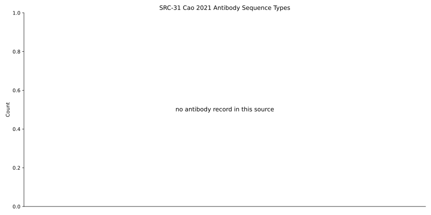
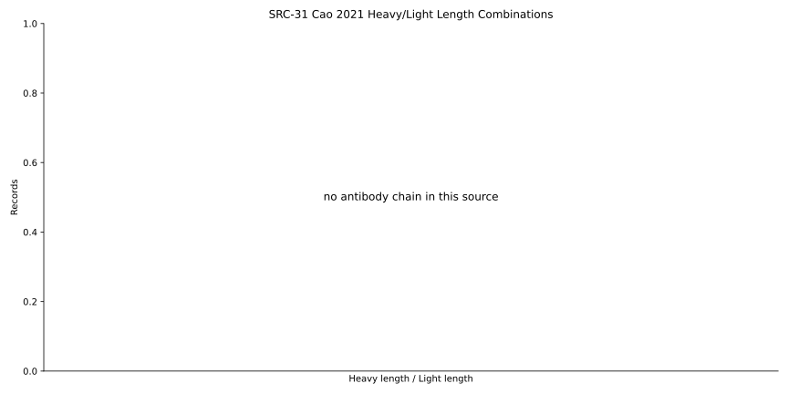
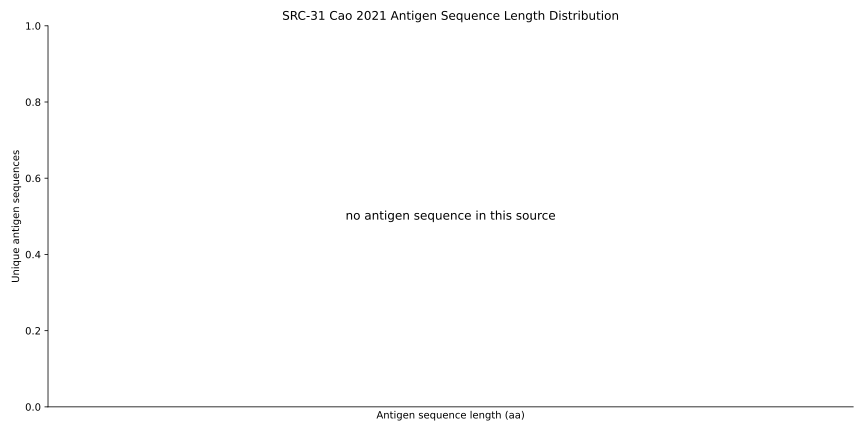

---
tags:
  - context
---

# SRC-31 Cao 2021

> 每条 data 统一建模为 `((ab, ag), label, assay, condition, replicate, source)`.
> 本地快照 `G:\abag-datasets\SRC_R31_CAO_MINIBINDERS\snapshot-2021-10-09`, `supplemental_files/sorting_ngs_data/` 28 个设计库 (`sequences.list` 共 1,057,232 行, 1,056,925 条唯一序列) 与 `ngs_analysis/affinities/` 27 张 SC50 score 表 (997,343 行), 加 24 个冻结 RCSB entry.
> 抗体侧为空: 被测对象是 de novo 设计的 40-67 aa miniprotein binder, 不是免疫球蛋白, 没有任何行能落入固定的 `Sequence Type` 词表.

## Antibody

> 有 Heavy 和 Light 的 `Unique` 字段是 `(heavy, light)` 二元组精确去重. `Unique with PDB_ID` 是按 Unique 后的 sequence 计数.
> Total Unique 计数方式为统一转 string, 如果有 Heavy 和 Light 用 `/` 拼接成 string.

| Key | 含义 | 说明 |
| --- | --- | --- |
| Sequence Type | 抗体序列类型 | 根据原始数据字段、链槽位及已有构建体标签划分的类别. |
| Records | 原始记录数 | 原始数据中的记录数量, 同一序列可能重复出现. |
| Unique | 唯一序列数 | 按对应数据集定义的去重规则统计. |
| Unique with PDB_ID | 关联 PDB 的唯一序列数 | 去重后具有关联 PDB_ID 的序列数量, 不等同于具有可用实验结构监督的序列数量. |
| Description | 类型说明 | 描述分类依据、序列槽位特征及分类限制. |

| Sequence Type | Records | Unique | Unique with PDB_ID | Description |
| --- | --- | --- | --- | --- |
| Total | 0 | 0 | 0 |  |

> 源 README 明写这是 "跨靶点蛋白 binder 数据, 不能把这些短蛋白称为抗体"; 24 个冻结构造里 13 条 binder 链的 entity 描述全部是 `Binder` / `Miniprotein Binder` / `Designed TrkA-binding miniprotein` / `De novo designed protein H3mb`, 没有一条带免疫球蛋白措辞. 因此本节 `Records = 0`, 不把 1,056,925 条 binder 序列记成 `Unknown` 抗体: 那会把非抗体设计混入抗体计数.
>
> 词表里没有表示"非抗体结合蛋白"的类别, 新增一个即自造标签. 这些测量完整登记在 Antigen 与 Affinity 两节, 不在此节凑数. 三张图因此都是空轴加说明, 不含任何条形.
>
> `design_models_sequence/*.seq` 与 `sorting_ngs_data/*/sequences.list` 同源, 都是这些 miniprotein 的设计序列, 属于抗体层之外的 binder 层.

| Heavy Length | Light Length | Records | Description |
| --- | --- | --- | --- |
| missing | missing | 0 | 没有抗体链, 也就没有 Heavy / Light 长度; binder 自身的 40-67 aa 长度归 binder 层, 不写进本表. |

## Antigen

> Antigen 统计以 source-native antigen entity 为核心单位. 优先使用原始 antigen ID/name、construct 和 antigen chain 定义实体; 存在可靠序列时再统计唯一抗原序列.
> 结构、序列和数据库注释压缩到同一张表中, `PDB / UniProt` 采用唯一抗原实体粒度统计 2 × 2 覆盖结果.
> 长度图基于唯一抗原序列, 按该源实际范围平均切分 20 bins.

> 抗原侧是 13 个 source-native 靶点标签, 由 `sorting_ngs_data/<library>/` 目录名与 score 表的 `target` 列 (去掉分析后缀 `_ssm` / `_ssm_2` / `_graft`) 给出; 表内没有任何抗原序列字段.

| Records | Unique ag entity | Unique ag sequence | PDB / UniProt coverage | Antigen Length | Antigen Evidence / Provenance | Description |
| --- | --- | --- | --- | --- | --- | --- |
| 997,343 | 13 | unavailable | Reference PDB: 24; UniProt=unavailable | unavailable | Reference PDB / Fixed target | 13 个靶点标签: CD3d, EGFR, FGFR2, H3, IGF1R, IL7Ra, InsulinR, PDGFR, SARS_CoV2_RBD, TGFb, Tie2, TrkA, VirB8. 其中 SARS_CoV-2 RBD 是论文后续分支, 本地没有对应参考 entry; 其余 12 个各至少有 1 个冻结结构, 共 21 个 entry 可挂到靶点, 分属设计所用的靶点参考结构 (1DJS/1EV2 等) 与本研究解出的 binder-靶点复合物 (7RDH、7N3T、7OPB、7SH3, 其 binder 链 55-81 aa). 剩下 3 个 entry (`7N1K`、`7S5B` 是游离 binder, `7N1J` 的靶点是 FGFR4) 不挂到任何本次测量靶点, 计入表内总数但不计入 2 × 2 覆盖. 源内没有任何抗原序列文件, score 表也不带靶点序列, 因此 `Unique ag sequence` 与 `Antigen Length` 记 unavailable; 不从参考链反推被测构建体. 同一靶点的多个 entry 是共享参考, 不是逐设计的实验结构. 表内无 UniProt 字段. |

## Affinity

> 去重口径: 按 **(design description, 分析标签)** 去重, 全表 1:1 唯一 (997,343 行 / 997,343 键). 无 replicate 字段, 全记 `unknown`.
>
> 27 张 `.sc` 表的 `kd_lb` / `kd_ub` 是从测序计数与 sort 浓度反推的 SC50 区间, 不是直接拟合的 Kd: 642,335 行两端都是 `inf` (计数不足以定出区间), 224,290 行只有下界有限 (估计值高于最高分选浓度), 只有 130,718 行两端有限. `low_conf` (计数太少) 与 `avid_doesnt_agree` (avid 与非 avid 轮次矛盾) 是源内质量标记, 不改变 label, 但下游取样前应先过滤. `binder_4000_nm` / `binder_800_nm` / `binder_400_nm` 是作者按单次 sort 给出的阈值分类, 列名与上游 README 的阈值说明存在差异, 原样保留.
>
> `affinities_no_doubly_transformed_thresold/` 是同一批分析取消某过滤后的另一表示, 27 个文件的表头与行数与主目录一一对应, 按源 README 不叠加成新增实验.
>
> 三条 `binary` 行与 27 条 `Kd_M` 行取自同一批 997,343 条记录, 是同一组 sort 的两种表示; 表内各行可相加, 但跨 label 求和无意义.

| Label | Assay | Condition | Replicate | Record pairs | Unique pairs | Description |
| --- | --- | --- | --- | --- | --- | --- |
| `Kd_M` | `NGS_seq` | CD3d_ssm | unknown:7,492 | 7,492 | 7,492 | `target` 列恒为 `CD3d_ssm`, `kd_lb` / `kd_ub` 为 nM 的 SC50 区间; 3,182 行两端有限, 21 行两端皆 `inf`, 4,289 行仅下界有限; `low_conf` 23 行. |
| `Kd_M` | `NGS_seq` | EGFR | unknown:99,803 | 99,803 | 99,803 | `target` 列恒为 `EGFR`, `kd_lb` / `kd_ub` 为 nM 的 SC50 区间; 17 行两端有限, 98,857 行两端皆 `inf`, 929 行仅下界有限; `low_conf` 8 行. |
| `Kd_M` | `NGS_seq` | EGFR_ssm | unknown:14,832 | 14,832 | 14,832 | `target` 列恒为 `EGFR_ssm`, `kd_lb` / `kd_ub` 为 nM 的 SC50 区间; 5,182 行两端有限, 52 行两端皆 `inf`, 9,598 行仅下界有限; `low_conf` 60 行. |
| `Kd_M` | `NGS_seq` | FGFR2 | unknown:59,999 | 59,999 | 59,999 | `target` 列恒为 `FGFR2`, `kd_lb` / `kd_ub` 为 nM 的 SC50 区间; 1,269 行两端有限, 26,083 行两端皆 `inf`, 32,647 行仅下界有限; `low_conf` 6 行. |
| `Kd_M` | `NGS_seq` | FGFR2_ssm | unknown:30,476 | 30,476 | 30,476 | `target` 列恒为 `FGFR2_ssm`, `kd_lb` / `kd_ub` 为 nM 的 SC50 区间; 27,270 行两端有限, 89 行两端皆 `inf`, 3,117 行仅下界有限; `low_conf` 180 行. |
| `Kd_M` | `NGS_seq` | H3 | unknown:59,941 | 59,941 | 59,941 | `target` 列恒为 `H3`, `kd_lb` / `kd_ub` 为 nM 的 SC50 区间; 36 行两端有限, 59,864 行两端皆 `inf`, 41 行仅下界有限; `low_conf` 23 行. |
| `Kd_M` | `NGS_seq` | H3_ssm | unknown:16,563 | 16,563 | 16,563 | `target` 列恒为 `H3_ssm`, `kd_lb` / `kd_ub` 为 nM 的 SC50 区间; 7,621 行两端有限, 48 行两端皆 `inf`, 8,894 行仅下界有限; `low_conf` 54 行. |
| `Kd_M` | `NGS_seq` | H3_ssm_2 | unknown:12,666 | 12,666 | 12,666 | `target` 列恒为 `H3_ssm_2`, `kd_lb` / `kd_ub` 为 nM 的 SC50 区间; 4,503 行两端有限, 892 行两端皆 `inf`, 7,271 行仅下界有限; `low_conf` 892 行. |
| `Kd_M` | `NGS_seq` | IGF1R | unknown:15,000 | 15,000 | 15,000 | `target` 列恒为 `IGF1R`, `kd_lb` / `kd_ub` 为 nM 的 SC50 区间; 68 行两端有限, 14,096 行两端皆 `inf`, 836 行仅下界有限; `low_conf` 10 行. |
| `Kd_M` | `NGS_seq` | IGF1R_ssm | unknown:3,556 | 3,556 | 3,556 | `target` 列恒为 `IGF1R_ssm`, `kd_lb` / `kd_ub` 为 nM 的 SC50 区间; 3,267 行两端有限, 0 行两端皆 `inf`, 289 行仅下界有限; `low_conf` 0 行. |
| `Kd_M` | `NGS_seq` | IL7Ra | unknown:14,999 | 14,999 | 14,999 | `target` 列恒为 `IL7Ra`, `kd_lb` / `kd_ub` 为 nM 的 SC50 区间; 27 行两端有限, 14,647 行两端皆 `inf`, 325 行仅下界有限; `low_conf` 59 行. |
| `Kd_M` | `NGS_seq` | IL7Ra_graft | unknown:100,000 | 100,000 | 100,000 | `target` 列恒为 `IL7Ra_graft`, `kd_lb` / `kd_ub` 为 nM 的 SC50 区间; 1,563 行两端有限, 36,122 行两端皆 `inf`, 62,315 行仅下界有限; `low_conf` 36,142 行. |
| `Kd_M` | `NGS_seq` | IL7Ra_ssm | unknown:7,757 | 7,757 | 7,757 | `target` 列恒为 `IL7Ra_ssm`, `kd_lb` / `kd_ub` 为 nM 的 SC50 区间; 3,680 行两端有限, 403 行两端皆 `inf`, 3,674 行仅下界有限; `low_conf` 410 行. |
| `Kd_M` | `NGS_seq` | InsulinR | unknown:59,973 | 59,973 | 59,973 | `target` 列恒为 `InsulinR`, `kd_lb` / `kd_ub` 为 nM 的 SC50 区间; 220 行两端有限, 58,835 行两端皆 `inf`, 918 行仅下界有限; `low_conf` 2 行. |
| `Kd_M` | `NGS_seq` | InsulinR_ssm | unknown:40,352 | 40,352 | 40,352 | `target` 列恒为 `InsulinR_ssm`, `kd_lb` / `kd_ub` 为 nM 的 SC50 区间; 28,640 行两端有限, 1,072 行两端皆 `inf`, 10,640 行仅下界有限; `low_conf` 1,144 行. |
| `Kd_M` | `NGS_seq` | PDGFR | unknown:99,992 | 99,992 | 99,992 | `target` 列恒为 `PDGFR`, `kd_lb` / `kd_ub` 为 nM 的 SC50 区间; 429 行两端有限, 97,945 行两端皆 `inf`, 1,618 行仅下界有限; `low_conf` 2 行. |
| `Kd_M` | `NGS_seq` | PDGFR_ssm | unknown:26,717 | 26,717 | 26,717 | `target` 列恒为 `PDGFR_ssm`, `kd_lb` / `kd_ub` 为 nM 的 SC50 区间; 20,167 行两端有限, 292 行两端皆 `inf`, 6,258 行仅下界有限; `low_conf` 351 行. |
| `Kd_M` | `NGS_seq` | SARS_CoV2_RBD | unknown:99,998 | 99,998 | 99,998 | `target` 列恒为 `SARS_CoV2_RBD`, `kd_lb` / `kd_ub` 为 nM 的 SC50 区间; 17 行两端有限, 99,890 行两端皆 `inf`, 91 行仅下界有限; `low_conf` 9 行. |
| `Kd_M` | `NGS_seq` | SARS_CoV2_RBD_ssm | unknown:57,392 | 57,392 | 57,392 | `target` 列恒为 `SARS_CoV2_RBD_ssm`, `kd_lb` / `kd_ub` 为 nM 的 SC50 区间; 13,457 行两端有限, 1,798 行两端皆 `inf`, 42,137 行仅下界有限; `low_conf` 1,825 行. |
| `Kd_M` | `NGS_seq` | TGFb | unknown:15,000 | 15,000 | 15,000 | `target` 列恒为 `TGFb`, `kd_lb` / `kd_ub` 为 nM 的 SC50 区间; 103 行两端有限, 7,823 行两端皆 `inf`, 7,074 行仅下界有限; `low_conf` 203 行. |
| `Kd_M` | `NGS_seq` | TGFb_ssm | unknown:6,180 | 6,180 | 6,180 | `target` 列恒为 `TGFb_ssm`, `kd_lb` / `kd_ub` 为 nM 的 SC50 区间; 1,541 行两端有限, 1,817 行两端皆 `inf`, 2,822 行仅下界有限; `low_conf` 2 行. |
| `Kd_M` | `NGS_seq` | Tie2 | unknown:100,000 | 100,000 | 100,000 | `target` 列恒为 `Tie2`, `kd_lb` / `kd_ub` 为 nM 的 SC50 区间; 5 行两端有限, 99,938 行两端皆 `inf`, 57 行仅下界有限; `low_conf` 34 行. |
| `Kd_M` | `NGS_seq` | Tie2_ssm | unknown:11,124 | 11,124 | 11,124 | `target` 列恒为 `Tie2_ssm`, `kd_lb` / `kd_ub` 为 nM 的 SC50 区间; 5,388 行两端有限, 5 行两端皆 `inf`, 5,731 行仅下界有限; `low_conf` 7 行. |
| `Kd_M` | `NGS_seq` | TrkA | unknown:15,000 | 15,000 | 15,000 | `target` 列恒为 `TrkA`, `kd_lb` / `kd_ub` 为 nM 的 SC50 区间; 8 行两端有限, 14,362 行两端皆 `inf`, 630 行仅下界有限; `low_conf` 204 行. |
| `Kd_M` | `NGS_seq` | TrkA_ssm | unknown:6,303 | 6,303 | 6,303 | `target` 列恒为 `TrkA_ssm`, `kd_lb` / `kd_ub` 为 nM 的 SC50 区间; 1,614 行两端有限, 890 行两端皆 `inf`, 3,799 行仅下界有限; `low_conf` 890 行. |
| `Kd_M` | `NGS_seq` | VirB8 | unknown:15,011 | 15,011 | 15,011 | `target` 列恒为 `VirB8`, `kd_lb` / `kd_ub` 为 nM 的 SC50 区间; 485 行两端有限, 6,490 行两端皆 `inf`, 8,036 行仅下界有限; `low_conf` 47 行. |
| `Kd_M` | `NGS_seq` | VirB8_ssm | unknown:1,217 | 1,217 | 1,217 | `target` 列恒为 `VirB8_ssm`, `kd_lb` / `kd_ub` 为 nM 的 SC50 区间; 959 行两端有限, 4 行两端皆 `inf`, 254 行仅下界有限; `low_conf` 23 行. |
| `binary` | `NGS_seq` | 全部表 `binder_4000_nm` | unknown:954,201 | 954,201 | 954,201 | 单次 sort 近似阈值分类, True 55,001 / False 899,200; 是同一批 sort 的派生二值, 不是新测量. |
| `binary` | `NGS_seq` | 全部表 `binder_800_nm` | unknown:81,493 | 81,493 | 81,493 | 单次 sort 近似阈值分类, True 2,303 / False 79,190; 是同一批 sort 的派生二值, 不是新测量. |
| `binary` | `NGS_seq` | 全部表 `binder_400_nm` | unknown:803,184 | 803,184 | 803,184 | 单次 sort 近似阈值分类, True 37,103 / False 766,081; 是同一批 sort 的派生二值, 不是新测量. |
