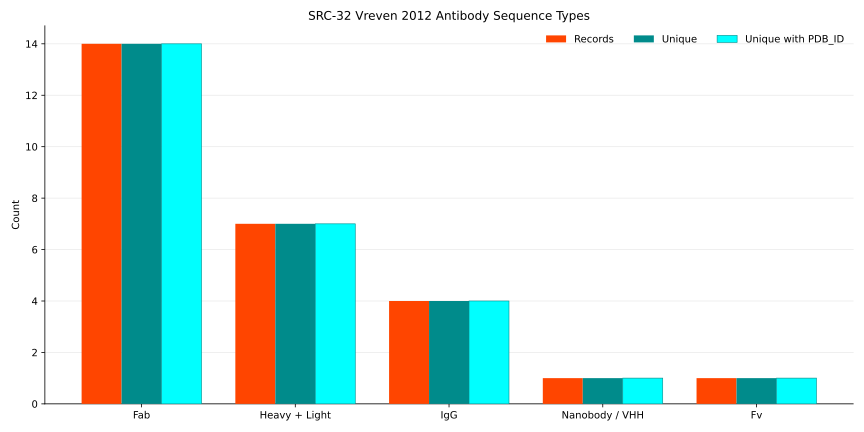
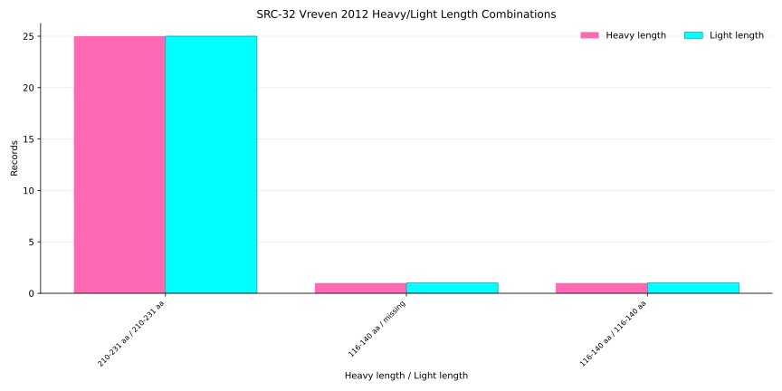
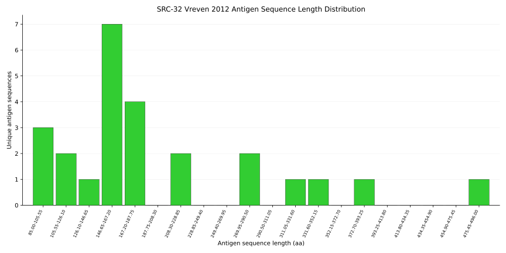

---
tags:
  - context
---

# [SRC-32 Vreven 2012](../2026-10-29-3a-src-readme/src-32-vreven-affinity-readme.md)

> 每条 data 统一建模为 `((ab, ag), label, assay, condition, replicate, source)`.
> 本地快照 `G:\abag-datasets\SRC_R32_VREVEN_AFFINITY\2.0`, affinity benchmark 2 张 TSV (`affinity_benchmark1` 144 行 + `affinity_benchmark2_additions` 35 行, 共 179 个复合物), 加 docking benchmark `Table_BM5.xlsx` 与 672 份冻结 RCSB entry FASTA.
> `Unique` 为 `(H 链序列, L 链序列)` 二元组精确去重; 链序列取冻结 FASTA, 链角色由 entity 描述判定.

## Antibody

> 有 Heavy 和 Light 的 `Unique` 字段是 `(heavy, light)` 二元组精确去重. `Unique with PDB_ID` 是按 Unique 后的 sequence 计数.
> Total Unique 计数方式为统一转 string, 如果有 Heavy 和 Light 用 `/` 拼接成 string.

| Key | 含义 | 说明 |
| --- | --- | --- |
| Sequence Type | 抗体序列类型 | 根据原始数据字段、链槽位及已有构建体标签划分的类别. |
| Records | 原始记录数 | 原始数据中的记录数量, 同一序列可能重复出现. |
| Unique | 唯一序列数 | 按对应数据集定义的去重规则统计. |
| Unique with PDB_ID | 关联 PDB 的唯一序列数 | 去重后具有关联 PDB_ID 的序列数量, 不等同于具有可用实验结构监督的序列数量. |
| Description | 类型说明 | 描述分类依据、序列槽位特征及分类限制. |

| Sequence Type | Records | Unique | Unique with PDB_ID | Description |
| --- | --- | --- | --- | --- |
| Fab | 14 | 14 | 14 | entity 描述显式写 `Fab` / `FAB FRAGMENT` / `Fab fragment`, 含 `IGG1-KAPPA D44.1 FAB`、`JEL42 FAB FRAGMENT` 等. |
| Heavy + Light | 7 | 7 | 7 | entity 只写 `IMMUNOGLOBULIN` / `IMMUNOGLOBULIN (IGG1, LAMBDA)` 或单抗名 + heavy/light 槽位, 未标构建体. |
| IgG | 4 | 4 | 4 | entity 描述显式写 `IGG` / `MURINE IGG` 且无 fragment 字样 (如 `2VXT` 的 `MURINE IGG 125-2H`). |
| Nanobody / VHH | 1 | 1 | 1 | entity 描述显式写 `VHH` (`1KXQ` 的 `antibody VHH fragment CABAMD9`). |
| Fv | 1 | 1 | 1 | entity 描述显式写 `FV` (`1VFB` 的 `IGG1-KAPPA D1.3 FV`). |
| Total | 27 | 27 | 27 |  |

> 这是 protein-protein affinity benchmark, 不是抗体库: 179 个复合物中只有 27 个含免疫球蛋白链, 其余 152 个是非抗体的蛋白-蛋白复合物, 不出现在本节.
>
> 链角色按 RCSB entity 描述判定, 判定顺序与 SRC-17 相同: 先排除 `BINDING PROTEIN` / `RECEPTOR` / `HISTOCOMPATIBILITY` / `LIGAND` 等非免疫球蛋白命名, 再要求描述中出现 `ANTIBODY` / `IMMUNOGLOBULIN` / `IGG` / `Fab` / `VHH` 等显式措辞. 因此 `3RVW` (`4C1 FAB` 只写在 TSV 的 `Protein A` 文本里, 冻结 FASTA 为空) 与 `1BVK` / `2I25` / `3L5W` / `3MXW` / `4DN4` (entity 只写 `Fv Hulys11`、`C836 HEAVY CHAIN`、`Shark single domain antigen receptor` 等不带免疫球蛋白措辞) 不判为抗体; 这些条目在源表 `Type` 列里被标为 `A`, 但源表标签不等于 entity 证据.
>
> `Unique with PDB_ID` 等于 `Unique`: 每个唯一链对都来自一个具名 PDB 条目, 且该条目同时含抗原与同源多拷贝链, 不是逐行独立解出的复合物.

| Heavy Length | Light Length | Records | Description |
| --- | --- | --- | --- |
| 210-231 aa | 210-231 aa | 25 | 主簇: 重链 210-231 aa + 轻链 210-221 aa, 双链均达 VH-CH1 / VL-CL 量级. |
| 116-140 aa | missing | 1 | 单域抗体侧: 只有一条 120 aa 的 VHH 链, 无轻链槽位 (`1KXQ`). |
| 116-140 aa | 116-140 aa | 1 | 两链均为纯可变区量级 (`1VFB` 的 Fv: 116 + 107 aa). |

## Antigen

> Antigen 统计以 source-native antigen entity 为核心单位. 优先使用原始 antigen ID/name、construct 和 antigen chain 定义实体; 存在可靠序列时再统计唯一抗原序列.
> 结构、序列和数据库注释压缩到同一张表中, `PDB / UniProt` 采用唯一抗原实体粒度统计 2 × 2 覆盖结果.
> 长度图基于唯一抗原序列, 按该源实际范围平均切分 20 bins.

> 抗原侧取抗体复合物中的非免疫球蛋白链, 实体按 `(PDB, chain)` 定义; 序列来自冻结的 RCSB entry FASTA, 属结构派生序列.

| Records | Unique ag entity | Unique ag sequence | PDB / UniProt coverage | Antigen Length | Antigen Evidence / Provenance | Description |
| --- | --- | --- | --- | --- | --- | --- |
| 27 | 64 | 25 | PDB=1/UniProt=0: 64; PDB=0/UniProt=0: 0 | 85-496 aa; 22 unique lengths | PDB-derived sequence / Reference PDB | 27 个含抗体链的复合物里, 非免疫球蛋白链合计 64 条实体 (含同源拷贝), 去重后 25 条唯一序列. 抗原序列全部来自冻结 FASTA, 每个实体挂其复合物 PDB, 属 Reference PDB; 不是逐行测量构建体. 其余 152 个无抗体复合物在本节不计. 4 份 FASTA (`1A2K`、`1ERK`、`2DTQ`、`3RVW`) 用 `mol:protein length:N` 风格的 header, 与本目录其余 668 份的 `|` 分隔格式不同, 且都不在抗体子集内. 表内无 UniProt 字段, 记 unavailable. |

## Affinity

> 去重口径: 按 **(complex PDB, 分区链)** 去重, 179 条 1:1 唯一; 其中 27 条含抗体链, 152 条是非抗体复合物 (条件里以 `Type` 区分, 该列是源表自带的类别码, 不是推断). 无 replicate 字段, 全记 `unknown`.
>
> `Kd (M)` 179 行全部有值, 其中 3 行是删失上界 (`<1.4e-11`、`<1e-10`、`<1e-13`), 不是点估计. `dG` 是由 Kd 按 RT ln K 换算的派生量 (逐行核对残差 < 1 kcal/mol), 不另立 label. `Method` 是自由文本, 拼写不统一 (`Flourescence`、`Spectroscopic inbition assay` 等); 只有逐字为 `SPR` / `ITC` / `BLI` / `ELISA` 的能落进封闭词表, 其余 84 行是抑制、荧光、量热以外的溶液相读出, 无对应词表项, 记 `unknown`. 同 SRC-17 PDBbind-PP 的独立复合物集, 两源有重叠条目, 跨源去重按 (complex PDB) 身份.

| Label | Assay | Condition | Replicate | Record pairs | Unique pairs | Description |
| --- | --- | --- | --- | --- | --- | --- |
| `Kd_M` | `unknown` | Type EI | unknown:38 | 38 | 38 | `Kd (M)` 2.40e-14-6.00e-06 M, 38 个复合物, 其中 0 个含抗体链; 1 行是删失上界 `<1e-13`. `dG` 同行给派生值, 不另立 label. |
| `Kd_M` | `SPR` | Type OX | unknown:16 | 16 | 16 | `Kd (M)` 1.40e-09-6.35e-04 M, 16 个复合物, 其中 0 个含抗体链; 全部为点估计. `dG` 同行给派生值, 不另立 label. |
| `Kd_M` | `SPR` | Type A | unknown:15 | 15 | 15 | `Kd (M)` 1.84e-11-4.70e-06 M, 15 个复合物, 其中 12 个含抗体链; 全部为点估计. `dG` 同行给派生值, 不另立 label. |
| `Kd_M` | `ITC` | Type OX | unknown:13 | 13 | 13 | `Kd (M)` 2.70e-08-2.21e-05 M, 13 个复合物, 其中 0 个含抗体链; 全部为点估计. `dG` 同行给派生值, 不另立 label. |
| `Kd_M` | `unknown` | Type OX | unknown:13 | 13 | 13 | `Kd (M)` 1.50e-10-2.00e-05 M, 13 个复合物, 其中 0 个含抗体链; 全部为点估计. `dG` 同行给派生值, 不另立 label. |
| `Kd_M` | `SPR` | Type OR | unknown:10 | 10 | 10 | `Kd (M)` 3.70e-12-1.70e-06 M, 10 个复合物, 其中 0 个含抗体链; 全部为点估计. `dG` 同行给派生值, 不另立 label. |
| `Kd_M` | `unknown` | Type OG | unknown:10 | 10 | 10 | `Kd (M)` 2.50e-12-1.70e-05 M, 10 个复合物, 其中 0 个含抗体链; 全部为点估计. `dG` 同行给派生值, 不另立 label. |
| `Kd_M` | `unknown` | Type ER | unknown:7 | 7 | 7 | `Kd (M)` 1.00e-09-1.10e-05 M, 7 个复合物, 其中 0 个含抗体链; 全部为点估计. `dG` 同行给派生值, 不另立 label. |
| `Kd_M` | `unknown` | Type A | unknown:5 | 5 | 5 | `Kd (M)` 2.90e-10-1.40e-08 M, 5 个复合物, 其中 4 个含抗体链; 全部为点估计. `dG` 同行给派生值, 不另立 label. |
| `Kd_M` | `SPR` | Type EI | unknown:5 | 5 | 5 | `Kd (M)` 9.20e-12-7.70e-08 M, 5 个复合物, 其中 0 个含抗体链; 全部为点估计. `dG` 同行给派生值, 不另立 label. |
| `Kd_M` | `ITC` | Type OG | unknown:4 | 4 | 4 | `Kd (M)` 1.50e-07-3.00e-06 M, 4 个复合物, 其中 0 个含抗体链; 全部为点估计. `dG` 同行给派生值, 不另立 label. |
| `Kd_M` | `SPR` | Type AB | unknown:4 | 4 | 4 | `Kd (M)` 2.40e-10-3.50e-09 M, 4 个复合物, 其中 4 个含抗体链; 1 行是删失上界 `<1.4e-11`. `dG` 同行给派生值, 不另立 label. |
| `Kd_M` | `unknown` | Type ES | unknown:4 | 4 | 4 | `Kd (M)` 1.30e-06-4.50e-06 M, 4 个复合物, 其中 0 个含抗体链; 全部为点估计. `dG` 同行给派生值, 不另立 label. |
| `Kd_M` | `SPR` | Type ER | unknown:4 | 4 | 4 | `Kd (M)` 1.20e-09-3.30e-07 M, 4 个复合物, 其中 0 个含抗体链; 全部为点估计. `dG` 同行给派生值, 不另立 label. |
| `Kd_M` | `ITC` | Type OR | unknown:4 | 4 | 4 | `Kd (M)` 4.00e-08-3.50e-06 M, 4 个复合物, 其中 0 个含抗体链; 全部为点估计. `dG` 同行给派生值, 不另立 label. |
| `Kd_M` | `unknown` | Type OR | unknown:4 | 4 | 4 | `Kd (M)` 1.70e-10-4.40e-06 M, 4 个复合物, 其中 0 个含抗体链; 全部为点估计. `dG` 同行给派生值, 不另立 label. |
| `Kd_M` | `ITC` | Type ES | unknown:4 | 4 | 4 | `Kd (M)` 6.00e-08-6.00e-05 M, 4 个复合物, 其中 0 个含抗体链; 全部为点估计. `dG` 同行给派生值, 不另立 label. |
| `Kd_M` | `SPR` | Type OG | unknown:3 | 3 | 3 | `Kd (M)` 1.10e-06-7.70e-06 M, 3 个复合物, 其中 0 个含抗体链; 全部为点估计. `dG` 同行给派生值, 不另立 label. |
| `Kd_M` | `ITC` | Type ER | unknown:3 | 3 | 3 | `Kd (M)` 2.50e-09-1.46e-06 M, 3 个复合物, 其中 0 个含抗体链; 全部为点估计. `dG` 同行给派生值, 不另立 label. |
| `Kd_M` | `unknown` | Type AB | unknown:3 | 3 | 3 | `Kd (M)` 2.80e-09-8.30e-09 M, 3 个复合物, 其中 3 个含抗体链; 1 行是删失上界 `<1e-10`. `dG` 同行给派生值, 不另立 label. |
| `Kd_M` | `ITC` | Type A | unknown:3 | 3 | 3 | `Kd (M)` 3.70e-09-1.90e-08 M, 3 个复合物, 其中 1 个含抗体链; 全部为点估计. `dG` 同行给派生值, 不另立 label. |
| `Kd_M` | `SPR` | Type ES | unknown:2 | 2 | 2 | `Kd (M)` 4.50e-08-8.56e-07 M, 2 个复合物, 其中 0 个含抗体链; 全部为点估计. `dG` 同行给派生值, 不另立 label. |
| `Kd_M` | `BLI` | Type A | unknown:2 | 2 | 2 | `Kd (M)` 9.00e-10-6.20e-09 M, 2 个复合物, 其中 2 个含抗体链; 全部为点估计. `dG` 同行给派生值, 不另立 label. |
| `Kd_M` | `ELISA` | Type A | unknown:1 | 1 | 1 | `Kd (M)` 1.30e-10-1.30e-10 M, 1 个复合物, 其中 1 个含抗体链; 全部为点估计. `dG` 同行给派生值, 不另立 label. |
| `Kd_M` | `ITC` | Type EI | unknown:1 | 1 | 1 | `Kd (M)` 2.81e-06-2.81e-06 M, 1 个复合物, 其中 0 个含抗体链; 全部为点估计. `dG` 同行给派生值, 不另立 label. |
| `Kd_M` | `SPR` | Type E | unknown:1 | 1 | 1 | `Kd (M)` 3.04e-07-3.04e-07 M, 1 个复合物, 其中 0 个含抗体链; 全部为点估计. `dG` 同行给派生值, 不另立 label. |
