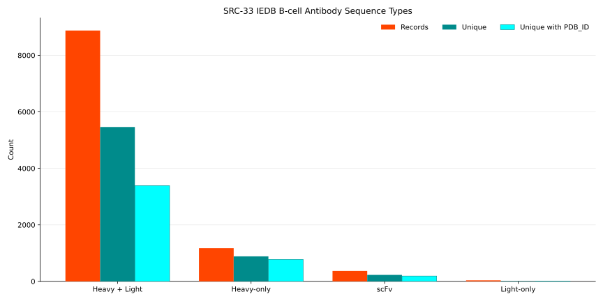
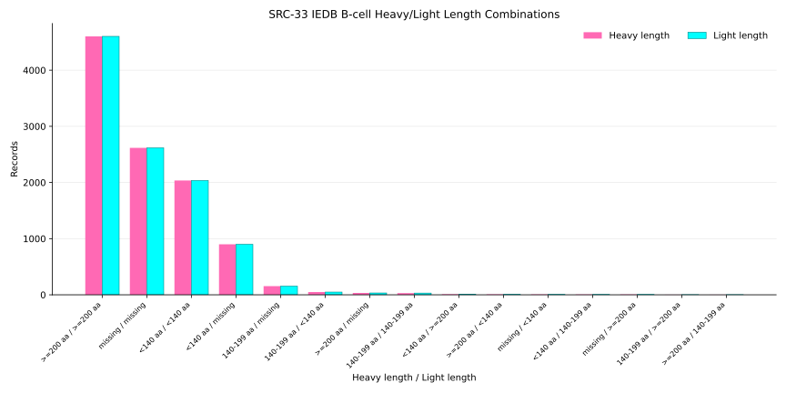
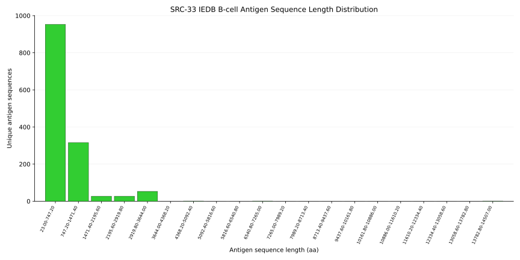

---
tags:
  - context
---

# SRC-33 IEDB B-cell

> 每条 data 统一建模为 `((ab, ag), label, assay, condition, replicate, source)`.
> 本地快照 `G:\abag-datasets\SRC_R33_IEDB_BCELL\snapshot-2026-09-13`, 三张 CSV 直接从 ZIP 内读出, 不解包: `bcell_full_v3.csv` (1,692,185 行, 131 列), `bcr_full_v3.csv` (10,461 行, 74 列), `bcr_3d_assays.csv` (5,947 行, 48 列), 加 5,515 个冻结 RCSB entry.
> 三张表都是两行表头 (分组 + 字段), 本脚本把两行拼成 `分组 / 字段` 后再读, 避免 `Name`、`IRI`、`Type` 这类重名互相覆盖.
> 抗体侧只数 BCR 表: B-cell 表有 `Antibody Name` 但没有链序列, 无法落 `Sequence Type`.

## Antibody

> 有 Heavy 和 Light 的 `Unique` 字段是 `(heavy, light)` 二元组精确去重. `Unique with PDB_ID` 是按 Unique 后的 sequence 计数.
> Total Unique 计数方式为统一转 string, 如果有 Heavy 和 Light 用 `/` 拼接成 string.

| Key | 含义 | 说明 |
| --- | --- | --- |
| Sequence Type | 抗体序列类型 | 根据原始数据字段、链槽位及已有构建体标签划分的类别. |
| Records | 原始记录数 | 原始数据中的记录数量, 同一序列可能重复出现. |
| Unique | 唯一序列数 | 按对应数据集定义的去重规则统计. |
| Unique with PDB_ID | 关联 PDB 的唯一序列数 | 去重后具有关联 PDB_ID 的序列数量, 不等同于具有可用实验结构监督的序列数量. |
| Description | 类型说明 | 描述分类依据、序列槽位特征及分类限制. |

| Sequence Type | Records | Unique | Unique with PDB_ID | Description |
| --- | --- | --- | --- | --- |
| Heavy + Light | 8,877 | 5,463 | 3,387 | `heavylight` 7,121 行 + `construct` 1,756 行; 两槽都有链, 无 Fab / Fv / IgG 措辞. |
| Heavy-only | 1,177 | 885 | 778 | `heavy` 950 + `heavyheavy` 210 + `IgNAR` 17; 单体或双重重链, 无轻链槽位. `IgNAR` 是鲨鱼重链抗体, 源内按单链记录. |
| scFv | 369 | 229 | 190 | 源内 `Receptor / Type` 显式标 `scFv`, 369 行; 仍分 Chain 1 / Chain 2 两槽记录. |
| Light-only | 38 | 13 | 13 | `lightlight` 26 + `light` 12; 只有轻链槽位. |
| Total | 10,461 | 6,586 | 4,364 |  |

> `Receptor / Type` 是源内构建体标记: `scFv` 369 行直接归 `scFv`; `heavylight` 与 `construct` 行按槽位归 `Heavy + Light`; `heavy`、`heavyheavy`、`IgNAR` 只有重链槽位, 归 `Heavy-only`; `lightlight`、`light` 归 `Light-only`. 源内没有 Fab / Fv / IgG 的措辞, 因此不出现这三类, 也不按长度反推.
>
> `construct` 是 IEDB 自己的构建体类别, 不在固定词表内; 它的 1,756 行绝大多数是 Chain 1 heavy + Chain 2 kappa/lambda light, 因此按槽位落 `Heavy + Light`, 不另立类别.
>
> `Unique` 按 `(Chain 1 Protein Sequence, Chain 2 Protein Sequence)` 精确去重. 1,633 个单元两槽都没有序列, 只能按 `IEDB Receptor ID` 记身份; 这 1,633 个占全表 25%.
>
> 各类 `Unique` 直接相加是 6,590, 但全表并集是 6,586: 有 4 个单元在两种 `Receptor / Type` 下各出现一次 (同一对链既被标 `heavylight` 又被标 `heavy`, 或既 `heavylight` 又 `scFv`). PDB 覆盖同理, 4,368 对 4,364.
>
> `Unique with PDB_ID` 记 4,364: 命中条件是两种源内非空结构标识之一, 该行的链 `Protein IRI` 是 PDB 链登录号 (如 `.../protein/1K4C_A`), 或该 `Receptor ID` 在 `bcr_3d_assays.csv` 里有 `PDB ID`. BCR 表自身没有 PDB 列.
>
> 同一个 `Receptor ID` 可对应多条不同链序列 (246 个 ID 有多种序列对), 所以去重单位是序列对而不是受体 ID; 反过来说, 受体 ID 也不是"一条抗体一个 ID"的键.
>
> 长度表按链字面长度分三档 (missing / <140 aa / 140-199 aa / >=200 aa) 的组合, 共 15 组: 4,602 行两侧都在 200 aa 以上 (含恒定区的 Fab / IgG 量级链), 2,617 行两侧都没有序列, 2,036 行两侧都短于 140 aa (V 区量级). 各组的构建体仍按 `Receptor / Type` 判定, 不按长度反推.

| Heavy Length | Light Length | Records | Description |
| --- | --- | --- | --- |
| >=200 aa | >=200 aa | 4,602 | 两侧都是含恒定区的完整链量级 (Fab / IgG), 主体形式. |
| missing | missing | 2,617 | 两槽都没有链序列, 只有受体 ID 与注释. |
| <140 aa | <140 aa | 2,036 | 两侧都在 V 区量级, 常见于 scFv 与可变区片段. |
| <140 aa | missing | 899 | 只有重链且是 V 区量级, 轻链未登记. |
| 140-199 aa | missing | 154 | 只有重链且落在中间区段. |
| 140-199 aa | <140 aa | 49 | 重链中间区段, 轻链 V 区量级. |
| >=200 aa | missing | 33 | 只有重链且是完整链量级. |
| 140-199 aa | 140-199 aa | 30 | 两侧都在中间区段. |
| <140 aa | >=200 aa | 10 | 重链 V 区量级配完整长链. |
| >=200 aa | <140 aa | 8 | 重链完整长链配轻链 V 区量级. |
| missing | <140 aa | 7 | 只有轻链且是 V 区量级. |
| <140 aa | 140-199 aa | 6 | 重链 V 区量级, 轻链在中间区段. |
| missing | >=200 aa | 6 | 只有轻链且是完整链量级. |
| 140-199 aa | >=200 aa | 2 | 重链中间区段配完整长链. |
| >=200 aa | 140-199 aa | 2 | 重链完整长链配轻链中间区段. |

## Antigen

> Antigen 统计以 source-native antigen entity 为核心单位. 优先使用原始 antigen ID/name、construct 和 antigen chain 定义实体; 存在可靠序列时再统计唯一抗原序列.
> 结构、序列和数据库注释压缩到同一张表中, `PDB / UniProt` 采用唯一抗原实体粒度统计 2 × 2 覆盖结果.
> 长度图基于唯一抗原序列, 按该源实际范围平均切分 20 bins.

> 抗原实体取 B-cell 表 `Assay Antigen` 三段: 优先 `Source Molecule IRI`, 其次 `Molecule Parent IRI`, 两者都空时用 `(Name, Organism)`. 表位 (Epitope) 是被测区段, 不是抗原实体.
> 抗原序列只来自 `bcr_3d_assays.csv` 的 `Antigen Sequence`; B-cell 表本身没有任何抗原序列列.

| Records | Unique ag entity | Unique ag sequence | PDB / UniProt coverage | Antigen Length | Antigen Evidence / Provenance | Description |
| --- | --- | --- | --- | --- | --- | --- |
| 1,692,185 | 109,402 | 1,379 | PDB=1/UniProt=0: 1,328; PDB=0/UniProt=0: 70,061; PDB=0/UniProt=1: 37,219; PDB=1/UniProt=1: 794 | 23-14507 aa; 692 unique lengths | Source-native / Direct sequence | 109,402 个实体按分子 IRI 或 (名称, 物种) 计: 38,825 个有 IRI, 70,577 个只有名称; 另有 89 行的抗原三段全空, 不成实体. 按 `Object Type`: Linear peptide 1,585,521 行, Protein 50,597 行, Organism 30,748 行; 肽段与完整蛋白是不同的抗原实体, 不合并. PDB 命中看该行 `Complex / PDB ID` 非空, 共 2,122 个实体; UniProt 命中看分子 IRI 或 Parent IRI 是否指向 uniprot.org, 共 38,013 个. 其余既无结构也无 UniProt 链接, 记 0, 不是生物学上不存在. 抗原序列只来自 3D 表: 那里给出 1,455 个抗原 IRI 的序列, 共 1,379 条唯一序列, 长度 23-14507 aa (最短是表位肽, 最长是 14,507 aa 的 Mucin-16 构建体). 这 1,455 个 IRI 里只有 876 个能对回上面 109,402 个 B-cell 实体; 其余 108,526 个实体只有名称或 ID, 没有序列, 不进长度图. 长度是源内给的构建体长度, 不是被测表位长度. |

## Affinity

> 去重口径: 按 **(Antibody Name, 抗原实体)** 去重; 行内没有 `Antibody Name` 时 (1,555,479 行) 没有抗体身份可配, 按该行自己的 assay IRI 计一次. 全表 assay IRI 逐行唯一, 所以只有带名字的 136,706 行会在组内折叠: 全部组加起来 1,692,185 行折成 1,629,880 个 pair.
>
> 一行是一个 curated assay, `Assay / Response measured` 是测的什么, `Units` 是量纲, `Measurement Inequality` 是删失关系. 同一个数值列在不同 Response 下量纲不同, 所以按 Response 拆组而不合并.
>
> `KD (nM)` 14,503 行是唯一可当 Kd 的列, 但其中 213 行写 `>`, 18 行写 `>=` (2,603 行写 `=`), 这些是删失边界而不是点估计.
>
> `off rate` / `on rate` 是解离/结合速率 (1/s, M^-1s^-1), `association constant KA` 是结合常数 (1/nM), 三者都不是 Kd, 词表里没有对应项, 记 `not_recorded` 并在 Description 写明原列名, 不改写成 Kd.
>
> `Qualitative Measure` 的 `Positive` / `Negative` 归 `binary`; `Positive-Low` / `Positive-Intermediate` / `Positive-High` 是源内的三级强度, 归 `ordinal`. 三个定性读出 (qualitative binding / antibody binding / neutralization) 共 1,647,795 行, 每一行都有判定, 没有空白可当阴性.
>
> 功能与体内终点 (ADCC、CDC、保护力、生存、调理、组胺释放等) 与 `3D structure` 的分辨率都不是结合强度, 统一落 `not_recorded`, 不折算成亲和力.
>
> 源内没有重复测量字段, `Replicate` 全记 `unknown`.

| Label | Assay | Condition | Replicate | Record pairs | Unique pairs | Description |
| --- | --- | --- | --- | --- | --- | --- |
| `binary` | `unknown` | qualitative binding | unknown:956,578 | 956,578 | 947,660 | `Qualitative Measure` 的 `Positive` / `Negative` 判定, 956,578 行, 读出是 qualitative binding. |
| `binary` | `phage_display` | qualitative binding | unknown:275,696 | 275,696 | 275,427 | `Qualitative Measure` 的 `Positive` / `Negative` 判定, 275,696 行, 读出是 qualitative binding. |
| `binary` | `unknown` | antibody binding | unknown:174,477 | 174,477 | 174,396 | `Qualitative Measure` 的 `Positive` / `Negative` 判定, 174,477 行, 读出是 antibody binding. |
| `binary` | `ELISA` | qualitative binding | unknown:159,457 | 159,457 | 144,407 | `Qualitative Measure` 的 `Positive` / `Negative` 判定, 159,457 行, 读出是 qualitative binding. |
| `ordinal` | `unknown` | qualitative binding | unknown:38,172 | 38,172 | 36,467 | `Qualitative Measure` 的 `Positive-Low` / `Positive-Intermediate` / `Positive-High` 三级, 38,172 行, 读出是 qualitative binding. 三级是源内强度层级, 跨 assay 无可比刻度. |
| `binary` | `unknown` | neutralization | unknown:19,500 | 19,500 | 17,198 | `Qualitative Measure` 的 `Positive` / `Negative` 判定, 19,500 行, 读出是 neutralization. |
| `not_recorded` | `unknown` | functional / in vivo endpoint | unknown:12,359 | 12,359 | 11,033 | 功能与体内终点共 12,359 行, 含 agglutination, antibody activity inhibition, antibody-dependent cellular cytotoxicity, antigen activation, complement-dependent cytotoxicity 等 37 种读出 (保护力、生存、ADCC、CDC、调理、组胺释放). 都不是结合强度, 记 `not_recorded`. |
| `ordinal` | `ELISA` | qualitative binding | unknown:10,249 | 10,249 | 9,598 | `Qualitative Measure` 的 `Positive-Low` / `Positive-Intermediate` / `Positive-High` 三级, 10,249 行, 读出是 qualitative binding. 三级是源内强度层级, 跨 assay 无可比刻度. |
| `not_recorded` | `SPR` | kinetics (off rate / on rate) | unknown:7,054 | 7,054 | 2,957 | `kdis (1/s)` 与 `ka (M^-1s^-1)` 两列, 本组含 off rate 与 on rate 两种读出, 7,054 行. 速率不是 Kd, 词表无对应 label, 记 `not_recorded` 以免被当成亲和力; 同批行里配对的 Kd 在 `Kd_M` 行另计. |
| `not_recorded` | `unknown` | 3D structure | unknown:6,214 | 6,214 | 4,725 | `Resolution (angstroms)` 6,214 行; 结构分辨率不是结合强度, 记 `not_recorded`. |
| `Kd_M` | `SPR` | dissociation constant KD | unknown:6,201 | 6,201 | 4,915 | `KD (nM)` 6,201 行, 值域 1.6e-22-4.59e+07 nM, 中位数 4.77 nM. 本组 `Measurement Inequality` 写 `=` 的 1,075 行是明确等式, `>` 39 行 / `>=` 6 行是删失边界, 其余 5,081 行没有记录不等关系. 保留源内 nM 量纲, 不做单位换算. |
| `binary` | `flow` | qualitative binding | unknown:5,173 | 5,173 | 4,592 | `Qualitative Measure` 的 `Positive` / `Negative` 判定, 5,173 行, 读出是 qualitative binding. |
| `ordinal` | `unknown` | neutralization | unknown:4,339 | 4,339 | 3,762 | `Qualitative Measure` 的 `Positive-Low` / `Positive-Intermediate` / `Positive-High` 三级, 4,339 行, 读出是 neutralization. 三级是源内强度层级, 跨 assay 无可比刻度. |
| `Kd_M` | `BLI` | dissociation constant KD | unknown:3,840 | 3,840 | 2,910 | `KD (nM)` 3,840 行, 值域 0.0001-1e+12 nM, 中位数 5 nM. 本组 `Measurement Inequality` 写 `=` 的 669 行是明确等式, `>` 9 行 / `>=` 3 行是删失边界, 其余 3,159 行没有记录不等关系. 保留源内 nM 量纲, 不做单位换算. |
| `not_recorded` | `BLI` | kinetics (off rate / on rate) | unknown:3,286 | 3,286 | 1,331 | `kdis (1/s)` 与 `ka (M^-1s^-1)` 两列, 本组含 off rate 与 on rate 两种读出, 3,286 行. 速率不是 Kd, 词表无对应 label, 记 `not_recorded` 以免被当成亲和力; 同批行里配对的 Kd 在 `Kd_M` 行另计. |
| `Kd_M` | `unknown` | dissociation constant KD | unknown:2,523 | 2,523 | 2,143 | `KD (nM)` 2,523 行, 值域 3e-06-9.6e+15 nM, 中位数 100 nM. 本组 `Measurement Inequality` 写 `=` 的 480 行是明确等式, `>` 140 行 / `>=` 6 行是删失边界, 其余 1,897 行没有记录不等关系. 保留源内 nM 量纲, 不做单位换算. |
| `ordinal` | `phage_display` | qualitative binding | unknown:1,796 | 1,796 | 1,789 | `Qualitative Measure` 的 `Positive-Low` / `Positive-Intermediate` / `Positive-High` 三级, 1,796 行, 读出是 qualitative binding. 三级是源内强度层级, 跨 assay 无可比刻度. |
| `Kd_M` | `ELISA` | dissociation constant KD | unknown:1,438 | 1,438 | 1,203 | `KD (nM)` 1,438 行, 值域 1e-10-1.1e+07 nM, 中位数 2.2 nM. 本组 `Measurement Inequality` 写 `=` 的 340 行是明确等式, `>` 25 行 / `>=` 3 行是删失边界, 其余 1,070 行没有记录不等关系. 保留源内 nM 量纲, 不做单位换算. |
| `ordinal` | `flow` | qualitative binding | unknown:867 | 867 | 683 | `Qualitative Measure` 的 `Positive-Low` / `Positive-Intermediate` / `Positive-High` 三级, 867 行, 读出是 qualitative binding. 三级是源内强度层级, 跨 assay 无可比刻度. |
| `binary` | `BLI` | qualitative binding | unknown:591 | 591 | 523 | `Qualitative Measure` 的 `Positive` / `Negative` 判定, 591 行, 读出是 qualitative binding. |
| `binary` | `SPR` | qualitative binding | unknown:548 | 548 | 459 | `Qualitative Measure` 的 `Positive` / `Negative` 判定, 548 行, 读出是 qualitative binding. |
| `Kd_M` | `ITC/KinExA` | dissociation constant KD | unknown:501 | 501 | 363 | `KD (nM)` 501 行, 值域 1.6e-05-6.5e+05 nM, 中位数 47 nM. 本组 `Measurement Inequality` 写 `=` 的 57 行是明确等式, `>` 0 行 / `>=` 0 行是删失边界, 其余 444 行没有记录不等关系. 保留源内 nM 量纲, 不做单位换算. |
| `not_recorded` | `SPR` | association constant KA | unknown:240 | 240 | 192 | `KA (1/nM)` 240 行; 结合常数是 Kd 的倒数, 不是 Kd, 词表无对应 label, 记 `not_recorded`. |
| `not_recorded` | `ELISA` | association constant KA | unknown:212 | 212 | 203 | `KA (1/nM)` 212 行; 结合常数是 Kd 的倒数, 不是 Kd, 词表无对应 label, 记 `not_recorded`. |
| `not_recorded` | `unknown` | association constant KA | unknown:212 | 212 | 196 | `KA (1/nM)` 212 行; 结合常数是 Kd 的倒数, 不是 Kd, 词表无对应 label, 记 `not_recorded`. |
| `not_recorded` | `unknown` | kinetics (off rate / on rate) | unknown:192 | 192 | 107 | `kdis (1/s)` 与 `ka (M^-1s^-1)` 两列, 本组含 off rate 与 on rate 两种读出, 192 行. 速率不是 Kd, 词表无对应 label, 记 `not_recorded` 以免被当成亲和力; 同批行里配对的 Kd 在 `Kd_M` 行另计. |
| `ordinal` | `BLI` | qualitative binding | unknown:145 | 145 | 127 | `Qualitative Measure` 的 `Positive-Low` / `Positive-Intermediate` / `Positive-High` 三级, 145 行, 读出是 qualitative binding. 三级是源内强度层级, 跨 assay 无可比刻度. |
| `ordinal` | `SPR` | qualitative binding | unknown:116 | 116 | 104 | `Qualitative Measure` 的 `Positive-Low` / `Positive-Intermediate` / `Positive-High` 三级, 116 行, 读出是 qualitative binding. 三级是源内强度层级, 跨 assay 无可比刻度. |
| `not_recorded` | `ITC/KinExA` | association constant KA | unknown:108 | 108 | 92 | `KA (1/nM)` 108 行; 结合常数是 Kd 的倒数, 不是 Kd, 词表无对应 label, 记 `not_recorded`. |
| `ordinal` | `unknown` | antibody binding | unknown:71 | 71 | 37 | `Qualitative Measure` 的 `Positive-Low` / `Positive-Intermediate` / `Positive-High` 三级, 71 行, 读出是 antibody binding. 三级是源内强度层级, 跨 assay 无可比刻度. |
| `binary` | `ITC/KinExA` | qualitative binding | unknown:20 | 20 | 20 | `Qualitative Measure` 的 `Positive` / `Negative` 判定, 20 行, 读出是 qualitative binding. |
| `not_recorded` | `BLI` | dissociation constant KD | unknown:4 | 4 | 4 | 该组 `dissociation constant KD` 有 4 行但 `Quantitative measurement` 为空, 没有数值, 记 `not_recorded`; 不是 0, 也不是不结合. 其中 `=` 0 行 / `>` 0 行. |
| `not_recorded` | `unknown` | dissociation constant KD | unknown:4 | 4 | 4 | 该组 `dissociation constant KD` 有 4 行但 `Quantitative measurement` 为空, 没有数值, 记 `not_recorded`; 不是 0, 也不是不结合. 其中 `=` 0 行 / `>` 0 行. |
| `not_recorded` | `ELISA` | dissociation constant KD | unknown:1 | 1 | 1 | 该组 `dissociation constant KD` 有 1 行但 `Quantitative measurement` 为空, 没有数值, 记 `not_recorded`; 不是 0, 也不是不结合. 其中 `=` 0 行 / `>` 0 行. |
| `not_recorded` | `SPR` | dissociation constant KD | unknown:1 | 1 | 1 | 该组 `dissociation constant KD` 有 1 行但 `Quantitative measurement` 为空, 没有数值, 记 `not_recorded`; 不是 0, 也不是不结合. 其中 `=` 0 行 / `>` 0 行. |
