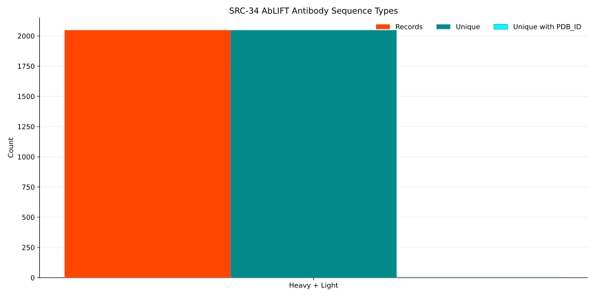
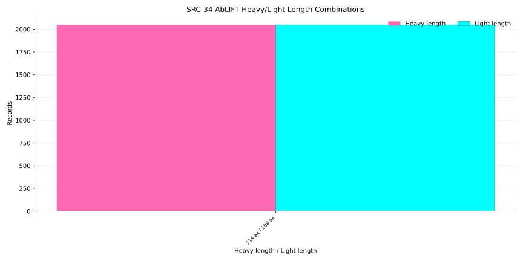
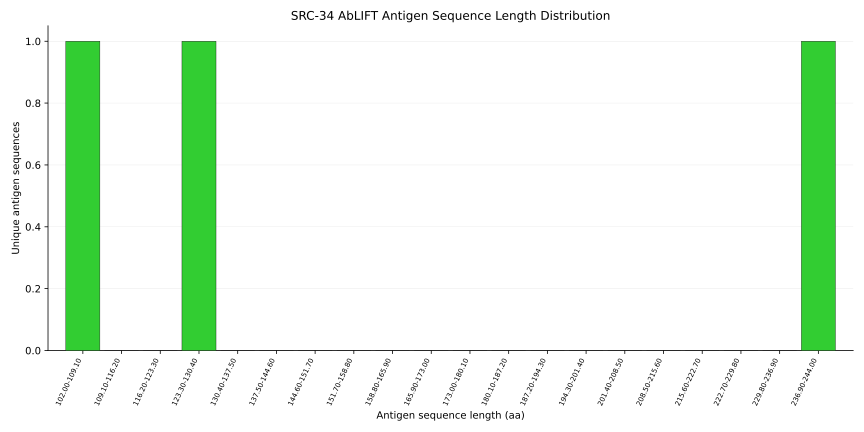

---
tags:
  - context
---

# SRC-34 AbLIFT

> 每条 data 统一建模为 `((ab, ag), label, assay, condition, replicate, source)`.
> 本地快照 `G:\abag-datasets\SRC_R34_ABLIFT\snapshot-2019-08-23`, `FLAb/warszawski2019_d44_Kd.csv` 2,048 行 × 6 列, 加 `AbLIFT/` 两张 ddG 矩阵 XLSX (s007 与 s010 逐字节相同) 与 7 个冻结 RCSB entry.
> `Unique` 为 `(heavy, light)` 二元组精确去重, 2,048 行全部 1:1 唯一.

## Antibody

> 有 Heavy 和 Light 的 `Unique` 字段是 `(heavy, light)` 二元组精确去重. `Unique with PDB_ID` 是按 Unique 后的 sequence 计数.
> Total Unique 计数方式为统一转 string, 如果有 Heavy 和 Light 用 `/` 拼接成 string.

| Key | 含义 | 说明 |
| --- | --- | --- |
| Sequence Type | 抗体序列类型 | 根据原始数据字段、链槽位及已有构建体标签划分的类别. |
| Records | 原始记录数 | 原始数据中的记录数量, 同一序列可能重复出现. |
| Unique | 唯一序列数 | 按对应数据集定义的去重规则统计. |
| Unique with PDB_ID | 关联 PDB 的唯一序列数 | 去重后具有关联 PDB_ID 的序列数量, 不等同于具有可用实验结构监督的序列数量. |
| Description | 类型说明 | 描述分类依据、序列槽位特征及分类限制. |

| Sequence Type | Records | Unique | Unique with PDB_ID | Description |
| --- | --- | --- | --- | --- |
| Heavy + Light | 2,048 | 2,048 | 1 | `heavy` / `light` 两列均为 V 区量级 (114 / 108 aa), 源未给构建体标签; 亲本 D44.1 的参考结构是 Fab 复合物 `1MLC`. |
| Total | 2,048 | 2,048 | 1 |  |

> 表内只有 `heavy` (114 aa) 与 `light` (108 aa) 两列可变区序列, 没有构建体字段; 两条链均属纯 V 区量级, 但源未标 Fab / Fv, 因此归 `Heavy + Light`, 不从长度反推.
>
> 抗体单元是 D44.1 的 2,048 个 VH/VL 组合. 全部记录同属一个亲本抗体, 只有 1 个 PDB entry `1MLC`, 即 D44.1 Fab 的亲本复合物; `1MLB` 是同一 Fab 的游离形式. 没有任何变体单独解出结构.

| Heavy Length | Light Length | Records | Description |
| --- | --- | --- | --- |
| 114 aa | 108 aa | 2,048 | 唯一观测到的长度组合; 全部变体只改可变区, 两列长度恒定. |

## Antigen

> Antigen 统计以 source-native antigen entity 为核心单位. 优先使用原始 antigen ID/name、construct 和 antigen chain 定义实体; 存在可靠序列时再统计唯一抗原序列.
> 结构、序列和数据库注释压缩到同一张表中, `PDB / UniProt` 采用唯一抗原实体粒度统计 2 × 2 覆盖结果.
> 长度图基于唯一抗原序列, 按该源实际范围平均切分 20 bins.

> 抗原侧取快照内抗体复合物中的非免疫球蛋白链, 实体按 `(PDB, chain)` 定义; 序列来自冻结的 RCSB entry FASTA, 属结构派生序列.

| Records | Unique ag entity | Unique ag sequence | PDB / UniProt coverage | Antigen Length | Antigen Evidence / Provenance | Description |
| --- | --- | --- | --- | --- | --- | --- |
| 2,048 | 9 | 3 | PDB=1/UniProt=0: 9; PDB=0/UniProt=0: 0 | 102-244 aa; 3 unique lengths | PDB-derived sequence / Reference PDB | 7 个本地条目中 4 个含抗体链 (`1MLC`、`1P2C`、`2FJG`、`4IJ3`), 其非免疫球蛋白链合计 9 条实体, 去重后 3 条序列: HEW lysozyme 129 aa (`1MLC` 2 条 + `1P2C` 2 条), VEGF-A 102 aa (`2FJG` 4 条), sulfhydryl oxidase 244 aa (`4IJ3` 1 条). 2,048 条测量记录的实测抗原只有 HEW lysozyme (`1MLC`); 其余实体属同批参考结构, 不是逐行测量构建体. `1MLB` 与 `2Q76` 只有抗体链, `6GC2` 的链描述只写 `Heavy chain` / `Light Chain` 而无免疫球蛋白措辞, 按规则不判抗体, 因此该条目不进入本节. 表内无 UniProt 字段. |

## Affinity

> 去重口径: 按 **(heavy 序列, light 序列)** 去重, FLAb 2,048 行全 1:1; ddG 矩阵按 **(链, 位点, 替换 aa)** 去重, 每个格点一条. 无 replicate 字段, 全记 `unknown`.
>
> `FLAb/warszawski2019_d44_Kd.csv` 给 `KD (nM)` 与 `-log10 (KD (M))`, 两条互为换算 (已逐行核对), 只把 `KD (nM)` 记 `Kd_M`, 不重复计 `log_Kd`. 这 2,048 行与 SRC-09 的 `warszawski2019 D44` 行、SRC-12 的 `flab_warszawski2019` 是同一批测量, 跨源汇总必须按测量身份去重, 不能三处相加. `AbLIFT/journal.pcbi.1007207.s007.xlsx` 与 `s010.xlsx` 逐字节相同 (md5 一致), 是同一 ddG 矩阵的两次命名, 不叠加.

| Label | Assay | Condition | Replicate | Record pairs | Unique pairs | Description |
| --- | --- | --- | --- | --- | --- | --- |
| `Kd_M` | `unknown` | D44.1 FLAb (KD nM) | unknown:2,048 | 2,048 | 2,048 | `KD (nM)` 3.7e-05-60.34 nM (即 3.7e-14-6.0e-08 M), 全 2,048 行有值; 同一行另给 `-log10 (KD (M))` 7.22-13.43, 是同值换算, 不另立 label. 表内无方法字段, assay 记 `unknown`. |
| `ddG` | `computational` | AbLIFT vL (47 位点 × 20 aa) | unknown:912 | 912 | 912 | `s007` 矩阵 vL 段, -3.38-10.20; 每格一条单点替换的计算值, 对角 (WT 对自身) 取值在 -2.1e-06 与 -5.2e-07 之间, 数值上即 0. 28 个格点为空, 空值保留为缺失. |
| `ddG` | `computational` | AbLIFT vH (68 位点 × 20 aa) | unknown:1,297 | 1,297 | 1,297 | `s007` 矩阵 vH 段, -4.10-10.18; 每格一条单点替换的计算值, 对角 (WT 对自身) 取值在 -2.1e-06 与 -5.2e-07 之间, 数值上即 0. 63 个格点为空, 空值保留为缺失. |
