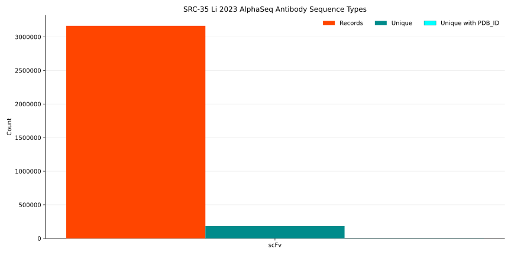
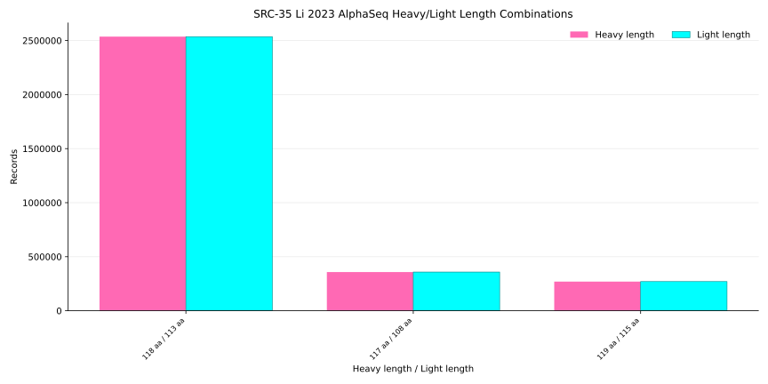
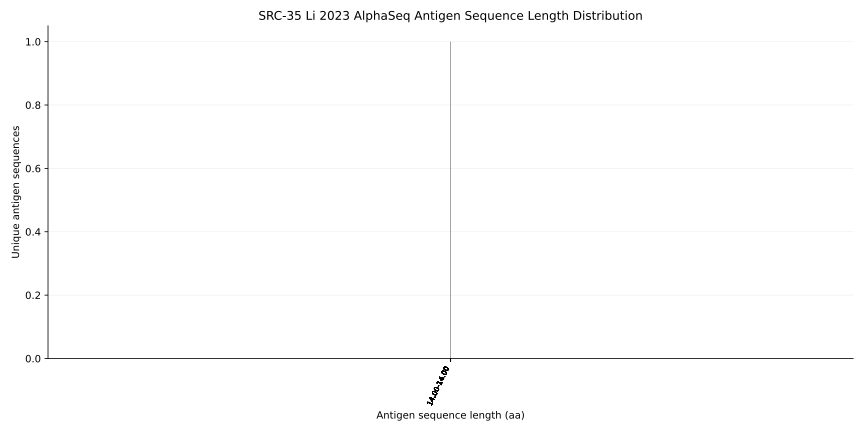

---
tags:
  - context
---

# [SRC-35 Li 2023 AlphaSeq](../2026-10-29-3a-src-readme/src-35-li-alphaseq-readme.md)

> 每条 data 统一建模为 `((ab, ag), label, assay, condition, replicate, source)`.
> 本地快照 `G:\abag-datasets\SRC_R35_LI_ALPHASEQ\v2.0.0`, `AlphaSeq_Antibody_Dataset/mit-ll-AlphaSeq_Antibody_Dataset-a8f64a9/` 两张 CSV: `antibody_dataset_1` 1,259,700 行, `antibody_dataset_2` 1,903,921 行 (表头前有 6 行免责声明), 共 3,163,621 行.
> `Unique` 为 `Sequence` (完整 scFv 单链) 精确去重; 两表合并后取并集.

## Antibody

> 有 Heavy 和 Light 的 `Unique` 字段是 `(heavy, light)` 二元组精确去重. `Unique with PDB_ID` 是按 Unique 后的 sequence 计数.
> Total Unique 计数方式为统一转 string, 如果有 Heavy 和 Light 用 `/` 拼接成 string.

| Key | 含义 | 说明 |
| --- | --- | --- |
| Sequence Type | 抗体序列类型 | 根据原始数据字段、链槽位及已有构建体标签划分的类别. |
| Records | 原始记录数 | 原始数据中的记录数量, 同一序列可能重复出现. |
| Unique | 唯一序列数 | 按对应数据集定义的去重规则统计. |
| Unique with PDB_ID | 关联 PDB 的唯一序列数 | 去重后具有关联 PDB_ID 的序列数量, 不等同于具有可用实验结构监督的序列数量. |
| Description | 类型说明 | 描述分类依据、序列槽位特征及分类限制. |

| Sequence Type | Records | Unique | Unique with PDB_ID | Description |
| --- | --- | --- | --- | --- |
| scFv | 1,259,700 | 104,968 | 0 | `antibody_dataset_1`, 三条 CDR 槽位由 HC / LC 拼成, 全表 scFv; 与 SRC-R23 同字节. |
| scFv | 1,903,921 | 78,872 | 0 | `antibody_dataset_2`, ML 设计批次, 单链 246 aa (HC 118 + linker 15 + LC 113); 与 dataset 1 有 759 条序列重合. |
| Total | 3,163,621 | 183,081 | 0 |  |

> 两张表都是 `scFv` 构建体, 标签来自 release README 的 "scFv-format antibodies", 属数据集级属性, 不是逐行字段. 每条 `Sequence` = `HC` + `GGGGSGGGGSGGGGS` + `LC`, 表内另有六条 CDR 字段.
>
> `antibody_dataset_1` 与 SRC-R23 的 `v1.0.0` 文件逐字节相同 (md5 一致), 不是独立测量, 跨源汇总时必须去重. `antibody_dataset_2` 是 2023 年 ML 设计批次, 与 dataset 1 共享 759 条相同 `Sequence`, 占 union 的 0.4%; 两表 Records 相加不等于独立抗体数.
>
> `Unique with PDB_ID` 为 0: 表内无 PDB 字段, 本地唯一的 `6LXT` 是 `MIT_Target` 的 S2 参考片段, 不是任何 scFv 的复合物结构.

| Heavy Length | Light Length | Records | Description |
| --- | --- | --- | --- |
| 118 aa | 113 aa | 2,536,081 | 两表合计; dataset 2 全部为 118 + 113, dataset 1 主簇也是这一组合. |
| 117 aa | 108 aa | 357,840 | dataset 1 特有的较短组合; dataset 2 无此长度. |
| 119 aa | 115 aa | 269,700 | dataset 1 特有的较短组合; dataset 2 无此长度. |

## Antigen

> Antigen 统计以 source-native antigen entity 为核心单位. 优先使用原始 antigen ID/name、construct 和 antigen chain 定义实体; 存在可靠序列时再统计唯一抗原序列.
> 结构、序列和数据库注释压缩到同一张表中, `PDB / UniProt` 采用唯一抗原实体粒度统计 2 × 2 覆盖结果.
> 长度图基于唯一抗原序列, 按该源实际范围平均切分 20 bins.

> 抗原侧只有 4 个源生 `Target` 标签 (`MIT_Target` 与 3 个负对照), 表内没有抗原序列、构建体或链字段; 唯一可用的抗原序列来自冻结的参考结构 `6LXT`, 属派生序列.

| Records | Unique ag entity | Unique ag sequence | PDB / UniProt coverage | Antigen Length | Antigen Evidence / Provenance | Description |
| --- | --- | --- | --- | --- | --- | --- |
| 3,163,621 | 4 | 1 | Reference PDB: 1; UniProt=unavailable | 14 aa | PDB-derived sequence / Reference PDB / Fixed target | `MIT_Target` + `AlphaNeg1/2/3` 四个来源标签逐行出现, 两表合计各约 790,905 行. 源内没有任何抗原序列表或列; 抗原序列取自本地冻结的 `6LXT`: SARS-CoV-2 S2 构建体 (132 aa, 6 条同序链), 其中 86-99 位逐字含目标肽 `PDVDLGDISGINAS` (14 aa), 与该 release README 的 "SARS-CoV-2 target peptide" 吻合, 因此按该肽记 1 条唯一序列, 属结构派生而非源生序列. 三个负对照标签无身份说明也无序列, 其抗原实体无法取得序列. 表内无 UniProt 字段. |

## Affinity

> 去重口径: 按 **(dataset, POI, Target)** 去重; 同一 POI 在 4 个 Target 下是不同 pair. Replicate 字段取值 1-3 (dataset 1) 与 1-6 (dataset 2), 按重复编号分桶.
>
> `Pred_affinity` 是 AlphaSeq 读出的预测解离常数 (log nM), 不是直接拟合的 Kd, 记 `predicted`. dataset 1 有值 352,139 行 / 空 907,561 行; dataset 2 有值 395,362 行 / 空 1,508,559 行. 空值 = 该 replicate 未给出预测, 不等于阴性.

| Label | Assay | Condition | Replicate | Record pairs | Unique pairs | Description |
| --- | --- | --- | --- | --- | --- | --- |
| `predicted` | `NGS_seq` | dataset_1 / MIT_Target / assay 1 | n=1:23,186; n=2:24,715; n=3:22,560 | 70,461 | 32,633 | `Pred_affinity` log nM, 有值 70,461 / 该块 158,043 行; 范围 -1.09~7.21. Replicate 桶按唯一 POI 计. |
| `predicted` | `NGS_seq` | dataset_1 / MIT_Target / assay 2 | n=1:31,729; n=2:28,638; n=3:23,804 | 84,171 | 39,204 | `Pred_affinity` log nM, 有值 84,171 / 该块 156,882 行; 范围 -1.43~7.35. Replicate 桶按唯一 POI 计. |
| `predicted` | `NGS_seq` | dataset_1 / AlphaNeg1 / assay 1 | n=1:8,060; n=2:10,501; n=3:8,588 | 27,149 | 20,022 | `Pred_affinity` log nM, 有值 27,149 / 该块 158,043 行; 范围 1.05~7.06. Replicate 桶按唯一 POI 计. |
| `predicted` | `NGS_seq` | dataset_1 / AlphaNeg1 / assay 2 | n=1:19,120; n=2:14,340; n=3:7,706 | 41,166 | 28,758 | `Pred_affinity` log nM, 有值 41,166 / 该块 156,882 行; 范围 1.35~7.32. Replicate 桶按唯一 POI 计. |
| `predicted` | `NGS_seq` | dataset_1 / AlphaNeg2 / assay 1 | n=1:7,649; n=2:9,830; n=3:7,993 | 25,472 | 19,131 | `Pred_affinity` log nM, 有值 25,472 / 该块 158,043 行; 范围 0.54~7.11. Replicate 桶按唯一 POI 计. |
| `predicted` | `NGS_seq` | dataset_1 / AlphaNeg2 / assay 2 | n=1:18,251; n=2:13,584; n=3:4,932 | 36,767 | 26,893 | `Pred_affinity` log nM, 有值 36,767 / 该块 156,882 行; 范围 1.10~6.93. Replicate 桶按唯一 POI 计. |
| `predicted` | `NGS_seq` | dataset_1 / AlphaNeg3 / assay 1 | n=1:8,072; n=2:10,594; n=3:8,472 | 27,138 | 19,936 | `Pred_affinity` log nM, 有值 27,138 / 该块 158,043 行; 范围 1.03~7.14. Replicate 桶按唯一 POI 计. |
| `predicted` | `NGS_seq` | dataset_1 / AlphaNeg3 / assay 2 | n=1:18,823; n=2:13,978; n=3:7,014 | 39,815 | 28,108 | `Pred_affinity` log nM, 有值 39,815 / 该块 156,882 行; 范围 1.32~7.32. Replicate 桶按唯一 POI 计. |
| `not_recorded` | `NGS_seq` | dataset_1 / 4 Target (空 `Pred_affinity`) | unknown:907,561 | 907,561 | 104,817 | 有测量记录但无预测值; 空值保留为缺失, 不记 0 也不当阴性. |
| `predicted` | `NGS_seq` | dataset_2 / MIT_Target / assay B | n=1:57,007; n=2:59,411; n=3:58,690; n=4:59,574; n=5:60,017; n=6:59,725 | 354,424 | 65,791 | `Pred_affinity` log nM, 有值 354,424 / 该块 475,980 行; 范围 -3.07~5.53. Replicate 桶按唯一 POI 计. |
| `predicted` | `NGS_seq` | dataset_2 / AlphaNeg1 / assay B | n=1:1,802; n=2:2,472; n=3:2,310; n=4:2,805; n=5:3,060; n=6:2,733 | 15,182 | 13,127 | `Pred_affinity` log nM, 有值 15,182 / 该块 475,980 行; 范围 -0.99~5.76. Replicate 桶按唯一 POI 计. |
| `predicted` | `NGS_seq` | dataset_2 / AlphaNeg2 / assay B | n=1:1,520; n=2:2,155; n=3:1,893; n=4:2,403; n=5:2,511; n=6:2,443 | 12,925 | 11,362 | `Pred_affinity` log nM, 有值 12,925 / 该块 475,980 行; 范围 -1.53~5.32. Replicate 桶按唯一 POI 计. |
| `predicted` | `NGS_seq` | dataset_2 / AlphaNeg3 / assay B | n=1:1,514; n=2:2,138; n=3:1,947; n=4:2,372; n=5:2,536; n=6:2,324 | 12,831 | 11,369 | `Pred_affinity` log nM, 有值 12,831 / 该块 475,981 行; 范围 -1.39~5.53. Replicate 桶按唯一 POI 计. |
| `not_recorded` | `NGS_seq` | dataset_2 / 4 Target (空 `Pred_affinity`) | unknown:1,508,559 | 1,508,559 | 79,330 | 有测量记录但无预测值; 空值保留为缺失, 不记 0 也不当阴性. |
