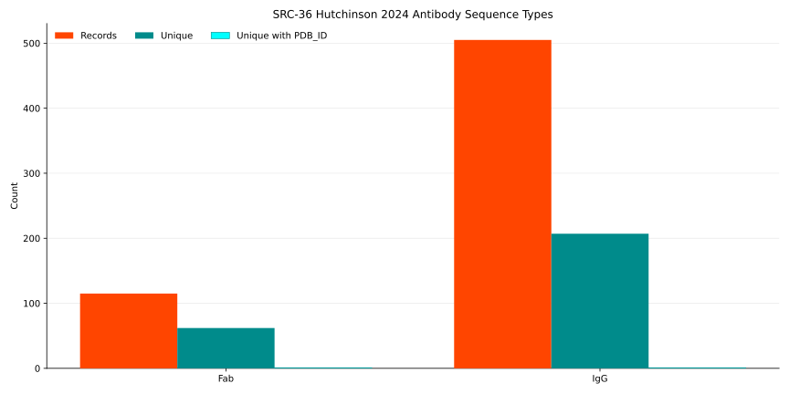
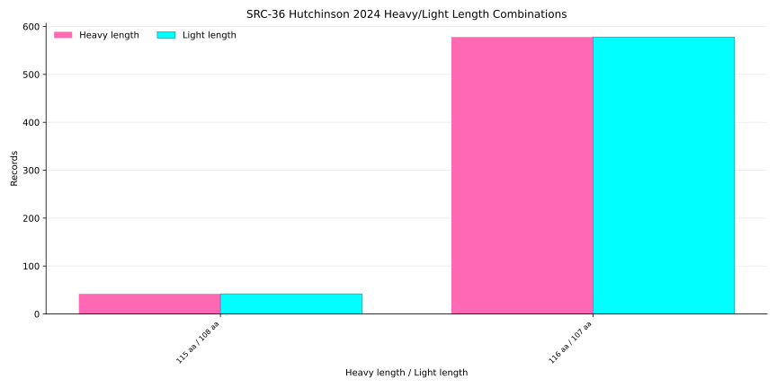
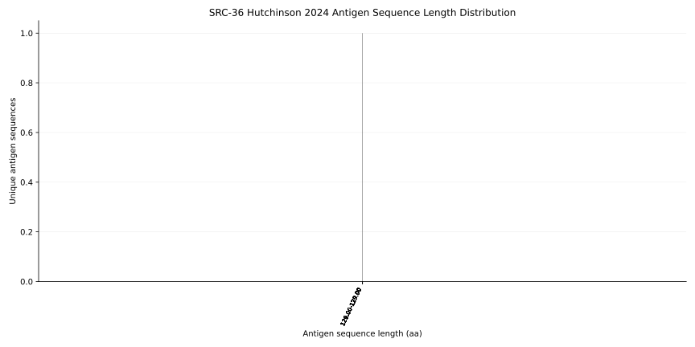

---
tags:
  - context
---

# SRC-36 Hutchinson 2024

> 每条 data 统一建模为 `((ab, ag), label, assay, condition, replicate, source)`.
> 本地快照 `G:\abag-datasets\SRC_R36_HUTCHINSON\snapshot-2026-08-17`, FLAb 12 张 CSV: `binding/` 8 张 (4 Fab + 4 IgG, 362 行) + `thermostability/` 4 张 (Tm1, 258 行), 共 620 行; 另有作者补充工作簿 `articles/Hutchinson_2024-06-20_mAbs-supplement-SM3514.xlsx`.
> `Unique` 为 `(heavy, light)` 二元组精确去重, 全表 207 个唯一 VH/VL 对.

## Antibody

> 有 Heavy 和 Light 的 `Unique` 字段是 `(heavy, light)` 二元组精确去重. `Unique with PDB_ID` 是按 Unique 后的 sequence 计数.
> Total Unique 计数方式为统一转 string, 如果有 Heavy 和 Light 用 `/` 拼接成 string.

| Key | 含义 | 说明 |
| --- | --- | --- |
| Sequence Type | 抗体序列类型 | 根据原始数据字段、链槽位及已有构建体标签划分的类别. |
| Records | 原始记录数 | 原始数据中的记录数量, 同一序列可能重复出现. |
| Unique | 唯一序列数 | 按对应数据集定义的去重规则统计. |
| Unique with PDB_ID | 关联 PDB 的唯一序列数 | 去重后具有关联 PDB_ID 的序列数量, 不等同于具有可用实验结构监督的序列数量. |
| Description | 类型说明 | 描述分类依据、序列槽位特征及分类限制. |

| Sequence Type | Records | Unique | Unique with PDB_ID | Description |
| --- | --- | --- | --- | --- |
| Fab | 115 | 62 | 1 | `_kd_fab` 四张表 (multikd 15 / singlekd 22 / top200kd 50 / top27kd 28), 列名显式写 Fab; 序列只到 VH/VL. |
| IgG | 505 | 207 | 1 | `_kd_igg` 四张表 247 行 + `_tm1_igg` 四张表 258 行, 列名显式写 IgG; 序列只到 VH/VL, Fab 的 62 个唯一对全部落在其中. |
| Total | 620 | 207 | 1 |  |

> 620 行全部是同一个亲本 D44.1 的 VH/VL 变体, 唯一 PDB entry `1MLC` 即亲本 D44.1 Fab 复合物; 没有任何变体单独解出结构. 因此 `Unique with PDB_ID` 按亲本体系计 1, 不是 62 或 207.
>
> 构建体来自源方显式措辞: 文件名与列名写 `_fab` (Fab binding kinetics) 与 `_igg` (IgG binding kinetics / IgG Thermostability). `heavy` / `light` 两列只含 VH 与 VL 可变区 (115/116 aa 与 107/108 aa), 不含任何恒定区; `IgG` 指该行序列的测量格式, 不是序列本身含完整重链.

| Heavy Length | Light Length | Records | Description |
| --- | --- | --- | --- |
| 115 aa | 108 aa | 42 | multikd_fab / multikd_igg / multitm1_igg 三张表各 14 行, 是仅有的 115/108 长度; 其余 9 张表全部为 116/107. |
| 116 aa | 107 aa | 578 | 主簇: 12 张表都有 116/107 长度的行; 长度只反映构建体骨架, 不区分突变类型. |

## Antigen

> Antigen 统计以 source-native antigen entity 为核心单位. 优先使用原始 antigen ID/name、construct 和 antigen chain 定义实体; 存在可靠序列时再统计唯一抗原序列.
> 结构、序列和数据库注释压缩到同一张表中, `PDB / UniProt` 采用唯一抗原实体粒度统计 2 × 2 覆盖结果.
> 长度图基于唯一抗原序列, 按该源实际范围平均切分 20 bins.

> 全部 620 行针对同一固定抗原 (鸡卵清溶菌酶 HEL), 表内无抗原序列字段; 序列取本地冻结的参考复合物 `1MLC`.

| Records | Unique ag entity | Unique ag sequence | PDB / UniProt coverage | Antigen Length | Antigen Evidence / Provenance | Description |
| --- | --- | --- | --- | --- | --- | --- |
| 620 | 1 | 1 | PDB=1/UniProt=0: 1; PDB=0/UniProt=0: 0 | 129 aa | Reference PDB / Fixed target | 唯一实体是 HEL (`1MLC` entity 3, author chain E/F, 129 aa), 属共享参考复合物, 不是逐行测量构建体; 表内无 UniProt 字段. 207 个唯一 VH/VL 全部是同一个亲本 D44.1 针对这一个抗原的变体, 不是各自独立的抗原–抗体对. |

## Affinity

> 去重口径: 按 **(heavy 序列, light 序列, 固定抗原)** 去重; 抗原单一, 8 张 binding 表并集 197 个唯一对. 无 replicate 字段, 全记 `unknown`.
>
> 4 张 Tm1 表 258 行是热稳定性 (Tm1, °C), 不在亲和力词表内, 不计入本表; 它们与 binding 表共用同一批 VH/VL. 这 12 张 CSV 与 SRC-09 FLAb 收录的 `hutchinson2023` 系列同源, 跨源合并须按测量身份去重. `KD (M)` 与 `-log10(KD)` 是同一数值的两种表示, 逐行自洽 (`fitness` = -log10(KD/M), 最大偏差 < 1e-8), 不是两次测量. assay 取作者补充工作簿自己的说明: `Table S1` 表头写 Fab 与 IgG 的结合动力学 "using BLI" (主文 Methods 用 Octet 仪器); 上游 FLAb 索引 (`flab_metadata.json`) 把这 8 张表统一标为 `SPR Kd`, 与作者表头说明不符, 这里以作者文本为准.

| Label | Assay | Condition | Replicate | Record pairs | Unique pairs | Description |
| --- | --- | --- | --- | --- | --- | --- |
| `Kd_M` | `BLI` | Fab binding kinetics (4 表) | unknown:115 | 115 | 62 | `KD (M)` 1.32e-09-2.88e-08. top200kd 表有 2 行整行重复 (同一序列同一 KD); top27kd 表有 1 个序列对出现两次且 KD 不同 (2.87e-09 / 5.53e-09). 源表未标 replicate, 重复行按记录计数, 不去重. |
| `Kd_M` | `BLI` | IgG binding kinetics (4 表) | unknown:247 | 247 | 196 | `KD (M)` 2.64e-10-2.86e-08. top27kd_igg 表有 1 个序列对出现两次且 KD 不同 (1.35e-09 / 1.43E-09). 列为 IgG 格式表观亲和力, 与 Fab 表是不同朝向与价态的测量, 不能合并成同一口径. |
| `log_Kd` | `BLI` | 8 表 `-log10(KD)` 列 | unknown:362 | 362 | 197 | `-log10(KD/M)` 7.54-9.58, 与同表 `KD (M)` 逐行互算; 与 `Kd_M` 是同一测量的另一种表示. |
