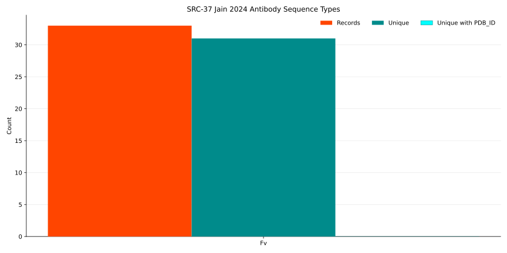
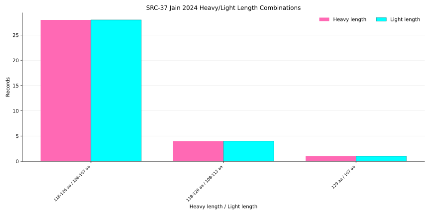
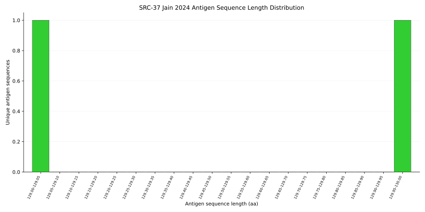

---
tags:
  - context
---

# [SRC-37 Jain 2024](../2026-10-29-3a-src-readme/src-37-jain-readme.md)

> 每条 data 统一建模为 `((ab, ag), label, assay, condition, replicate, source)`.
> 本地快照 `G:\abag-datasets\SRC_R37_JAIN\snapshot-2026-08-17`, `FLAb/data/binding/` 2 张 CSV (`jain2024assessment_Hen_Lys_kd.csv` 31 行, `jain2024assessment_mouse_Ly_kd.csv` 2 行), 共 33 行; 另有作者补充工作簿 `articles/Jain_2024-07-31_mAbs-supplement-SM4152.xlsx`.
> `Unique` 为 `(heavy, light)` 二元组精确去重, 33 行落 31 个唯一 VH/VL 对 (mouse 表的 2 条也出现在 HEL 表).

## Antibody

> 有 Heavy 和 Light 的 `Unique` 字段是 `(heavy, light)` 二元组精确去重. `Unique with PDB_ID` 是按 Unique 后的 sequence 计数.
> Total Unique 计数方式为统一转 string, 如果有 Heavy 和 Light 用 `/` 拼接成 string.

| Key | 含义 | 说明 |
| --- | --- | --- |
| Sequence Type | 抗体序列类型 | 根据原始数据字段、链槽位及已有构建体标签划分的类别. |
| Records | 原始记录数 | 原始数据中的记录数量, 同一序列可能重复出现. |
| Unique | 唯一序列数 | 按对应数据集定义的去重规则统计. |
| Unique with PDB_ID | 关联 PDB 的唯一序列数 | 去重后具有关联 PDB_ID 的序列数量, 不等同于具有可用实验结构监督的序列数量. |
| Description | 类型说明 | 描述分类依据、序列槽位特征及分类限制. |

| Sequence Type | Records | Unique | Unique with PDB_ID | Description |
| --- | --- | --- | --- | --- |
| Fv | 33 | 31 | 0 | 43 个 ADI 抗体各一对 VH/VL; FLAb 只保留 31 行 HEL 与 2 行 mouse 的数值子集, 2 个 mouse 对与 HEL 表重叠. |
| Total | 33 | 31 | 0 |  |

> 抗体侧没有任何逐行 PDB 字段, 也没有这 43 个 ADI 抗体的实验复合物; 因此 `Unique with PDB_ID` 为 0.
>
> 构建体取自源方对序列表的命名: 补充工作簿的 sheet 名为 `Fv Sequence`, 该 sheet 的 `VH` / `VL` 两列逐条给出 43 个抗体的可变区; FLAb CSV 的 `heavy` / `light` 同属这 43 对 VH/VL. 工作簿的其余 sheet 另给出这些抗体的 IgG 相关性质, 但公开序列表只到 Fv, 因此这里记 `Fv`, 不按体内给药格式写成 IgG.

| Heavy Length | Light Length | Records | Description |
| --- | --- | --- | --- |
| 118-126 aa | 106-107 aa | 28 | 主簇: 近种系人 VH/VL 的常规长度. |
| 118-126 aa | 108-113 aa | 4 | 轻链为 108 或 113 aa 的四对, 比主簇的 106-107 aa 长 1-6 aa. |
| 129 aa | 107 aa | 1 | 单条偏长的重链 (129 aa), 无构建体差异标注. |

## Antigen

> Antigen 统计以 source-native antigen entity 为核心单位. 优先使用原始 antigen ID/name、construct 和 antigen chain 定义实体; 存在可靠序列时再统计唯一抗原序列.
> 结构、序列和数据库注释压缩到同一张表中, `PDB / UniProt` 采用唯一抗原实体粒度统计 2 × 2 覆盖结果.
> 长度图基于唯一抗原序列, 按该源实际范围平均切分 20 bins.

> 2 张表各对一个 assay 靶点, 表内无抗原序列字段; 抗原由 assay 名称给出 (Hen Lysozyme / Mouse Lysozyme-Fc), 序列取本地冻结的参考结构.

| Records | Unique ag entity | Unique ag sequence | PDB / UniProt coverage | Antigen Length | Antigen Evidence / Provenance | Description |
| --- | --- | --- | --- | --- | --- | --- |
| 33 | 2 | 2 | PDB=1/UniProt=0: 2; PDB=0/UniProt=0: 0 | 129-130 aa | Reference PDB / Fixed target | 两个实体: 鸡溶菌酶 `1AKI` chain A (129 aa) 与鼠溶菌酶 M `1IVM` chain A (130 aa, NMR ensemble 20 models). 两者都只是 assay 靶点类别的参考结构, 不是这 43 个抗体的复合物; 1IVM 也不等于 mouse-Lysozyme-Fc 融合构建体. 表内无 UniProt 字段. |

## Affinity

> 去重口径: 按 **(heavy 序列, light 序列, 抗原)** 去重; 33 行落 31 个唯一对. 无 replicate 字段, 全记 `unknown`.
>
> 两个条件不可混: HEL 表列名写 `Monovalent`, mouse 表写 `Avid` (biotin 化的鼠溶菌酶-Fc 融合), 单价与多价读出同样按 1:1 模型拟合, 但 avidity 不能被拟合消除. assay 取论文 Methods 的 Octet HTX BLI. 两张 CSV 与 SRC-09 FLAb 收录的 `jain2024` 系列同源, 跨源合并须按测量身份去重. FLAb 的 `neg_log_kd` / `fitness` 是 `-log10(KD/M)`, 与 KD 列逐行互算, 是同一数值的两种表示.

| Label | Assay | Condition | Replicate | Record pairs | Unique pairs | Description |
| --- | --- | --- | --- | --- | --- | --- |
| `Kd_M` | `BLI` | Hel monovalent (31) | unknown:31 | 31 | 31 | `Octet b-Hen Lysozyme Kd Monovalent (M)` 3e-10-5e-07 M, 31 个数值且只有 18 个不同取值, 是原工作簿 KD 舍入到一位有效数字的结果. |
| `Kd_M` | `BLI` | Mouse Lysozyme-Fc avid (2) | unknown:2 | 2 | 2 | `Octet IgG KD b-Mouse Lysozyme-Fc Avid (M)` 1e-07-4e-07 M, 只有 2 个抗体有数值; 其余 41 个在原工作簿记 `N.B.` (assay 条件下未观察到结合), 公开 CSV 不保留这些行, 因此本表 33 行不是 43 个抗体 x 2 个靶点的完整读数. |
| `log_Kd` | `BLI` | 2 表 `neg_log_kd` 列 | unknown:33 | 33 | 31 | `-log10(KD/M)` 6.30-9.52, 与同表 KD 逐行互算; 与 `Kd_M` 是同一测量的另一种表示. |
