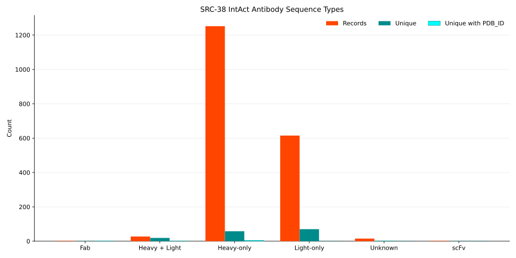
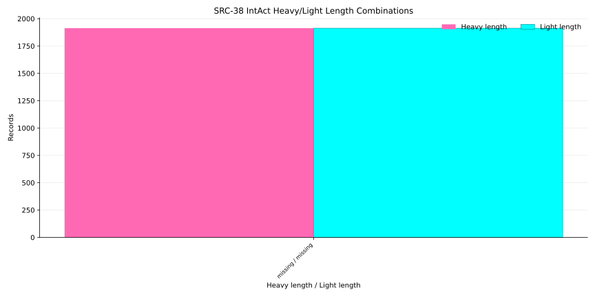
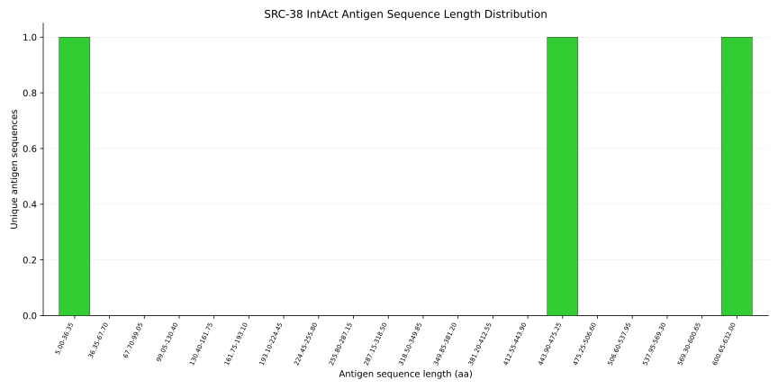

---
tags:
  - context
---

# SRC-38 IntAct

> 每条 data 统一建模为 `((ab, ag), label, assay, condition, replicate, source)`.
> 本地快照 `G:\abag-datasets\SRC_R38_INTACT\snapshot-2026-01-14`, `IntAct/psimitab/intact.zip` 的两个成员 (`intact.txt` 1,787,425 行, `intact_negative.txt` 983 行) 共 1,788,408 行 × 42 列 MITAB27, 加 2 个冻结 RCSB entry (`3VI3`、`3VI4`).
> `Unique` 为抗体侧参与者的 `intact:` / `uniprotkb:` 标识元组精确去重; 载荷没有任何抗体序列, 抗体只能以参与者标识为单位, 不能按序列去重.

## Antibody

> 有 Heavy 和 Light 的 `Unique` 字段是 `(heavy, light)` 二元组精确去重. `Unique with PDB_ID` 是按 Unique 后的 sequence 计数.
> Total Unique 计数方式为统一转 string, 如果有 Heavy 和 Light 用 `/` 拼接成 string.

| Key | 含义 | 说明 |
| --- | --- | --- |
| Sequence Type | 抗体序列类型 | 根据原始数据字段、链槽位及已有构建体标签划分的类别. |
| Records | 原始记录数 | 原始数据中的记录数量, 同一序列可能重复出现. |
| Unique | 唯一序列数 | 按对应数据集定义的去重规则统计. |
| Unique with PDB_ID | 关联 PDB 的唯一序列数 | 去重后具有关联 PDB_ID 的序列数量, 不等同于具有可用实验结构监督的序列数量. |
| Description | 类型说明 | 描述分类依据、序列槽位特征及分类限制. |

| Sequence Type | Records | Unique | Unique with PDB_ID | Description |
| --- | --- | --- | --- | --- |
| Fab | 2 | 1 | 1 | 2 行是 SG/19 的重链 + 轻链条目 (3VI3 一条, 3VI4 一条); 构建体名来自冻结 entry 的 `SG/19 Fab fragment (Heavy chain)` / `(Light chain)` entity 描述, 是亲本级标签. |
| Heavy + Light | 27 | 19 | 1 | 一行内两侧参与者分别带 IGH 与 IGK / IGL 基因名, 无构建体字段; 只能判有重链和轻链槽位, 不能判 Fab / Fv / IgG. |
| Heavy-only | 1,252 | 58 | 4 | 只有一侧参与者带 IGH 基因名, 另一侧不是免疫球蛋白; 该行在 IntAct 里是一条二元证据边, 不是缺轻链的构建体. |
| Light-only | 615 | 70 | 0 | 只有一侧参与者带 IGK / IGL 基因名, 另一侧不是免疫球蛋白. |
| Unknown | 15 | 3 | 0 | IgE、IGM、`ch-11 antibody` 这类整体免疫球蛋白参与者: 名称写明是免疫球蛋白, 但没有拆成重链 / 轻链, 判不出槽位形状. |
| scFv | 2 | 1 | 0 | 参与者基因名直接写作 `scFv` (UniProt Q65ZC9), 是源内显式标注. |
| Total | 1,913 | 152 | 6 |  |

> IntAct 没有抗体序列列、没有链槽位列、也没有构建体列, 每一行只是一条二元相互作用证据. 本节把参与者判为免疫球蛋白链, 依据是该参与者自己的 `gene name` 别名给出的基因符号 (IGH 开头为重链, IGK / IGL 开头为轻链), 以及 `antibody hc` / `antibody lc` / `scFv` 这类显式名称. 全表 1,788,408 行里命中候选 1,967 行, 其中 54 行只命中 IG 开头但并非免疫球蛋白的基因名, 余 1,913 行进入本节.
>
> 名字以 IG 开头但不是免疫球蛋白的基因被逐个排除: IGHMBP2 是 ATP 依赖解旋酶, IGDCC3 / IGDCC4 / IGLON5 是神经黏附分子, IGD1 是酵母 YFR017C, IGMT1 / IGMT4 是拟南芥甲基转移酶, `igl` 是果蝇 igloo-L, `iglC2` 是土拉弗朗西斯菌蛋白. 只按 `^IG` 匹配会把 54 行这类非抗体记录算进抗体.
>
> 构建体只写得出两类: SG/19 的 2 行, 因为冻结 entry 的 entity 描述写明 `Fab fragment`; 参与者基因名写 `scFv` 的 2 行. 其余 1,909 行只有重链 / 轻链的基因名, 无构建体措辞, 按槽位归 `Heavy + Light` / `Heavy-only` / `Light-only`, 不据基因名或长度判 Fab / Fv / IgG.
>
> `Unique with PDB_ID` 只认相互作用级的 PDB 键 (`pdb|rcsb pdb:` 出现在 Interaction identifier / Interaction Xref 列), 不认参与者 xref 里的 `rcsb pdb:`: 后者是该蛋白的参考结构, 不是这条证据的结构. 例如 `IGHG1` 的参与者 xref 挂 276 个 entry, 但那 276 个是同一条 UniProt 条目的结构交叉引用, 不是 276 条证据各自的结构. 按这条规则, 抗体侧有结构的唯一单元 6 个, 覆盖 7 个 entry (3VI3 / 3VI4 / 1NBY / 1NDG / 1NDM / 1L7I / 1OW0).

| Heavy Length | Light Length | Records | Description |
| --- | --- | --- | --- |
| missing | missing | 1,913 | 抗体侧只有参与者标识, 载荷没有抗体链序列, 因此没有 Heavy / Light 长度; 与抗体配对的抗原链长度归 Antigen 一节, 不写进本表. |

## Antigen

> Antigen 统计以 source-native antigen entity 为核心单位. 优先使用原始 antigen ID/name、construct 和 antigen chain 定义实体; 存在可靠序列时再统计唯一抗原序列.
> 结构、序列和数据库注释压缩到同一张表中, `PDB / UniProt` 采用唯一抗原实体粒度统计 2 × 2 覆盖结果.
> 长度图基于唯一抗原序列, 按该源实际范围平均切分 20 bins.

> 抗原是抗体记录的对侧参与者, 以 IntAct / UniProt 标识为实体; 只有两个冻结 entry 的受体链能给出序列.

| Records | Unique ag entity | Unique ag sequence | PDB / UniProt coverage | Antigen Length | Antigen Evidence / Provenance | Description |
| --- | --- | --- | --- | --- | --- | --- |
| 1,913 | 906 | unavailable | PDB=1/UniProt=1: 5; PDB=1/UniProt=0: 1; PDB=0/UniProt=1: 894; PDB=0/UniProt=0: 6 | 5-632 aa | Source-native / Reference PDB / PDB-derived sequence | 抗原取每条抗体记录的对侧参与者: 1,913 条抗体行里有 1,843 条对侧存在非免疫球蛋白参与者, 去重后 906 个实体 (IntAct / UniProt 标识). 其中 6 个实体在相互作用级挂到 PDB entry, 其余 900 个只有数据库标识. 抗原序列在载荷里没有: 只有 `3VI3` / `3VI4` 两个 entry 被冻结, 能给序列的对侧链只有整合素 alpha-5 (632 aa)、整合素 beta-1 (454 aa) 与一条 RGD 肽 (5 aa), 长度 5-632 aa, 下界是那条肽而非蛋白链; 其余 903 个实体没有序列, 长度记 unavailable 而不是从 accession 反推. 同一条抗体行里另一侧的抗体链不构成抗原, 70 条只连另一个免疫球蛋白参与者的行不产生抗原实体. |

## Affinity

> 去重口径: 按 **(抗体参与者, 抗原参与者)** 标识对去重. `Record pairs` 记带 `Interaction parameter(s)` 的抗体行, `Unique pairs` 记去重后的标识对.
>
> 全表只有 `kd` 一个亲和力参数键, 出现在抗体行上的只有 3 行, 都是表面等离子共振 (MI:0107), 数值自带 `(molar)` 单位: 4.2e-09、1.7e-05、2.8e-05. 这三行分属 3 条 interaction, 其中两条是同一个 (HLA-B, IGKC) 对的不同文献测量.
>
> 抗体行的阴性标记全为 `false`; `intact_negative.txt` 的 983 行没有一行命中免疫球蛋白参与者, 因此本节没有 `binary` 行, 也不把「无参数」写成「不结合」. 其余 1,840 条有抗原配对、但没有亲和力参数的抗体行记 `not_recorded`.
>
> `intact-miscore` (Confidence value) 是证据评分, 不是亲和力, 不进本表.

| Label | Assay | Condition | Replicate | Record pairs | Unique pairs | Description |
| --- | --- | --- | --- | --- | --- | --- |
| `Kd_M` | `SPR` | SPR 行, `Interaction parameter(s)` 的 `kd` 项 | unknown:3 | 3 | 2 | `kd` 值 4.2e-09 / 1.7e-05 / 2.8e-05 M, 单位在单元格内写为 `(molar)`. 两条是 HLA-B–IGKC (PubMed 25480565 / 22020283), 一条是 IGHG1–FCGR1A (PubMed 25925696). 另两个 `kd` 值为 `28.0x10^-6` 与 `17.0x10^-6`, 写作科学计数形式, 按 2.8e-05 / 1.7e-05 M 计. |
| `not_recorded` | `unknown` | 抗体行, `Interaction parameter(s)` 为空 | unknown:1,840 | 1,840 | 1,574 | 抗体侧有抗原配对的记录里没有 `Interaction parameter(s)`, 也没有 binding / not-binding 列. 空参数是未记录, 不是阴性. |
