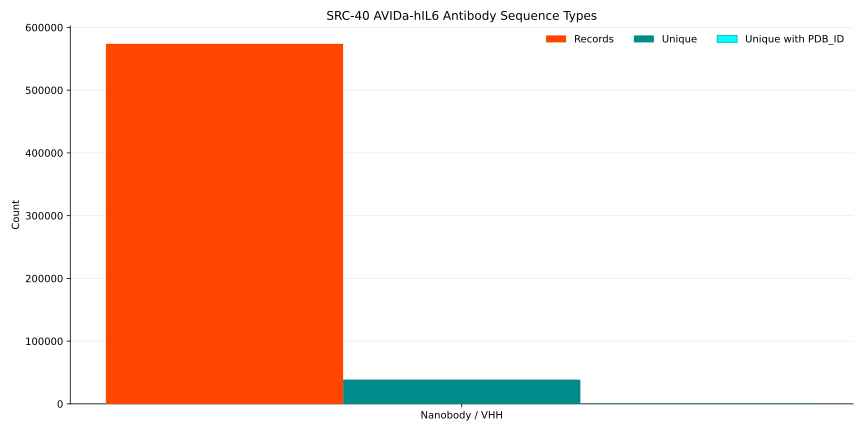
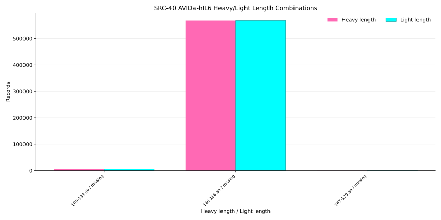
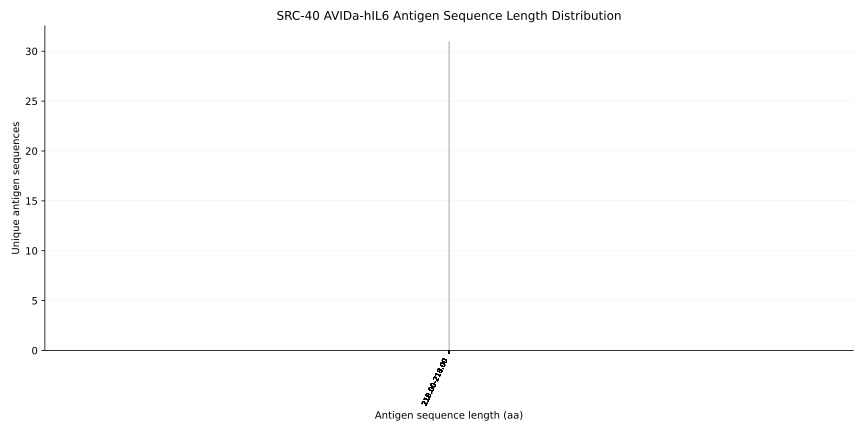

---
- tags:
  - context
---

# SRC-40 AVIDa-hIL6

> 每条 data 统一建模为 `((ab, ag), label, assay, condition, replicate, source)`.
> 本地快照 `G:\abag-datasets\SRC_R40_AVIDA_HIL6\1.0.0`, `AVIDa-hIL6-Zenodo/il6_aai_dataset.csv` 573,891 行 × 4 列 (`VHH_sequence`, `label`, `Ag_label`, `Ag_sequence`).
> `Unique` 为 `VHH_sequence` 精确去重, 573,891 个 (VHH_sequence, Ag_label) 对里落 38,599 条唯一 VHH.

## Antibody

> 有 Heavy 和 Light 的 `Unique` 字段是 `(heavy, light)` 二元组精确去重. `Unique with PDB_ID` 是按 Unique 后的 sequence 计数.
> Total Unique 计数方式为统一转 string, 如果有 Heavy 和 Light 用 `/` 拼接成 string.

| Key | 含义 | 说明 |
| --- | --- | --- |
| Sequence Type | 抗体序列类型 | 根据原始数据字段、链槽位及已有构建体标签划分的类别. |
| Records | 原始记录数 | 原始数据中的记录数量, 同一序列可能重复出现. |
| Unique | 唯一序列数 | 按对应数据集定义的去重规则统计. |
| Unique with PDB_ID | 关联 PDB 的唯一序列数 | 去重后具有关联 PDB_ID 的序列数量, 不等同于具有可用实验结构监督的序列数量. |
| Description | 类型说明 | 描述分类依据、序列槽位特征及分类限制. |

| Sequence Type | Records | Unique | Unique with PDB_ID | Description |
| --- | --- | --- | --- | --- |
| Nanobody / VHH | 573,891 | 38,599 | 0 | 字段名为 `VHH_sequence`, 上游即按 VHH 单域交付; 无轻链槽位, 无其它构建体类别. |
| Total | 573,891 | 38,599 | 0 |  |

> 抗体侧只有一个 VHH 槽位, 序列是作者交付的表达构建体串: 568,080 行以 22 aa 信号前缀 `MKYLLPTAAAGLLLLAAQPAMA` 起始, 另有 5,811 行带前缀变体 (如 `...AAQPAMV`, 仅末位不同), 573,891 行全部以 `HHHHHH` 结尾; 保留原字节, 不裁剪. 长度 100-179 aa 是含前缀与 His6 的表达串长度, 不等于 VH 域长度.
>
> 抗体侧没有逐行 PDB 字段, 也没有任何 VHH 的复合物在本地快照内; `Unique with PDB_ID` 为 0.

| Heavy Length | Light Length | Records | Description |
| --- | --- | --- | --- |
| 100-139 aa | missing | 6,128 | 139 aa 及以下的短串: 6,095 行带 22 aa 前缀, 33 行是前缀变体, 最短 100 aa. |
| 140-166 aa | missing | 567,564 | 主簇 98.9%: 含信号前缀与 His6 的常规 VHH 表达串, 峰值 154 aa (74,098 行); 其中 5,778 行是前缀变体. |
| 167-179 aa | missing | 199 | 167-179 aa 的偏长串 199 行, 全部带标准前缀; 表内无构建体差异标注. |

## Antigen

> Antigen 统计以 source-native antigen entity 为核心单位. 优先使用原始 antigen ID/name、construct 和 antigen chain 定义实体; 存在可靠序列时再统计唯一抗原序列.
> 结构、序列和数据库注释压缩到同一张表中, `PDB / UniProt` 采用唯一抗原实体粒度统计 2 × 2 覆盖结果.
> 长度图基于唯一抗原序列, 按该源实际范围平均切分 20 bins.

> 抗原侧逐行给出 `Ag_label` 与 `Ag_sequence`, 31 个抗原版本各对应一条 218 aa 的直接序列; 全部是同一人 IL-6 表达构建体 (27 aa N 端前缀 + 185 aa 成熟 IL-6 + HHHHHH), 30 个突变体是单点 Ala 替换.

| Records | Unique ag entity | Unique ag sequence | PDB / UniProt coverage | Antigen Length | Antigen Evidence / Provenance | Description |
| --- | --- | --- | --- | --- | --- | --- |
| 573,891 | 31 | 31 | Reference PDB: 1; UniProt=unavailable | 218 aa (31 个版本同一长度) | Direct sequence / Fixed target | 唯一实体按 `Ag_label` 计 31 个: `IL-6_WTs` 加 30 个单点 Ala 突变体 (`IL-6_<位点>A`). 序列全部直接给出, 且 30 个突变体与 WT 逐位比较只有一处不同、替换为 Ala. 参考结构 `1IL6` entity 1 chain A (185 aa, INTERLEUKIN-6) 完整落在 WT 构建体第 28-212 位, 只覆盖 WT 靶点区域; 30 个突变体没有各自的结构, 27 aa 前缀与 His6 也不在参考实体内. 表内无 UniProt 字段. |

## Affinity

> 去重口径: 按 **(VHH_sequence, Ag_label)** 去重; 573,891 行全部 1:1 唯一. 无 replicate 字段, 全记 `unknown`; 12 个母库、WT 三次重复与 408 个子库在标签形成阶段已汇总成每行一个配对, 本表每行不是一次湿实验重复.
>
> `label` 是双样本比例 Z 检验得到的二元判定 (比例上升且 p≤0.05 为 1, 下降且 p≤0.05 为 0, 再由无靶点对照排除噪声), 不是 SPR/BLI 的 Kd, 也不是连续亲和力. 论文另述 1,998,127 个 non-significant 配对未进入本表; 未入表不等于不结合. 31 个抗原版本共用一个 VHH 文库, 同一 VHH 跨版本的行为相关, 不能按行当独立样本. 本表与 SRC-09 FLAb 的 `tsuruta2024 AVIDa-hIL6` 行同源 (同 573,891 行二元标签), 跨源合并须按测量身份去重.

| Label | Assay | Condition | Replicate | Record pairs | Unique pairs | Description |
| --- | --- | --- | --- | --- | --- | --- |
| `binary` | `NGS_seq` | `IL-6_C72A` | unknown:25,518 | 25,518 | 25,518 | `label` 1: 464 / 0: 25,054; 同一 VHH–抗原版本一行. |
| `binary` | `NGS_seq` | `IL-6_C78A` | unknown:13,768 | 13,768 | 13,768 | `label` 1: 529 / 0: 13,239; 同一 VHH–抗原版本一行. |
| `binary` | `NGS_seq` | `IL-6_D162A` | unknown:12,047 | 12,047 | 12,047 | `label` 1: 952 / 0: 11,095; 同一 VHH–抗原版本一行. |
| `binary` | `NGS_seq` | `IL-6_D168A` | unknown:12,515 | 12,515 | 12,515 | `label` 1: 279 / 0: 12,236; 同一 VHH–抗原版本一行. |
| `binary` | `NGS_seq` | `IL-6_D54A` | unknown:29,244 | 29,244 | 29,244 | `label` 1: 493 / 0: 28,751; 同一 VHH–抗原版本一行. |
| `binary` | `NGS_seq` | `IL-6_D99A` | unknown:23,018 | 23,018 | 23,018 | `label` 1: 436 / 0: 22,582; 同一 VHH–抗原版本一行. |
| `binary` | `NGS_seq` | `IL-6_E108A` | unknown:19,780 | 19,780 | 19,780 | `label` 1: 625 / 0: 19,155; 同一 VHH–抗原版本一行. |
| `binary` | `NGS_seq` | `IL-6_E138A` | unknown:10,974 | 10,974 | 10,974 | `label` 1: 1,402 / 0: 9,572; 同一 VHH–抗原版本一行. |
| `binary` | `NGS_seq` | `IL-6_E51A` | unknown:17,734 | 17,734 | 17,734 | `label` 1: 835 / 0: 16,899; 同一 VHH–抗原版本一行. |
| `binary` | `NGS_seq` | `IL-6_E87A` | unknown:26,241 | 26,241 | 26,241 | `label` 1: 508 / 0: 25,733; 同一 VHH–抗原版本一行. |
| `binary` | `NGS_seq` | `IL-6_F102A` | unknown:24,040 | 24,040 | 24,040 | `label` 1: 615 / 0: 23,425; 同一 VHH–抗原版本一行. |
| `binary` | `NGS_seq` | `IL-6_F153A` | unknown:11,469 | 11,469 | 11,469 | `label` 1: 1,158 / 0: 10,311; 同一 VHH–抗原版本一行. |
| `binary` | `NGS_seq` | `IL-6_G105A` | unknown:13,832 | 13,832 | 13,832 | `label` 1: 862 / 0: 12,970; 同一 VHH–抗原版本一行. |
| `binary` | `NGS_seq` | `IL-6_G63A` | unknown:27,683 | 27,683 | 27,683 | `label` 1: 534 / 0: 27,149; 同一 VHH–抗原版本一行. |
| `binary` | `NGS_seq` | `IL-6_I57A` | unknown:28,503 | 28,503 | 28,503 | `label` 1: 336 / 0: 28,167; 同一 VHH–抗原版本一行. |
| `binary` | `NGS_seq` | `IL-6_I60A` | unknown:28,383 | 28,383 | 28,383 | `label` 1: 319 / 0: 28,064; 同一 VHH–抗原版本一行. |
| `binary` | `NGS_seq` | `IL-6_K69A` | unknown:27,562 | 27,562 | 27,562 | `label` 1: 439 / 0: 27,123; 同一 VHH–抗原版本一行. |
| `binary` | `NGS_seq` | `IL-6_L120A` | unknown:13,411 | 13,411 | 13,411 | `label` 1: 752 / 0: 12,659; 同一 VHH–抗原版本一行. |
| `binary` | `NGS_seq` | `IL-6_L126A` | unknown:13,964 | 13,964 | 13,964 | `label` 1: 521 / 0: 13,443; 同一 VHH–抗原版本一行. |
| `binary` | `NGS_seq` | `IL-6_L129A` | unknown:13,557 | 13,557 | 13,557 | `label` 1: 610 / 0: 12,947; 同一 VHH–抗原版本一行. |
| `binary` | `NGS_seq` | `IL-6_L90A` | unknown:12,294 | 12,294 | 12,294 | `label` 1: 250 / 0: 12,044; 同一 VHH–抗原版本一行. |
| `binary` | `NGS_seq` | `IL-6_P42A` | unknown:18,040 | 18,040 | 18,040 | `label` 1: 928 / 0: 17,112; 同一 VHH–抗原版本一行. |
| `binary` | `NGS_seq` | `IL-6_P93A` | unknown:20,898 | 20,898 | 20,898 | `label` 1: 344 / 0: 20,554; 同一 VHH–抗原版本一行. |
| `binary` | `NGS_seq` | `IL-6_Q144A` | unknown:10,265 | 10,265 | 10,265 | `label` 1: 1,411 / 0: 8,854; 同一 VHH–抗原版本一行. |
| `binary` | `NGS_seq` | `IL-6_Q45A` | unknown:16,898 | 16,898 | 16,898 | `label` 1: 832 / 0: 16,066; 同一 VHH–抗原版本一行. |
| `binary` | `NGS_seq` | `IL-6_S135A` | unknown:16,357 | 16,357 | 16,357 | `label` 1: 995 / 0: 15,362; 同一 VHH–抗原版本一行. |
| `binary` | `NGS_seq` | `IL-6_S81A` | unknown:25,344 | 25,344 | 25,344 | `label` 1: 453 / 0: 24,891; 同一 VHH–抗原版本一行. |
| `binary` | `NGS_seq` | `IL-6_T117A` | unknown:15,303 | 15,303 | 15,303 | `label` 1: 735 / 0: 14,568; 同一 VHH–抗原版本一行. |
| `binary` | `NGS_seq` | `IL-6_T165A` | unknown:14,002 | 14,002 | 14,002 | `label` 1: 944 / 0: 13,058; 同一 VHH–抗原版本一行. |
| `binary` | `NGS_seq` | `IL-6_T48A` | unknown:18,227 | 18,227 | 18,227 | `label` 1: 879 / 0: 17,348; 同一 VHH–抗原版本一行. |
| `binary` | `NGS_seq` | `IL-6_WTs` | unknown:13,020 | 13,020 | 13,020 | `label` 1: 540 / 0: 12,480; 同一 VHH–抗原版本一行. |
