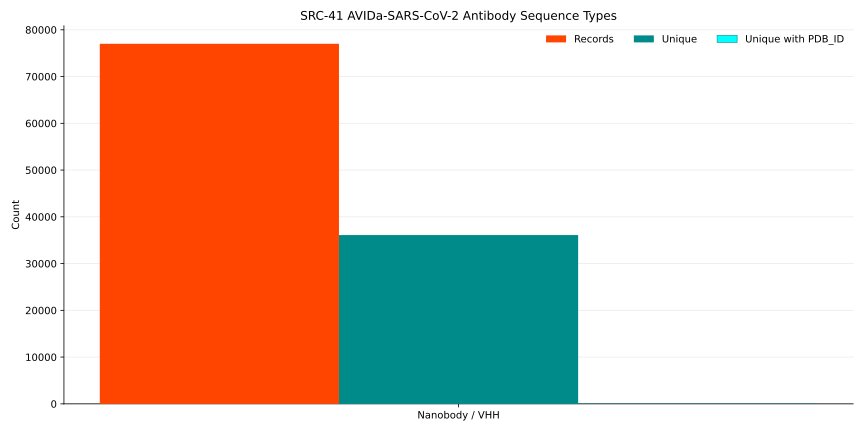
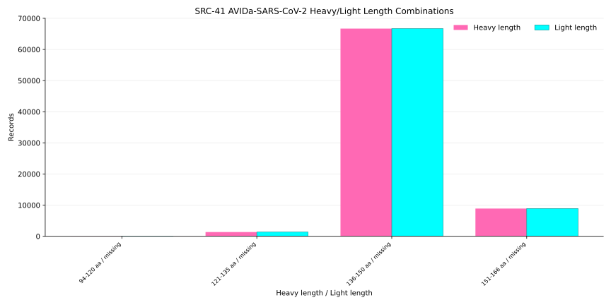
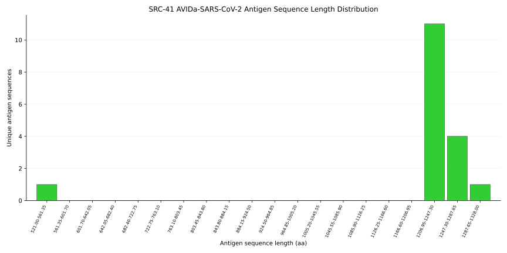

---
tags:
  - context
---

# SRC-41 AVIDa-SARS-CoV-2

> 每条 data 统一建模为 `((ab, ag), label, assay, condition, replicate, source)`.
> 本地快照 `G:\abag-datasets\SRC_R41_AVIDA_SARS_COV2\snapshot-2024-10-17`, `AVIDa-SARS-CoV-2/` 4 张 CSV: `AVIDa-SARS-CoV-2.csv` 77,003 行 × 6 列, `antigen_sequences.csv` 17 行, `train.csv` 49,685 行与 `test.csv` 27,318 行 (按动物划分, 并集等于总表).
> `Unique` 为 `VHH_sequence` 精确去重, 77,003 行落 36,100 条唯一 VHH.

## Antibody

> 有 Heavy 和 Light 的 `Unique` 字段是 `(heavy, light)` 二元组精确去重. `Unique with PDB_ID` 是按 Unique 后的 sequence 计数.
> Total Unique 计数方式为统一转 string, 如果有 Heavy 和 Light 用 `/` 拼接成 string.

| Key | 含义 | 说明 |
| --- | --- | --- |
| Sequence Type | 抗体序列类型 | 根据原始数据字段、链槽位及已有构建体标签划分的类别. |
| Records | 原始记录数 | 原始数据中的记录数量, 同一序列可能重复出现. |
| Unique | 唯一序列数 | 按对应数据集定义的去重规则统计. |
| Unique with PDB_ID | 关联 PDB 的唯一序列数 | 去重后具有关联 PDB_ID 的序列数量, 不等同于具有可用实验结构监督的序列数量. |
| Description | 类型说明 | 描述分类依据、序列槽位特征及分类限制. |

| Sequence Type | Records | Unique | Unique with PDB_ID | Description |
| --- | --- | --- | --- | --- |
| Nanobody / VHH | 77,003 | 36,100 | 0 | 字段名为 `VHH_sequence`, 上游按 VHH 单域交付; 无轻链槽位, 无其它构建体类别. |
| Total | 77,003 | 36,100 | 0 |  |

> 抗体侧只有一个 VHH 域槽位, 字段名 `VHH_sequence`; 序列是 94-166 aa 的表达串, 其中 76,498 行带 22 aa 信号前缀 `MKYLLPTAAAGLLLLAAQPAMA`, 全表无 His6 标签; 不是完整 IgG 或 Fab. train / test 是同一总表的两种划分, 两表共 264 条重合 VHH, 不构成两批独立抗体.
>
> 抗体侧无逐行 PDB 字段, 也没有任一 VHH 的实验复合物; `Unique with PDB_ID` 为 0.

| Heavy Length | Light Length | Records | Description |
| --- | --- | --- | --- |
| 94-120 aa | missing | 40 | 极少数 94-120 aa 的短串. |
| 121-135 aa | missing | 1,355 | 121-135 aa 的小簇, 数量不到全表 2%. |
| 136-150 aa | missing | 66,702 | 主簇 86.6%: 常规 VHH 域长度. |
| 151-166 aa | missing | 8,906 | 151-166 aa 的偏长串; 表内无构建体差异标注. |

## Antigen

> Antigen 统计以 source-native antigen entity 为核心单位. 优先使用原始 antigen ID/name、construct 和 antigen chain 定义实体; 存在可靠序列时再统计唯一抗原序列.
> 结构、序列和数据库注释压缩到同一张表中, `PDB / UniProt` 采用唯一抗原实体粒度统计 2 × 2 覆盖结果.
> 长度图基于唯一抗原序列, 按该源实际范围平均切分 20 bins.

> 抗原由 `Ag_label` 给出 17 个条件键, `antigen_sequences.csv` 逐键给出一条直接序列 (521-1,328 aa); bead 与 cell 后缀是呈递方式, 同名的两种构建体序列长度不同, 不合并.

| Records | Unique ag entity | Unique ag sequence | PDB / UniProt coverage | Antigen Length | Antigen Evidence / Provenance | Description |
| --- | --- | --- | --- | --- | --- | --- |
| 77,003 | 17 | 17 | Reference PDB: 2; UniProt=unavailable | 521-1328 aa | Direct sequence / Fixed target | 17 个实体按 `Ag_label` 计, 每个键一条唯一序列, 无重复序列也无孤立键. 序列是 spike / S2 构建体直接给出, 不是从结构重建. 靶点层面的参考结构有 2 个 (`6VSB` SARS-CoV-2 spike 1,288 aa, `6NZK` OC43 spike 1,322 aa), 它们是共享参考, 不与任一行 construct 精确对应, 也不证明每个条件有独立结构. 表内无 UniProt 字段. |

## Affinity

> 去重口径: 按 **(VHH_sequence, Ag_label)** 去重; 77,003 行落 76,800 个唯一对, 203 行是同配对重复 (同一配对最多出现 2 次), 且没有任何配对带两个不同 label.
>
> `label` 是筛选前后 NGS 比例的统计检验判定 (1 = binder, 0 = non-binder), 不是 SPR/BLI 的 Kd; 论文说明约 97% 比例无显著变化的候选被排除, 未入表不等于不结合. 无 replicate 字段, 全记 `unknown`; train / test 只是动物划分, 不是重复测量. 本表与 SRC-09 FLAb 的 `tsuruta2024 SARS-CoV-2` 行同源 (同 77,003 行), 跨源合并须按测量身份去重.

| Label | Assay | Condition | Replicate | Record pairs | Unique pairs | Description |
| --- | --- | --- | --- | --- | --- | --- |
| `binary` | `NGS_seq` | `Alpha+E484K_cell` | unknown:4,800 | 4,800 | 4,800 | `label` 1: 1,731 / 0: 3,069. |
| `binary` | `NGS_seq` | `Alpha+K417N_cell` | unknown:5,167 | 5,167 | 5,167 | `label` 1: 1,900 / 0: 3,267. |
| `binary` | `NGS_seq` | `Alpha_bead` | unknown:1,928 | 1,928 | 1,928 | `label` 1: 545 / 0: 1,383. |
| `binary` | `NGS_seq` | `Alpha_cell` | unknown:3,908 | 3,908 | 3,908 | `label` 1: 1,234 / 0: 2,674. |
| `binary` | `NGS_seq` | `Beta_bead` | unknown:3,201 | 3,201 | 3,201 | `label` 1: 1,048 / 0: 2,153. |
| `binary` | `NGS_seq` | `Beta_cell` | unknown:6,113 | 6,113 | 6,113 | `label` 1: 1,776 / 0: 4,337. |
| `binary` | `NGS_seq` | `D614G_cell` | unknown:8,436 | 8,436 | 8,436 | `label` 1: 2,359 / 0: 6,077. |
| `binary` | `NGS_seq` | `Delta_bead` | unknown:1,969 | 1,969 | 1,969 | `label` 1: 649 / 0: 1,320. |
| `binary` | `NGS_seq` | `Delta_cell` | unknown:3,917 | 3,917 | 3,917 | `label` 1: 432 / 0: 3,485. |
| `binary` | `NGS_seq` | `Kappa_bead` | unknown:2,652 | 2,652 | 2,652 | `label` 1: 1,287 / 0: 1,365. |
| `binary` | `NGS_seq` | `Lambda_bead` | unknown:4,054 | 4,054 | 4,054 | `label` 1: 1,454 / 0: 2,600. |
| `binary` | `NGS_seq` | `OC43_bead` | unknown:3,733 | 3,733 | 3,733 | `label` 1: 741 / 0: 2,992. |
| `binary` | `NGS_seq` | `Omicron_bead` | unknown:3,291 | 3,291 | 3,291 | `label` 1: 1,243 / 0: 2,048. |
| `binary` | `NGS_seq` | `Omicron_cell` | unknown:4,664 | 4,664 | 4,664 | `label` 1: 509 / 0: 4,155. |
| `binary` | `NGS_seq` | `PMS_bead` | unknown:2,905 | 2,905 | 2,905 | `label` 1: 1,557 / 0: 1,348. |
| `binary` | `NGS_seq` | `S2-domain_bead` | unknown:5,475 | 5,475 | 5,475 | `label` 1: 1,280 / 0: 4,195. |
| `binary` | `NGS_seq` | `WT_cell` | unknown:10,790 | 10,790 | 10,790 | `label` 1: 2,257 / 0: 8,533. |
