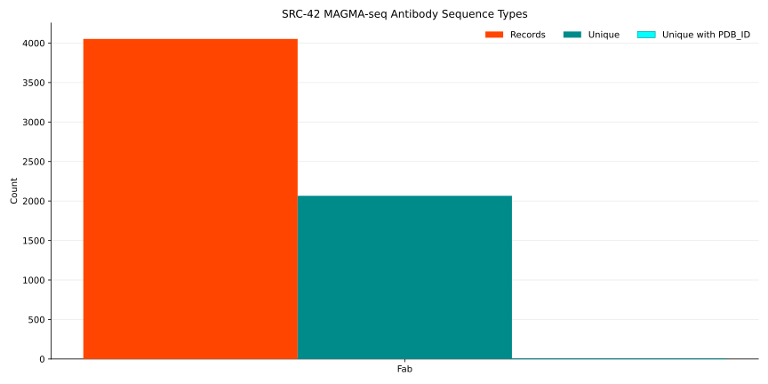
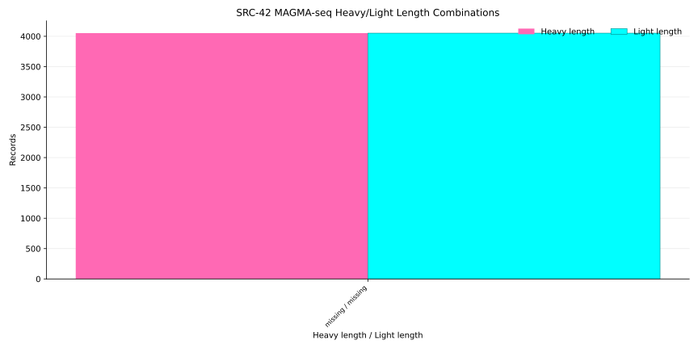
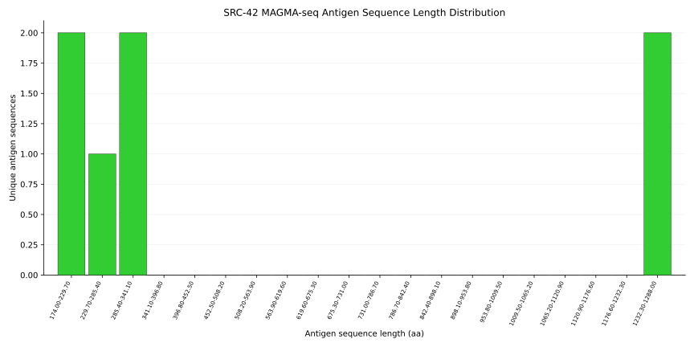

---
- tags:
  - context
---

# SRC-42 MAGMA-seq

> 每条 data 统一建模为 `((ab, ag), label, assay, condition, replicate, source)`.
> 本地快照 `G:\abag-datasets\SRC_R42_MAGMA_SEQ\snapshot-2024-06-10`, 结果表为 `articles/MAGMAseq_2024-05-10_NatureCommunications-v1-supplement6.xlsx` (Supplementary Data 4) 的 5 个结果 sheet, 共 4,052 行; 另有 Data 1 (质粒/文库/引物) 与 Source Data `supplement9.xlsx`.
> `Unique` 为 `(Ab, Variant)` 二元组精确去重, 4,052 行落 2,066 个唯一 (亲本, 变异串) 对; 同一变体在 barcode 级与 collapsed 级 sheet 中各出现一次.

## Antibody

> 有 Heavy 和 Light 的 `Unique` 字段是 `(heavy, light)` 二元组精确去重. `Unique with PDB_ID` 是按 Unique 后的 sequence 计数.
> Total Unique 计数方式为统一转 string, 如果有 Heavy 和 Light 用 `/` 拼接成 string.

| Key | 含义 | 说明 |
| --- | --- | --- |
| Sequence Type | 抗体序列类型 | 根据原始数据字段、链槽位及已有构建体标签划分的类别. |
| Records | 原始记录数 | 原始数据中的记录数量, 同一序列可能重复出现. |
| Unique | 唯一序列数 | 按对应数据集定义的去重规则统计. |
| Unique with PDB_ID | 关联 PDB 的唯一序列数 | 去重后具有关联 PDB_ID 的序列数量, 不等同于具有可用实验结构监督的序列数量. |
| Description | 类型说明 | 描述分类依据、序列槽位特征及分类限制. |

| Sequence Type | Records | Unique | Unique with PDB_ID | Description |
| --- | --- | --- | --- | --- |
| Fab | 4,052 | 2,066 | 5 | 变异串同时给出 VH 与 VL 两个区段的替换, 但没有可解析的链序列; 构建体由质粒表与论文的 Fab 措辞给出. |
| Total | 4,052 | 2,066 | 5 |  |

> 抗体序列不在快照内: 5 个结果 sheet 没有任何序列列, `Variant` 只是相对亲本的替换串 (如 `4A8>VH:A9A-GCC;V20V-GTG|4A8>VL:S7T-ACT`), 记的是密码子级替换而非完整 VH/VL. 因此本节的 Records 与 Unique 计的是测量行与唯一变异标识, 长度表两侧均为 `missing`.
>
> 构建体取自源方显式措辞: Data 1 的 `Plasmids` sheet 有 18 行带 `Fab` 措辞 (15 行 `... | Fab Mutagenesis Plasmid`, 另 3 行 `Fab <isotype> KanR/CamR Mutagenesis Plasmid`), 同 sheet 无 VHH / scFv 条目; 论文亦以 Fab 库描述. 9 个亲本中有 5 个在快照内存在冻结参考复合物 (`7C2L` 4A8、`6XC3` CC12.1、`3GBN` CR6261、`7T3D` 222-1C06、`7LSS` 2-7), 另 4 个 (319-345、1G01、1G04、Ab_2-17) 没有; `Unique with PDB_ID` 按亲本体系计 5, 不是 2,066 个变体各有一个结构.

| Heavy Length | Light Length | Records | Description |
| --- | --- | --- | --- |
| missing | missing | 4,052 | 结果表只给替换串, 无任何重链或轻链序列, 两侧记 missing. |

## Antigen

> Antigen 统计以 source-native antigen entity 为核心单位. 优先使用原始 antigen ID/name、construct 和 antigen chain 定义实体; 存在可靠序列时再统计唯一抗原序列.
> 结构、序列和数据库注释压缩到同一张表中, `PDB / UniProt` 采用唯一抗原实体粒度统计 2 × 2 覆盖结果.
> 长度图基于唯一抗原序列, 按该源实际范围平均切分 20 bins.

> 5 个 sheet 各固定一个抗原: 4A8/CC12.1 两张为 S1, 222-1C06 / 319-345 / topbinHA_rep2 三张为 HA (supp6 README 逐 sheet 写明). 表内无抗原序列字段, 序列取本地冻结的参考复合物, 属派生数据.

| Records | Unique ag entity | Unique ag sequence | PDB / UniProt coverage | Antigen Length | Antigen Evidence / Provenance | Description |
| --- | --- | --- | --- | --- | --- | --- |
| 4,052 | 2 | 7 | Reference PDB: 2; UniProt=unavailable | 174-1288 aa | Reference PDB / PDB-derived sequence | 唯一实体按 sheet 声明的靶点计 2 个 (SARS-CoV-2 S1、流感 HA). 表内无抗原序列, 长度图用 5 个冻结参考复合物中的 7 条非免疫球蛋白链作代理: 3GBN A/B (HA1 331 aa、HA2 179 aa)、7T3D A/B (HA1 331 aa、HA2 174 aa)、6XC3 E (S1 231 aa)、7C2L A (spike 1,283 aa)、7LSS A (spike 1,288 aa). 这些是各亲本的共享参考结构, 不是每一行的测量构建体; 4A8/CC12.1 的 S1 与 HA 表所用株系在表内均未给出. 表内无 UniProt 字段. |

## Affinity

> 去重口径: 按 **(Ab, Variant)** 去重, 跨 sheet 并集 2,066. 无标注重复测量的列; `n` 列取 4-10 的整数, 源表 README 未说明其定义, 不据此推断重复次数, 全记 `unknown`. barcode 级 sheet 与同抗原的 collapsed sheet 是同一批测量的两种汇总层级, 不能相加成独立抗体.
>
> `Kd` 单位为 nM, 由 barcode 计数与分选参数经 maximum likelihood 拟合得到, 是实验支持的拟合参数而非逐变体低通量 SPR. `ddg` / `dg` 列不是独立测量: 逐行等于 `0.616 x ln(Kd / 参考Kd)` (S1 两张取 100 nM, HA 三张取 1e6 nM, 最大偏差 < 1e-3), 是 Kd 的固定对数变换, 因此不另列一行.
>
> 边界与失败状态: `Kd=20,000` 8 行、`Kd=0.01` 7 行是求解边界, `Success=False` 63 行; 这些行保留原值, 不当作精确点估计. 4A8 与 CC12.1 的这批结果被 SRC-44 Kirby 研究复用, 跨源合并须按测量身份去重.

| Label | Assay | Condition | Replicate | Record pairs | Unique pairs | Description |
| --- | --- | --- | --- | --- | --- | --- |
| `Kd_M` | `NGS_seq` | all_barcodes_4A8_CC121 (S1) | unknown:858 | 858 | 153 | `Kd` (nM) 38.55-20000.00, 2 个亲本; `Success` True 851 / False 7; `n` 列 6-9. |
| `Kd_M` | `NGS_seq` | 4A8_CC121_combined (S1) | unknown:153 | 153 | 153 | `Kd` (nM) 49.12-20000.00, 2 个亲本; `Success` True 151 / False 2; `n` 列 6-9. |
| `Kd_M` | `NGS_seq` | all_barcodes_222-1C06 (HA) | unknown:514 | 514 | 377 | `Kd` (nM) 8.73-19723.32, 1 个亲本; `Success` True 490 / False 24; `n` 列 4-10. |
| `Kd_M` | `NGS_seq` | all_barcodes_319-345 (HA) | unknown:712 | 712 | 492 | `Kd` (nM) 2.68-18746.81, 1 个亲本; `Success` True 712 / False 0; `n` 列 4-10. |
| `Kd_M` | `NGS_seq` | topbinHA_rep2 (HA) | unknown:1,815 | 1,815 | 1,815 | `Kd` (nM) 0.01-12270.59, 8 个亲本; `Success` True 1,785 / False 30; `n` 列 4-9. |
