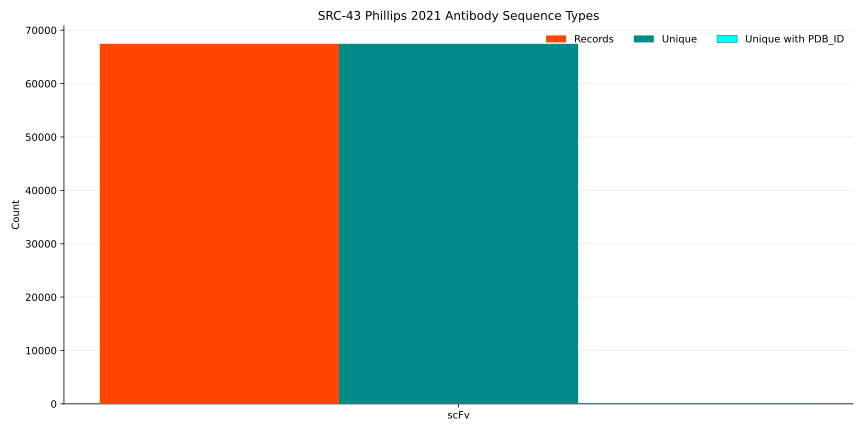
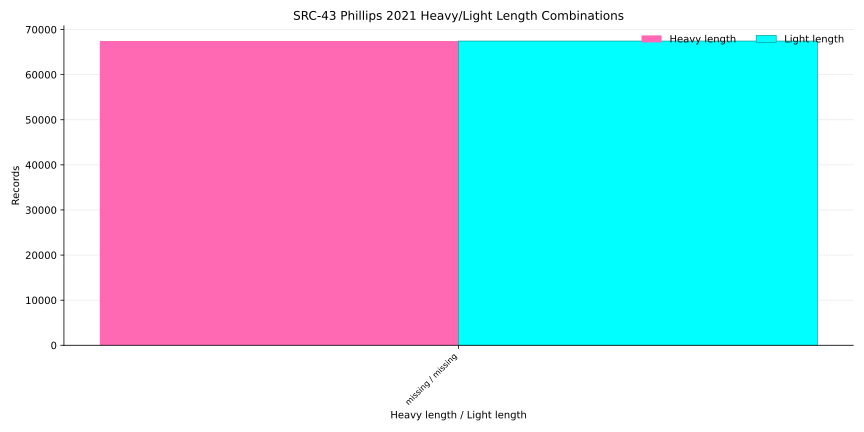
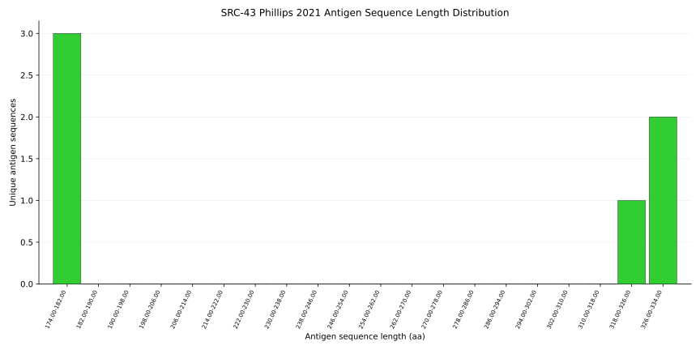

---
tags:
  - context
---

# SRC-43 Phillips 2021

> 每条 data 统一建模为 `((ab, ag), label, assay, condition, replicate, source)`.
> 本地快照 `G:\abag-datasets\SRC_R43_PHILLIPS\snapshot-2021-09-22`, 出版方 v3 Figure 1 source data 两张定量表, 加上游完整 git tree (`bnab-landscapes/`, 3,862 个文件) 与 3 个冻结 RCSB entry.
> `Unique` 按 **(亲本抗体, genotype)** 去重. 源内没有任何链序列, genotype 是父本成熟位点上的 11 / 16 位二进制码, 不是氨基酸序列; CR9114 65,536 个加 CR6261 1,917 个, 共 67,453 个. 位宽不同, 两个亲本之间不会撞键.

## Antibody

> 有 Heavy 和 Light 的 `Unique` 字段是 `(heavy, light)` 二元组精确去重. `Unique with PDB_ID` 是按 Unique 后的 sequence 计数.
> Total Unique 计数方式为统一转 string, 如果有 Heavy 和 Light 用 `/` 拼接成 string.

| Key | 含义 | 说明 |
| --- | --- | --- |
| Sequence Type | 抗体序列类型 | 根据原始数据字段、链槽位及已有构建体标签划分的类别. |
| Records | 原始记录数 | 原始数据中的记录数量, 同一序列可能重复出现. |
| Unique | 唯一序列数 | 按对应数据集定义的去重规则统计. |
| Unique with PDB_ID | 关联 PDB 的唯一序列数 | 去重后具有关联 PDB_ID 的序列数量, 不等同于具有可用实验结构监督的序列数量. |
| Description | 类型说明 | 描述分类依据、序列槽位特征及分类限制. |

| Sequence Type | Records | Unique | Unique with PDB_ID | Description |
| --- | --- | --- | --- | --- |
| scFv | 67,453 | 67,453 | 3 | 论文标注 scFv (`V_L-Ser(Gly4Ser)5-V_H-Myc`, 酵母表面展示), 属亲本级构建体标注; 表内只有 genotype 码, 无链槽位与序列, 不按长度反推构建体. |
| Total | 67,453 | 67,453 | 3 |  |

> 构建体只有论文层面的标注: Materials and methods 写明以 `V_L-Ser(Gly4Ser)5-V_H-Myc` 的 scFv 在酵母表面展示做 Tite-Seq, 两个亲本共用这一个构建体, 因此全表归 `scFv`. 这是亲本级属性, 不是逐行字段; 每行只有一个 genotype 码, 没有重链 / 轻链槽位, 也没有构建体列.
>
> `Unique with PDB_ID` 是亲本级计数: CR6261 → `3GBN`, CR9114 → `4FQI` 与 `4FQY`, 合计 3 个 `(亲本, entry)` 对. 都是亲本复合物, 没有任何 genotype 单独解出结构.
>
> 表内没有任何长度信息: 亲本链序列与逐变体序列都不在快照内, genotype 只标位点的 germline / somatic 状态, 无法安全重建序列, 长度列全记 `missing`.
>
> 同一批 genotype 在仓库里有多条处理分支, 不能相加: 出版方 Figure 1 的 1,917 行 CR6261 表等于 `20210323_6261_HA_unadj_fil_merg.csv` 的 1,917 行 (genotype 与全部数值逐行核对一致, 只有表头命名不同); 同源的还有 `unadj_unfilt_merg` 2,039 行与 `keepall` 2,048 行. CR9114 过滤与未过滤都是 65,536 行.

| Heavy Length | Light Length | Records | Description |
| --- | --- | --- | --- |
| missing | missing | 67,453 | 快照内没有任何链序列; genotype 是二进制位点码, 无法还原重链或轻链长度. |

## Antigen

> Antigen 统计以 source-native antigen entity 为核心单位. 优先使用原始 antigen ID/name、construct 和 antigen chain 定义实体; 存在可靠序列时再统计唯一抗原序列.
> 结构、序列和数据库注释压缩到同一张表中, `PDB / UniProt` 采用唯一抗原实体粒度统计 2 × 2 覆盖结果.
> 长度图基于唯一抗原序列, 按该源实际范围平均切分 20 bins.

> 抗原侧是 4 个 source-native HA 标签 (H1, H3, H9, FluB), 由定量表的列名前缀给出; 表内没有抗原序列字段, 序列只能取冻结复合物的抗原链.

| Records | Unique ag entity | Unique ag sequence | PDB / UniProt coverage | Antigen Length | Antigen Evidence / Provenance | Description |
| --- | --- | --- | --- | --- | --- | --- |
| 199,892 | 4 | 6 | PDB=1/UniProt=0: 2; PDB=0/UniProt=0: 2 | 174-334 aa; 6 unique lengths | PDB-derived sequence / Fixed target | 4 个标签: FluB, H1, H3, H9, 都是漂移中的流感 HA 亚型; H1 同时出现在 CR6261 与 CR9114 两张表里, 同一标签在两处复用. 实体是这 4 个亚型标签; 序列按 HA1 / HA2 两条链计, 所以 4 个实体对应 6 条序列. 实体级结构覆盖只有 2 个: H1 由 `3GBN` 直接覆盖, H3 由 `4FQY` 直接覆盖; H9 与 FluB 没有任何结构. 3 个冻结复合物给出 6 条非免疫球蛋白链, 6 条唯一序列: `3GBN` 的 H1 HA1/HA2 (331 / 179 aa), `4FQI` 的 H5 HA1/HA2 (334 / 177 aa), `4FQY` 的 H3 HA1/HA2 (323 / 174 aa). `4FQI` 是 H5 而不是被测的 H1, 论文用它作 CR9114-H1 的代理结构, 因此它是 `Reference PDB` 而不是 H1 的实测复合物; FluB 没有任何结构, 记 `PDB=0`. 长度是完整 HA 胞外域链长, 不是表内被测构建体的长度. 表内无 UniProt 字段. |

## Affinity

> 去重口径: landscape 按 **(亲本抗体, genotype, 抗原)** 去重, 每个 genotype 在每个抗原下一条; isogenic 复核按 **(克隆 shortname, 抗原)** 去重.
>
> `h1_mean` / `h3_mean` / `h9_mean` / `fluB_mean` 是 **-log10(KD [M])** (pKd 形式), 越大亲和力越强, 归 `log_Kd`. 换算是源内直接给出的, 不需要下游再取对数.
>
> 滴定窗口外的 genotype 被钉在窗口边界上: H1 / H9 窗口 1e-12-1e-07 M (弱端 pKd 7), H3 / FluB 窗口 1e-11-1e-06 M (弱端 pKd 6). 弱端因此出现成片相同的边界值 (H3 有 58,361 行、FluB 有 65,336 行取到 6.0, H1 有 1,675 / 214 行取到 7.0), 这是截断, 不是精确弱结合; 强端没有出现成片钉值, 最大值各只有 1 行, 属真实读数. 表内空值是该 genotype 在该抗原下没测出可用值, 记缺失, 不当阴性.
>
> `Kd_maxlikelihood/` 是同一批读数的另一套参数化, 保留内部 **ln(KD [M])** 负值 (约 -0.43 到 -16.2), 与 pKd 不同量纲, 不并入本表. `adj` / `unadj` / `filt` / `unfilt` / `keepall` 是处理分支, `Expression_meanbin/` 是表达量估计, `Epistasis_linear_models/` 与 `Figures/` 是回归系数与图件, 都是同一实验的派生层.
>
> 与本表同源的跨源副本: R09 FLAb 的 `phillips2021binding_cr9114_h1/h3` 与 `cr6261_h1/h9` 四张表取自这里 (genotype 与数值逐行核对一致, 只多补了重链 / 轻链序列列), 跨源汇总按测量身份去重, 不与 R09 相加.

| Label | Assay | Condition | Replicate | Record pairs | Unique pairs | Description |
| --- | --- | --- | --- | --- | --- | --- |
| `log_Kd` | `NGS_seq` | CR9114 - H1 | n=1:1,152; n=2:1,718; n=3:62,224; unknown:0 | 65,094 | 65,094 | `h1_mean` = -log10(KD [M]); 值域 7.000-9.835, 弱端 7.0 有 1,675 行取到, 是钉在滴定窗口弱端的截断值; 强端最大值 9.835 只有 1 行, 未触窗口上沿, 是真实上界. 同表另有 442 个 genotype 在该抗原下无值, 记缺失. 只有填了该毒株 rep 列的行才有 mean, 未填的不计入. `H1_sem` 是所填 replicate 的标准误. |
| `log_Kd` | `NGS_seq` | CR9114 - H3 | n=1:41; n=2:470; n=3:65,024; unknown:0 | 65,535 | 65,535 | `h3_mean` = -log10(KD [M]); 值域 6.000-9.042, 弱端 6.0 有 58,361 行取到, 是钉在滴定窗口弱端的截断值; 强端最大值 9.042 只有 1 行, 未触窗口上沿, 是真实上界. 同表另有 1 个 genotype 在该抗原下无值, 记缺失. 只有填了该毒株 rep 列的行才有 mean, 未填的不计入. `H3_sem` 是所填 replicate 的标准误. |
| `log_Kd` | `NGS_seq` | CR9114 - FluB | n=1:10; n=2:136; n=3:65,388; unknown:0 | 65,534 | 65,534 | `fluB_mean` = -log10(KD [M]); 值域 6.000-8.061, 弱端 6.0 有 65,336 行取到, 是钉在滴定窗口弱端的截断值; 强端最大值 8.061 只有 1 行, 未触窗口上沿, 是真实上界. 同表另有 2 个 genotype 在该抗原下无值, 记缺失. 只有填了该毒株 rep 列的行才有 mean, 未填的不计入. `FluB_sem` 是所填 replicate 的标准误. |
| `log_Kd` | `NGS_seq` | CR6261 - H1 | n=1:48; n=2:88; n=3:1,751; unknown:0 | 1,887 | 1,887 | `h1_mean` = -log10(KD [M]); 值域 7.000-9.729, 弱端 7.0 有 214 行取到, 是钉在滴定窗口弱端的截断值; 强端最大值 9.729 只有 1 行, 未触窗口上沿, 是真实上界. 同表另有 30 个 genotype 在该抗原下无值, 记缺失. 只有填了该毒株 rep 列的行才有 mean, 未填的不计入. `H1_sem` 是所填 replicate 的标准误. |
| `log_Kd` | `NGS_seq` | CR6261 - H9 | n=1:209; n=2:161; n=3:1,472; unknown:0 | 1,842 | 1,842 | `h9_mean` = -log10(KD [M]); 值域 7.000-10.150, 弱端 7.0 有 372 行取到, 是钉在滴定窗口弱端的截断值; 强端最大值 10.150 只有 1 行, 未触窗口上沿, 是真实上界. 同表另有 75 个 genotype 在该抗原下无值, 记缺失. 只有填了该毒株 rep 列的行才有 mean, 未填的不计入. `H9_sem` 是所填 replicate 的标准误. |
| `log_Kd` | `flow` | isogenic 复核 - CR6261 变体 | n=2:8 | 16 | 8 | `KD` 列是选定克隆的独立等温滴定复核, 与 landscape 的 `-log10(Kd)` 同尺度反号 (与 landscape 同克隆值的偏差已逐行核对, 除 CR9114 revertant 的 `gg` 一列 (自身拟合误差 2.2) 外均 < 0.5; 取 -KD 后值域 8.94-10.19); 抗原 H1, H9 (revertant 表的 `_run1` / `_run2` 是两次滴定, 去重时折算成同一抗原). 这些克隆同时出现在 landscape 表里, 是同一批 (ab, ag) 对的复测, 不当作新测量相加. |
| `log_Kd` | `flow` | isogenic 复核 - CR6261 revertant | n=2:2 | 4 | 2 | `KD` 列是选定克隆的独立等温滴定复核, 与 landscape 的 `-log10(Kd)` 同尺度反号 (与 landscape 同克隆值的偏差已逐行核对, 除 CR9114 revertant 的 `gg` 一列 (自身拟合误差 2.2) 外均 < 0.5; 取 -KD 后值域 9.15-10.28); 抗原 H1, H9 (revertant 表的 `_run1` / `_run2` 是两次滴定, 去重时折算成同一抗原). 这些克隆同时出现在 landscape 表里, 是同一批 (ab, ag) 对的复测, 不当作新测量相加. |
| `log_Kd` | `flow` | isogenic 复核 - CR9114 变体 | n=2:13; n=3:2; n=4:1 | 36 | 16 | `KD` 列是选定克隆的独立等温滴定复核, 与 landscape 的 `-log10(Kd)` 同尺度反号 (与 landscape 同克隆值的偏差已逐行核对, 除 CR9114 revertant 的 `gg` 一列 (自身拟合误差 2.2) 外均 < 0.5; 取 -KD 后值域 6.78-9.70); 抗原 FluB, H1, H3 (revertant 表的 `_run1` / `_run2` 是两次滴定, 去重时折算成同一抗原). 这些克隆同时出现在 landscape 表里, 是同一批 (ab, ag) 对的复测, 不当作新测量相加. |
| `log_Kd` | `flow` | isogenic 复核 - CR9114 revertant | n=2:6 | 12 | 6 | `KD` 列是选定克隆的独立等温滴定复核, 与 landscape 的 `-log10(Kd)` 同尺度反号 (与 landscape 同克隆值的偏差已逐行核对, 除 CR9114 revertant 的 `gg` 一列 (自身拟合误差 2.2) 外均 < 0.5; 取 -KD 后值域 7.17-9.55); 抗原 H1_run1, H1_run2, H3_run1, H3_run2 (revertant 表的 `_run1` / `_run2` 是两次滴定, 去重时折算成同一抗原). 这些克隆同时出现在 landscape 表里, 是同一批 (ab, ag) 对的复测, 不当作新测量相加. |
