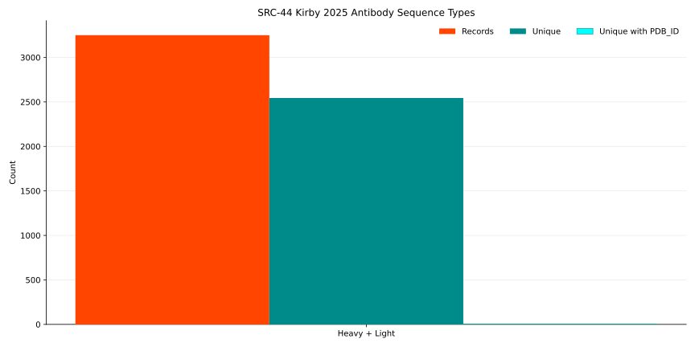
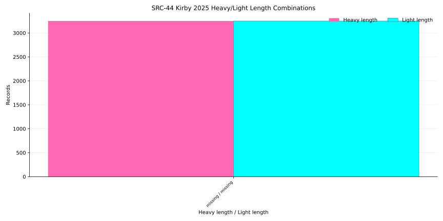
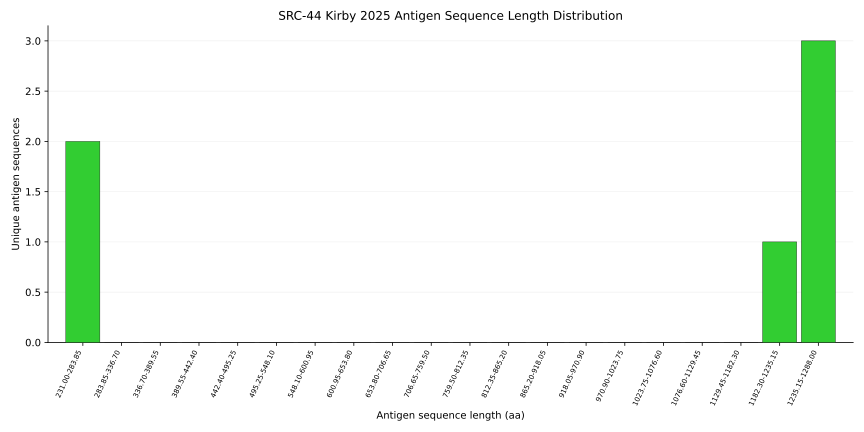

---
- tags:
  - context
---

# SRC-44 Kirby 2025

> 每条 data 统一建模为 `((ab, ag), label, assay, condition, replicate, source)`.
> 本地快照 `G:\abag-datasets\SRC_R44_KIRBY\snapshot-2024-06-21`, 出版方 dataset1 一张工作簿 (25 张表: 两个酵母展示库的 barcode counts 与最大似然拟合、两个打分库、Figure 4A 等温滴定), dataset2 只有克隆寡核苷酸与引物, 加 6 个冻结 RCSB entry.
> `Unique` 按 **变体字符串** 去重: 抗体以 `<亲本>_UCA>VH:...|<亲本>_UCA>VL:...` 形式给出, 只列突变与亲本名, 表内没有任何链序列; YL009 1,356 个与 YL011 1,894 个合计 2,544 个, 两库重合 706 个.

## Antibody

> 有 Heavy 和 Light 的 `Unique` 字段是 `(heavy, light)` 二元组精确去重. `Unique with PDB_ID` 是按 Unique 后的 sequence 计数.
> Total Unique 计数方式为统一转 string, 如果有 Heavy 和 Light 用 `/` 拼接成 string.

| Key | 含义 | 说明 |
| --- | --- | --- |
| Sequence Type | 抗体序列类型 | 根据原始数据字段、链槽位及已有构建体标签划分的类别. |
| Records | 原始记录数 | 原始数据中的记录数量, 同一序列可能重复出现. |
| Unique | 唯一序列数 | 按对应数据集定义的去重规则统计. |
| Unique with PDB_ID | 关联 PDB 的唯一序列数 | 去重后具有关联 PDB_ID 的序列数量, 不等同于具有可用实验结构监督的序列数量. |
| Description | 类型说明 | 描述分类依据、序列槽位特征及分类限制. |

| Sequence Type | Records | Unique | Unique with PDB_ID | Description |
| --- | --- | --- | --- | --- |
| Heavy + Light | 3,250 | 2,544 | 5 | 每个变体同时给出 VH 与 VL 两段突变描述, 无构建体字段; PDB 覆盖是 5 个亲本复合物的亲本级计数. |
| Total | 3,250 | 2,544 | 5 |  |

> 每个变体串都同时带 `>VH:` 与 `>VL:` 两段, 说明重链、轻链两个槽位都存在; 源内没有 Fab / Fv / IgG / scFv 之类的构建体字段, 因此归 `Heavy + Light`, 不按长度反推. 亲本名带 `_UCA` 后缀, 表示该变体是未突变共同祖先抗体在指定位点上的重构.
>
> `Unique with PDB_ID` 是亲本级计数: 10 个亲本里有 5 个各有一个冻结复合物 (`CC121_UCA`→`6XC3`, `Ab_1-57_UCA`→`7LS9`, `Ab_2-15_UCA`→`7L5B`, `C118_UCA`→`7RKV`, `002-S21F2_UCA`→`7U0P`), 合计 5 个 `(亲本, entry)` 对. 都是成熟抗体的复合物, 没有任何 UCA 变体单独解出结构; 其余 5 个亲本 (含 `C022_UCA`, 只有 1 个变体) 没有结构.
>
> 6 个冻结 entry 里 `7L5B` 与 `7C2L` 的链描述写作 `2-15 Heavy chain` / `heavy chain of 4A8`, 只有抗体名加槽位, 没有免疫球蛋白措辞; 共享分类器认不出这类命名, 本源按"已知亲本名 + 重/轻链槽位"这一条补齐 (与 `MEDI8852 heavy chain` 同一判据), 不改共享模块. `7C2L` 的 4A8 在本源的展示库里没有对应列, 因此它有结构但不计入 `(亲本, entry)` 对.
>
> 表内没有链序列, 长度列全记 `missing`: 变体串只给位点替换, 亲本全长序列不在本快照内.

| Heavy Length | Light Length | Records | Description |
| --- | --- | --- | --- |
| missing | missing | 3,250 | 表内只有变体串 (亲本名加位点替换), 没有任何链序列; 亲本全长也不在快照内, 无法重建长度. |

## Antigen

> Antigen 统计以 source-native antigen entity 为核心单位. 优先使用原始 antigen ID/name、construct 和 antigen chain 定义实体; 存在可靠序列时再统计唯一抗原序列.
> 结构、序列和数据库注释压缩到同一张表中, `PDB / UniProt` 采用唯一抗原实体粒度统计 2 × 2 覆盖结果.
> 长度图基于唯一抗原序列, 按该源实际范围平均切分 20 bins.

> 源内没有抗原字段: 两个展示库的表只有 `Variant` / 浓度 / 分选门, 没有靶点列或抗原序列列. 抗原侧只能取自 4 个亲本复合物的非免疫球蛋白链, 属结构派生序列.

| Records | Unique ag entity | Unique ag sequence | PDB / UniProt coverage | Antigen Length | Antigen Evidence / Provenance | Description |
| --- | --- | --- | --- | --- | --- | --- |
| 3,250 | 6 | 6 | PDB=1/UniProt=0: 6; PDB=0/UniProt=0: 0 | 231-1288 aa; 6 unique lengths | PDB-derived sequence / Reference PDB | 源内没有抗原 ID / 名称 / 构建体字段, 因此按 skill 的代理规则用唯一抗原序列代替实体计数: 两条 spike 序列相同即合并, 6 条序列即 6 个实体, 全部有结构. 6 个复合物给出 16 条非免疫球蛋白链、6 条唯一序列, 全部是 SARS-CoV-2 spike: `6XC3` 的 S1 231 aa、`7L5B` 的 S1 239 aa、`7U0P` 的胞外域 1,208 aa、`7RKV` 的 1,271 aa、`7C2L` 的 1,283 aa、`7LS9` 的 1,288 aa. 这些是亲本抗体的参考复合物, 不是逐变体的实测抗原; 每个变体测的是哪一个毒株的 spike, 源内没有标注, 不补. 表内无 UniProt 字段. |

## Affinity

> 去重口径: 按 **变体字符串** 去重, MLE 表的每一行都是唯一变体, 1:1; 打分表同样按变体去重; 等温滴定按抗体名去重.
>
> `Kd` 单位 nM, 由 barcode 计数在 11 个浓度 (2.5-2,000 nM) 下的分选分布做最大似然拟合得到. 拟合失败的行被源钉在窗口边界: `Kd = 20000` nM (YL009 415 行, YL011 373 行) 与 `Kd = 0.01` nM (5 / 3 行), 两端都是边界值而不是测量值, 必须与可拟合值分开. `Success` 列标 False 的行数更多 (538 / 909), 其中多数给出未触边的数值, 只有触边的那部分才是边界值. `dg` 是同一个 `Kd` 的确定性换算 (逐行拟合 `dg = 0.616 ln(Kd[M]) + 4.25`, 残差 < 1e-3, 即 RT 尺度), 不是第二个测量, 不另立行.
>
> `MLE filter` 两个表是 `MLE all` 的子集 (515 / 526 行), 供回归使用, 不叠加. `Rep comparison` 是 283 个变体在两库间的重复测量 (两列都有值), 不是新变体. `Score YL013` / `YL014` 是另外两个库在 4-5 个浓度下的分选分数, 变体集合与 YL009 / YL011 无交集, 属富集类读出, 不是 Kd.
>
> 与 R09 FLAb 的 `kirby2024retrospective_ab-SARSCoV2_kd` (869 行) 及 `_binary_kd` (1,407 行) 同源, 跨源汇总按测量身份去重.

| Label | Assay | Condition | Replicate | Record pairs | Unique pairs | Description |
| --- | --- | --- | --- | --- | --- | --- |
| `Kd_M` | `NGS_seq` | YL009 MLE all | unknown:1,356 | 1,356 | 1,356 | `Kd` 单位 nM, 值域 0.01-20000.0 (即 1.0e-11-2.0e-05 M); 415 行取上界 20,000 nM (拟合失败, 不是测量值), 123 行标 `Success=False` 但仍给出可拟合同值. 无 replicate 列. |
| `Kd_M` | `NGS_seq` | YL011 MLE all | unknown:1,894 | 1,894 | 1,894 | `Kd` 单位 nM, 值域 0.01-20000.0, 两端钉在边界: 373 行取 20,000 nM, 3 行取 0.01 nM; `Success` 标 False 的 909 行里另 533 行给出未触边的数值. 无 replicate 列. |
| `Kd_M` | `NGS_seq` | YL009 MLE filter | unknown:515 | 515 | 515 | `Kd` 可拟合的 515 行子集 (同一批 YL009 变体), 供回归使用, 值与 `MLE all` 相同, 不叠加. |
| `Kd_M` | `NGS_seq` | YL011 MLE filter | unknown:526 | 526 | 526 | `Kd` 可拟合的 526 行子集 (同一批 YL011 变体), 供回归使用, 值与 `MLE all` 相同, 不叠加. |
| `Kd_M` | `flow` | Figure 4A isogenic titration | unknown:16 | 16 | 16 | `Mean KD (nM)` 是 16 个抗体的等温滴定复核: 9 个数值 35.0-1,334.0 nM, 7 个写作 `>2000` (其中 2 个在原表带星标, 源注: 有可饱和结合但 Fmax 太低无法拟合), 记删失上界. 这些抗体是展示库的亲本级对照, 与上面的变体 Kd 不可相加. |
| `enrichment` | `NGS_seq` | Score YL013 | unknown:98 | 98 | 98 | 4-5 个浓度下的 top25 分选比例 (0-0.076) 与 `Score`, 是展示富集读数, 不是 Kd; 变体与 YL009 无交集. |
| `enrichment` | `NGS_seq` | Score YL014 | unknown:118 | 118 | 118 | 4 个浓度下的 top25 分选比例 (0-0.085) 与 `Score`, 是展示富集读数, 不是 Kd; 变体与 YL011 无交集. |
