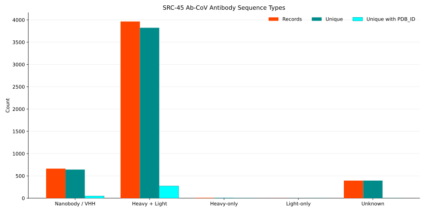
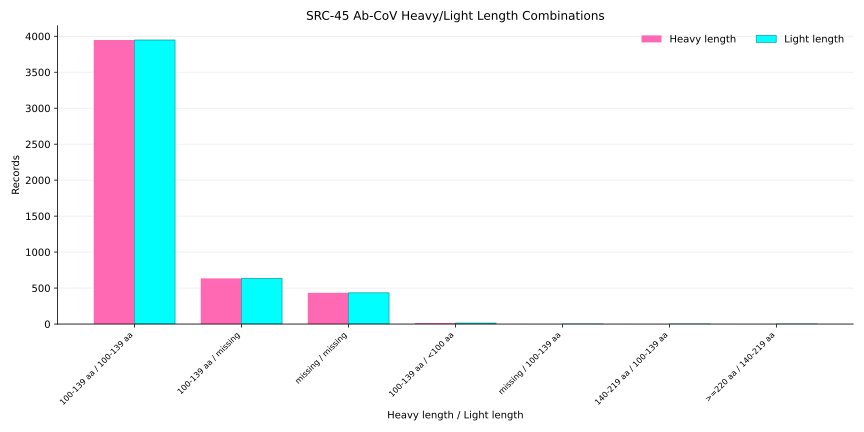
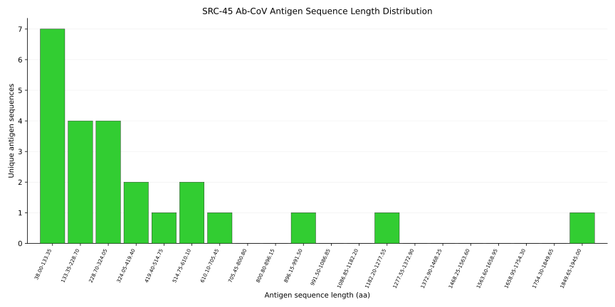

---
- tags:
  - context
---

# SRC-45 Ab-CoV

> 每条 data 统一建模为 `((ab, ag), label, assay, condition, replicate, source)`.
> 本地快照 `G:\abag-datasets\SRC_R45_ABCOV\figshare-5661658-v1`, 主体是 `Ab-CoV-Figshare/CoV-AbDab_220222.csv` (5,033 条抗体 / 纳米抗体记录, 带 VH、VL、结合与中和标记), 同目录另有 epitope、界面残基、计算突变网格与病毒蛋白表, 加 `FLAb/data/binding/` 的 rawat2022abcov Kd / IC50 两张表与 214 个冻结 RCSB entry.
> `Unique` 按每类的序列单元去重: `Heavy + Light` 用 `(VH, VL)` 二元组, `Nanobody / VHH` 与 `Heavy-only` 用单条 VH 序列, `Light-only` 用单条 VL 序列, 无序列的 `Unknown` 用记录名. 全表 5,033 条记录去重后 4,871 个单元, 各类型之间没有重复计数.

## Antibody

> 有 Heavy 和 Light 的 `Unique` 字段是 `(heavy, light)` 二元组精确去重. `Unique with PDB_ID` 是按 Unique 后的 sequence 计数.
> Total Unique 计数方式为统一转 string, 如果有 Heavy 和 Light 用 `/` 拼接成 string.

| Key | 含义 | 说明 |
| --- | --- | --- |
| Sequence Type | 抗体序列类型 | 根据原始数据字段、链槽位及已有构建体标签划分的类别. |
| Records | 原始记录数 | 原始数据中的记录数量, 同一序列可能重复出现. |
| Unique | 唯一序列数 | 按对应数据集定义的去重规则统计. |
| Unique with PDB_ID | 关联 PDB 的唯一序列数 | 去重后具有关联 PDB_ID 的序列数量, 不等同于具有可用实验结构监督的序列数量. |
| Description | 类型说明 | 描述分类依据、序列槽位特征及分类限制. |

| Sequence Type | Records | Unique | Unique with PDB_ID | Description |
| --- | --- | --- | --- | --- |
| Nanobody / VHH | 663 | 642 | 48 | `Ab or Nb` 列显式标 `Nb`; 单条 VH 即全部可变区 (109-152 aa), 无轻链槽位. |
| Heavy + Light | 3,964 | 3,823 | 273 | VH 与 VL 两槽都有序列, 无构建体字段; 绝大多数是 109-139 aa 的 V 区量级. |
| Heavy-only | 10 | 10 | 1 | 标 `Ab` 但 VL 为空 / `ND`; 有的是单链, 有的只是没登记轻链, 源内无法区分. |
| Light-only | 1 | 1 | 0 | 标 `Ab` 但 VH 为空 / `ND`; 只有 1 条. |
| Unknown | 395 | 395 | 0 | VH 与 VL 都是 `ND` / `N/A`; 有记录名与结合标记但没有可用序列, 按记录名去重. |
| Total | 5,033 | 4,871 | 322 |  |

> `Ab or Nb` 列显式给出 `Ab` / `Nb`, 因此 `Nb` 的 663 行直接归 `Nanobody / VHH`; 其余按槽位判定: VH 与 VL 都有序列 → `Heavy + Light` 3,964, 只有 VH → `Heavy-only` 10, 只有 VL → `Light-only` 1, 两槽都没有可用序列 → `Unknown` 395.
>
> 源内的 `ND` / `N/A` 是"没有该链", 不是缺失值: 395 行两槽都写 `ND` 或 `N/A`, 共 435 行 VH 如此; 把这些记成序列会把空槽当成抗体. 源内没有任何 Fab / Fv / scFv / IgG 构建体列, 因此不出现这些类别, 也不按长度反推.
>
> `Unique with PDB_ID` 是链序列级覆盖: 记录里 328 行带 RCSB 链接, 去重到 322 个单元; 另有 15 行写 `Expected (7TCQ)` 之类, 只是预期结构, 没有解出, 不计入. 链接里共 491 个不同 PDB ID, 本地冻结的 214 个 entry 全部在链接中出现, 另有 277 个只出现在链接里而没有本地坐标.
>
> `fitness` 列与亲和力列同值 (例如 `2.7` 对 `2.7`), 不是独立测量, 不另计.

| Heavy Length | Light Length | Records | Description |
| --- | --- | --- | --- |
| 100-139 aa | 100-139 aa | 3,948 | 主体形式: V 区量级的 VH + VL 双链. |
| 100-139 aa | missing | 634 | 只有 VH, 轻链槽为 `ND` / `N/A` 或空; 单域或未登记轻链, 源内无法区分. |
| missing | missing | 434 | 两槽都写 `ND` / `N/A`, 只有记录名可用. |
| 100-139 aa | <100 aa | 14 | 轻链短于 100 aa 的记录. |
| missing | 100-139 aa | 1 | 只有 VL, 无 VH. |
| 140-219 aa | 100-139 aa | 1 | 重链槽偏长, 轻链正常. |
| >=220 aa | 140-219 aa | 1 | 两侧都偏长 (VH 221 aa / VL 215 aa 的单条记录). |

## Antigen

> Antigen 统计以 source-native antigen entity 为核心单位. 优先使用原始 antigen ID/name、construct 和 antigen chain 定义实体; 存在可靠序列时再统计唯一抗原序列.
> 结构、序列和数据库注释压缩到同一张表中, `PDB / UniProt` 采用唯一抗原实体粒度统计 2 × 2 覆盖结果.
> 长度图基于唯一抗原序列, 按该源实际范围平均切分 20 bins.

> 抗原侧以 `Ab-CoV_viral_protein.csv` 的 source-native 病毒蛋白实体为核心: 24 个 SARS-CoV-2 蛋白 (Accession + Gene + UniProt), 自带 UniProt 号与实验结构编号. 抗体复合物里没有逐抗体的抗原标签, 因此不从复合物侧反推.

| Records | Unique ag entity | Unique ag sequence | PDB / UniProt coverage | Antigen Length | Antigen Evidence / Provenance | Description |
| --- | --- | --- | --- | --- | --- | --- |
| 5,033 | 24 | 24 | PDB=1/UniProt=1: 17; PDB=0/UniProt=1: 7; PDB=0/UniProt=0: 0; PDB=1/UniProt=0: 0 | 38-1945 aa; 24 unique lengths | Source-native / Direct sequence / Reference PDB | 24 个蛋白: E, M, N, ORF10, ORF3a, ORF6, ORF7a, ORF8, S, nsp1, nsp2, PLpro, nsp4, 3CLpro, nsp6, nsp7, nsp8, nsp9, nsp10, RdRp, Hel, ExoN, NendoU, 2'-O-MT. 每个都有 Accession、UniProt 号与完整蛋白序列, 17 个给出实验结构编号 (部分给多个, 如 S = 6VYB; 6VXX; 6LXT), 其余 7 个没有结构 (M, ORF6, nsp2, nsp4, nsp6, ExoN). 长度是该蛋白在全长多聚蛋白上的完整长度, 38-1,945 aa. 抗体记录里的 `Protein + Epitope` 列给的是结合区域标签 (S; RBD 3,491 行、S; non-RBD 429 行、S; NTD 251 行等 32 种), 不是抗原实体, 只作分层说明. 冻结的 214 个 entry 里有 165 个含抗体链, 其非免疫球蛋白链合计 460 条、68 条唯一序列 (15-1329 aa), 与上面 24 个病毒蛋白不是同一套定义, 不合并计数. 这 460 条里有 27 条其实是抗体链, 但 entity 文本只写 `CC12.1 light chain` / `EY6A heavy chain` / `IG c181_light_IGLV2-14_IGLJ3` 这类名字, 没有免疫球蛋白或 isotype 措辞, 按固定规则落在本侧; 最短的一条是 15 aa 的 `Spike glycoprotein stem helix peptide`, 属肽段而非蛋白链. |

## Affinity

> 去重口径: 结合 / 中和判定按与 Antibody 节相同的序列单元去重 (全表 4,871 个); rawat2022 的 Kd 与 IC50 按 `(heavy, light)` 去重; 计算 ddG 按 `(抗体, PDB, 位点, 替换 aa)` 去重.
>
> CoV-AbDab 的两个标记列是 **分株判定**, 不是数值亲和力: `Binds to` / `Doesn't Bind to` 与 `Neutralising Vs` / `Not Neutralising Vs` 列出的是毒株名单 (102 种写法, 含 `(weak)` 与大小写不一致), 因此只能归 `binary`. 同一记录可以对一个株结合、对另一个株不结合 (1,333 行两列同时有值), 这不是矛盾而是分株结果.
>
> rawat2022abcov 的两张表与 R09 FLAb 里同名的 `rawat2022abcov_kd` / `rawat2022abcov_ic50` 逐字节相同, 是同一批测量的另一个副本, 跨源汇总必须去重, 不能与 R09 相加. 这两张表与 CoV-AbDab 的 5,033 条记录有 406 条重链序列重叠, 属同一抗体在不同层的表示.
>
> `Ab-CoV_interface_mutation.csv` 的 29,010 行是 FoldX / mCSM / ProAffiMuSeq / CUPSAT 四个计算方法的输出, 每个 (抗体, PDB) 对给出 20 种替换的 ddG 网格, 归 `predicted`, 与实验值分开.

| Label | Assay | Condition | Replicate | Record pairs | Unique pairs | Description |
| --- | --- | --- | --- | --- | --- | --- |
| `binary` | `unknown` | CoV-AbDab `Binds to` | unknown:5,033 | 5,033 | 4,871 | 分株结合判定, 每行列出该抗体结合的毒株名单 (SARS-CoV2_WT / Alpha / ... / 229E 等, 含 `(weak)` 标注); 无方法字段. |
| `binary` | `unknown` | CoV-AbDab `Doesn't Bind to` | unknown:1,333 | 1,333 | 1,290 | 分株不结合判定; 其中 1,333 行与 `Binds to` 同时有值, 说明是分株结果而非全局阴性. |
| `binary` | `unknown` | CoV-AbDab `Neutralising Vs` | unknown:2,408 | 2,408 | 2,349 | 分株中和判定, 毒株名单与结合列独立. |
| `binary` | `unknown` | CoV-AbDab `Not Neutralising Vs` | unknown:1,700 | 1,700 | 1,638 | 分株非中和判定; 282 行与中和列同时有值. |
| `Kd_M` | `unknown` | rawat2022abcov Kd | unknown:141 | 141 | 136 | `Binding Affinity (KD nM)` 141 行, 去重后 136 对; 同表另给 `-log (KD M)`, 是同值换算, 不另立 label. 无方法字段. |
| `IC50` | `unknown` | rawat2022abcov IC50 | unknown:427 | 427 | 413 | `IC50 (ng/ml)` 427 行中和测定, 去重后 413 对; 无方法字段. |
| `predicted` | `computational` | Ab-CoV_interface_mutation binding | unknown:14,506 | 14506 | 143 | FoldX 4,836 / ProAffiMuSeq 4,835 / mCSM 4,835 行的 `binding affinity change upon mutation` (kcal/mol), 每行一个 (抗体, PDB, 位点) 的 20 种替换网格; 值域 -12.54-63.33, 去重后 143 个 (抗体, PDB) 对. 全部是计算值. |
