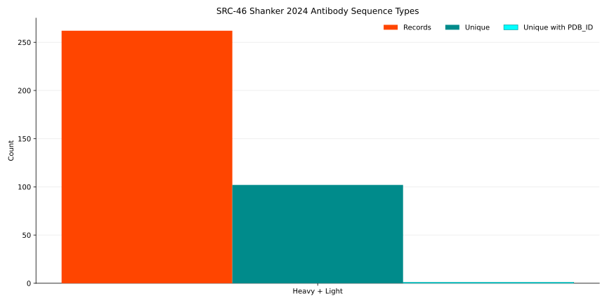
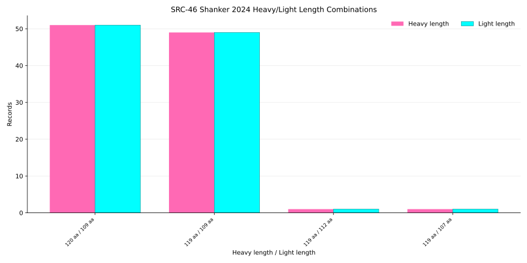
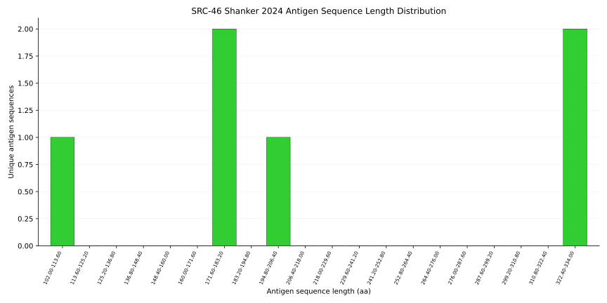

---
- tags:
  - context
---

# SRC-46 Shanker 2024

> 每条 data 统一建模为 `((ab, ag), label, assay, condition, replicate, source)`.
> 本地快照 `G:\abag-datasets\SRC_R46_SHANKER\zenodo-11260318`, `FLAb/data/` 下 7 张结合表与 3 张多反应性表 (每行带完整 VH、VL 序列), 另加 `Shanker-supplementary-data/` 的 5 份补充数据与 19 个冻结 RCSB entry.
> `Unique` 按 **(heavy, light)** 二元组精确去重: 10 张表 262 行去重后 102 对, 只有 56 条不同的重链.

## Antibody

> 有 Heavy 和 Light 的 `Unique` 字段是 `(heavy, light)` 二元组精确去重. `Unique with PDB_ID` 是按 Unique 后的 sequence 计数.
> Total Unique 计数方式为统一转 string, 如果有 Heavy 和 Light 用 `/` 拼接成 string.

| Key | 含义 | 说明 |
| --- | --- | --- |
| Sequence Type | 抗体序列类型 | 根据原始数据字段、链槽位及已有构建体标签划分的类别. |
| Records | 原始记录数 | 原始数据中的记录数量, 同一序列可能重复出现. |
| Unique | 唯一序列数 | 按对应数据集定义的去重规则统计. |
| Unique with PDB_ID | 关联 PDB 的唯一序列数 | 去重后具有关联 PDB_ID 的序列数量, 不等同于具有可用实验结构监督的序列数量. |
| Description | 类型说明 | 描述分类依据、序列槽位特征及分类限制. |

| Sequence Type | Records | Unique | Unique with PDB_ID | Description |
| --- | --- | --- | --- | --- |
| Heavy + Light | 262 | 102 | 1 | 10 张表均给出 VH、VL 两段完整序列, 无构建体字段; 长度均在 V 区量级. PDB 覆盖是 1 个亲本复合物 (`7MMO`) 的亲本级计数. |
| Total | 262 | 102 | 1 |  |

> 10 张表都同时给出 `heavy` 与 `light` 两段完整序列, 没有构建体字段, 因此归 `Heavy + Light`; 表内没有任何 Fab / Fv / scFv / IgG 标记.
>
> 补充数据 S2 的工作表说明页写 "Round 1 and 2 IgG Kd measurements", 是对这批测量的亲本级描述; 但该措辞不在逐行字段里, 也不覆盖 `FLAb/data/` 的 10 张表, 因此不据此把任何一行升级为 `IgG`.
>
> `Unique with PDB_ID` 是亲本级计数, 记 1. 19 个冻结 entry 里有 4 个含抗体链 (`2FJG`、`3GBN`、`4FQI`、`7MMO`), 表内没有 PDB 字段, 因此用序列比对建立连接: 只有 `7MMO` 的 `LY-CoV1404 Fab heavy chain` (223 aa) 与 `Fab light chain` (215 aa) 以表内 LY-CoV1404 变体的 VH (119 aa) / VL (109 aa) 为前缀, 命中 1 个 `(heavy, light)` 对; 其余 3 个 entry 与表内任何序列都不匹配. 也就是说 Ly1404 库有 1 个亲本复合物, SA58 库没有结构; 没有任何变体单独解出结构.
>
> 唯一观测到的长度组合是 120/119 aa 重链配 109 aa 轻链 (另有各 1 条 119/107 与 119/112), 全部是 V 区量级, 没有恒定区.

| Heavy Length | Light Length | Records | Description |
| --- | --- | --- | --- |
| 120 aa | 109 aa | 51 | SA58 变异系的唯一长度组合. |
| 119 aa | 109 aa | 49 | LY-CoV1404 变异系的唯一长度组合. |
| 119 aa | 112 aa | 1 | 1 条轻链偏长的记录. |
| 119 aa | 107 aa | 1 | 1 条轻链偏短的记录. |

## Antigen

> Antigen 统计以 source-native antigen entity 为核心单位. 优先使用原始 antigen ID/name、construct 和 antigen chain 定义实体; 存在可靠序列时再统计唯一抗原序列.
> 结构、序列和数据库注释压缩到同一张表中, `PDB / UniProt` 采用唯一抗原实体粒度统计 2 × 2 覆盖结果.
> 长度图基于唯一抗原序列, 按该源实际范围平均切分 20 bins.

> 源内没有抗原字段: 结合表只有序列与读数, 抗原名只出现在文件名 (`Ly1404-BQ.1.1`、`SA58-XBB.1.5` 等) 与补充表 S1/S2 的表头. 抗原序列只能取自文献 S3 用到的参考复合物, 属结构派生序列.

| Records | Unique ag entity | Unique ag sequence | PDB / UniProt coverage | Antigen Length | Antigen Evidence / Provenance | Description |
| --- | --- | --- | --- | --- | --- | --- |
| 262 | 6 | 6 | PDB=1/UniProt=0: 1; PDB=0/UniProt=0: 5 | 102-334 aa; 6 unique lengths | PDB-derived sequence / Fixed target | 6 个 source-native 抗原标签, 来自 `FLAb/data/binding/` 的文件名与 S1/S2 的表头: BQ.1.1, Wuhan, BA.1, XBB.1.5 (SARS-CoV-2 株, 配 LY-CoV1404 与 SA58) 与 S3 里作为方法学基准的流感 H1、H3; S3 的第四个靶点 VEGF-A 与抗体 g6.31 只用于相关性比较, 不是本源的测量对象. 实体级结构覆盖只有 1 个: 流感 H1 由 `3GBN` 的血凝素链直接覆盖. 4 个 SARS-CoV-2 株标签 (BQ.1.1, Wuhan, BA.1, XBB.1.5) 都没有逐株结构; `7MMO` 的 spike S1 链 (205 aa) 不带株注释, 只能证明 LY-CoV1404 的亲本复合物, 不能指认它测的是哪一株; H3 在本地没有复合物. `2FJG` 的抗原是 VEGF-A, 属 S3 的相关性基准靶点 (配 g6.31), 不是本源的测量对象. 4 个含抗体链的 entry 的非免疫球蛋白链合计 10 条、6 条唯一序列 (102-334 aa), 涵盖 H1、H5 代理、VEGF-A 与不带株注释的 S1. 株特异的 spike 构建体长度源内没有给出, 只有 BQ.1.1 RBD 的读数; 不从参考链反推被测构建体. 表内无 UniProt 字段. |

## Affinity

> 去重口径: 结合表按 **(heavy, light)** 序列对去重, 同一对在不同表里重复出现只算一次; 补充数据按 (表, 设计名) 去重.
>
> `FLAb/data/binding/` 的 7 张表全部与 R09 FLAb 同名文件逐字节相同, 是同一批测量的副本, 跨源汇总必须去重, 不能与 R09 相加.
>
> `fitness` 列与亲和力列同值 (例如 `2.7` 对 `2.7`), 不是独立测量. 补充数据 S1 的单元格带 `± SD` 与样本数 `n`, S2 的 Kd 带两次重复, 这些是本源唯一记录了重复结构的地方; `FLAb/` 的 10 张表没有重复编号, 全记 `unknown`.

| Label | Assay | Condition | Replicate | Record pairs | Unique pairs | Description |
| --- | --- | --- | --- | --- | --- | --- |
| `IC50` | `unknown` | shanker2024unsupervised_Ly1404-BQ.1.1_IC50.csv | unknown:50 | 50 | 45 | `Avg Neutralization IC50 (ng/µL)` 单位 ng/uL, 值域 4.3-338, 50 行可解析; 无方法字段, 无重复列, 逐行一个变体序列对. |
| `Kd_M` | `unknown` | shanker2024unsupervised_Ly1404-BQ.1.1_Kd.csv | unknown:36 | 36 | 32 | `Kd avg (M)` 单位 M, 值域 1.12e-07-4.85e-06, 36 行可解析; 无方法字段, 无重复列, 逐行一个变体序列对. |
| `IC50` | `unknown` | shanker2024unsupervised_Ly1404_Wuhan_IC50.csv | unknown:32 | 32 | 32 | `Avg Neutralization IC50 (ng/µL)` 单位 ng/uL, 值域 0.93-4.3, 32 行可解析; 无方法字段, 无重复列, 逐行一个变体序列对. |
| `IC50` | `unknown` | shanker2024unsupervised_SA58-BA.1_IC50.csv | unknown:19 | 19 | 19 | `Avg Neutralization IC50 (ng/µL)` 单位 ng/uL, 值域 7.7-2.1e+03, 19 行可解析; 无方法字段, 无重复列, 逐行一个变体序列对. |
| `IC50` | `unknown` | shanker2024unsupervised_SA58-BQ.1.1_IC50.csv | unknown:49 | 49 | 46 | `Avg Neutralization IC50 (ng/µL)` 单位 ng/uL, 值域 0.56-449, 49 行可解析; 无方法字段, 无重复列, 逐行一个变体序列对. |
| `Kd_M` | `unknown` | shanker2024unsupervised_SA58-BQ.1.1_Kd.csv | unknown:7 | 7 | 7 | `Kd avg (M)` 单位 M, 值域 0-7.82e-08, 7 行可解析; 无方法字段, 无重复列, 逐行一个变体序列对. |
| `Kd_M` | `unknown` | shanker2024unsupervised_SA58-XBB.1.5_Kd.csv | unknown:30 | 30 | 26 | `Kd avg (M)` 单位 M, 值域 1.18e-07-7.64e+19, 30 行可解析; 无方法字段, 无重复列, 逐行一个变体序列对. |
| `Kd_M` | `unknown` | supplementary S2 Kd (Ly-1404 / SA58) | unknown:96 | 96 | 96 | `Kd avg (M)` 两次重复; 73 个数值取 0-7.6e19 中的可解析段, 23 行是 `<1.0E-12` 的删失上界 (源注: 超过检测灵敏度), 必须与数值分开. 与 `FLAb/data/binding/` 的 Kd 表是同一批测量, 不叠加. |
| `IC50` | `unknown` | supplementary S1 IC50 (4 张表) | unknown:115 | 115 | 115 | `Avg Neutralization IC50 ± SD (ng/uL 或 ug/uL)` 单元格形如 `2.7 ± 1.1`, 102 个有值、13 个标 `>LOQ` / `LOQ` (超出定量限). 每张表两个株, 两列 IC50 (ng/uL 与 ug/uL) 是同一读数的两种单位, 只取一列. 与 `FLAb/data/binding/` 的 IC50 表同批, 不叠加. |
| `enrichment` | `flow` | APC-MFI 多反应性 (3 表) | unknown:39 | 39 | 13 | `APC MFI` 是细胞表面结合的平均荧光强度, 属多反应性读数, 不是亲和力; `Elotuzumab-Ixekuzimab` 一表只有 2 个对照抗体, 不参与长度统计之外的任何计数. |
| `not_recorded` | `unknown` | S3 基准相关性 / S5 文献汇总 | unknown:0 | 0 | 0 | S3 是 30 行 `Correlation` 值 (CR9114 / CR6261 / g6.31 × H1/H3/VEGF-A × SILM/LM/MSA), S5 是 26 行文献汇总; 两者都不含 (ab, ag) 测量, 不产生记录. |
