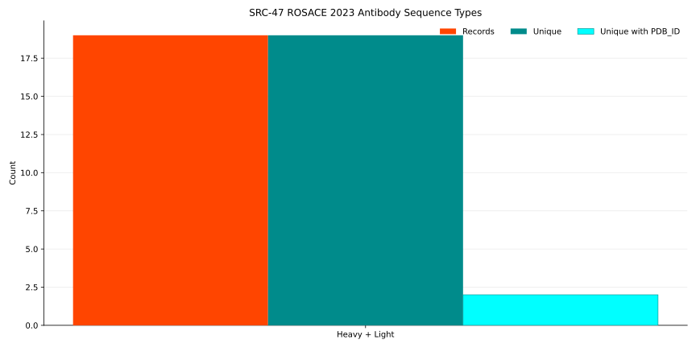
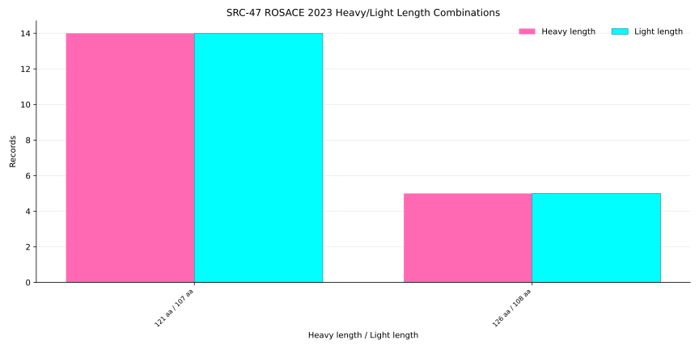
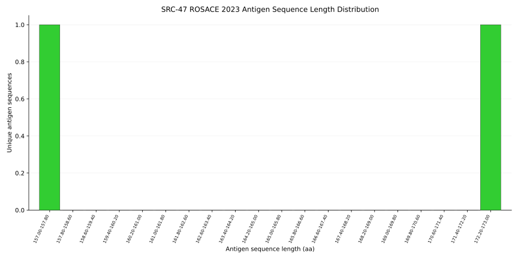

---
tags:
  - context
---

# [SRC-47 ROSACE 2023](../2026-10-29-3a-src-readme/src-47-rosace-readme.md)

> 每条 data 统一建模为 `((ab, ag), label, assay, condition, replicate, source)`.
> 本地快照 `G:\abag-datasets\SRC_R47_ROSACE\snapshot-2023-04-06`, `FLAb/data/` 下 2 张结合表、6 张多反应性表、2 张热稳定性表, 加 `Rosace-source-data/` 两份补充工作簿与 114 个冻结 RCSB entry.
> `Unique` 按 **(heavy, light)** 二元组精确去重: 14 个 adalimumab 变体与 5 个 golimumab 变体, 共 19 个, 全部 1:1 唯一.

## Antibody

> 有 Heavy 和 Light 的 `Unique` 字段是 `(heavy, light)` 二元组精确去重. `Unique with PDB_ID` 是按 Unique 后的 sequence 计数.
> Total Unique 计数方式为统一转 string, 如果有 Heavy 和 Light 用 `/` 拼接成 string.

| Key | 含义 | 说明 |
| --- | --- | --- |
| Sequence Type | 抗体序列类型 | 根据原始数据字段、链槽位及已有构建体标签划分的类别. |
| Records | 原始记录数 | 原始数据中的记录数量, 同一序列可能重复出现. |
| Unique | 唯一序列数 | 按对应数据集定义的去重规则统计. |
| Unique with PDB_ID | 关联 PDB 的唯一序列数 | 去重后具有关联 PDB_ID 的序列数量, 不等同于具有可用实验结构监督的序列数量. |
| Description | 类型说明 | 描述分类依据、序列槽位特征及分类限制. |

| Sequence Type | Records | Unique | Unique with PDB_ID | Description |
| --- | --- | --- | --- | --- |
| Heavy + Light | 19 | 19 | 2 | 两个亲本的变体系列均为 VH + VL 双链, 无构建体字段; PDB 覆盖是 2 个亲本复合物的亲本级计数. |
| Total | 19 | 19 | 2 |  |

> 两个亲本的变体系列都给出完整 `heavy` / `light` 序列, 没有构建体字段, 源内也没有 Fab / Fv / IgG / scFv 措辞, 因此归 `Heavy + Light`, 不按长度反推.
>
> 表内没有 PDB 字段. 114 个冻结 entry 里只有 `3WD5` (adalimumab Fab-TNF) 与 `5YOY` (golimumab Fv-TNF) 属于这两个亲本, 都是亲本复合物, 没有任何变体单独解出结构; 因此 `Unique with PDB_ID` 记 2. 其余 112 个 entry 是论文做突变特征分析与方法学演示用的通用结构面板: 其中 18 个是别的抗体复合物 (CR3022、Beta-38、CIS43、CC40.8 等), 94 个是单蛋白或小肽, 没有一个是 adalimumab 或 golimumab, 与这 19 个变体没有序列或 ID 连接, 不计入.
>
> `3WD5` / `5YOY` 的链描述写作 `Adalimumab Heavy Chain` / `Golimumab heavy chain variable region`, 只有药名加槽位, 没有免疫球蛋白措辞; 共享的分类器认不出这类命名, 本源按"已知亲本名 + 重/轻链槽位"这一条补齐 (与 `MEDI8852 heavy chain` 同一判据), 不改共享模块.
>
> 长度只有两组: adalimumab 121 aa 重链配 107 aa 轻链, golimumab 126 aa 配 108 aa; 全部是 V 区量级.

| Heavy Length | Light Length | Records | Description |
| --- | --- | --- | --- |
| 121 aa | 107 aa | 14 | adalimumab 的 14 个变体; 只有 VH/VL, 长度随突变恒定. |
| 126 aa | 108 aa | 5 | golimumab 的 5 个变体; 同上. |

## Antigen

> Antigen 统计以 source-native antigen entity 为核心单位. 优先使用原始 antigen ID/name、construct 和 antigen chain 定义实体; 存在可靠序列时再统计唯一抗原序列.
> 结构、序列和数据库注释压缩到同一张表中, `PDB / UniProt` 采用唯一抗原实体粒度统计 2 × 2 覆盖结果.
> 长度图基于唯一抗原序列, 按该源实际范围平均切分 20 bins.

> 抗原只有一个: 肿瘤坏死因子 (TNF). 源表没有抗原字段, 由两个亲本复合物的非免疫球蛋白链给出, 属结构派生序列.

| Records | Unique ag entity | Unique ag sequence | PDB / UniProt coverage | Antigen Length | Antigen Evidence / Provenance | Description |
| --- | --- | --- | --- | --- | --- | --- |
| 19 | 2 | 2 | PDB=1/UniProt=0: 2; PDB=0/UniProt=0: 0 | 157-173 aa; 2 unique lengths | PDB-derived sequence / Reference PDB | `3WD5` 给 1 条 TNF 链 (157 aa), `5YOY` 给 6 条 TNF 链 (173 aa, 同一条序列的多拷贝), 合计 7 条实体、去重后 2 条序列, 同一个抗原. 这是 19 个变体共同的靶点, 不是逐变体的实测抗原. 源内没有抗原 ID 或 UniProt 字段, 构建体长度也没有给出, 不从参考链反推. 表内无 UniProt 字段. |

## Affinity

> 去重口径: 按 **(heavy, light)** 序列对去重, 19 行全部唯一.
>
> `KD (M)` 是同表 `-log10(KD (M))` 与 `-log(Kd [nM])` 的来源, 三种写法逐行核对一致, 只记 `Kd_M`, 不重复计 `log_Kd`. 表内没有方法字段, assay 记 `unknown`; 表内也没有重复列.
>
> `Mutations` 列给出该变体相对亲本的替换 (如 `AH23K AH40P SH49G`), 是条件而不是独立测量.
>
> `FLAb/data/polyreactivity/` 的 6 张表 (`CIC RT (min) rep1` / `rep2`) 是交叉相互作用色谱保留时间, `FLAb/data/thermostability/` 的 2 张表 (`Tm (C) rep1`) 是熔解温度. 两者都不是结合测量: 保留时间是无量纲的疏水性 / 多反应性指标, Tm 的单位是 °C. 它们都不在 `Label` 词表内, 一律不产生亲和力记录, 也不单列成 0 行的表项; 这 6 张表只作为同一批 19 个变体存在多属性读数的证据.
>
> 与本表同源的跨源副本: 这 8 张表与 R09 FLAb 的同名文件逐字节相同, 跨源汇总必须去重, 不能与 R09 相加.
>
> `Rosace-source-data/` 的两份补充工作簿不是亲和力: MOESM13 是 beta-lactamase / APH(3')-II / Hsp90 等非抗体蛋白的 DMS 验证, MOESM15 是论文各图的 source data (`Fig 1A` 的 `experimental_DDG` 对 `foldX_DDG` 是蛋白稳定性, `Fig 4` / `Fig 5` 的 `Tm` 与 `CIC RT` 与上面同源).

| Label | Assay | Condition | Replicate | Record pairs | Unique pairs | Description |
| --- | --- | --- | --- | --- | --- | --- |
| `Kd_M` | `unknown` | ROSACE 优化变体 - Adalimumab | unknown:14 | 14 | 14 | `KD (M)` 2.6e-11-2.4e-09, 14 个变体 (含 `WT`); 同表 `-log10(KD)` 与 `-log(Kd [nM])` 是同值换算. 无删失值, 无重复列. |
| `Kd_M` | `unknown` | ROSACE 优化变体 - Golimumab | unknown:5 | 5 | 5 | `KD (M)` 2e-10-1.1e-09, 5 个变体 (含 `WT`); 同表 `-log10(KD)` 与 `-log(Kd [nM])` 是同值换算. 无删失值, 无重复列. |
