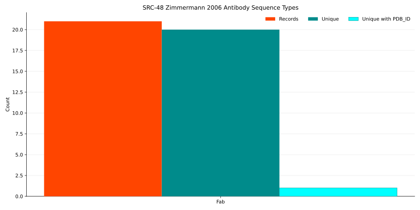
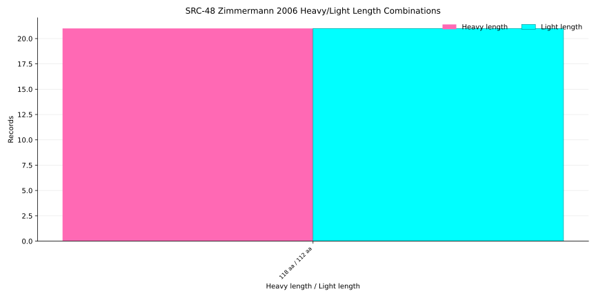
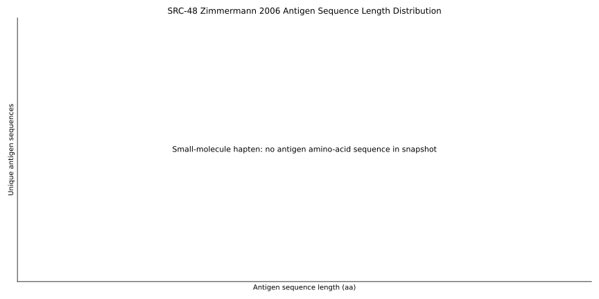

---
tags:
  - context
---

# SRC-48 Zimmermann 2006

> 每条 data 统一建模为 `((ab, ag), label, assay, condition, replicate, source)`.
> 本地快照 `G:\abag-datasets\SRC_R48_ZIMMERMANN\snapshot-2026-08-17`, 唯一数据表 `FLAb/data/binding/zimmerman2020antibody_4420_kd.csv` 21 行 × 6 列; 另有 `pdb/` 下一份冻结的参考复合物 `1FLR`.
> `Unique` 为 `(heavy, light)` 二元组精确去重, 21 行落 20 个唯一变体对.

## Antibody

> 有 Heavy 和 Light 的 `Unique` 字段是 `(heavy, light)` 二元组精确去重. `Unique with PDB_ID` 是按 Unique 后的 sequence 计数.
> Total Unique 计数方式为统一转 string, 如果有 Heavy 和 Light 用 `/` 拼接成 string.

| Key | 含义 | 说明 |
| --- | --- | --- |
| Sequence Type | 抗体序列类型 | 根据原始数据字段、链槽位及已有构建体标签划分的类别. |
| Records | 原始记录数 | 原始数据中的记录数量, 同一序列可能重复出现. |
| Unique | 唯一序列数 | 按对应数据集定义的去重规则统计. |
| Unique with PDB_ID | 关联 PDB 的唯一序列数 | 去重后具有关联 PDB_ID 的序列数量, 不等同于具有可用实验结构监督的序列数量. |
| Description | 类型说明 | 描述分类依据、序列槽位特征及分类限制. |

| Sequence Type | Records | Unique | Unique with PDB_ID | Description |
| --- | --- | --- | --- | --- |
| Fab | 21 | 20 | 1 | 2 种轻链背景 x 11 个重链序列 = 22 个拟表征条件, 其中 2 个因表达差未测, 另 1 行整行重复; 源文以 Fab 表达与测量, 表内两列只到可变区. |
| Total | 21 | 20 | 1 |  |

> 源表字段与链角色相反: 原 `heavy` 列是 112 aa 的轻链可变区, 原 `light` 列才是 118 aa 的重链可变区. 证据是序列本身: 两个 `heavy` 值之一是 `1FLR` author chain L 的完整前缀, 而 18 个 `light` 值与 `1FLR` author chain H 前 118 位最多差 2 个残基. 下游按 §Length 的 `118 aa` / `112 aa` 读, 但 raw 列名不改写.
>
> 全部 20 个变体都是同一个亲本 4-4-20 的体系: 2 种轻链背景 x (成熟重链基准 + 10 个单点回变). `Unique with PDB_ID` 按亲本体系计 1 (`1FLR` 即 4-4-20 Fab 复合物), 没有任何回变体单独解出结构.
>
> 构建体取自源方显式措辞: 冻结参考复合物 `1FLR` 的 entity 描述逐字写 `4-4-20 (IG*G2A=KAPPA=) FAB FRAGMENT`, 而全部变体都属这一亲本体系; 本表两列只到可变区 (112 / 118 aa), 不含恒定区, 因此该标签属亲本体系, 不是逐行序列自身的构建体字段.

| Heavy Length | Light Length | Records | Description |
| --- | --- | --- | --- |
| 118 aa | 112 aa | 21 | 单一长度组合. 重链 118 aa 与轻链 112 aa 均为可变区量级; 重链 18 种 (成熟基准 + 回变), 轻链 2 种. 原 `light` / `heavy` 列名与实际链相反, 已按序列核正. |

## Antigen

> Antigen 统计以 source-native antigen entity 为核心单位. 优先使用原始 antigen ID/name、construct 和 antigen chain 定义实体; 存在可靠序列时再统计唯一抗原序列.
> 结构、序列和数据库注释压缩到同一张表中, `PDB / UniProt` 采用唯一抗原实体粒度统计 2 × 2 覆盖结果.
> 长度图基于唯一抗原序列, 按该源实际范围平均切分 20 bins.

> 全部 21 行针对同一小分子半抗原 (荧光素), 表内无抗原序列字段; 小分子没有氨基酸序列, 长度图因此不画柱.

| Records | Unique ag entity | Unique ag sequence | PDB / UniProt coverage | Antigen Length | Antigen Evidence / Provenance | Description |
| --- | --- | --- | --- | --- | --- | --- |
| 21 | 1 | unavailable | Reference PDB: 1; UniProt=unavailable | unavailable | Reference PDB / Fixed target | 唯一实体是荧光素 (半抗原), 在参考复合物 `1FLR` 中以 entity 3 的小分子配体出现, 不是多肽链, 因此没有可统计的抗原氨基酸序列, `Unique ag sequence` 与长度均记 unavailable. `1FLR` 是成熟 4-4-20 Fab 的共享参考结构, 胚系复合物是作者从该结构回变后建模得到, 不是第二个实验结构. 表内无 UniProt 字段. |

## Affinity

> 去重口径: 按 **(heavy 序列, light 序列)** 去重; 21 行落 20 个唯一变体对, 重复来自一行整行副本 (同一 VL/VH, 同一 KD), 不是重复测量. 表内无 replicate 字段, 全记 `unknown`.
>
> `KD (microM)` / `KD (M)` / `-log(KD M)` / `fitness` 是同一数值的四种表示, 逐行互算 (单位换算与负对数偏差分别在 1e-20 与 1e-8 以内), 不是四次测量. assay 取原研究 Methods 的 Biacore 3000 平衡拟合. 本表与 SRC-09 FLAb 的 `zimmerman2020 4420` 行同源 (同 21 行), 跨源合并须按测量身份去重.

| Label | Assay | Condition | Replicate | Record pairs | Unique pairs | Description |
| --- | --- | --- | --- | --- | --- | --- |
| `Kd_M` | `SPR` | 4420 变体 (21 行) | unknown:21 | 21 | 20 | `KD (M)` 3.00e-08-1.50e-04, 即 `KD (microM)` 0.03-150 的换算列; 1 行整行重复. |
| `log_Kd` | `SPR` | 4420 变体 (21 行) | unknown:21 | 21 | 20 | `-log(KD M)` 3.82-7.52, 与同表 `KD (M)` 逐行互算; `fitness` 列与它完全相同, 是同一派生量, 不另列一行. |
