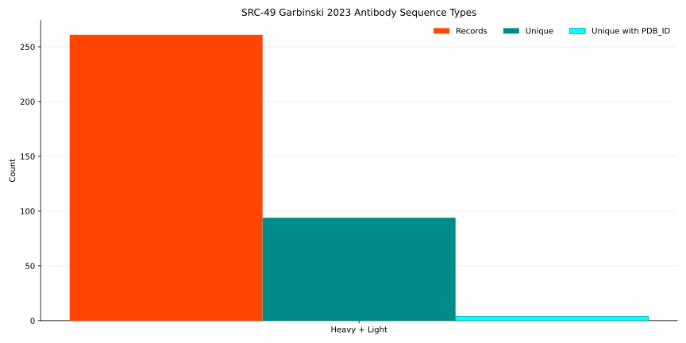
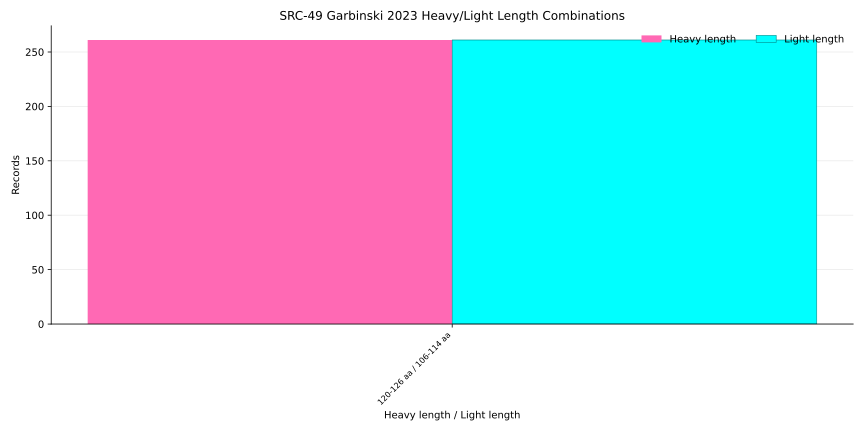
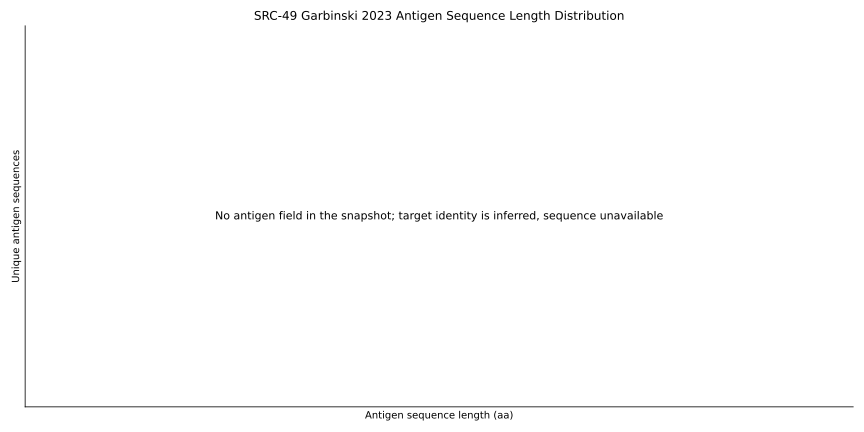

---
tags:
  - context
---

# SRC-49 Garbinski 2023

> 每条 data 统一建模为 `((ab, ag), label, assay, condition, replicate, source)`.
> 本地快照 `G:\abag-datasets\SRC_R49_GARBINSKI_GSK\snapshot-2026-08-17`, `FLAb/data/` 三张表: `binding/garbinski2023_kd.csv` 81 行, `expression/garbinski2023_exp.csv` 94 行, `thermostability/garbinski2023_tm1.csv` 86 行, 共 261 行; 另有 `pdb/` 下三份冻结参考复合物.
> `Unique` 为 `(heavy, light)` 二元组精确去重, 三表合计落 94 个唯一序列对; 表达表是这 94 对的全集, KD 与 Tm1 分别是其子集.

## Antibody

> 有 Heavy 和 Light 的 `Unique` 字段是 `(heavy, light)` 二元组精确去重. `Unique with PDB_ID` 是按 Unique 后的 sequence 计数.
> Total Unique 计数方式为统一转 string, 如果有 Heavy 和 Light 用 `/` 拼接成 string.

| Key | 含义 | 说明 |
| --- | --- | --- |
| Sequence Type | 抗体序列类型 | 根据原始数据字段、链槽位及已有构建体标签划分的类别. |
| Records | 原始记录数 | 原始数据中的记录数量, 同一序列可能重复出现. |
| Unique | 唯一序列数 | 按对应数据集定义的去重规则统计. |
| Unique with PDB_ID | 关联 PDB 的唯一序列数 | 去重后具有关联 PDB_ID 的序列数量, 不等同于具有可用实验结构监督的序列数量. |
| Description | 类型说明 | 描述分类依据、序列槽位特征及分类限制. |

| Sequence Type | Records | Unique | Unique with PDB_ID | Description |
| --- | --- | --- | --- | --- |
| Heavy + Light | 261 | 94 | 4 | 两列均为可变区样式, 源表无构建体标签; 4 个序列对与冻结参考复合物的抗体链精确匹配. |
| Total | 261 | 94 | 4 |  |

> 94 对里 74 对三项齐全, 12 对只有表达与 Tm1, 7 对只有表达与 KD, 1 对只有表达. 三表内各自没有重复序列对.
>
> 构建体只有槽位证据: 两列都是可变区量级 (heavy 120-126 aa, light 106-114 aa), 表内无任何 IgG / Fab / Fv 标签, 因此记 `Heavy + Light`, 不据长度判定 Fab 或 Fv.
>
> `Unique with PDB_ID` 是序列级证据但只覆盖 4 对: 其中 4 个序列对与三份冻结复合物的抗体链精确匹配 (`4ZYP` 的 AM14 与 Motavizumab 各 1 对, `4JHW` 的 D25, `6W52` 的 RSB1), 另 90 对没有任何结构. 这些 entry 是上述参考抗体的复合物, 不是本表变体的逐条实验结构.

| Heavy Length | Light Length | Records | Description |
| --- | --- | --- | --- |
| 120-126 aa | 106-114 aa | 261 | 全部 261 行落在可变区量级. 8 种长度组合: (121,110) 67 行、(122,108) 63 行、(126,107) 51 行、(120,106) 29 行、(126,106) 18 行、(122,114) 12 行、(122,113) 11 行、(122,112) 10 行. 长度不用于判定构建体. |

## Antigen

> Antigen 统计以 source-native antigen entity 为核心单位. 优先使用原始 antigen ID/name、construct 和 antigen chain 定义实体; 存在可靠序列时再统计唯一抗原序列.
> 结构、序列和数据库注释压缩到同一张表中, `PDB / UniProt` 采用唯一抗原实体粒度统计 2 × 2 覆盖结果.
> 长度图基于唯一抗原序列, 按该源实际范围平均切分 20 bins.

> 三张表都没有抗原字段; 四个在冻结复合物中精确匹配的参考抗体都结合 RSV F, 这是靶点的最强背景解释, 但本快照未给出本次测量实际使用的 antigen construct, 也没有可统计的抗原序列.

| Records | Unique ag entity | Unique ag sequence | PDB / UniProt coverage | Antigen Length | Antigen Evidence / Provenance | Description |
| --- | --- | --- | --- | --- | --- | --- |
| 261 | 1 | unavailable | Reference PDB: 3; UniProt=unavailable | unavailable | Reference PDB / Fixed target | 唯一抗原实体按参考抗体共享的 RSV F 计 1 个, 无 build / strain 字段. 3 个冻结结构 (`4ZYP`、`4JHW`、`6W52`) 都是 prefusion RSV F 与上述参考抗体的复合物, 其 F 链长度与构建体互不一致 (498 aa F0、498 aa F0+fibritin、414 aa F1+fibritin 与 82 aa F0), 不能代表本表实测的单一构建体, 因此不取任何一条参考链当抗原序列, `Unique ag sequence` 与长度记 unavailable. 表内无 UniProt 字段. |

## Affinity

> 去重口径: 按 **(heavy 序列, light 序列)** 去重, 81 个 KD 行 1:1 唯一. 表内无 replicate 字段, 全记 `unknown`.
>
> `KD` 表头未写单位, 同表 `-log (KD (M) )` 明示按 M 计算, 且 `fitness` 与该负对数逐行完全相同, 因此 `KD` 与 `-log(KD/M)` 是同一测量的两种表示 (`KD` 1.23e-11-3.00e-08). FLAb metadata 把该端点标为 `SPR Kd`; 原始曲线、拟合模型与检测边界未公开.
>
> 表达表 (68.29-373.75 µg/mL) 与热稳定性表 (35.2-76.8) 不在亲和力词表内, 不计入本表; 它们与 KD 表共用同一批序列对. 本组三张 CSV 与 SRC-09 FLAb 的 `garbinski2023` 行同源, 跨源合并须按测量身份去重.

| Label | Assay | Condition | Replicate | Record pairs | Unique pairs | Description |
| --- | --- | --- | --- | --- | --- | --- |
| `Kd_M` | `SPR` | garbinski2023_kd (81 对) | unknown:81 | 81 | 81 | `KD` 1.23e-11-3.00e-08 M; 表头未标单位, 由同表 `-log (KD (M) )` 与逐行负对数互算确认. |
| `log_Kd` | `SPR` | garbinski2023_kd (81 对) | unknown:81 | 81 | 81 | `-log (KD (M) )` 7.52-10.91; `fitness` 列与它逐行相同, 是同一派生量, 不另列一行. |
