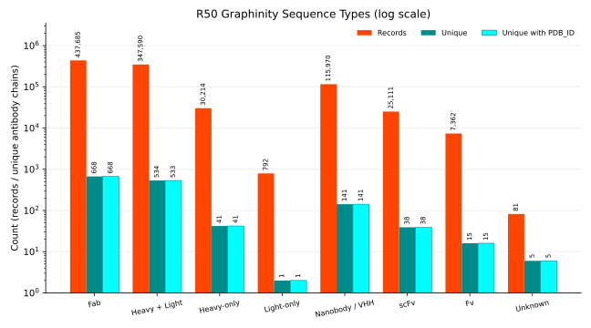
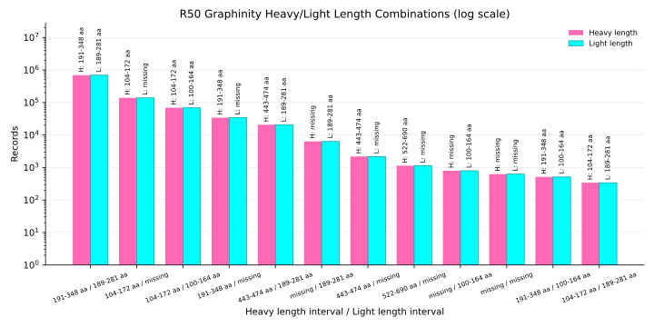
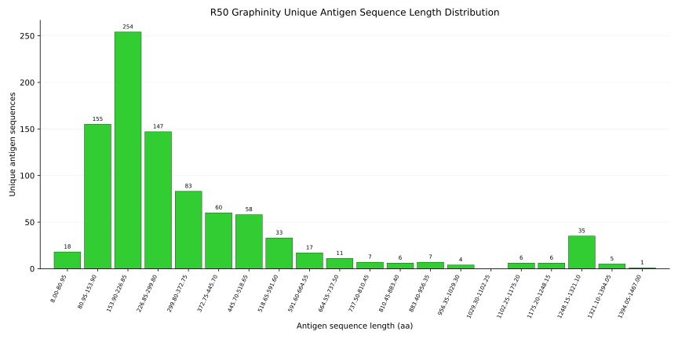

---
- tags:
  - context
---

# SRC-50 Graphinity

> 每条 data 统一建模为 `((ab, ag), label, assay, condition, replicate, source)`.
> 本地快照 `G:\abag-datasets\SRC_R50_GRAPHINITY\v1`, 4 张表: AB-Bind 645, SKEMPI 608, FoldX 942,723, Flex 20,829.
> `Unique` 为 `(heavy, light)` 二元组精确去重.

## Antibody

> 有 Heavy 和 Light 的 `Unique` 字段是 `(heavy, light)` 二元组精确去重. `Unique with PDB_ID` 是按 Unique 后的 sequence 计数.
> Total Unique 计数方式为统一转 string, 如果有 Heavy 和 Light 用 `/` 拼接成 string.

| Key | 含义 | 说明 |
| --- | --- | --- |
| Sequence Type | 抗体序列类型 | 根据原始数据字段、链槽位及已有构建体标签划分的类别. |
| Records | 原始记录数 | 原始数据中的记录数量, 同一序列可能重复出现. |
| Unique | 唯一序列数 | 按对应数据集定义的去重规则统计. |
| Unique with PDB_ID | 关联 PDB 的唯一序列数 | 去重后具有关联 PDB_ID 的序列数量, 不等同于具有可用实验结构监督的序列数量. |
| Description | 类型说明 | 描述分类依据、序列槽位特征及分类限制. |

| Sequence Type | Records | Unique | Unique with PDB_ID | Description |
| --- | --- | --- | --- | --- |
| Fab | 437,685 | 668 | 668 | 源表无 construct 字段; 依 RCSB entity 描述中的 `Fab`/`F(ab)`/`DutaFab` 归类. 重链 104-472 aa, 轻链 100-265 aa. |
| Heavy + Light | 347,590 | 534 | 533 | 双链齐备但 entity 描述未给出构建体名称; 不能据此判定 IgG/Fab/Fv. |
| Nanobody / VHH | 115,970 | 141 | 141 | entity 描述显式写 `nanobody`/`VHH`/`Nb`; 仅单条重链槽位, 114-159 aa. |
| scFv | 25,111 | 38 | 38 | entity 描述显式写 `scFv`/`single-chain Fv`; 单链构建体, 无独立轻链. |
| Heavy-only | 30,214 | 41 | 41 | 只有重链 entity, 108-690 aa; 既非 nanobody 也未标 Fab/Fv, 不进一步判定 VH-only. |
| Fv | 7,362 | 15 | 15 | 双链皆为纯可变区量级 (113-203 / 104-189 aa) 且描述含 `Fv`/`variable fragment`. |
| Light-only | 792 | 1 | 1 | 单一 `immunoglobulin variable light chain domain` entry (4N1E); 592 行来自 FoldX, 200 行来自 Flex. |
| Unknown | 81 | 5 | 5 | AB-Bind 645 内 5 个非抗体–抗原复合物 (README 明示), entity 描述无抗体词; 其余 944,688 行均有抗体 entity. |
| Total | 964,805 | 1,443 | 1,442 | |

| Heavy Length | Light Length | Records | Description |
| --- | --- | --- | --- |
| 191-348 aa | 189-281 aa | 690,798 | 主簇 71.6%: VH-CH1 + VL-CL 量级双链, 是 Fab 与未标构建体的双链主体. |
| 104-172 aa | missing | 138,550 | 单域构建体: nanobody/VHH 115,970 行加未标名单链 21,519 行. |
| 104-172 aa | 100-164 aa | 68,655 | 双链均在纯可变区量级, 最小的一对完整双链. |
| 191-348 aa | missing | 34,162 | 重链达 VH-CH1 量级但无轻链槽位, 多为 scFv/F(ab) 单链存法. |
| 443-474 aa | 189-281 aa | 20,756 | 重链含 CH1-CH2-CH3 量级, 轻链常规; 源表未标 `IgG`, 不据此判定. |
| missing | 189-281 aa | 6,306 | 只有轻链 entity 可取, 重链缺失. |
| 443-474 aa | missing | 2,179 | 长重链单链构建体. |
| 522-690 aa | missing | 1,134 | 5 条超长单链重链 (522 / 690 aa), 保留为独立观测. |
| missing | 100-164 aa | 792 | 4N1E 的轻链可变域, 无重链. |
| 191-348 aa | 100-164 aa | 510 | 重链偏长、轻链偏短的不对称组合. |
| 104-172 aa | 189-281 aa | 339 | 短重链 + 长轻链的不对称组合. |
| missing | missing | 624 | 仅 `7CU4`, RCSB 撤销无替代, 序列不可取得. |

## Antigen

> Antigen 统计以 source-native antigen entity 为核心单位. 优先使用原始 antigen ID/name、construct 和 antigen chain 定义实体; 存在可靠序列时再统计唯一抗原序列.
> 结构、序列和数据库注释压缩到同一张表中, `PDB / UniProt` 采用唯一抗原实体粒度统计 2 × 2 覆盖结果.
> 长度图基于唯一抗原序列, 按该源实际范围平均切分 20 bins.

| Records | Unique ag entity | Unique ag sequence | PDB / UniProt coverage | Antigen Length | Antigen Evidence / Provenance | Description |
| --- | --- | --- | --- | --- | --- | --- |
| 964,805 | 1,492 | 913 | PDB=1/UniProt=0: 1,116; PDB=0/UniProt=0: 376 | 8-1,467 aa; median 236 aa; 421 unique lengths | PDB-derived sequence / Source-native | 4 张表 (AB-Bind 645, SKEMPI 608, FoldX 942,723, Flex 20,829) 均带 `ag_chain`, 抗原侧从 RCSB FASTA 按链重建. 唯一实体按 (pdb, ag_chain) 计 1,492 个, 其中 1,116 个可取得序列 (913 条唯一), 376 个本地无对应链 fasta (含 7CU4 撤销无替代). 长度 8-1,467 aa, median 236 aa. 抗原链是亲本复合物结构的一部分, 属 Reference PDB 级证据; 无 UniProt 字段. |

## Affinity

> 去重口径: 按 **(complex, ab_chain, ag_chain)** 三元组去重. 两表全行有值, 无重复行, 每行一个突变. 无 replicate 字段, 全记 `unknown`.
>
> 两张合成突变表: `Synthetic_FoldX_ddG_942723.csv` 942,723 行 (1,409 PDB, 全 1:1 唯一, `foldx_ddg` −97.9~28.8 kcal/mol), `Synthetic_FlexddG_ddG_20829.csv` 20,829 行 (1,246 PDB, `flexddg_ddg` −28.4~25.0). 全部是计算值 (FoldX / Flex ddG), 非实验. 同 SRC-17/SRC-18 的结构突变扩展.

| Label | Assay | Condition | Replicate | Record pairs | Unique pairs | Description |
| --- | --- | --- | --- | --- | --- | --- |
| `ddG` | `computational` | `FoldX (942,723 突变)` | `unknown:942723` | 942,723 | 942,723 | `foldx_ddg` kcal/mol −97.9~28.8, 1,409 PDB, 计算突变差. |
| `ddG` | `computational` | `Flex ddG (20,829 突变)` | `unknown:20829` | 20,829 | 20,829 | `flexddg_ddg` kcal/mol −28.4~25.0, 1,246 PDB, 计算突变差. |
