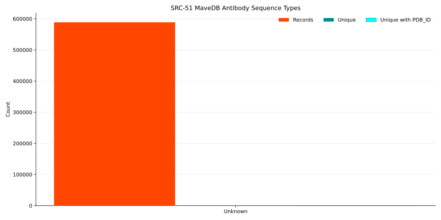
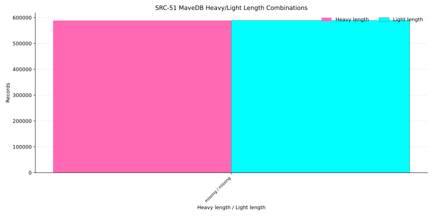
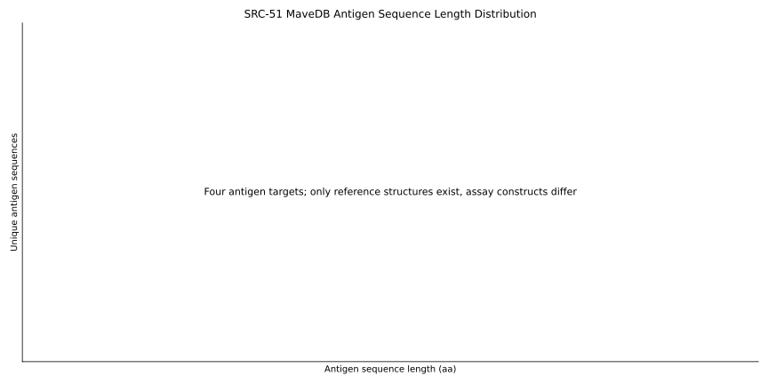

---
- tags:
  - context
---

# SRC-51 MaveDB

> 每条 data 统一建模为 `((ab, ag), label, assay, condition, replicate, source)`.
> 本地快照 `G:\abag-datasets\SRC_R51_MAVEDB\snapshot-2026-06-23`, `MaveDB/` 下 5 个 score set 共 588,717 行, 另有 `pdb/` 下 5 份冻结参考复合物.
> 本源的变异体是抗原侧 (受体或 protein G domain) 的单点替换, 抗体侧是每个 assay 固定的一株结合物, 表内没有抗体序列列.

## Antibody

> 有 Heavy 和 Light 的 `Unique` 字段是 `(heavy, light)` 二元组精确去重. `Unique with PDB_ID` 是按 Unique 后的 sequence 计数.
> Total Unique 计数方式为统一转 string, 如果有 Heavy 和 Light 用 `/` 拼接成 string.

| Key | 含义 | 说明 |
| --- | --- | --- |
| Sequence Type | 抗体序列类型 | 根据原始数据字段、链槽位及已有构建体标签划分的类别. |
| Records | 原始记录数 | 原始数据中的记录数量, 同一序列可能重复出现. |
| Unique | 唯一序列数 | 按对应数据集定义的去重规则统计. |
| Unique with PDB_ID | 关联 PDB 的唯一序列数 | 去重后具有关联 PDB_ID 的序列数量, 不等同于具有可用实验结构监督的序列数量. |
| Description | 类型说明 | 描述分类依据、序列槽位特征及分类限制. |

| Sequence Type | Records | Unique | Unique with PDB_ID | Description |
| --- | --- | --- | --- | --- |
| Unknown | 588,717 | 5 | 2 | 5 个固定结合物 (2D7、12G5、83-07、83-14、IgG Fc), 表内无抗体序列也无构建体标注; 记录行的序列变化不在抗体侧. |
| Total | 588,717 | 5 | 2 |  |

> 5 个 score set 各自固定一株抗体侧结合物: `2D7`、`12G5`、`83-07`、`83-14` 与人 IgG1 Fc. 因此抗体侧 `Unique` 计 5 个结合物, `Records` 计全部测量行; 逐行变异的序列不在抗体侧.
>
> `Unique with PDB_ID` 按结合物计数 2: `4ZXB` 同时含 `83-07` 与 `83-14` 两个 Fab 的复合物; 另三株 (`2D7`、`12G5`、IgG Fc) 没有任何复合物结构, 快照内的其余 entry 也不含这三株抗体.
>
> 构建体: 表内没有 Fc / Fab / Fv 等标注, 也没有链槽位, 故按 `Unknown` 归; 长度列两侧均记 `missing`.

| Heavy Length | Light Length | Records | Description |
| --- | --- | --- | --- |
| missing | missing | 588,717 | 五个 CSV 只有抗原侧 HGVS 与 score, 没有抗体链序列; 两侧记 missing. |

## Antigen

> Antigen 统计以 source-native antigen entity 为核心单位. 优先使用原始 antigen ID/name、construct 和 antigen chain 定义实体; 存在可靠序列时再统计唯一抗原序列.
> 结构、序列和数据库注释压缩到同一张表中, `PDB / UniProt` 采用唯一抗原实体粒度统计 2 × 2 覆盖结果.
> 长度图基于唯一抗原序列, 按该源实际范围平均切分 20 bins.

> 抗原侧有 4 个靶点 (CCR5、CXCR4、INSR、GB1), 变异体以 HGVS 蛋白替换串给出; 快照内 5 份参考结构都只是靶点身份锚点, 不是本批实测构建体, 也没有抗原序列列.

| Records | Unique ag entity | Unique ag sequence | PDB / UniProt coverage | Antigen Length | Antigen Evidence / Provenance | Description |
| --- | --- | --- | --- | --- | --- | --- |
| 588,717 | 4 | unavailable | Reference PDB: 4; UniProt=unavailable | unavailable | Reference PDB / Fixed target | 4 个实体按 score set 的靶点计: CCR5、CXCR4、INSR、GB1 (protein G B1 domain), 其中两个 INSR 集是同一受体对两株抗体. 每个变体的身份是 accession 与 HGVS 替换串; 参考序列本身不在快照内 (MaveDB 记录侧提供), 因此不在变异体粒度重建抗原序列, 实体只到靶点层, 长度记 unavailable. 5 份参考结构覆盖这 4 个靶点: 4MBS CCR5-rubredoxin 嵌合 414 aa、3ODU CXCR4-lysozyme 嵌合 502 aa、4ZXB INSR ectodomain 894 aa、1PGA protein G B1 56 aa、1FCC protein G C2 56 aa 与 IgG1 Fc 206 aa 的复合物. 前三个是带融合标签的晶体构建体, 1PGA 是 standalone B1 domain, 均与 score set 实际测量的构建体不同, 不当作实测抗原序列. 表内无 UniProt 字段. |

## Affinity

> 去重口径: 按 **(固定抗体, 抗原变体 accession)** 去重; 五个文件的 accession 各自唯一且互不重复, 588,717 行即 588,717 个唯一测量.
>
> 五个 score set 的 `score` 是选择/富集的相对读出, 量纲各自独立, 不是 Kd: CCR5 与 CXCR4 是两个 replicate 的 log2 enrichment 均值并按 WT 归一化, INSR 是上游重标定的四 bin 荧光分数 (正值被重缩放), GB1 是 mutation/WT 的 fraction bound 比值. 因此全部记 `enrichment`; 跨 set 不可比较数值, 也不可当亲和力排序. `NA` 表示该变体无可解析 score, 不是 0 也不是不结合.
>
> 抗体侧方法: CCR5 / CXCR4 / INSR 三项是细胞分选读出 (`flow`); GB1 是 mRNA display 后测序读出 (`NGS_seq`). 无 `NA` 以外的显式截断标记.

| Label | Assay | Condition | Replicate | Record pairs | Unique pairs | Description |
| --- | --- | --- | --- | --- | --- | --- |
| `enrichment` | `flow` | `00000047-b-1-scores` (2D7 × CCR5) | n=2:6,895; n=1:0 | 6,895 | 6,895 | `score` -7.622445-2.928299; 有 125 行 `NA` 不计入. |
| `enrichment` | `flow` | `00000048-c-1-scores` (12G5 × CXCR4) | n=2:6,996; n=1:0 | 6,996 | 6,996 | `score` -5.0-3.850338; 有 25 行 `NA` 不计入. |
| `enrichment` | `flow` | `00001239-a-2-scores` (83-07 × INSR) | n=2:13,352; n=1:560 | 13,912 | 13,912 | `score` -1.42436-1.42436; 有 5,188 行 `NA` 不计入. |
| `enrichment` | `flow` | `00001239-a-3-scores` (83-14 × INSR) | n=2:13,528; n=1:535 | 14,063 | 14,063 | `score` -1.406295-1.406295; 有 5,037 行 `NA` 不计入. |
| `enrichment` | `NGS_seq` | `00000105-a-1-scores` (IgG Fc × GB1) | unknown:536,476 | 536,476 | 536,476 | `score` 0.0-14.461873; 无 `NA`; 41,403 行 score 恰为 0. |
