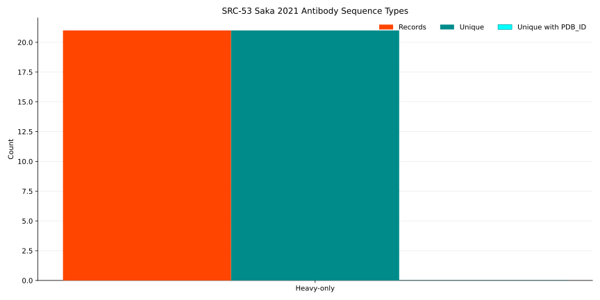
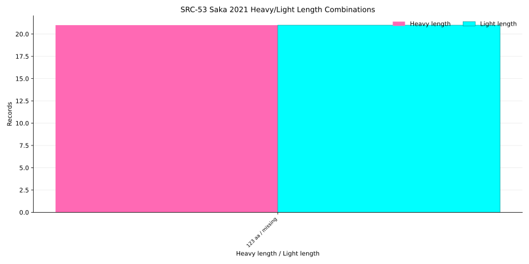
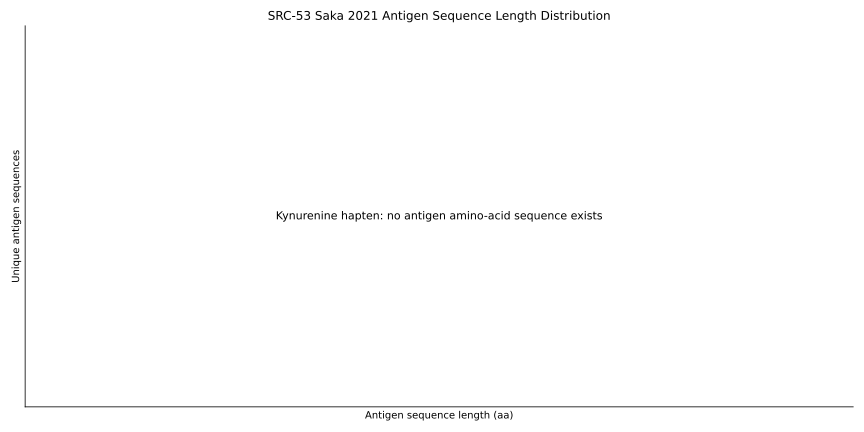

---
- tags:
  - context
---

# SRC-53 Saka 2021

> 每条 data 统一建模为 `((ab, ag), label, assay, condition, replicate, source)`.
> 本地快照 `G:\abag-datasets\SRC_R53_SAKA\snapshot-2021-03-12`, 论文正式版加三张主文表页; 逐行测量只在 `Saka/Table-3.html`, 21 行 (10 ML + 10 Freq + 1 Control).
> `Unique` 为 17 个可变位点残基串精确去重, 21 行 21 个唯一串; 这批串属同一亲本 F02 背景.

## Antibody

> 有 Heavy 和 Light 的 `Unique` 字段是 `(heavy, light)` 二元组精确去重. `Unique with PDB_ID` 是按 Unique 后的 sequence 计数.
> Total Unique 计数方式为统一转 string, 如果有 Heavy 和 Light 用 `/` 拼接成 string.

| Key | 含义 | 说明 |
| --- | --- | --- |
| Sequence Type | 抗体序列类型 | 根据原始数据字段、链槽位及已有构建体标签划分的类别. |
| Records | 原始记录数 | 原始数据中的记录数量, 同一序列可能重复出现. |
| Unique | 唯一序列数 | 按对应数据集定义的去重规则统计. |
| Unique with PDB_ID | 关联 PDB 的唯一序列数 | 去重后具有关联 PDB_ID 的序列数量, 不等同于具有可用实验结构监督的序列数量. |
| Description | 类型说明 | 描述分类依据、序列槽位特征及分类限制. |

| Sequence Type | Records | Unique | Unique with PDB_ID | Description |
| --- | --- | --- | --- | --- |
| Heavy-only | 21 | 21 | 0 | 17 个位点残基串, 全部来自同一亲本 F02 重链; 无轻链槽位, 无构建体标注, 快照内无 PDB. |
| Total | 21 | 21 | 0 |  |

> 表内只有重链: Table 3 给出 F02 重链 17 个 Kabat 位置 (28, 31, 33, 50-52, 54-56, 58, 96-97, 99-100c) 的残基, 无轻链列, 公开包也没有 VL. 因此槽位是 `Heavy-only`; 论文用 293F 瞬时表达、protein A 纯化后测量, 表内没有 IgG / Fab 等构建体标注, 不据方法描述把该行升级为 IgG.
>
> 完整 VH 可由 Table 1 模板逐位替换确定性还原 (123 aa, 21 条互不相同), 属派生数据而非 raw 字段; 长度列因此写 123 aa, 并在下游按派生量处理.
>
> `Unique with PDB_ID` 为 0: 快照内没有任何 PDB 文件或结构 entry; 论文所述的设计依据晶体分析注明为 unpublished, 也没有给出 accession, 本抗体没有任何可用的实验结构.

| Heavy Length | Light Length | Records | Description |
| --- | --- | --- | --- |
| 123 aa | missing | 21 | 21 条均由 Table 1 模板替换 17 个位点得到, 长度恒为 123 aa; 轻链不在公开包内, 记 missing. |

## Antigen

> Antigen 统计以 source-native antigen entity 为核心单位. 优先使用原始 antigen ID/name、construct 和 antigen chain 定义实体; 存在可靠序列时再统计唯一抗原序列.
> 结构、序列和数据库注释压缩到同一张表中, `PDB / UniProt` 采用唯一抗原实体粒度统计 2 × 2 覆盖结果.
> 长度图基于唯一抗原序列, 按该源实际范围平均切分 20 bins.

> 抗原是犬尿氨酸 (kynurenine), 一种色氨酸代谢小分子; 它不是蛋白, 没有可下载的抗原氨基酸序列, 快照内也没有 PDB 文件.

| Records | Unique ag entity | Unique ag sequence | PDB / UniProt coverage | Antigen Length | Antigen Evidence / Provenance | Description |
| --- | --- | --- | --- | --- | --- | --- |
| 21 | 1 | unavailable | PDB=0/UniProt=0: 1 | unavailable | Source-native / Fixed target | 唯一实体是犬尿氨酸, 属小分子半抗原, 由论文明确指认, 但没有氨基酸序列, `Unique ag sequence` 与长度均记 unavailable. 全部 21 行在同一个生物素化犬尿氨酸体系下测量, 属单一固定靶点. 生成犬尿氨酸的 IDO 酶不是本次结合测量的靶点, 不计入. 表内无 UniProt 字段, 也没有抗原 PDB 锚点. |

## Affinity

> 去重口径: 按 **17 位点残基串** 去重, 21 行 21 个唯一候选. 表内无 replicate 字段, 全记 `unknown`.
>
> `KD (M)` 是 Biacore 8K+ 上以 protein A/G 捕获抗体、犬尿氨酸为流动相的稳态亲和力拟合 (Methods), 范围 4.2e-08-7.7e-05 M. 同表 `NLL` 是 LSTM 负对数似然, 属模型分数, 不是亲和力, 不计入本表; Control 行的 NLL 为 `-`, 不是 0.
>
> 公开包只有 Table 3 的 21 行逐条读数: 论文另有 32 条分层 NLL 候选只在 Figure 10 聚合展示, 没有逐条 KD; Table 2 的 NGS reads / unique sequences 是筛选规模统计, 无亲和力.

| Label | Assay | Condition | Replicate | Record pairs | Unique pairs | Description |
| --- | --- | --- | --- | --- | --- | --- |
| `Kd_M` | `SPR` | Table 3 ML | unknown:10 | 10 | 10 | `KD (M)` 4.2e-08-1.9e-06; 同表 `NLL` 9.01-9.30 为模型分数, 不是亲和力. |
| `Kd_M` | `SPR` | Table 3 Freq | unknown:10 | 10 | 10 | `KD (M)` 2.8e-07-1.5e-05; 同表 `NLL` 12.00-28.00 为模型分数, 不是亲和力. |
| `Kd_M` | `SPR` | Table 3 Control | unknown:1 | 1 | 1 | `KD (M)` 7.7e-05; 亲本 F02 参照行, `NLL` 记为 `-`. |
